# AWS IAM: Complete Practical Guide (Equivalent to a 5-Hour Lecture)

> **How to use this file:** Read each section, then immediately do the lab for it in your own AWS account. Do not just read. IAM is learned with your hands.
> **Cost:** IAM itself is free. Only the optional EC2 lab (Lab 7) uses a billable resource, and it has a cleanup step.
> **Audience:** Beginner to job-ready. Covers SAA-C03 and DEA-C01 IAM topics plus real-world banking/healthcare/enterprise practice.
> **Placeholders:** `ACCOUNT_ID` = your 12-digit account number. `YOURNAME` = anything unique. Get your account ID any time with `aws sts get-caller-identity --query Account --output text`.

---

## Table of Contents

**Part A: Prerequisites (do not skip)**
1. Authentication vs Authorization
2. JSON in 5 minutes
3. API-driven AWS: Principal, Action, Resource
4. ARN: the address of everything
5. Credentials: long-term vs temporary
6. Least privilege and default deny
7. Global vs Regional (where IAM lives)

**Part B: IAM Core**
8. What is IAM
9. The four building blocks (Users, Groups, Roles, Policies)
10. Lab 0 and Lab 1: Prepare account, password policy, alias
11. Users and Groups + Lab 2
12. Policies in depth (JSON anatomy, types, managed vs inline)
13. Policy evaluation logic (the brain of IAM)
14. Conditions, variables, tags (ABAC) + Lab 3 (custom S3 policy) + Lab 4 (MFA enforcement)
15. Roles and STS in depth + Lab 5 (assume role) + Lab 6 (cross-account concept) + Lab 7 (EC2 role)
16. Access keys, CLI profiles, rotation + Lab 8
17. Resource-based policies + Lab 9
18. Permission boundaries + Lab 10
19. Organizations, SCPs, and IAM Identity Center
20. Federation (SAML, OIDC, Cognito)
21. Auditing and monitoring + Lab 11
22. IAM for Data Engineering (Glue, Athena, Redshift, Lambda, Kinesis, PassRole) + Lab 12
23. Troubleshooting AccessDenied
24. Real-world architectures (bank, hospital, enterprise)
25. Best practices checklist
26. Exam cheat sheet and 25 practice questions
27. Interview questions
28. Cleanup and final checklist

---

# PART A: PREREQUISITES

Before IAM makes sense you need seven small ideas. Spend 20 minutes here and the rest becomes easy.

---

## 1. Authentication vs Authorization

These two words are confused constantly. Learn them once, properly.

| Term | Question it answers | Real-life analogy | AWS version |
|---|---|---|---|
| **Authentication (AuthN)** | **Who are you?** | Showing your ID card at the building gate | Username + password, access key, MFA code |
| **Authorization (AuthZ)** | **What are you allowed to do?** | Your badge opens floor 3 but not the server room | IAM policies |

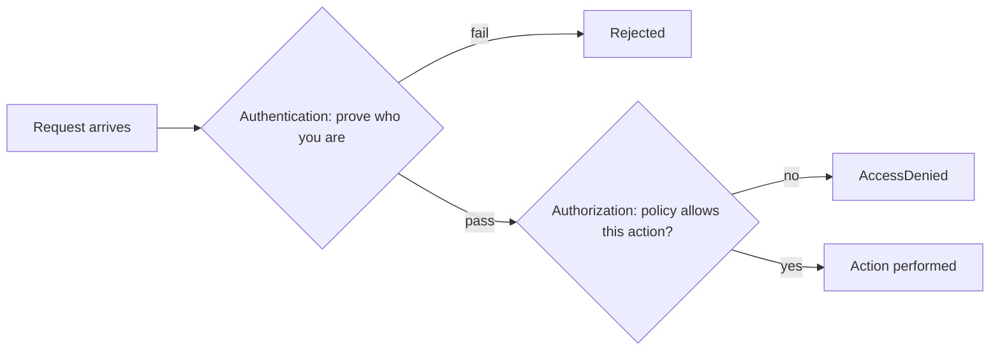

**Everything in IAM is one of these two.** Users, passwords, MFA, access keys = authentication. Policies = authorization.

---

## 2. JSON in 5 Minutes

IAM policies are written in **JSON**. If you can read this, you can read any policy.

```json
{
  "name": "Asha",
  "age": 30,
  "active": true,
  "cities": ["Mumbai", "Pune"],
  "address": { "city": "Mumbai", "pin": "400001" }
}
```

Rules:
- Data is **key: value** pairs inside `{ }`.
- Text is in **double quotes**. Numbers and `true/false` are not.
- A **list** uses `[ ]`, items separated by commas.
- Objects can be **nested** inside objects.
- **No trailing commas.** (The #1 cause of "invalid policy" errors.)

Practice: validate any JSON at jsonlint.com or with `python3 -m json.tool file.json`.

---

## 3. API-Driven AWS: Principal, Action, Resource

Every single thing in AWS is an **API call**. Console click, CLI command, Python code: all become an API request.

Every request has three key parts. Memorize this triple, it is the heart of every policy:

| Part | Meaning | Example |
|---|---|---|
| **Principal** | **Who** is making the request | user `asha`, role `GlueRole` |
| **Action** | **What** they want to do | `s3:GetObject`, `ec2:StartInstances` |
| **Resource** | **On what** | `arn:aws:s3:::mybucket/data.csv` |

Plus an optional fourth: **Condition** (**when/under what circumstances**), e.g., only from office IP, only with MFA.

**Sentence form:** *"Can [Principal] perform [Action] on [Resource] [if Condition]?"* IAM answers Yes or No.

**Action naming:** `service:Operation`. Examples: `s3:PutObject`, `glue:StartJobRun`, `iam:CreateUser`, `dynamodb:Query`. Wildcards: `s3:*` (all S3 actions), `s3:Get*` (all actions starting with Get).

---

## 4. ARN: The Address of Everything

An **ARN (Amazon Resource Name)** uniquely identifies any AWS resource. Policies point to resources using ARNs.

```
arn:aws:SERVICE:REGION:ACCOUNT_ID:RESOURCE
 │    │     │      │        │         └─ resource name/path
 │    │     │      │        └─ 12-digit account (blank for S3 buckets, which are global names)
 │    │     │      └─ region (blank for global services like IAM and S3)
 │    │     └─ service
 │    └─ partition (aws, aws-cn, aws-us-gov)
 └─ always "arn"
```

Examples to recognize on sight:

| Resource | ARN |
|---|---|
| S3 bucket | `arn:aws:s3:::my-bucket` |
| S3 objects in bucket | `arn:aws:s3:::my-bucket/*` |
| S3 folder (prefix) | `arn:aws:s3:::my-bucket/raw/*` |
| IAM user | `arn:aws:iam::123456789012:user/asha` |
| IAM role | `arn:aws:iam::123456789012:role/GlueRole` |
| Lambda function | `arn:aws:lambda:ap-south-1:123456789012:function:myfn` |
| EC2 instance | `arn:aws:ec2:ap-south-1:123456789012:instance/i-0abc123` |

**Critical S3 detail (huge exam and real-world trap):**
- `arn:aws:s3:::my-bucket` = the **bucket itself** → used for bucket-level actions (`s3:ListBucket`).
- `arn:aws:s3:::my-bucket/*` = the **objects inside** → used for object-level actions (`s3:GetObject`, `s3:PutObject`).
- You almost always need **both** in a policy.

---

## 5. Credentials: Long-Term vs Temporary

To prove who you are, you present **credentials**.

| Type | Examples | Lifetime | Risk |
|---|---|---|---|
| **Long-term** | Password, **access key** (`AKIA...` + secret) | Until you rotate/delete | If leaked, attacker has indefinite access |
| **Temporary** | Access key `ASIA...` + secret + **session token** | Minutes to hours (auto-expires) | If leaked, expires soon |

**Memory trick:** Access key ID starting with **AKIA** = permanent user key. Starting with **ASIA** = temporary session credentials from STS.

**Golden rule of modern AWS:** prefer **temporary credentials (roles)** over **long-term keys** wherever possible. This single idea explains why IAM Roles exist.

---

## 6. Least Privilege and Default Deny

**Principle of Least Privilege:** give only the permissions needed to do the job, nothing more.

Bad: Data analyst gets `AdministratorAccess`.
Good: Data analyst gets read on one S3 prefix + Athena query on one workgroup.

**Default Deny:** In IAM, **everything is denied unless explicitly allowed.** A brand-new user can do **nothing**. You add permissions by attaching policies.

```
New user created  →  zero permissions  →  you attach policies  →  user can do exactly those things
```

---

## 7. Global vs Regional: Where IAM Lives

- **IAM is a global service.** Users, groups, roles, and policies are not tied to a Region. Create a user once; it works in Mumbai, Virginia, anywhere.
- In the console, the Region selector shows **"Global"** on IAM pages.
- IAM is **free**.
- IAM is **eventually consistent**: after you change a policy, it may take a few seconds to take effect everywhere. If a test fails right after a change, wait 10 seconds and retry.

---

# PART B: IAM CORE

---

## 8. What is IAM?

**AWS Identity and Access Management (IAM)** is the service that controls **who can do what** in your AWS account.

**Office building analogy (we will reuse this):**

| Building | IAM |
|---|---|
| The building | Your AWS account |
| Owner's master key (opens everything) | **Root user** |
| Employee with ID card | **IAM user** |
| Department (Finance, Engineering) | **IAM group** |
| Visitor/contractor temporary pass, or a robot that needs a door pass | **IAM role** |
| The rulebook of which doors each badge opens | **IAM policy** |

IAM answers: **Who** (identity) can do **what** (actions) on **which** resources, **under what conditions**.

---

## 9. The Four Building Blocks

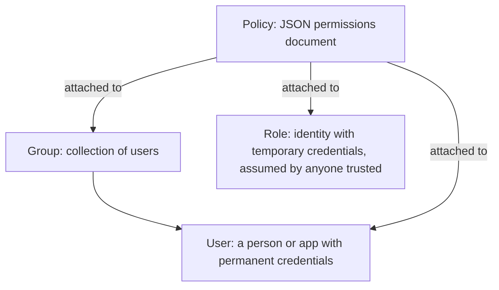

| Block | One-line definition | Has credentials? | Typical use |
|---|---|---|---|
| **User** | A named identity for one person/application | Yes (password, access keys) | Individual engineers (in small setups) |
| **Group** | A bundle of users sharing permissions | No (cannot log in) | "DataEngineers", "Auditors" |
| **Role** | An identity **assumed** temporarily, no permanent password/keys | No (gets temporary credentials) | EC2, Lambda, Glue, cross-account, federated users |
| **Policy** | JSON document that lists allow/deny rules | n/a | Attached to users/groups/roles/resources |

Remember: **Permissions come only from policies.** Users, groups, and roles are just *places to attach* policies.

---

## 10. LAB 0 and LAB 1: Prepare Your Account

### Lab 0: Sign in correctly
1. Sign in as your **IAM admin user** (not root). If you only have root so far, first create the admin user as described in the "AWS before core learning" notes (Section 6) and enable MFA.
2. Set Region to **Asia Pacific (Mumbai) ap-south-1** (IAM is global but you need a Region for S3/EC2 labs).
3. Open **CloudShell** (terminal icon, top bar). Run:
```bash
aws sts get-caller-identity
```
Expected output (yours will differ):
```json
{
    "UserId": "AIDAEXAMPLEXXXXXXXX",
    "Account": "123456789012",
    "Arn": "arn:aws:iam::123456789012:user/admin-yourname"
}
```
Read this carefully: `Arn` ends in `user/...`, so you are an IAM user. Later when you assume a role, this will say `assumed-role/...`.

4. Save your account ID:
```bash
ACCOUNT_ID=$(aws sts get-caller-identity --query Account --output text)
echo $ACCOUNT_ID
```

### Lab 1: Account alias and password policy
**Account alias** makes your sign-in URL friendly.
```
IAM console > Dashboard (right side) > Account Alias > Create
Alias: de-learn-yourname   (must be globally unique, lowercase)
```
Your IAM sign-in URL becomes `https://de-learn-yourname.signin.aws.amazon.com/console`.

**Password policy** (a real compliance requirement in banks):
```
IAM > Account settings > Password policy > Edit
Choose: Custom
 [x] Minimum length 14
 [x] Require uppercase, lowercase, number, non-alphanumeric
 [x] Enable password expiration: 90 days
 [x] Password expiration requires administrator reset: (optional)
 [x] Allow users to change their own password
 [x] Prevent password reuse: remember last 5
Save changes
```
CLI equivalent:
```bash
aws iam update-account-password-policy \
  --minimum-password-length 14 \
  --require-symbols --require-numbers \
  --require-uppercase-characters --require-lowercase-characters \
  --allow-users-to-change-password \
  --max-password-age 90 --password-reuse-prevention 5

aws iam get-account-password-policy
```

> **Exam note:** The password policy applies to **IAM users** of the account. It does not apply to the root user or to federated/SSO users.

---

## 11. Users and Groups

### 11.1 IAM Users in depth
- Represent **a person or an application** needing long-term access.
- Can have: **console password**, **up to 2 access keys**, **MFA devices**, **SSH keys / Git credentials** (CodeCommit-related), **service-specific credentials**.
- New user = **no permissions**.
- Limit: 5,000 users per account (approx., check Service Quotas).

**Modern advice:** For *humans*, prefer **IAM Identity Center (SSO)** over creating IAM users. For *applications on AWS*, use **roles**. Use IAM users mainly for small/learning accounts, or legacy/third-party systems that cannot assume roles.

### 11.2 IAM Groups in depth
- A group is a **container of users** to simplify permission management.
- Attach policy once to the group → all members get it.
- **A user can belong to multiple groups** (up to 10).
- **Groups cannot contain other groups** (no nesting). Very common exam trick.
- **A group is not a principal**: you cannot name a group in a resource policy's `Principal`.
- Groups cannot log in or have credentials.

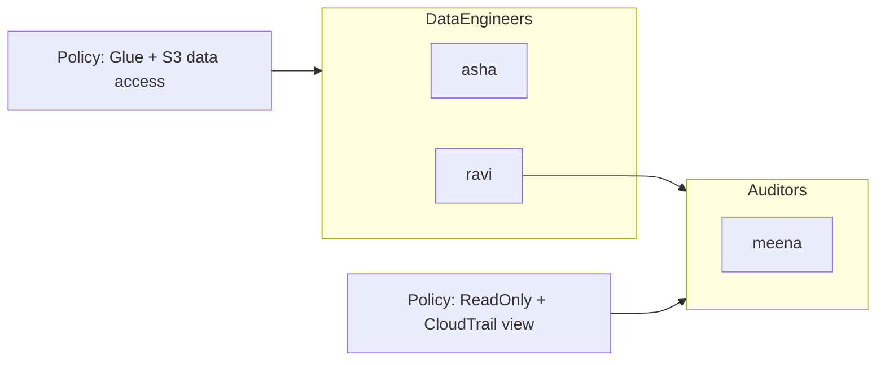
Here `ravi` gets permissions from **both** groups (union of allows).

### LAB 2: Create groups and a user, then test permissions

**Goal:** Prove "new user can do nothing" and "group policy grants access".

**Step 1: Create a group**
```
IAM > User groups > Create group
Name: DataEngineers
Attach permissions policies: AmazonS3ReadOnlyAccess   (AWS managed)
Create group
```

**Step 2: Create a user**
```
IAM > Users > Create user
User name: dev-asha
[x] Provide user access to the AWS Management Console
    > I want to create an IAM user
    > Custom password: set one   [x] Users must create a new password at next sign-in
Next > Add user to group: DataEngineers
Next > Review > Create user
Copy the console sign-in URL and password
```

**Step 3: Sign in as the new user**
Open a **private/incognito window** (so you stay logged in as admin in the normal window).
Go to your sign-in URL (`https://ALIAS.signin.aws.amazon.com/console`), user `dev-asha`, set a new password.

**Step 4: Test (this is the learning moment)**
- Go to **S3**: bucket list works (read-only allowed) ✓
- Try **Create bucket**: **Access denied** ✗ (policy gives read only)
- Go to **EC2 > Instances**: you will see **"You are not authorized to perform this operation"** errors ✗ (nothing allows EC2)
- Go to **IAM > Users**: denied ✗

**Step 5: Remove from group and re-test (admin window)**
```
IAM > User groups > DataEngineers > Users tab > select dev-asha > Remove users
```
Refresh S3 in the incognito window after ~10 seconds: access denied now. You just saw group-based permissions work.

**Step 6: CLI version (CloudShell as admin)**
```bash
aws iam create-group --group-name Auditors
aws iam attach-group-policy --group-name Auditors \
  --policy-arn arn:aws:iam::aws:policy/SecurityAudit
aws iam create-user --user-name audit-meena
aws iam add-user-to-group --group-name Auditors --user-name audit-meena
aws iam list-groups-for-user --user-name audit-meena
aws iam list-attached-group-policies --group-name Auditors
```
Note the policy ARN format for AWS-managed policies: `arn:aws:iam::aws:policy/NAME` (the account field is the literal word `aws`).

---

## 12. Policies in Depth

A **policy** is a JSON document that defines permissions. Master this section and you master IAM.

### 12.1 Anatomy of a policy

```json
{
  "Version": "2012-10-17",
  "Statement": [
    {
      "Sid": "AllowReadRawData",
      "Effect": "Allow",
      "Action": [
        "s3:GetObject",
        "s3:ListBucket"
      ],
      "Resource": [
        "arn:aws:s3:::my-data-lake",
        "arn:aws:s3:::my-data-lake/raw/*"
      ],
      "Condition": {
        "IpAddress": { "aws:SourceIp": "203.0.113.0/24" }
      }
    }
  ]
}
```

| Element | Required? | Meaning |
|---|---|---|
| `Version` | Yes | Always `"2012-10-17"` (policy language version, not a date you choose) |
| `Statement` | Yes | One statement or a list of statements |
| `Sid` | Optional | Human label for the statement |
| `Effect` | Yes | `"Allow"` or `"Deny"` |
| `Action` | Yes (or `NotAction`) | The API operations |
| `Resource` | Yes in identity policies (or `NotResource`) | What the actions apply to |
| `Principal` | Only in **resource-based** and **trust** policies | Who the policy applies to (never used in identity-based policies because the principal is whoever it's attached to) |
| `Condition` | Optional | Extra rules (IP, MFA, time, tags, Region...) |

### 12.2 `NotAction` and `NotResource` (advanced but tested)
- `"Effect":"Allow","NotAction":"iam:*"` = allow everything **except** IAM actions. (It does **not** deny IAM; it just does not grant it.)
- `"Effect":"Deny","NotAction":[...]` = deny everything **except** these. Used in the MFA-enforcement policy below.

### 12.3 Types of policies (know all, exam tests this)

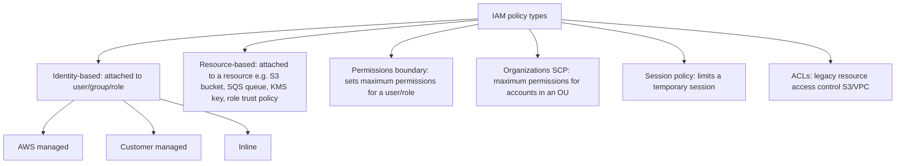

| Policy type | Grants permissions? | Where attached | Key use |
|---|---|---|---|
| **Identity-based** | Yes | User, group, role | Normal day-to-day permissions |
| **Resource-based** | Yes | The resource | Cross-account access, service access to a resource |
| **Permissions boundary** | **No (only limits)** | User or role | Delegated admin, safety cap |
| **SCP** | **No (only limits)** | Org root / OU / account | Organization-wide guardrails |
| **Session policy** | **No (only limits)** | Passed when assuming role/federating | Narrow a single session |
| **ACL** | Yes | S3 objects/buckets, etc. | Legacy; AWS recommends disabling S3 ACLs |

### 12.4 Identity-based policy flavors

| Flavor | What | When to use |
|---|---|---|
| **AWS managed policy** | Created and maintained by AWS (e.g., `AmazonS3ReadOnlyAccess`, `AdministratorAccess`, `job-function/DatabaseAdministrator`) | Quick start, common needs. AWS updates them automatically. Often broader than needed. |
| **Customer managed policy** | You write it; reusable; versioned (up to 5 versions) | **Recommended for production**: precise least privilege, reusable, rollback to previous version |
| **Inline policy** | Embedded directly in one user/group/role; deleted with it | One-to-one strict relationship; rare |

**Exam:** Managed policies can be attached to many identities; inline policies live and die with a single identity.

### 12.5 Wildcards
- `*` matches any characters: `s3:Get*`, `arn:aws:s3:::logs-*`.
- `Action: "*"` + `Resource: "*"` = **full admin**. Dangerous.
- Wildcards in `Resource` for S3 ARNs: `arn:aws:s3:::bucket/*` covers every object.

### 12.6 Explore real AWS managed policies (hands-on 5 minutes)
```
IAM > Policies > Filter "AWS managed"
Open: AmazonS3ReadOnlyAccess > JSON tab
```
You will see `s3:Get*`, `s3:List*`, `s3:Describe*` on `*`. Notice it is broad: all buckets. This is why custom policies matter.

```bash
aws iam get-policy --policy-arn arn:aws:iam::aws:policy/AmazonS3ReadOnlyAccess
aws iam get-policy-version --policy-arn arn:aws:iam::aws:policy/AmazonS3ReadOnlyAccess --version-id v2
```

---

## 13. Policy Evaluation Logic (The Brain of IAM)

When a request arrives, AWS decides Allow or Deny using this logic. **This is the most important exam topic in IAM.**

### 13.1 Three golden rules
1. **Default = Deny.** If nothing allows it, it is denied.
2. **An explicit Deny always wins.** No Allow anywhere can override a Deny.
3. **An Allow is needed** (from the right policy types) for access to succeed.

### 13.2 The flow (simplified)

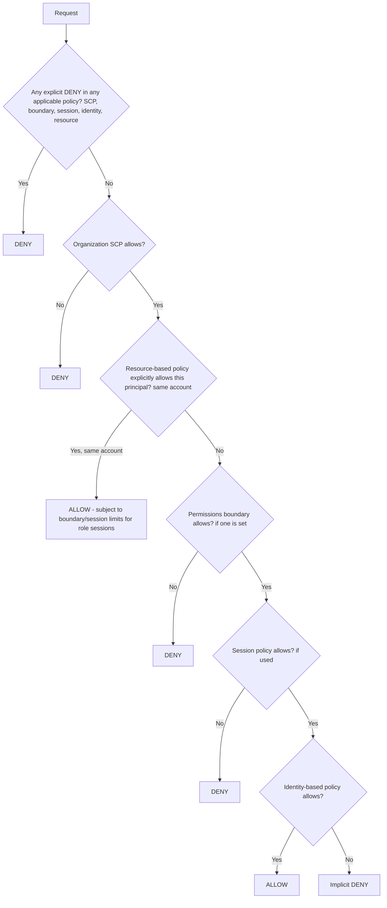

### 13.3 The mental model that sticks: "intersection of limits, union of grants"

Think of two layers:

- **Guardrails (limits):** SCP ∩ Permission boundary ∩ Session policy. These only **shrink** what is possible.
- **Grants:** Identity-based policies ∪ Resource-based policies. These only **add** permissions.

**Effective permission = (Grants) ∩ (all Guardrails that apply), minus anything explicitly denied.**

### 13.4 Same-account vs cross-account

| Scenario | What's needed |
|---|---|
| **Same account**, identity policy allows | Enough by itself (if no deny/guardrails block it) |
| **Same account**, resource policy allows the principal | Enough by itself (union rule) |
| **Cross-account** | **Both sides must allow**: the resource-based policy in the owner account **and** an identity-based policy in the caller's account |

### 13.5 Worked examples (do them on paper; they are exam-style)

**Example 1**
- Identity policy: Allow `s3:*` on `*`.
- Bucket policy: Deny `s3:DeleteObject` for this user.
- Result: Can read/write, **cannot delete** (explicit deny wins).

**Example 2**
- User has `AdministratorAccess`.
- Permission boundary: allows only `s3:*`.
- Result: User can only do S3 (boundary caps it). EC2 is denied.

**Example 3**
- Role has Allow `ec2:*`. SCP on account denies `ec2:RunInstances` in Region `us-west-2`.
- Result: Cannot launch instances in us-west-2, even as admin. SCP wins.

**Example 4**
- Two groups: Group A allows S3 read, Group B allows EC2 read. User is in both.
- Result: Union: S3 read **and** EC2 read.

**Example 5**
- Group A allows S3 read. Group B denies S3 read.
- Result: **Denied** (explicit deny).

### 13.6 Special case: the root user
- IAM policies **cannot** restrict the root user of an account (SCPs can restrict member-account roots).
- Hence: lock root away with MFA, never create root access keys.

---

## 14. Conditions, Variables, Tags (ABAC)

### 14.1 Condition syntax
```json
"Condition": {
  "OPERATOR": { "condition-key": "value-or-list" }
}
```
Multiple operators or keys = **AND**. Multiple values for one key = **OR**.

### 14.2 Common operators
| Operator | Meaning |
|---|---|
| `StringEquals`, `StringNotEquals`, `StringLike` | Exact / wildcard text match |
| `NumericLessThan`, `DateGreaterThan` | Numbers and time |
| `Bool` | true/false |
| `IpAddress`, `NotIpAddress` | CIDR match on source IP |
| `ArnLike` | ARN with wildcard |
| `Null` | Key exists or not |
| `...IfExists` suffix | Only evaluate if key is present |
| `ForAllValues:` / `ForAnyValue:` | Multi-valued keys |

### 14.3 Most useful global condition keys
| Key | Use |
|---|---|
| `aws:SourceIp` | Restrict to office/VPN IP range |
| `aws:MultiFactorAuthPresent` | Require MFA |
| `aws:RequestedRegion` | Allow only specific Regions |
| `aws:SecureTransport` | Force HTTPS |
| `aws:PrincipalTag/KEY` | Tag on the caller |
| `aws:ResourceTag/KEY` or `s3:ExistingObjectTag/KEY` | Tag on the target |
| `aws:PrincipalOrgID` | Anyone from my Organization |
| `aws:CurrentTime` | Time windows |
| `aws:userid`, `aws:username` | Identity of caller |
| `s3:prefix` | Which folder a ListBucket targets |
| `iam:PassedToService` | Which service a role can be passed to |

### 14.4 Policy variables
`${aws:username}` is replaced by the caller's name at runtime.
```json
{
  "Effect": "Allow",
  "Action": ["s3:GetObject", "s3:PutObject"],
  "Resource": "arn:aws:s3:::company-home/${aws:username}/*"
}
```
Each user automatically gets a private folder, one policy for everyone.

### 14.5 ABAC: Attribute-Based Access Control
Instead of one policy per team, use **tags**: "a principal can access resources whose `Project` tag equals the principal's `Project` tag".
```json
{
  "Version": "2012-10-17",
  "Statement": [{
    "Effect": "Allow",
    "Action": ["ec2:StartInstances", "ec2:StopInstances"],
    "Resource": "arn:aws:ec2:*:*:instance/*",
    "Condition": {
      "StringEquals": { "aws:ResourceTag/Project": "${aws:PrincipalTag/Project}" }
    }
  }]
}
```
Benefit: when a new project starts, you add tags, not new policies. This scales to hundreds of teams (a favorite in enterprises).

### LAB 3: Write a custom S3 policy (least privilege) and test it

**Goal:** `dev-asha` may read **only** the `raw/` folder of one bucket.

**Step 1: Create a test bucket and files (admin, CloudShell)**
```bash
BUCKET=iam-lab-yourname-$RANDOM
echo $BUCKET
aws s3 mb s3://$BUCKET --region ap-south-1
echo "public sales data"   > raw1.txt
echo "secret salary data"  > conf1.txt
aws s3 cp raw1.txt  s3://$BUCKET/raw/raw1.txt
aws s3 cp conf1.txt s3://$BUCKET/confidential/conf1.txt
aws s3 ls s3://$BUCKET --recursive
```
Write down the bucket name.

**Step 2: Remove broad access from dev-asha**
```
IAM > User groups > DataEngineers > Permissions > detach AmazonS3ReadOnlyAccess
```

**Step 3: Create the customer managed policy**
```
IAM > Policies > Create policy > JSON tab > paste (replace BUCKET) > Next
Name: S3ReadRawOnly > Create policy
```
```json
{
  "Version": "2012-10-17",
  "Statement": [
    {
      "Sid": "ListOnlyRawPrefix",
      "Effect": "Allow",
      "Action": "s3:ListBucket",
      "Resource": "arn:aws:s3:::BUCKET",
      "Condition": {
        "StringLike": { "s3:prefix": ["raw/", "raw/*"] }
      }
    },
    {
      "Sid": "ReadRawObjects",
      "Effect": "Allow",
      "Action": "s3:GetObject",
      "Resource": "arn:aws:s3:::BUCKET/raw/*"
    }
  ]
}
```
**Why two statements?** `ListBucket` is a **bucket-level** action (ARN without `/*`). `GetObject` is **object-level** (ARN with `/*`). The condition on `s3:prefix` restricts which folder can be listed.

**Step 4: Attach to the group**
```
IAM > User groups > DataEngineers > Permissions > Add permissions > Attach policies > S3ReadRawOnly
```

**Step 5: Test with the policy simulator first (no need to log in as the user)**
```
Open https://policysim.aws.amazon.com  (or IAM > Users > dev-asha > Permissions > Simulate)
Select user: dev-asha
Service: Amazon S3
Actions: GetObject
Resource: arn:aws:s3:::BUCKET/raw/raw1.txt   → Allowed
Resource: arn:aws:s3:::BUCKET/confidential/conf1.txt → Denied (implicitly denied)
```

**Step 6: Real test using the user's CLI credentials**
Create access keys for dev-asha for this test only:
```
IAM > Users > dev-asha > Security credentials > Create access key > Command Line Interface > Create
Copy Access key ID and Secret
```
In CloudShell:
```bash
aws configure --profile asha
# paste access key, secret, region ap-south-1, output json

aws s3 ls s3://BUCKET/raw/            --profile asha   # works
aws s3 cp s3://BUCKET/raw/raw1.txt -  --profile asha   # prints "public sales data"
aws s3 cp s3://BUCKET/confidential/conf1.txt - --profile asha   # AccessDenied
aws s3 ls s3://BUCKET/                --profile asha   # AccessDenied (prefix not allowed)
aws s3 ls                             --profile asha   # AccessDenied (no ListAllMyBuckets)
aws s3 cp raw1.txt s3://BUCKET/raw/new.txt --profile asha  # AccessDenied (no PutObject)
```
Each result tells you exactly how IAM thinks. Read the error text: `User: arn:aws:iam::...:user/dev-asha is not authorized to perform: s3:GetObject on resource: ... because no identity-based policy allows the s3:GetObject action` means **implicit deny**.

> Why does `aws s3 ls` fail? Because `s3:ListAllMyBuckets` was not granted. Least privilege often breaks the console listing experience; you add that action deliberately if you want it.

### LAB 4: Enforce MFA (a real bank requirement)

**Goal:** Users cannot do anything except manage their own MFA until they sign in with MFA.

Create customer managed policy `RequireMFA`:
```json
{
  "Version": "2012-10-17",
  "Statement": [
    {
      "Sid": "AllowManageOwnMFAAndPassword",
      "Effect": "Allow",
      "Action": [
        "iam:ListMFADevices", "iam:ListVirtualMFADevices",
        "iam:CreateVirtualMFADevice", "iam:EnableMFADevice",
        "iam:ResyncMFADevice", "iam:ChangePassword",
        "iam:GetUser", "iam:ListUsers"
      ],
      "Resource": [
        "arn:aws:iam::*:user/${aws:username}",
        "arn:aws:iam::*:mfa/${aws:username}",
        "arn:aws:iam::*:mfa/*"
      ]
    },
    {
      "Sid": "DenyEverythingElseIfNoMFA",
      "Effect": "Deny",
      "NotAction": [
        "iam:ListMFADevices", "iam:ListVirtualMFADevices",
        "iam:CreateVirtualMFADevice", "iam:EnableMFADevice",
        "iam:ResyncMFADevice", "iam:ChangePassword",
        "iam:GetUser", "iam:ListUsers",
        "sts:GetSessionToken"
      ],
      "Resource": "*",
      "Condition": {
        "BoolIfExists": { "aws:MultiFactorAuthPresent": "false" }
      }
    }
  ]
}
```
Attach it to the `DataEngineers` group. Sign in as `dev-asha` (incognito): S3 access is denied until you enable MFA (Security credentials > Assign MFA device) and **sign in again**; the new session carries `MFA present = true`.

**Why `BoolIfExists`?** Long-term access keys do not carry the MFA flag; `IfExists` makes calls without the key evaluate as `false` and be denied. This also blocks CLI keys unless used with a session token obtained via `aws sts get-session-token --serial-number ... --token-code ...`.

**This is a classic exam pattern:** Deny with `NotAction` and `aws:MultiFactorAuthPresent = false`.

---

## 15. Roles and STS in Depth

### 15.1 Why roles exist
Problem: An EC2 server needs to read S3. Options:
1. Put an access key in the server's code/config. **Bad**: keys leak (GitHub, logs, images), never rotated, long-lived.
2. Attach a **role** to the server. The server **automatically gets temporary credentials** that rotate. **Good.**

**A role is an identity with permissions but no permanent credentials. Anyone (or any service) trusted by the role can "assume" it and receive temporary credentials.**

### 15.2 Two policies on every role (the key concept)

| Policy | Question | Contains |
|---|---|---|
| **Trust policy** (a resource-based policy on the role) | **Who may assume this role?** | `Principal` (user, role, account, AWS service, federated identity) |
| **Permissions policy** (identity-based) | **What can the role do after assumed?** | Normal allow/deny |

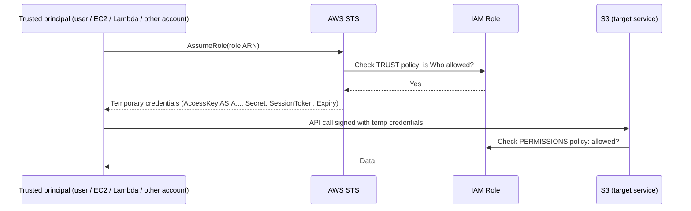

**Trust policy example (EC2 service can assume the role):**
```json
{
  "Version": "2012-10-17",
  "Statement": [{
    "Effect": "Allow",
    "Principal": { "Service": "ec2.amazonaws.com" },
    "Action": "sts:AssumeRole"
  }]
}
```
**Trust policy for a specific user in the same account:**
```json
{
  "Version": "2012-10-17",
  "Statement": [{
    "Effect": "Allow",
    "Principal": { "AWS": "arn:aws:iam::ACCOUNT_ID:user/dev-asha" },
    "Action": "sts:AssumeRole"
  }]
}
```
**Key subtlety (exam favorite):**
- If the trust policy names a **specific user/role ARN**, that principal can assume the role (same account) even without an identity policy granting `sts:AssumeRole`.
- If the trust policy names **the account root** (`arn:aws:iam::ACCOUNT_ID:root`), it means "any principal in that account **that is itself allowed `sts:AssumeRole` by its own identity policy**". The trust policy delegates the decision to that account's IAM.

### 15.3 AWS STS (Security Token Service)
STS issues **temporary credentials**. Core APIs:

| API | Used for |
|---|---|
| `AssumeRole` | Switch to a role (same/cross-account, users, apps) |
| `AssumeRoleWithSAML` | Enterprise SSO via SAML 2.0 |
| `AssumeRoleWithWebIdentity` | Login with OIDC providers (Google, Cognito, GitHub, EKS service accounts) |
| `GetSessionToken` | Temporary creds for an IAM user, commonly **with MFA** |
| `GetFederationToken` | Temporary creds for a federated user (legacy) |
| `GetCallerIdentity` | "Who am I?" (works without any permission) |
| `DecodeAuthorizationMessage` | Decode encoded error details |

A temporary credential has three parts:
```
AccessKeyId     = ASIA...
SecretAccessKey = ...
SessionToken    = long string   <-- required, otherwise the call fails
Expiration      = timestamp
```
- Default session: **1 hour**. Role max session duration configurable from **1 to 12 hours**.
- **Role chaining** (a role assuming another role) is limited to **1 hour** sessions.

### 15.4 Types of roles

| Role type | Trusted principal | Example |
|---|---|---|
| **AWS service role** | An AWS service | Glue job role, Lambda execution role, EC2 instance role |
| **Cross-account role** | Another AWS account | Central security account auditing production |
| **Federated role** | SAML/OIDC identity | Corporate AD users, GitHub Actions |
| **Service-linked role** | A specific service (predefined, managed by the service) | `AWSServiceRoleForElasticLoadBalancing`; you cannot edit its permissions |
| **Role for an IAM user in same account** | A user | Elevate privileges temporarily ("break glass") |

**EC2 and instance profiles:** EC2 does not attach a role directly; it attaches an **instance profile** (a container for one role). The console creates it automatically with the role; CLI/CloudFormation users create it explicitly.

### 15.5 Cross-account access (very common in enterprises)

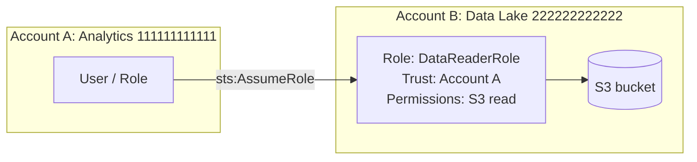
Steps: (1) Account B creates the role trusting Account A. (2) Account A grants its user/role permission `sts:AssumeRole` on that role ARN. (3) The user assumes the role and works **in Account B's context** (they temporarily give up their original permissions).

**External ID (confused deputy protection):** When a **third party** (SaaS vendor) assumes a role in your account, require a secret `sts:ExternalId` in the trust policy condition so another customer of that vendor cannot trick the vendor into accessing your account.
```json
"Condition": { "StringEquals": { "sts:ExternalId": "unique-id-from-vendor" } }
```

### LAB 5: Create and assume a role (console and CLI, free)

**Step 1: Create the role**
```
IAM > Roles > Create role
Trusted entity type: AWS account > This account (ACCOUNT_ID)
Next > Permissions: AmazonS3ReadOnlyAccess
Next > Role name: DataReadRole > Create role
```
Open the role. Look at **Trust relationships** tab: Principal is `arn:aws:iam::ACCOUNT_ID:root`. Look at **Permissions** tab and **Maximum session duration**.

**Step 2: Switch role in the console**
```
Top-right account menu > Switch role
Account: ACCOUNT_ID
Role: DataReadRole
Display name: DataRead > Switch Role
```
The top bar shows a colored label. You now have **only** read-only S3 permissions, even though you're an admin user. Try creating an S3 bucket: denied. Try EC2: denied. Choose **Switch back** to return.
*Lesson: when you assume a role you **replace** your original permissions with the role's.*

**Step 3: Assume the role with the CLI**
```bash
ROLE_ARN=arn:aws:iam::$ACCOUNT_ID:role/DataReadRole

aws sts assume-role --role-arn $ROLE_ARN --role-session-name lab5 --duration-seconds 900
```
Output:
```json
{
  "Credentials": {
     "AccessKeyId": "ASIA...",
     "SecretAccessKey": "...",
     "SessionToken": "IQoJ...",
     "Expiration": "2026-11-01T13:15:00+00:00"
  },
  "AssumedRoleUser": {
     "AssumedRoleId": "AROA...:lab5",
     "Arn": "arn:aws:sts::123456789012:assumed-role/DataReadRole/lab5"
  }
}
```
Use them (CloudShell):
```bash
CREDS=$(aws sts assume-role --role-arn $ROLE_ARN --role-session-name lab5 \
  --query 'Credentials.[AccessKeyId,SecretAccessKey,SessionToken]' --output text)
export AWS_ACCESS_KEY_ID=$(echo $CREDS | awk '{print $1}')
export AWS_SECRET_ACCESS_KEY=$(echo $CREDS | awk '{print $2}')
export AWS_SESSION_TOKEN=$(echo $CREDS | awk '{print $3}')

aws sts get-caller-identity      # now shows ...:assumed-role/DataReadRole/lab5
aws s3 ls                        # works (read only)
aws s3 mb s3://should-fail-$RANDOM   # AccessDenied
```
Return to your admin identity:
```bash
unset AWS_ACCESS_KEY_ID AWS_SECRET_ACCESS_KEY AWS_SESSION_TOKEN
aws sts get-caller-identity      # back to user/admin-yourname
```

**Step 4: Easier way, a CLI profile that auto-assumes**
Edit `~/.aws/config`:
```ini
[profile dataread]
role_arn = arn:aws:iam::ACCOUNT_ID:role/DataReadRole
source_profile = default
region = ap-south-1
```
```bash
aws s3 ls --profile dataread
aws sts get-caller-identity --profile dataread
```
The CLI calls STS for you and caches the credentials.

**Step 5: Test the trust policy limits**
Edit the role's trust policy to name only `user/dev-asha`. Now your admin cannot assume it (unless specific rules allow): try `aws sts assume-role ...` and see `AccessDenied`. Restore the original trust policy afterwards.

### LAB 6: Cross-account (read-through exercise; needs a 2nd account to execute)
If you have a second account (e.g., a friend's or another email), do this: in Account B create `DataReaderRole` trusting Account A's root; in Account A, give a user:
```json
{
  "Version": "2012-10-17",
  "Statement": [{
    "Effect": "Allow",
    "Action": "sts:AssumeRole",
    "Resource": "arn:aws:iam::ACCOUNT_B_ID:role/DataReaderRole"
  }]
}
```
Then `aws sts assume-role --role-arn arn:aws:iam::ACCOUNT_B_ID:role/DataReaderRole --role-session-name x`. Without a second account, just understand the diagram and the two required sides (trust on B, permission on A).

### LAB 7 (optional, small cost): EC2 instance role: no keys on the server

**Goal:** Prove an EC2 can use S3 with **no access keys stored anywhere**.

**Step 1: Create the role**
```
IAM > Roles > Create role > AWS service > EC2 > Next
Policy: AmazonS3ReadOnlyAccess > Next
Role name: EC2-S3Read-Role > Create
```
**Step 2: Launch a tiny instance**
```
EC2 > Launch instance
Name: iam-lab-ec2
AMI: Amazon Linux 2023
Instance type: choose one marked "Free tier eligible" (e.g., t3.micro / t2.micro; the console shows which is allowed in your plan)
Key pair: proceed without key pair (we will use browser connect)
Network: default; Security group: allow no inbound except nothing needed
Advanced details > IAM instance profile: EC2-S3Read-Role
Launch
```
**Step 3: Connect with EC2 Instance Connect or Session Manager** (Connect button > EC2 Instance Connect > Connect).

**Step 4: Test**
```bash
aws sts get-caller-identity       # shows assumed-role/EC2-S3Read-Role/i-xxxx
aws s3 ls                         # works with NO aws configure
ls ~/.aws                         # no credentials file exists
```
**Step 5: See how the temporary credentials arrive (IMDSv2)**
```bash
TOKEN=$(curl -s -X PUT "http://169.254.169.254/latest/api/token" -H "X-aws-ec2-metadata-token-ttl-seconds: 300")
curl -s -H "X-aws-ec2-metadata-token: $TOKEN" http://169.254.169.254/latest/meta-data/iam/security-credentials/
curl -s -H "X-aws-ec2-metadata-token: $TOKEN" http://169.254.169.254/latest/meta-data/iam/security-credentials/EC2-S3Read-Role
```
You see `AccessKeyId` (`ASIA...`), `Token`, and `Expiration`. The SDK/CLI fetches and refreshes these automatically. **Never copy these anywhere.**

**Step 6: CLEAN UP NOW:** terminate the instance (EC2 > Instances > Instance state > Terminate). Confirm it shows *terminated*.

---

## 16. Access Keys, CLI Profiles, Rotation

### 16.1 What is an access key?
A pair for **programmatic** access (CLI/SDK): **Access Key ID** (like a username, `AKIA...`) + **Secret Access Key** (like a password, shown **only once**).
- Up to **2 access keys per user** (so you can rotate without downtime).
- Anyone holding both can act as you. Treat like a password.

### 16.2 Where credentials are looked up (credential provider chain, in order)
1. Explicit parameters in code (avoid)
2. **Environment variables** (`AWS_ACCESS_KEY_ID`, `AWS_SECRET_ACCESS_KEY`, `AWS_SESSION_TOKEN`)
3. **Shared credentials/config files** (`~/.aws/credentials`, `~/.aws/config`) + profiles/SSO
4. **Container credentials** (ECS task role)
5. **Instance profile credentials** (EC2 role via IMDS)

(Lambda and Glue inject role credentials through environment variables automatically.)

Exam implication: a role attached to EC2 is used **only if no higher-priority credentials are found**. A stale key in environment variables will override your role and cause confusing errors.

### 16.3 Rotation procedure (zero downtime)
1. Create **second** key.
2. Update the application to use it.
3. Check the old key's **Last used** in console.
4. **Deactivate** old key (don't delete yet). Wait, watch for errors.
5. **Delete** old key.

### LAB 8: Manage, rotate and audit keys
```bash
# list keys for a user
aws iam list-access-keys --user-name dev-asha

# when was a key last used?
aws iam get-access-key-last-used --access-key-id AKIAXXXXXXXX

# create second key, deactivate first
aws iam create-access-key --user-name dev-asha
aws iam update-access-key --user-name dev-asha --access-key-id AKIAOLD --status Inactive

# delete
aws iam delete-access-key --user-name dev-asha --access-key-id AKIAOLD

# credential report: all users, passwords, MFA, key age
aws iam generate-credential-report
aws iam get-credential-report --query Content --output text | base64 -d > cred_report.csv
head -n 3 cred_report.csv
```
Open `cred_report.csv`: columns like `password_last_used`, `mfa_active`, `access_key_1_last_rotated`. Banks run this monthly to find users without MFA and keys older than 90 days. (Console: IAM > Credential report > Download.)

> **Security rule:** If a key is ever exposed (pasted in chat, committed to GitHub), **deactivate it immediately**, then investigate CloudTrail for misuse, then delete. AWS also scans public GitHub and may quarantine exposed keys with a policy `AWSCompromisedKeyQuarantine`.

---

## 17. Resource-Based Policies

An **identity-based policy** says "this *user* can do X". A **resource-based policy** says "this *resource* allows principal P to do X". It has a `Principal` element.

**Resources that support them:** S3 buckets (bucket policy), SQS, SNS, Lambda (function policy), KMS (key policy: mandatory), Secrets Manager, ECR, API Gateway, Glue Data Catalog (resource policy), IAM role trust policies, and more.

### Example: S3 bucket policy
```json
{
  "Version": "2012-10-17",
  "Statement": [
    {
      "Sid": "AllowAnalyticsAccountRead",
      "Effect": "Allow",
      "Principal": { "AWS": "arn:aws:iam::111111111111:role/AnalyticsRole" },
      "Action": ["s3:GetObject", "s3:ListBucket"],
      "Resource": ["arn:aws:s3:::lake-bucket", "arn:aws:s3:::lake-bucket/*"]
    },
    {
      "Sid": "DenyNonTLS",
      "Effect": "Deny",
      "Principal": "*",
      "Action": "s3:*",
      "Resource": ["arn:aws:s3:::lake-bucket", "arn:aws:s3:::lake-bucket/*"],
      "Condition": { "Bool": { "aws:SecureTransport": "false" } }
    }
  ]
}
```
- `"Principal": "*"` means everyone. In an **Allow** it makes the resource **public**. S3 Block Public Access protects you from this mistake. Keep it ON.
- The `DenyNonTLS` pattern is required by many compliance frameworks.

### Identity-based vs Resource-based (exam table)
| | Identity-based | Resource-based |
|---|---|---|
| Attached to | User/group/role | Resource |
| `Principal` element | No | **Yes** |
| Cross-account | Needs resource side also | Can grant directly (plus caller side must also allow) |
| Role gets used? | Caller keeps own permissions | **When cross-account via resource policy, caller keeps own identity** (no role switching) |

**Subtle but valuable point:** With a **role assumption**, you give up your original permissions while in the role. With a **resource-based policy**, you keep your original permissions and simply gain access to that resource. This matters when you need to read from a source account **and** write to your own account's bucket in the same call.

### LAB 9: Bucket policy grants access; explicit deny overrides

Use `BUCKET` and `dev-asha` from Lab 3. Remember: dev-asha can only read `raw/`.

**Step 1: Resource-based allow (same account, union rule)**
```
S3 > BUCKET > Permissions > Bucket policy > Edit > paste > Save
```
```json
{
  "Version": "2012-10-17",
  "Statement": [{
    "Sid": "AllowAshaConfidentialRead",
    "Effect": "Allow",
    "Principal": { "AWS": "arn:aws:iam::ACCOUNT_ID:user/dev-asha" },
    "Action": "s3:GetObject",
    "Resource": "arn:aws:s3:::BUCKET/confidential/*"
  }]
}
```
Test (with Lab 3's `asha` profile):
```bash
aws s3 cp s3://BUCKET/confidential/conf1.txt - --profile asha     # now WORKS
```
Her identity policy never allowed `confidential/`, yet the bucket policy did, because **same-account permissions are a union**.

**Step 2: Add an explicit deny**
Add this second statement to the bucket policy:
```json
{
  "Sid": "DenyAshaEverythingExceptRaw",
  "Effect": "Deny",
  "Principal": { "AWS": "arn:aws:iam::ACCOUNT_ID:user/dev-asha" },
  "Action": "s3:*",
  "NotResource": [
    "arn:aws:s3:::BUCKET",
    "arn:aws:s3:::BUCKET/raw/*"
  ]
}
```
Test again:
```bash
aws s3 cp s3://BUCKET/confidential/conf1.txt - --profile asha     # AccessDenied: "explicit deny in a resource-based policy"
aws s3 cp s3://BUCKET/raw/raw1.txt - --profile asha               # still works
```
Read the error message: it distinguishes **explicit deny** from **implicit deny**. This is how you diagnose real-world permission issues.

**Step 3: Remove the two statements to reset** (or delete the bucket policy).

---

## 18. Permissions Boundaries

A **permissions boundary** is a policy that sets the **maximum** permissions an IAM user or role can ever have. It does **not grant** anything by itself.

**Effective permissions = Identity policy ∩ Permissions boundary.**

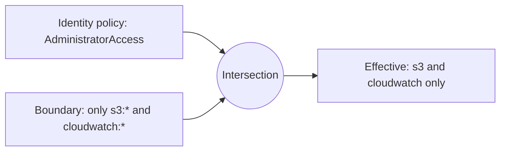

### Why companies use them (delegated administration)
A bank's central security team lets **project leads create their own roles**, but with a **mandatory boundary**, so no lead can create a role more powerful than the boundary allows (preventing privilege escalation). The delegation policy says: "you may `iam:CreateRole` only if you attach boundary X".

```json
{
  "Effect": "Allow",
  "Action": ["iam:CreateRole", "iam:AttachRolePolicy"],
  "Resource": "*",
  "Condition": {
    "StringEquals": {
      "iam:PermissionsBoundary": "arn:aws:iam::ACCOUNT_ID:policy/DevBoundary"
    }
  }
}
```

### LAB 10: See a boundary cut an Administrator down
```
IAM > Policies > Create policy > JSON:
{ "Version":"2012-10-17","Statement":[
  {"Effect":"Allow","Action":["s3:*","cloudwatch:*"],"Resource":"*"} ] }
Name: DevBoundary
```
```bash
aws iam create-user --user-name boundary-test
aws iam attach-user-policy --user-name boundary-test \
   --policy-arn arn:aws:iam::aws:policy/AdministratorAccess
aws iam put-user-permissions-boundary --user-name boundary-test \
   --permissions-boundary arn:aws:iam::$ACCOUNT_ID:policy/DevBoundary
aws iam create-access-key --user-name boundary-test
aws configure --profile btest      # paste keys
```
Test:
```bash
aws s3 ls --profile btest                      # works (in boundary)
aws ec2 describe-instances --profile btest     # AccessDenied: no permissions boundary allows ec2:DescribeInstances
aws iam list-users --profile btest             # AccessDenied
```
Even with `AdministratorAccess` attached, the boundary blocks everything outside S3/CloudWatch. Notice the error text mentions *permissions boundary*.

Cleanup: delete keys and user later (Section 28).

---

## 19. Organizations, SCPs, and IAM Identity Center

### 19.1 AWS Organizations and SCPs (concept level)
**Organizations** lets you manage many accounts. **Service Control Policies (SCPs)** are guardrails applied at root/OU/account level.
- SCPs **never grant**; they define the **maximum available** permissions to all principals in member accounts (including the account's root user, but **not** the management account).
- Default SCP `FullAWSAccess` allows everything; you add Deny SCPs ("deny-list") or switch to allow-list.
- Typical SCPs:
  - Deny leaving the Organization.
  - Deny disabling CloudTrail/Config/GuardDuty.
  - Deny any Region except `ap-south-1` and `ap-south-2` (data residency).
  - Deny creating IAM users (force SSO).
  - Deny root user actions.

Example region-restrict SCP (note exemptions for global services):
```json
{
  "Version": "2012-10-17",
  "Statement": [{
    "Sid": "DenyOutsideIndia",
    "Effect": "Deny",
    "NotAction": ["iam:*","organizations:*","route53:*","cloudfront:*","support:*","sts:*"],
    "Resource": "*",
    "Condition": {
      "StringNotEquals": { "aws:RequestedRegion": ["ap-south-1","ap-south-2"] }
    }
  }]
}
```
Also exists: **Resource Control Policies (RCPs)**, org-level guardrails over **resources** (e.g., prevent external access to S3 regardless of bucket policy).

### 19.2 IAM Identity Center (successor to AWS SSO)
**What:** A central place to give **people** (your workforce) single sign-on access to **many AWS accounts** and apps, with **temporary credentials**, no IAM users needed.

Concepts:
| Term | Meaning |
|---|---|
| **Identity source** | Where users live: Identity Center directory, Active Directory, or external IdP (Okta, Entra ID) |
| **User / Group** | Workforce identities |
| **Permission set** | A template of permissions (like a role definition) you assign |
| **Assignment** | User/group + permission set + target account |
| **Access portal** | A web page listing accounts/roles the user can open |

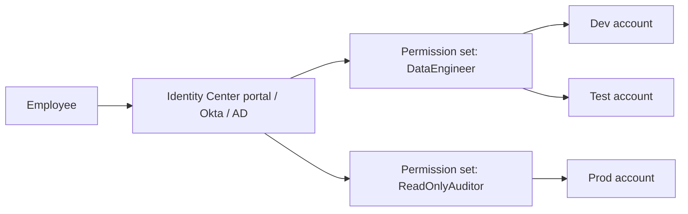
Behind the scenes, Identity Center creates **roles** (named `AWSReservedSSO_...`) in each target account and the user assumes them via STS, receiving **temporary** credentials.

**Why better than IAM users:** centralized on/off-boarding (disable one user → access gone everywhere), MFA enforced centrally, no long-lived keys, easy CLI via `aws sso login`.

#### Mini lab (Identity Center; optional)
```
Search "IAM Identity Center" > Enable (choose a Region once, e.g., ap-south-1; it is a one-time home Region)
Users > Add user (your email) > Groups > Create group "DataEngineers"
Permission sets > Create > Predefined > ReadOnlyAccess (or PowerUserAccess)
AWS accounts > select your account > Assign users or groups > DataEngineers > permission set
Open the AWS access portal URL, sign in, choose account > role > Console or "Access keys"
```
CLI:
```bash
aws configure sso
# SSO start URL: https://d-xxxx.awsapps.com/start
# SSO region: ap-south-1
# Pick account/role, name profile "sso-dev"
aws sso login --profile sso-dev
aws s3 ls --profile sso-dev
```
Note: Identity Center may need AWS Organizations enabled (an organization instance); follow the console prompts. For personal learning accounts, IAM users + roles are sufficient, but know Identity Center well for interviews.

---

## 20. Federation (SAML, OIDC, Cognito)

**Federation** = trust an **external identity system** so users don't need separate IAM users.

| Method | Used for | How |
|---|---|---|
| **SAML 2.0 federation** | Corporate SSO (AD FS, Okta, Entra ID, Ping) | IdP issues SAML assertion → `AssumeRoleWithSAML` → temporary credentials |
| **OIDC / Web identity federation** | Google/Facebook/GitHub/EKS/other OIDC providers | `AssumeRoleWithWebIdentity` |
| **IAM Identity Center** | Workforce SSO (recommended for staff) | Managed service on top of the above |
| **Amazon Cognito** | **End users of your own app** (mobile/web customers) | User pools (sign-up/sign-in, JWT) + Identity pools (exchange for AWS credentials) |
| **IAM Roles Anywhere** | Servers **outside AWS** needing AWS access | X.509 certificate → temporary credentials |

**Real-world modern example, GitHub Actions deploying to AWS with no stored keys:**
1. Create an IAM OIDC identity provider `token.actions.githubusercontent.com`.
2. Create a role whose trust policy trusts that provider, restricted to your repo:
```json
{
  "Version": "2012-10-17",
  "Statement": [{
    "Effect": "Allow",
    "Principal": { "Federated": "arn:aws:iam::ACCOUNT_ID:oidc-provider/token.actions.githubusercontent.com" },
    "Action": "sts:AssumeRoleWithWebIdentity",
    "Condition": {
      "StringEquals": { "token.actions.githubusercontent.com:aud": "sts.amazonaws.com" },
      "StringLike":   { "token.actions.githubusercontent.com:sub": "repo:YOURORG/YOURREPO:*" }
    }
  }]
}
```
3. The pipeline gets short-lived credentials. No secret keys in GitHub. This is how data-engineering CI/CD should be done.

**Exam trick:** "Mobile app users need access to their own S3 folder" → **Cognito Identity Pools**. "Employees with corporate AD login to AWS Console" → **SAML federation / Identity Center**. "On-prem server needs AWS access without keys" → **IAM Roles Anywhere**.

---

## 21. Auditing and Monitoring IAM

You cannot secure what you cannot see.

| Tool | What it answers |
|---|---|
| **CloudTrail** | **Who did what, when, from where?** Logs every API call (IAM sign-ins, AssumeRole, CreateUser...). Event history keeps 90 days of management events free; create a **trail** to S3 for long-term retention. |
| **IAM Credential Report** | Account-wide list of users with password/MFA/key status (updates at most every 4 hours) |
| **IAM Access Advisor** | Per-identity: which **services** it has permission for and **when last accessed**: used to remove unused permissions |
| **IAM Access Analyzer** | (1) Finds **external access** to your resources (public/cross-account buckets, roles, KMS keys); (2) **Unused access** findings (unused roles, keys, permissions); (3) **Policy validation** (syntax, security warnings); (4) **Policy generation** from CloudTrail activity (build least-privilege policies from actual use); (5) Custom policy checks |
| **Policy Simulator** | Test "would this user be allowed?" without making real calls |
| **AWS Config** | Track configuration history and compliance rules (e.g., `iam-user-mfa-enabled`, `access-keys-rotated`, `iam-root-access-key-check`) |
| **CloudWatch + EventBridge** | Alert on events like root login |
| **Security Hub / GuardDuty** | Detect suspicious IAM behavior (credential exfiltration, unusual API calls) |

### Alert on root user sign-in (real bank control)
EventBridge rule on pattern:
```json
{
  "detail-type": ["AWS Console Sign In via CloudTrail"],
  "detail": { "userIdentity": { "type": ["Root"] } }
}
```
→ target an SNS topic that emails the security team.

### LAB 11: Investigate with CloudTrail, Access Advisor, and Access Analyzer

**Part 1: CloudTrail event history**
```
CloudTrail > Event history > Lookup attributes: Event name = AssumeRole
```
You should see your Lab 5 `assume-role` calls. Click one → **Event record** JSON: see `userIdentity`, `sourceIPAddress`, `requestParameters.roleArn`.
Also search: `CreateUser`, `ConsoleLogin`, `AttachUserPolicy`, `AccessDenied` in `errorCode` (use the filter or Athena later).
```bash
aws cloudtrail lookup-events --lookup-attributes AttributeKey=EventName,AttributeValue=CreateUser \
  --max-results 5 --query 'Events[].[EventTime,Username]' --output table
```

**Part 2: Access Advisor**
```
IAM > Users > dev-asha > Access Advisor tab
```
See "Last accessed" per service. Anything "Not accessed in tracking period" is a candidate to remove.

**Part 3: Access Analyzer**
```
IAM > Access Analyzer > Create analyzer > Zone of trust: Current account > Create
```
Create an intentional external-access example: add to your lab bucket policy a statement allowing a *different* account (any other valid 12-digit ID, e.g., `arn:aws:iam::111122223333:root`) to `s3:GetObject`. After a minute, **Findings** shows **external access** to your bucket. Remove the statement and see the finding resolve.

Try **Policy validation**: IAM > Policies > Create policy > JSON editor; paste a policy with `"Action": "*"` / `"Resource": "*"` and observe the security warnings.

**Part 4: Policy generation (powerful)**
```
IAM > Roles > DataReadRole > "Generate policy based on CloudTrail events" (needs a trail to S3)
```
This builds a least-privilege policy from what the role actually did.

---

## 22. IAM for Data Engineering (Your Core Career Topic)

In data engineering most IAM work involves **service roles**: each AWS service that processes data needs a role to access S3, the Catalog, KMS, etc.

### 22.1 The mental pattern
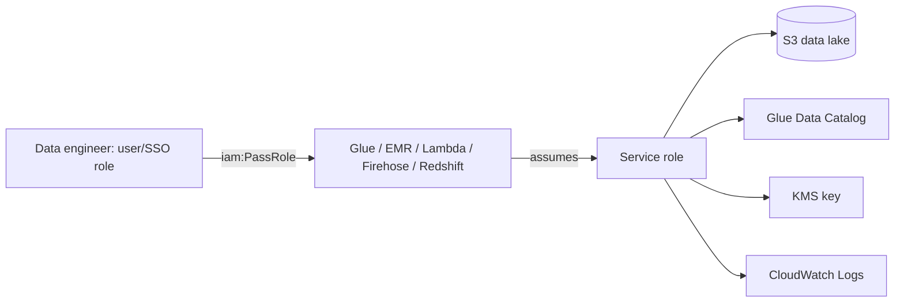

### 22.2 iam:PassRole (very important, tested and used daily)
When you create a Glue job, Lambda, Step Function, EMR cluster, Firehose stream or Redshift COPY, you **hand a role to the service**. IAM requires **you** to have `iam:PassRole` for that role. Why? Without it, a low-privileged user could pass a powerful admin role to a service and escalate privileges.

```json
{
  "Effect": "Allow",
  "Action": "iam:PassRole",
  "Resource": "arn:aws:iam::ACCOUNT_ID:role/GlueETLRole",
  "Condition": { "StringEquals": { "iam:PassedToService": "glue.amazonaws.com" } }
}
```
Typical error: `User ... is not authorized to perform: iam:PassRole on resource: arn:aws:iam::...:role/GlueETLRole`.

### 22.3 Service roles you will create in this career

| Service | Trust principal | Typical permissions |
|---|---|---|
| **Glue job/crawler** | `glue.amazonaws.com` | `AWSGlueServiceRole` (managed) + S3 read/write on lake paths + KMS decrypt |
| **Lambda** | `lambda.amazonaws.com` | `AWSLambdaBasicExecutionRole` (logs) + data access (S3/DynamoDB/Kinesis) |
| **EMR** | `elasticmapreduce.amazonaws.com` (service role) + `ec2.amazonaws.com` (EC2 instance profile for nodes) | S3, Glue catalog, KMS |
| **Redshift** | `redshift.amazonaws.com` | `s3:GetObject`, `s3:ListBucket` for **COPY/UNLOAD**, Glue catalog for Spectrum |
| **Kinesis Firehose** | `firehose.amazonaws.com` | Write to S3, KMS, Glue schema for conversion, Lambda invoke |
| **Step Functions** | `states.amazonaws.com` | Invoke Lambda/Glue/Athena/etc. |
| **DMS** | `dms.amazonaws.com` | Access endpoints, S3 target, Secrets Manager |
| **Athena (user side)** | n/a (uses caller's identity) | `athena:*` query actions + Glue catalog read + S3 read on data + S3 write on results bucket |

### 22.4 Athena permissions: a classic puzzle
A user runs a query on `s3://lake/raw/sales`. They need **all** of:
1. `athena:StartQueryExecution`, `GetQueryExecution`, `GetQueryResults` (and workgroup access).
2. `glue:GetDatabase`, `GetTable`, `GetPartitions` (the **Catalog** metadata).
3. `s3:GetObject` and `s3:ListBucket` on the **data** location.
4. `s3:PutObject`, `s3:GetBucketLocation`, `s3:ListBucket`/multipart on the **query results** location.
5. `kms:Decrypt` (and `GenerateDataKey` for results) if SSE-KMS is used.
Missing any one → failure with confusing messages.

### 22.5 Sample Glue ETL role permissions policy
```json
{
  "Version": "2012-10-17",
  "Statement": [
    {
      "Sid": "ReadRawWriteCurated",
      "Effect": "Allow",
      "Action": ["s3:GetObject", "s3:PutObject", "s3:DeleteObject"],
      "Resource": [
        "arn:aws:s3:::lake-bucket/raw/*",
        "arn:aws:s3:::lake-bucket/curated/*"
      ]
    },
    {
      "Sid": "ListLake",
      "Effect": "Allow",
      "Action": "s3:ListBucket",
      "Resource": "arn:aws:s3:::lake-bucket"
    }
  ]
}
```
Plus managed `AWSGlueServiceRole` for Glue's own needs (logs, catalog).

### 22.6 Data lake security layering (preview)
IAM is **one layer**. In a governed lake you also use:
- **S3 bucket policies** (force TLS, restrict to VPC endpoint, `aws:PrincipalOrgID`).
- **KMS key policies** (who can decrypt: separate from S3 access).
- **Lake Formation** (fine-grained table/column/row permissions on top of IAM, preferred for analytics access).
- **VPC endpoints + endpoint policies**.

**Rule:** A call succeeds only if every layer permits it. When debugging, check IAM → resource policy → KMS → Lake Formation → network.

### LAB 12: Build a Glue-style service role and experience iam:PassRole

You do not need to run a Glue job; the goal is to feel the PassRole mechanic. (Glue job creation itself is free; running jobs costs.)

**Step 1: Create the Glue service role**
```
IAM > Roles > Create role > AWS service > Glue > Next
Policy: AWSGlueServiceRole
Name: GlueETLRole > Create
```
Add inline policy `LakeAccess` (use Section 22.5 JSON with your `BUCKET` name) to this role.
Inspect its **Trust relationships**: Principal `glue.amazonaws.com`.

**Step 2: Create a limited user `etl-dev`**
```bash
aws iam create-user --user-name etl-dev
aws iam create-access-key --user-name etl-dev     # configure as profile etl
aws configure --profile etl
```
Attach inline policy to `etl-dev` (Glue actions only, **no PassRole**):
```bash
cat > glue-only.json << 'EOF'
{
  "Version": "2012-10-17",
  "Statement": [{
    "Effect": "Allow",
    "Action": ["glue:CreateJob", "glue:GetJob", "glue:GetJobs", "glue:DeleteJob"],
    "Resource": "*"
  }]
}
EOF
aws iam put-user-policy --user-name etl-dev --policy-name GlueOnly --policy-document file://glue-only.json
```

**Step 3: Try to create a Glue job (will fail)**
```bash
aws glue create-job --name pass-role-test \
  --role arn:aws:iam::$ACCOUNT_ID:role/GlueETLRole \
  --command Name=glueetl,ScriptLocation=s3://$BUCKET/scripts/test.py,PythonVersion=3 \
  --glue-version 4.0 --profile etl
```
Expected: `AccessDeniedException ... not authorized to perform: iam:PassRole on resource: .../GlueETLRole`.

**Step 4: Fix with a scoped PassRole**
```bash
cat > passrole.json << EOF
{
  "Version": "2012-10-17",
  "Statement": [{
    "Effect": "Allow",
    "Action": "iam:PassRole",
    "Resource": "arn:aws:iam::$ACCOUNT_ID:role/GlueETLRole",
    "Condition": { "StringEquals": { "iam:PassedToService": "glue.amazonaws.com" } }
  }]
}
EOF
aws iam put-user-policy --user-name etl-dev --policy-name PassGlueRole --policy-document file://passrole.json
sleep 15
# rerun the create-job command from Step 3
aws glue get-job --job-name pass-role-test --profile etl
```
The job now gets created. Delete it: `aws glue delete-job --job-name pass-role-test`.

**Takeaway:** Two different permissions are involved: *"may I create a Glue job?"* (glue:CreateJob) and *"may I give this specific role to Glue?"* (iam:PassRole).

---

## 23. Troubleshooting AccessDenied (A Skill Interviewers Love)

### 23.1 Diagnostic checklist
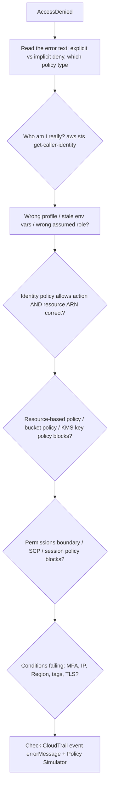

### 23.2 Reading error messages
| Message fragment | Meaning |
|---|---|
| `because no identity-based policy allows the X action` | **Implicit deny**: add an allow |
| `with an explicit deny in an identity-based policy` | A deny statement in the user/role's policy |
| `with an explicit deny in a resource-based policy` | Bucket/key/queue policy denies |
| `with an explicit deny in a service control policy` | Org SCP blocks |
| `because no permissions boundary allows` | Boundary is cutting you |
| `...session policy...` | Session was narrowed when assumed |

### 23.3 Useful commands
```bash
aws sts get-caller-identity                    # who am I?
aws configure list                             # where are creds coming from?
env | grep AWS_                                # stale environment variables?
aws iam simulate-principal-policy --policy-source-arn arn:aws:iam::$ACCOUNT_ID:user/dev-asha \
   --action-names s3:GetObject --resource-arns arn:aws:s3:::$BUCKET/raw/raw1.txt \
   --query 'EvaluationResults[].[EvalActionName,EvalDecision]' --output table
aws sts decode-authorization-message --encoded-message <paste-long-string>   # needs sts:DecodeAuthorizationMessage
```

### 23.4 Common causes (from real projects)
1. Missing `/*` on S3 object ARN, or missing bucket-level ARN for `ListBucket`.
2. KMS: object encrypted with a CMK and the role lacks `kms:Decrypt`.
3. Role works in console but not CLI because of stale env vars overriding.
4. Typo in account ID or role name in ARN.
5. Policy attached to the **wrong** identity (user vs group vs role).
6. Policy change not yet propagated (wait seconds).
7. `Principal` incorrectly specified in an identity policy (not allowed there).
8. Region condition (`aws:RequestedRegion`) or SCP blocks resources in unexpected Region.
9. Cross-account: only one side configured.
10. Role session duration expired.

---

## 24. Real-World Architectures

### 24.1 Banking: multi-account, SSO, guardrails
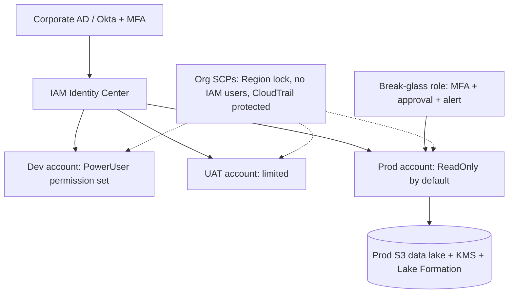
Practices:
- No IAM users for humans; **SSO + MFA**.
- Production access is **read-only** by default; write via **CI/CD roles** (OIDC) or time-boxed **break-glass roles** with alerts.
- Separate accounts for logs (immutable CloudTrail archive), security tooling, and data.
- Quarterly access reviews using **Access Analyzer + Access Advisor + credential report**.
- Regulatory: PCI-DSS / RBI data-localisation → SCP locks Regions to India.

### 24.2 Healthcare (HIPAA-style)
- Patient data in S3 + KMS CMK; **KMS key policy** allows decrypt only to specific roles.
- **Condition keys**: `aws:SecureTransport`, VPC endpoint (`aws:SourceVpce`), `aws:PrincipalOrgID`.
- Analysts get **de-identified** datasets; PHI access via a separately audited role, every call visible in CloudTrail data events.
- Lake Formation column-level security to hide SSN/diagnosis columns.

### 24.3 Enterprise data platform
- **Producer accounts** push to central lake via **cross-account roles** and bucket policies.
- **ABAC** with `Domain=Finance|Risk|Sales` tags, so teams self-serve without new policies.
- **Permission boundaries** let domain teams create their own Glue/Lambda roles safely.
- **GitHub Actions OIDC roles** for pipeline deployments, no static keys anywhere.

---

## 25. Best Practices Checklist

1. **Lock away the root user:** MFA, no access keys, use only for tasks that require it.
2. **Use SSO/roles for people; roles for workloads.** Avoid long-term keys.
3. **Enforce MFA** for humans.
4. **Least privilege**: start narrow, widen with evidence (Access Analyzer policy generation).
5. **Use groups (or SSO groups) for permissions**, not per-user attachments.
6. **Prefer customer managed policies** over inline; version and review them.
7. **Avoid `*` on Action and Resource**; scope by ARN and conditions.
8. **Use conditions**: MFA, source IP/VPC endpoint, Region, TLS, tags.
9. **Rotate or remove unused credentials** (>90 days); delete unused users/roles.
10. **Separate accounts** for environments; use SCPs for guardrails.
11. **Permission boundaries** for delegated role creation.
12. **Monitor**: CloudTrail in all Regions (to a protected bucket), Config rules, Access Analyzer, GuardDuty, root-login alerts.
13. **Never put credentials in code, images, logs or Git.** Use Secrets Manager/roles; enable secret scanning.
14. **Review access regularly** (credential report, Access Advisor).
15. **Tag identities and resources** consistently for ABAC and cost allocation.

---

## 26. Exam Cheat Sheet and Practice Questions

### 26.1 Facts to memorize
- IAM is **global** and **free**; changes are **eventually consistent**.
- New users have **no permissions** (default deny). **Explicit deny beats everything.**
- **Groups can't be nested**, can't be principals, can't log in. A user can be in up to **10 groups**.
- **2 access keys per user**. AKIA = long-term, ASIA = temporary.
- **Roles = temporary credentials via STS.** Trust policy = who assumes; permissions policy = what they can do.
- Default role session **1 hour**; configurable **1-12 hours**; role chaining max **1 hour**.
- **Resource-based policies** have `Principal`; identity-based don't.
- **SCP / permissions boundary / session policy** = **limit only**, never grant.
- **Cross-account** needs **both** sides to allow. **Same account**: resource policy OR identity policy is enough.
- IAM policies can't restrict the **root user**; SCPs can restrict **member account** root.
- **Credential report** = account-wide user/credential status. **Access Advisor** = last-used services per identity. **Access Analyzer** = external/unused access + policy generation/validation.
- **Instance profile** = container that passes a role to EC2.
- **Service-linked role** = predefined by a service; you can't modify its permissions.
- **iam:PassRole** needed to give a role to a service.
- **MFA enforcement** = Deny with `aws:MultiFactorAuthPresent=false`.
- **Cognito** for app customers; **Identity Center** for workforce; **SAML** for corporate IdP; **Roles Anywhere** for outside-AWS workloads.
- **Password policy** applies to IAM users only.
- Managed policy: reusable, versioned (up to 5 versions); inline: tied to one identity.
- **Default session when users switch role** replaces their permissions with the role's.

### 26.2 25 scenario questions (try before reading the answers)

**Q1.** A new IAM user is created with no policies. What can they do?
**A:** Nothing. Default deny. (They can't even list S3 buckets.)

**Q2.** An EC2 app must read S3 securely with the least operational overhead. What do you do?
**A:** Create a role with S3 read permissions, attach it via an instance profile. No access keys.

**Q3.** An identity policy allows `s3:*`, but a bucket policy denies `s3:DeleteObject` for that user. Can they delete?
**A:** No. Explicit deny wins.

**Q4.** A user has AdministratorAccess but a permissions boundary allowing only S3. Can they launch EC2?
**A:** No. Effective permissions are the intersection.

**Q5.** An SCP denies `ec2:*` in an OU. The account's admin role has `ec2:*` allowed. Can they use EC2?
**A:** No. SCP is a ceiling.

**Q6.** Two accounts: Account A bucket, Account B user needs to read. What is required?
**A:** Bucket policy in A (or role in A that B assumes) **and** an identity policy in B permitting access (or `sts:AssumeRole`).

**Q7.** A third-party SaaS needs access to your account's resources. How do you prevent the confused deputy problem?
**A:** Cross-account role with an **ExternalId** condition.

**Q8.** How do you force all IAM users to use MFA before accessing resources?
**A:** Policy with `Deny` + `NotAction` for MFA self-management + condition `BoolIfExists aws:MultiFactorAuthPresent: false`.

**Q9.** Corporate employees with Active Directory credentials need access to many AWS accounts. Best solution?
**A:** IAM Identity Center (or SAML federation), not IAM users.

**Q10.** A mobile app's end users need to upload to their own S3 folder. Solution?
**A:** Amazon Cognito (user pool + identity pool) with policy variable for per-user prefix.

**Q11.** You need to find which IAM users haven't used their credentials in 90 days.
**A:** IAM credential report (and Access Advisor for service-level detail).

**Q12.** You want to create a least-privilege policy based on what a role actually did.
**A:** IAM Access Analyzer policy generation (uses CloudTrail).

**Q13.** Find S3 buckets or roles accessible from outside your account.
**A:** IAM Access Analyzer (external access analyzer).

**Q14.** How do you let developers create IAM roles without letting them become admins?
**A:** Permissions boundary required on any role they create (condition `iam:PermissionsBoundary`).

**Q15.** A Lambda function can't write logs. What's likely missing?
**A:** Its execution role lacks CloudWatch Logs permissions (`AWSLambdaBasicExecutionRole`).

**Q16.** Which credential type begins with ASIA?
**A:** Temporary credentials from STS (requires a session token).

**Q17.** A developer leaked an access key on GitHub. First actions?
**A:** Deactivate the key immediately, review CloudTrail for misuse, rotate/delete, remove from history, consider scanning/quarantine policy.

**Q18.** Can you attach a group to a policy's `Principal`?
**A:** No. Groups are not principals.

**Q19.** Which policy type determines who can assume a role?
**A:** The role's **trust policy**.

**Q20.** An on-prem server needs AWS access without long-term keys.
**A:** IAM Roles Anywhere (X.509 certificates) or hybrid activation depending on service; avoid static keys.

**Q21.** A user in the Org can't delete CloudTrail even as admin. Why?
**A:** An SCP likely denies `cloudtrail:StopLogging/DeleteTrail`.

**Q22.** You want a user's Glue job to use a specific role. The user gets an error about `iam:PassRole`. Fix?
**A:** Grant the user `iam:PassRole` on that role (condition `iam:PassedToService`).

**Q23.** Athena returns AccessDenied on query results location though data bucket access is fine. Why?
**A:** The results bucket needs `s3:PutObject`/`GetBucketLocation`/`ListBucket` permissions too.

**Q24.** Difference between assuming a role and a resource-based policy for cross-account access?
**A:** Assuming a role **replaces** your permissions; a resource-based policy lets you **keep** your own permissions while accessing the resource.

**Q25.** What is the maximum permissions boundary effect on a policy that grants `s3:*` when the boundary only lists `s3:GetObject`?
**A:** Only `s3:GetObject` is effective.

---

## 27. Interview Questions (Explain in Your Own Words)

1. Explain IAM users, groups, roles and policies with an example.
2. When would you use a role instead of an IAM user?
3. What's in a trust policy vs a permissions policy?
4. Walk me through how AWS evaluates a request (deny, SCP, boundary, resource policy, identity policy).
5. What is the difference between an SCP and a permissions boundary?
6. How do you grant cross-account access to an S3 bucket securely?
7. How do you secure the root user?
8. How would you design access for 200 data engineers across dev/test/prod accounts?
9. How do you give a CI/CD pipeline access without storing keys?
10. What is `iam:PassRole` and why does it exist?
11. How would you troubleshoot an AccessDenied in Athena/Glue/Redshift COPY?
12. What is ABAC and why is it better than RBAC at scale?
13. How do you audit IAM in a regulated environment?
14. How do you handle a leaked access key?
15. What is the difference between Cognito and IAM Identity Center?

**Tip for answers:** use the structure *principle → mechanism → example → pitfall*. Example: "Least privilege (principle) is implemented using narrow customer managed policies and conditions (mechanism), e.g., giving analysts read on `s3://lake/curated/*` only (example); the common pitfall is forgetting the bucket-level ARN for ListBucket or KMS decrypt (pitfall)."

---

## 28. Cleanup and Final Checklist

### Cleanup (run in CloudShell as admin; adjust names)
```bash
# 1) Delete access keys and users created in labs
for U in dev-asha audit-meena boundary-test etl-dev; do
  for K in $(aws iam list-access-keys --user-name $U --query 'AccessKeyMetadata[].AccessKeyId' --output text 2>/dev/null); do
    aws iam delete-access-key --user-name $U --access-key-id $K
  done
done

# 2) Detach/delete user policies and remove from groups (examples)
aws iam delete-user-policy --user-name etl-dev --policy-name GlueOnly
aws iam delete-user-policy --user-name etl-dev --policy-name PassGlueRole
aws iam detach-user-policy --user-name boundary-test --policy-arn arn:aws:iam::aws:policy/AdministratorAccess
aws iam delete-user-permissions-boundary --user-name boundary-test
aws iam remove-user-from-group --user-name audit-meena --group-name Auditors
aws iam remove-user-from-group --user-name dev-asha --group-name DataEngineers   # if still a member
```
Then in the console (easier for passwords/MFA/login profiles): **IAM > Users > select > Delete**, then delete groups (detach policies first), custom policies (`S3ReadRawOnly`, `RequireMFA`, `DevBoundary`), roles (`DataReadRole`, `EC2-S3Read-Role`, `GlueETLRole`). Also:
```bash
# 3) Remove the S3 test bucket (empty it first)
aws s3 rm s3://$BUCKET --recursive
aws s3 rb s3://$BUCKET

# 4) Remove local lab credentials
rm -f ~/.aws/credentials       # in CloudShell, profiles for asha/btest/etl
```
Also delete the Access Analyzer you created if you do not want it, and confirm the EC2 instance from Lab 7 is **terminated**. Keep your admin user, MFA, alias and password policy.

### Final self-check (tick when you can do it without notes)
- [ ] Explain authentication vs authorization and the Principal/Action/Resource/Condition model
- [ ] Read any policy JSON and say what it does
- [ ] Write a least-privilege S3 policy with bucket and object ARNs
- [ ] Explain evaluation logic: default deny, explicit deny, union of grants, intersection with guardrails
- [ ] Create a role, edit its trust policy, assume it via console and CLI
- [ ] Attach a role to EC2 and show no keys exist on the machine
- [ ] Enforce MFA with a deny policy
- [ ] Explain boundaries vs SCPs vs session policies
- [ ] Set up cross-account access in your head (both sides)
- [ ] Explain and fix an `iam:PassRole` error
- [ ] Use credential report, Access Advisor, Access Analyzer, CloudTrail
- [ ] Diagnose AccessDenied using the error text and `get-caller-identity`

**Next topic:** **Amazon S3** (storage classes, versioning, lifecycle, encryption, bucket policies and replication), the foundation of every data lake, where the IAM knowledge from this guide will be used in every lab.
