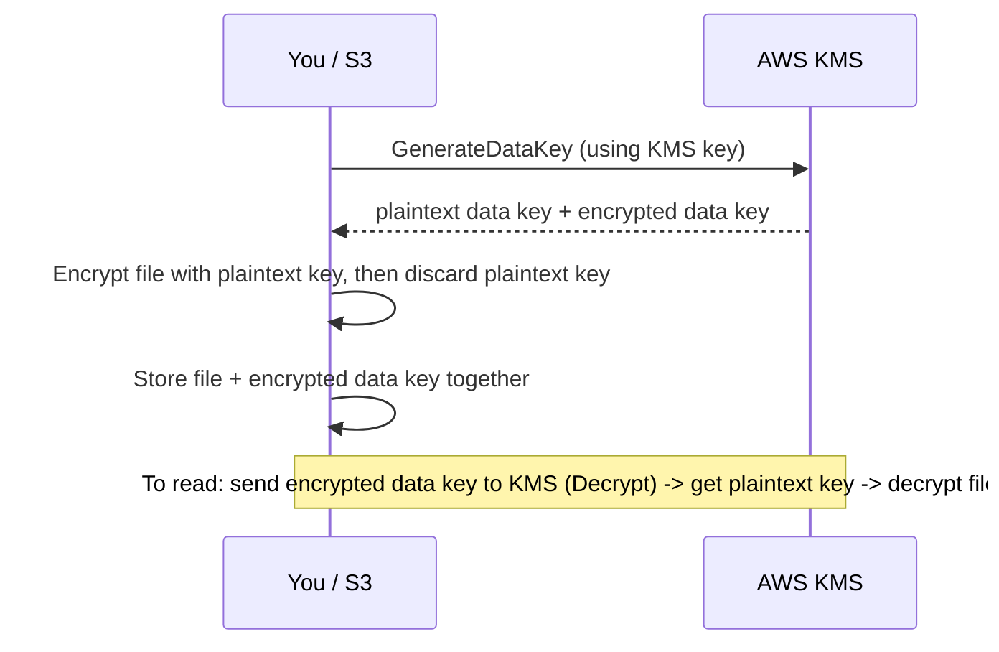
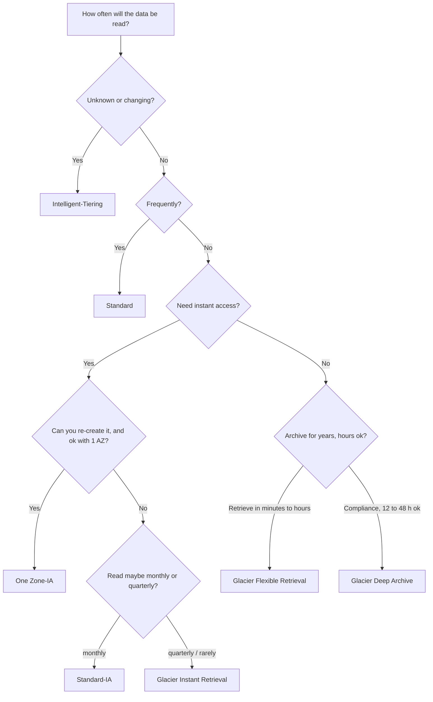
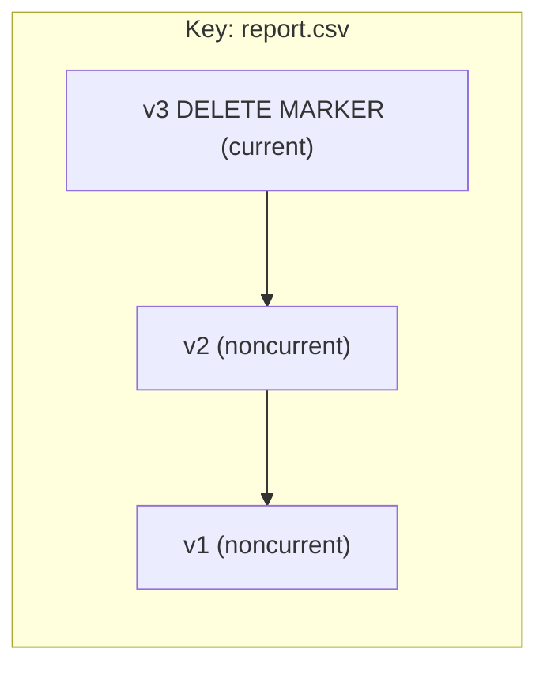
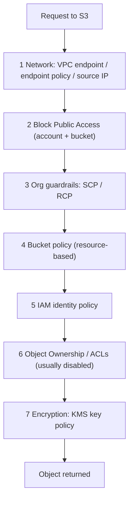
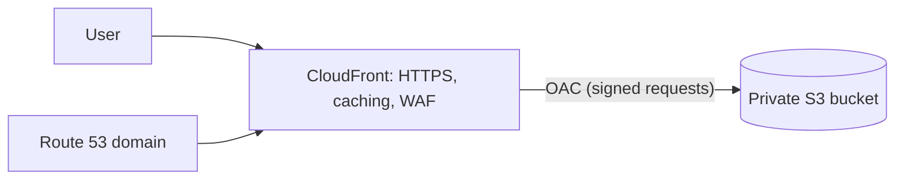
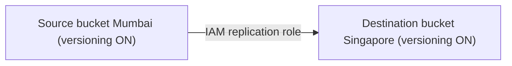
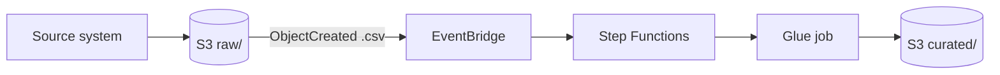
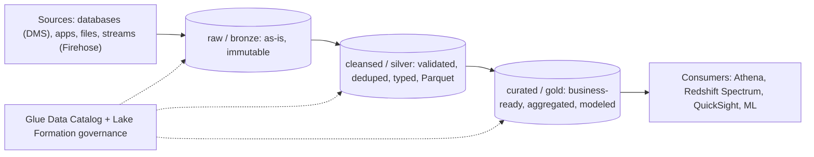
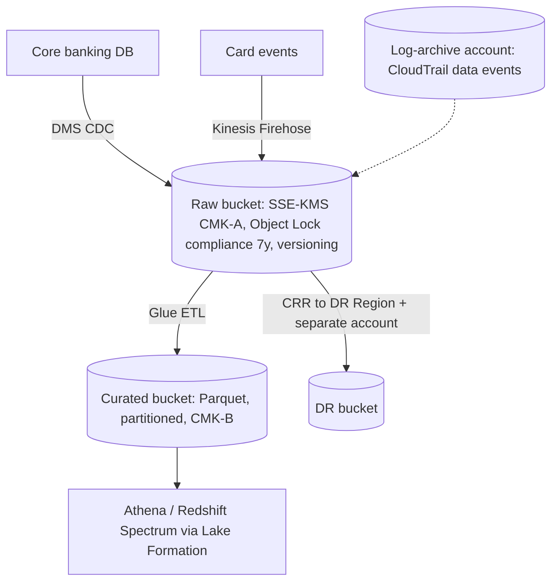

# Amazon S3: Complete Practical Guide (Equivalent to a 5-Hour Lecture)

> **How to use this file:** Read a section, then do its lab in your own AWS account straight away. S3 is learned by uploading, breaking, and fixing things.
> **Cost:** Almost every lab uses a few KB or MB, which costs a fraction of a rupee. The bigger items are flagged (Lab 10 replication, Lab 12 multipart, Lab 14 Object Lock) and each ends with cleanup. **Always run the cleanup in Section 30.**
> **Placeholders:** `BUCKET` = your bucket name. `ACCOUNT_ID` = your 12-digit account number. Set them once in CloudShell (Lab 0) and reuse.
> **Audience:** Beginner to job-ready. Covers SAA-C03 and DEA-C01 S3 topics, plus real data-lake practice.
> **Prices and limits** change. Where I give numbers, treat them as "approximately right" and verify on the S3 pricing page and Service Quotas before relying on them.

---

## Table of Contents

**Part A: Prerequisites (do not skip)**
1. Three kinds of storage: block, file, object
2. HTTP and REST in 5 minutes
3. Key-value thinking
4. Durability vs Availability vs Consistency
5. Encryption basics (TLS, symmetric keys, envelope encryption, KMS)
6. Data file formats (CSV, JSON, Parquet) and why they matter
7. Hot, warm, cold data and tiering
8. Recap: Regions, AZs, and IAM you need

**Part B: S3 Core**
9. What is S3 and why it is the heart of AWS data engineering
10. Buckets, objects, keys, prefixes (the "folders are an illusion" lesson)
11. Lab 0 and Lab 1: Setup and create your first bucket
12. Working with objects + Lab 2
13. Consistency, limits, and object anatomy
14. Storage classes + Lab 3
15. Versioning + Lab 4
16. Lifecycle management + Lab 5
17. Encryption + Lab 6
18. Security and access control + Lab 7 (policies, Block Public Access, presigned URLs, access points)
19. Static website hosting + Lab 8
20. Replication + Lab 9
21. Event notifications + Lab 10
22. Performance (prefixes, multipart, Transfer Acceleration, byte-range) + Lab 11
23. Object Lock and data protection + Lab 12
24. Monitoring, logging, inventory, Storage Lens
25. Pricing and cost optimization
26. **S3 for Data Engineering** (lake layout, partitions, Parquet, small files, integrations) + Lab 13
27. Data transfer and migration tools
28. Troubleshooting
29. Real-world architectures (bank, hospital, enterprise)
30. Cleanup (versioned buckets need special care)
31. Best practices checklist
32. Exam cheat sheet and 25 practice questions
33. Interview questions and final checklist

---

# PART A: PREREQUISITES

---

## 1. Three Kinds of Storage: Block, File, Object

You must know why S3 is different, otherwise its design rules feel random.

| Type | How data is organized | Typical use | AWS service |
|---|---|---|---|
| **Block** | Fixed-size blocks on a "disk"; an OS formats it | OS disks, databases | **EBS** (attached to one EC2) |
| **File** | Folders and files, shared over a network, normal paths | Shared drives, home folders | **EFS**, FSx |
| **Object** | Flat pool of **objects**, each = data + metadata + unique key, accessed over HTTP APIs | Backups, media, logs, data lakes, static websites | **S3** |

```
Block (EBS):   [disk of blocks] -> OS mounts as C:\ or /dev/xvdf -> edit bytes inside a file in place
File (EFS):    /shared/reports/q3.xlsx -> many servers mount the same folder
Object (S3):   PUT sales.csv -> stored whole as an object. You replace the whole object; you don't edit bytes inside it.
```

**Consequences for S3 (memorize):**
- You **cannot append to or edit part of** an object. To change a file you upload a **new version of the entire object**.
- S3 is **not a file system** (no real folders, no file locking, no `rename`; "rename" = copy + delete).
- S3 scales almost without limit and is cheap, because it avoids those file-system features.

---

## 2. HTTP and REST in 5 Minutes

S3 is accessed over **HTTPS** with a REST API. Every console click and CLI command becomes an HTTP request.

| HTTP verb | Meaning | S3 operation |
|---|---|---|
| `GET` | Read | Download an object, list a bucket |
| `PUT` | Create or replace | Upload an object |
| `DELETE` | Remove | Delete an object |
| `HEAD` | Read metadata only | Check if an object exists, get size |
| `POST` | Submit | Multipart upload completion, browser form uploads |

Status codes you will see in S3:

| Code | Meaning in S3 practice |
|---|---|
| **200** | OK |
| **204** | Success, no content (delete) |
| **301** | Wrong Region endpoint (bucket is elsewhere) |
| **403** | **Forbidden**: you are not allowed (permissions, policy, KMS, Block Public Access) |
| **404** | Not found: bucket or key doesn't exist |
| **409** | Conflict (e.g., bucket name already taken, bucket not empty) |
| **503 SlowDown** | You are sending requests too fast for a prefix; slow down/retry |

> **Practical trap:** If you do **not** have `s3:ListBucket` permission and request a key that **doesn't exist**, S3 returns **403** (not 404), to avoid leaking whether the key exists. Many debugging sessions start with this confusion.

---

## 3. Key-Value Thinking

S3 is basically a giant **key-value store**:

```
KEY   (unique name)                   VALUE (the data)         + METADATA
raw/sales/2026/10/01/sales.csv   -->  [bytes of the file]      content-type, size, timestamps, tags...
```
The "path" is just a long **key name** containing slashes. There is **no real directory tree**. Section 10 shows how this affects you.

---

## 4. Durability vs Availability vs Consistency

Three words that sound similar and are tested constantly.

| Term | Question | S3 Standard answer |
|---|---|---|
| **Durability** | Will my data **survive** (not be lost/corrupted)? | **99.999999999% (11 nines)** per year. Store 10 million objects, expect to lose about one every 10,000 years. |
| **Availability** | Can I **access** it right now? | **99.99%** for Standard (SLA: 99.9%); lower for cheaper classes |
| **Consistency** | After I write, do I **read the latest**? | **Strong read-after-write consistency** for all operations (since Dec 2020) |

How 11 nines is achieved: S3 automatically **stores copies across at least 3 Availability Zones** in the Region (except One Zone classes) and constantly checks data integrity (checksums) and repairs.

**Strong consistency means:**
- You `PUT` a new object, then immediately `GET` or `LIST` → you see it.
- You overwrite an object, then `GET` → you get the **new** data (never stale).
- You delete, then `GET` → 404.
(Old exam material says S3 had eventual consistency for overwrites and deletes. That is outdated.)

**Note:** Bucket **configuration** changes (policy, versioning toggles) can still take a short time to propagate.

---

## 5. Encryption Basics

You need five ideas to understand S3's encryption options:

1. **Encryption in transit:** data encrypted while moving over the network. Done with **TLS** (the "S" in HTTPS). Force it in S3 with a policy that denies `aws:SecureTransport=false`.
2. **Encryption at rest:** data encrypted while stored on disk.
3. **Symmetric encryption (AES-256):** one secret key both encrypts and decrypts. Fast. Used for the data itself.
4. **Envelope encryption:** (a) generate a one-time **data key** to encrypt your data, (b) encrypt that data key with a **master key** (kept safe in KMS), (c) store the encrypted data key beside the data. Only KMS can unwrap it. Reason: you never send huge data to KMS, only small keys.
5. **AWS KMS (Key Management Service):** managed service holding master keys ("KMS keys"), controlling who may use them with **key policies + IAM**, and logging every use in **CloudTrail**.



---

## 6. Data File Formats and Why They Matter

Data engineers choose formats constantly. Know the difference now; Section 26 builds on it.

| Format | Layout | Splittable? | Compression | Schema | Best for |
|---|---|---|---|---|---|
| **CSV** | Row-based text | Yes (uncompressed or bzip2) | Poor | None (header only) | Small data, exchange with humans |
| **JSON** | Row-based text, nested | Line-delimited yes | Poor | Self-describing | APIs, logs, semi-structured |
| **Avro** | Row-based binary | Yes | Good | Schema stored in file, evolves well | Streaming/Kafka, write-heavy |
| **Parquet** | **Columnar** binary | Yes | **Excellent** | Embedded | **Analytics (Athena, Redshift Spectrum, Spark)** |
| **ORC** | **Columnar** binary | Yes | Excellent | Embedded | Hive/Spark/EMR analytics |

**Row vs columnar (the key idea):**
```
Table: txn_id | customer | amount | date
Row storage:     [1,Asha,2500,Oct1] [2,Ravi,1800,Oct1] ...  (reads every column for each row)
Columnar:        txn_id:[1,2,3...] customer:[Asha,Ravi...] amount:[2500,1800...]  (reads only the columns you ask for)
```
Query `SELECT SUM(amount)` on columnar data reads only the `amount` column. Less data scanned = faster and cheaper (Athena bills by data scanned).

---

## 7. Hot, Warm, Cold Data and Tiering

Data's value and access frequency change over time.

| Temperature | Access pattern | Example | Storage choice |
|---|---|---|---|
| **Hot** | Daily/constantly | Today's transactions | S3 Standard |
| **Warm** | Occasionally | Last quarter's reports | Standard-IA / Intelligent-Tiering |
| **Cold** | Rarely (compliance) | 7-year bank records | Glacier / Deep Archive |

S3 storage classes and lifecycle rules exist to move data from hot to cold automatically and save money.

---

## 8. Recap: Regions, AZs, IAM

- A **bucket lives in one Region**; its data is copied across multiple AZs there (except One Zone classes). Data never leaves the Region unless you replicate it.
- **IAM:** S3 permissions come from IAM identity policies, **bucket policies** (resource-based), and a few legacy ACLs. If you did the IAM notes, you already know the evaluation logic (explicit deny wins, same-account union, cross-account both sides).
- **S3 ARNs:** `arn:aws:s3:::BUCKET` (bucket-level actions like `s3:ListBucket`) and `arn:aws:s3:::BUCKET/*` (object-level actions like `s3:GetObject`).

---

# PART B: S3 CORE

---

## 9. What is S3?

**Amazon Simple Storage Service (S3)** is a fully managed, **virtually unlimited**, highly durable **object storage** service accessed through APIs. It launched in 2006 and is the **foundation of the AWS data lake**.

**Why S3 is central to data engineering:**
- Separates **storage from compute**: store once cheaply, process with many engines (Athena, Glue, EMR, Redshift Spectrum, SageMaker) without copying.
- Practically **unlimited scale**, 11-nines durability, pay for what you store.
- Integrates with everything: Kinesis Firehose lands data there, DMS writes there, Lake Formation governs it, Glue catalogs it.

**Common uses:** data lakes, backup/archive, log storage, static websites, software distribution, application data, media, ML training data.

---

## 10. Buckets, Objects, Keys, Prefixes

### 10.1 Definitions
| Term | Meaning |
|---|---|
| **Bucket** | A container for objects. Has a **globally unique name** and lives in **one Region**. |
| **Object** | The thing stored: data + metadata (+ version ID, tags). Size 0 bytes to **5 TB**. |
| **Key** | The object's full name inside the bucket, e.g. `raw/sales/2026/10/sales.csv`. Max **1,024 bytes** (UTF-8). |
| **Prefix** | The leading part of a key, e.g. `raw/sales/2026/`. Used to group and filter. |
| **Delimiter** | A character (usually `/`) used by the console/CLI to **show** prefixes as folders. |
| **Metadata** | System metadata (size, last-modified, content-type, ETag) and optional user metadata (`x-amz-meta-*`). |
| **Tags** | Up to 10 key-value tags per object (used for lifecycle, access control, cost allocation). |
| **Version ID** | Unique ID per version if versioning is on. |

### 10.2 Bucket naming rules
- **Globally unique** across all AWS accounts (all Regions of that partition). Add your name + random number.
- 3-63 characters; lowercase letters, numbers, hyphens, (dots allowed but avoid them); start and end with a letter or number.
- **No underscores**, no uppercase, not formatted like an IP address.
- Name can't be changed later. To "rename," create a new bucket and copy.
- Default quota: thousands of buckets per account (the default was recently raised well above the old 100; check Service Quotas).

### 10.3 URL formats
```
Virtual-hosted style (current):  https://BUCKET.s3.ap-south-1.amazonaws.com/raw/sales.csv
Path style (legacy):             https://s3.ap-south-1.amazonaws.com/BUCKET/raw/sales.csv
S3 URI (used by CLI/tools):      s3://BUCKET/raw/sales.csv
```

### 10.4 "Folders are an illusion" (core concept)
S3 has a **flat structure**. When you "create a folder" in the console, S3 just creates a **0-byte object** whose key ends in `/` (like `raw/`), purely as a visual marker. Uploading `raw/sales/a.csv` works even if `raw/` was never created.

```
Flat reality in the bucket:
  raw/sales/2026/10/a.csv
  raw/sales/2026/10/b.csv
  raw/customers/c.csv
  curated/sales/part-0000.parquet

Console/CLI group them by splitting on "/" -> shows a tree. There's no tree in storage.
```
**Why it matters:**
- "Renaming/moving a folder" with millions of objects = copy **each** object then delete each, which is slow and costs requests.
- Listing "a folder" = listing keys by **prefix**.
- Performance and access control are based on **prefixes**.

---

## 11. LAB 0 and LAB 1: Setup and Your First Bucket

### Lab 0: Environment
1. Sign in as your **IAM admin user** (not root). Region: **Asia Pacific (Mumbai) ap-south-1**.
2. Open **CloudShell**. Run:
```bash
aws sts get-caller-identity
export AWS_DEFAULT_REGION=ap-south-1
ACCOUNT_ID=$(aws sts get-caller-identity --query Account --output text)
BUCKET=s3lab-yourname-$RANDOM
echo "ACCOUNT_ID=$ACCOUNT_ID  BUCKET=$BUCKET"
```
> CloudShell loses your shell variables if the session restarts. **Write down your BUCKET name** and re-export it: `BUCKET=s3lab-yourname-12345`.

3. Create sample files:
```bash
mkdir -p ~/s3lab && cd ~/s3lab
cat > sales_oct01.csv << 'EOF'
order_id,customer,amount,status
1,Asha,2500,PAID
2,Ravi,1800,FAILED
3,Meena,3200,PAID
EOF
cat > sales_oct02.csv << 'EOF'
order_id,customer,amount,status
4,Ravi,900,PAID
5,John,4100,PAID
EOF
echo "salary: confidential" > salary.txt
ls -l
```

### Lab 1: Create a bucket (console, then inspect)

**Console path**
```
S3 > Create bucket
Bucket type: General purpose
Bucket name: <your BUCKET value>
AWS Region: Asia Pacific (Mumbai) ap-south-1
Object Ownership: ACLs disabled (Bucket owner enforced)   <- recommended default
Block Public Access: [x] Block ALL public access           <- leave ON
Bucket Versioning: Disable (we will enable later)
Default encryption: SSE-S3 (Amazon S3 managed keys)
Create bucket
```
Open the bucket and look at each tab: **Objects, Metadata, Properties, Permissions, Metrics, Management, Access Points**.
- **Properties:** Region, ARN (`arn:aws:s3:::BUCKET`), versioning, tags, default encryption, Object Lock, Transfer Acceleration, event notifications, static website hosting.
- **Permissions:** Block Public Access, bucket policy, Object Ownership, ACL, CORS.
- **Management:** lifecycle rules, replication rules, inventory.

**CLI path (alternative way to create)**
```bash
# If the bucket already exists from the console, skip this. Otherwise:
aws s3 mb s3://$BUCKET --region ap-south-1          # high-level command
# or, equivalent lower-level API for the same:
# aws s3api create-bucket --bucket $BUCKET --region ap-south-1 \
#     --create-bucket-configuration LocationConstraint=ap-south-1
aws s3 ls                                           # list your buckets
aws s3api get-public-access-block --bucket $BUCKET
aws s3api get-bucket-encryption --bucket $BUCKET
aws s3api get-bucket-versioning --bucket $BUCKET    # empty output = never enabled
```
> **Region note:** For `us-east-1` you omit `LocationConstraint`; for every other Region it is **required** in `create-bucket` (a classic exam/tooling quirk).

**Understand `s3` vs `s3api`**
| CLI group | Level | Examples |
|---|---|---|
| `aws s3` | High-level, friendly (sync, cp, mv, rm, ls, presign) | `aws s3 cp`, `aws s3 sync` |
| `aws s3api` | 1-to-1 with REST APIs, full control | `put-bucket-policy`, `list-object-versions` |
| `aws s3control` | Account-level and Batch Operations / Access Points | |

---

## 12. Working with Objects

### 12.1 Operations
| Operation | Meaning |
|---|---|
| **PUT / Upload** | Create/replace an object. Single `PUT` up to **5 GB**; use **multipart** beyond that (required) and for >100 MB (recommended). |
| **GET / Download** | Read an object; supports **byte-range** requests |
| **HEAD** | Get metadata without the body |
| **LIST** | List keys under a prefix (up to 1,000 per call; paginated) |
| **COPY** | Server-side copy (also used to "move" or change class/metadata) |
| **DELETE** | Remove an object (with versioning: adds a delete marker) |

### LAB 2: Upload, prefixes, metadata, tags, sync

```bash
cd ~/s3lab

# 1) Upload with "folder" prefixes
aws s3 cp sales_oct01.csv s3://$BUCKET/raw/sales/2026/10/01/sales.csv
aws s3 cp sales_oct02.csv s3://$BUCKET/raw/sales/2026/10/02/sales.csv
aws s3 cp salary.txt      s3://$BUCKET/confidential/salary.txt

# 2) List the way a "folder tree" looks
aws s3 ls s3://$BUCKET/
aws s3 ls s3://$BUCKET/raw/
aws s3 ls s3://$BUCKET/raw/sales/2026/10/ 
aws s3 ls s3://$BUCKET/ --recursive --human-readable --summarize
```
Notice: `raw/` shows as `PRE raw/`. "PRE" = prefix, not a real folder.

```bash
# 3) Prove folders aren't real: list the underlying keys
aws s3api list-objects-v2 --bucket $BUCKET --query 'Contents[].Key'
```
You will see only 3 keys. No `raw/` object exists, because we never created one.

```bash
# 4) Create a console-style "folder marker" and see it appear as a real 0-byte object
aws s3api put-object --bucket $BUCKET --key emptyfolder/
aws s3api list-objects-v2 --bucket $BUCKET --prefix emptyfolder/ --query 'Contents[].[Key,Size]'
```

```bash
# 5) Metadata and content-type
aws s3 cp sales_oct01.csv s3://$BUCKET/meta/sales.csv \
   --metadata dept=finance,owner=asha --content-type text/csv
aws s3api head-object --bucket $BUCKET --key meta/sales.csv
```
Output includes `ContentLength`, `ETag`, `LastModified`, `ContentType`, and `Metadata: {dept, owner}`.

```bash
# 6) Tags
aws s3api put-object-tagging --bucket $BUCKET --key meta/sales.csv \
  --tagging 'TagSet=[{Key=classification,Value=internal},{Key=project,Value=learning}]'
aws s3api get-object-tagging --bucket $BUCKET --key meta/sales.csv
```

```bash
# 7) Download, byte-range, copy, delete
aws s3 cp s3://$BUCKET/raw/sales/2026/10/01/sales.csv ./downloaded.csv
aws s3api get-object --bucket $BUCKET --key raw/sales/2026/10/01/sales.csv --range bytes=0-19 part.txt
cat part.txt        # only the first 20 bytes
aws s3 cp s3://$BUCKET/raw/sales/2026/10/01/sales.csv s3://$BUCKET/backup/sales.csv     # server-side copy
aws s3 mv s3://$BUCKET/backup/sales.csv s3://$BUCKET/archive/sales.csv                  # copy + delete
aws s3 rm s3://$BUCKET/archive/sales.csv
```

```bash
# 8) sync: the data engineer's favorite
mkdir -p localdata && cp sales_oct0*.csv localdata/
aws s3 sync localdata s3://$BUCKET/synced/               # uploads only new/changed files
aws s3 sync localdata s3://$BUCKET/synced/ --dryrun      # shows nothing to do
echo "3rd file" > localdata/new.txt
aws s3 sync localdata s3://$BUCKET/synced/ --dryrun      # shows only new.txt
aws s3 sync s3://$BUCKET/synced/ ./restored/ --exclude "*" --include "*.csv"   # filters
```
`--delete` makes the destination mirror the source (removes extra files). **Use `--dryrun` first**; it can delete things.

**Console exercise:** In the S3 console open `raw/sales/2026/10/01/sales.csv`. Look at **Object URL**, **S3 URI**, **ARN**, **ETag**, **Storage class**, **Server-side encryption**, **Versions** tab. Click **Open**: you get **Access Denied** because the object is private (you will fix properly in Lab 7 with presigned URLs).

---

## 13. Consistency, Limits, and Object Anatomy

| Item | Limit / fact |
|---|---|
| Object size | 0 B to **5 TB** |
| Single PUT | up to **5 GB** |
| Multipart | parts **5 MiB to 5 GiB** (last part may be smaller), up to **10,000 parts** |
| Key length | up to **1,024 bytes** |
| User-defined metadata | about **2 KB** |
| Tags | up to **10 per object** |
| Listing page | 1,000 keys per call |
| Request rate | at least **3,500 PUT/COPY/POST/DELETE** and **5,500 GET/HEAD** per second **per prefix** |
| Bucket size | Unlimited |
| ETag | For simple unencrypted/SSE-S3 uploads, usually the MD5; for multipart/KMS it is *not* a simple MD5 |
| Checksums | S3 supports integrity checksums (CRC32, CRC32C, SHA-1, SHA-256, and newer CRC64NVME in recent SDKs) to detect corruption in transit/at rest |

---

## 14. Storage Classes

You choose a **storage class per object**. Trade-off: cheaper storage ⇄ higher retrieval cost / slower access / minimum storage duration.

### 14.1 The classes

| Class | Designed for | Availability | AZs | Retrieval | Min duration | Min billable object size |
|---|---|---|---|---|---|---|
| **S3 Standard** | Frequent access, hot data | 99.99% | ≥3 | Instant, no retrieval fee | none | none |
| **S3 Intelligent-Tiering** | **Unknown/changing** access patterns | 99.9% | ≥3 | Instant (frequent/infrequent/archive-instant tiers) | none | 128 KB for auto-tiering |
| **S3 Standard-IA** (Infrequent Access) | Rarely accessed but needs **instant** access (backups, DR) | 99.9% | ≥3 | Instant, **per-GB retrieval fee** | **30 days** | 128 KB |
| **S3 One Zone-IA** | Re-creatable, infrequently accessed data | 99.5% | **1** | Instant, retrieval fee | **30 days** | 128 KB |
| **S3 Glacier Instant Retrieval** | Archive that is **read rarely but needs milliseconds** (e.g., medical images, quarterly reports) | 99.9% | ≥3 | **Milliseconds** | **90 days** | 128 KB |
| **S3 Glacier Flexible Retrieval** (formerly "Glacier") | Archives where minutes-to-hours is fine | 99.99% | ≥3 | Expedited 1-5 min, Standard 3-5 h, Bulk 5-12 h | **90 days** | (small overhead) |
| **S3 Glacier Deep Archive** | **Cheapest**, long-term compliance (7-10+ years) | 99.99% | ≥3 | Standard ~12 h, Bulk ~48 h | **180 days** | (small overhead) |
| **S3 Express One Zone** | **Ultra-low latency** (single-digit ms), high request rate, ML/analytics hot paths; stored in **directory buckets**, one AZ | 99.95% | 1 | Very fast | none | n/a |

All classes except One Zone (and Express One Zone) give **11 nines durability** across ≥3 AZs. **One Zone** classes keep data in a single AZ, so the data can be lost if that AZ is destroyed.

Also exists: **Reduced Redundancy** (deprecated, ignore), **S3 on Outposts** (S3 in your data center).

### 14.2 Choosing a class (decision flow)


### 14.3 Intelligent-Tiering in detail
- S3 **monitors access** per object and moves it automatically; **no retrieval fees** and no tiering fees, but a small **per-object monitoring charge**.
- Automatic tiers: **Frequent Access** → (30 days no access) **Infrequent Access** → (90 days) **Archive Instant Access**.
- Optional (you enable): **Archive Access** (90+ days) and **Deep Archive Access** (180+ days). These need restore time like Glacier.
- Objects smaller than 128 KB are **not** monitored/auto-tiered (stay at Frequent rates), so it isn't ideal for millions of tiny objects.

### 14.4 Glacier restores
For **Glacier Flexible Retrieval and Deep Archive**, an object is **not directly readable**. You issue a **restore request** that creates a **temporary copy** in Standard for N days:
```bash
aws s3api restore-object --bucket $BUCKET --key archive/old.csv \
  --restore-request '{"Days":2,"GlacierJobParameters":{"Tier":"Bulk"}}'
aws s3api head-object --bucket $BUCKET --key archive/old.csv    # check "Restore": "ongoing-request=\"true\""
```
**Glacier Instant Retrieval** needs **no restore** (that is its selling point).

### LAB 3: Storage classes in action
```bash
cd ~/s3lab
# Upload the same file into different classes
aws s3 cp sales_oct01.csv s3://$BUCKET/classes/standard.csv
aws s3 cp sales_oct01.csv s3://$BUCKET/classes/ia.csv       --storage-class STANDARD_IA
aws s3 cp sales_oct01.csv s3://$BUCKET/classes/onezone.csv  --storage-class ONEZONE_IA
aws s3 cp sales_oct01.csv s3://$BUCKET/classes/it.csv       --storage-class INTELLIGENT_TIERING
aws s3 cp sales_oct01.csv s3://$BUCKET/classes/gir.csv      --storage-class GLACIER_IR
aws s3 cp sales_oct01.csv s3://$BUCKET/classes/glacier.csv  --storage-class GLACIER

# See the class of each object
aws s3api list-objects-v2 --bucket $BUCKET --prefix classes/ \
   --query 'Contents[].[Key,StorageClass,Size]' --output table
```
(Standard shows `STANDARD`.)

```bash
# Read test: which can you download instantly?
aws s3 cp s3://$BUCKET/classes/ia.csv -         # works
aws s3 cp s3://$BUCKET/classes/gir.csv -        # works instantly
aws s3 cp s3://$BUCKET/classes/glacier.csv -    # FAILS: InvalidObjectState (archived object, restore first)
```
Read that error. This is exactly what a data engineer sees when a pipeline reads archived data.

```bash
# Change class of an existing object by copying onto itself
aws s3 cp s3://$BUCKET/classes/standard.csv s3://$BUCKET/classes/standard.csv --storage-class STANDARD_IA
aws s3api head-object --bucket $BUCKET --key classes/standard.csv --query StorageClass

# (Optional) Restore the Glacier object, takes hours for Bulk; just see the request succeed
aws s3api restore-object --bucket $BUCKET --key classes/glacier.csv \
   --restore-request '{"Days":1,"GlacierJobParameters":{"Tier":"Bulk"}}'
aws s3api head-object --bucket $BUCKET --key classes/glacier.csv
```
**Console exercise:** Select an object > **Actions > Edit storage class**. Note the warning about minimum storage durations and class change = a new copy.

**Observe the cost trap:** a tiny file in Glacier/IA is billed as at least 128 KB for IA classes and incurs minimum-duration charges. Cheap classes are for **large, long-lived** objects. Millions of tiny files in Glacier = expensive and slow.

---

## 15. Versioning

### 15.1 Concept
**Versioning** keeps **every version** of an object in the same bucket. It protects from accidental overwrite and deletion.

States: **Unversioned (default)** → **Enabled** → **Suspended**.
- **Once enabled you can never return to "unversioned"**, only **suspend**.
- Objects uploaded before enabling have version ID **`null`**.
- Suspending doesn't delete old versions; new uploads get version ID `null`, overwriting the previous null version.

### 15.2 What happens on operations (with versioning enabled)

| Action | Result |
|---|---|
| Upload an existing key | **New version** created; old version kept (noncurrent) |
| `DELETE key` (no version ID) | S3 adds a **delete marker** as the latest version; the data is **hidden but not deleted**. Normal GET returns 404. |
| `DELETE key?versionId=X` | **Permanently deletes that version** (cannot be undone, unless Object Lock/MFA delete prevents it) |
| Delete the **delete marker** | The previous version becomes current again, which means a **restore** |


GET sees "deleted". Remove `v3` (the marker) and `v2` is the current version again.

### 15.3 MFA Delete
An extra protection: permanently deleting versions or changing versioning state requires **MFA** from the **bucket owner (root user)**. Enabled via CLI only. Rare, mainly an exam fact.

### 15.4 Cost note
Every version is billed as storage. A 1 GB file overwritten 10 times = ~10 GB stored. Pair versioning with lifecycle rules to expire old versions (Lab 5).

### LAB 4: Versioning, delete markers, recovery
```bash
cd ~/s3lab
# 1) Enable versioning
aws s3api put-bucket-versioning --bucket $BUCKET --versioning-configuration Status=Enabled
aws s3api get-bucket-versioning --bucket $BUCKET

# 2) Create 3 versions of one key
echo "version 1" > v.txt && aws s3 cp v.txt s3://$BUCKET/ver/report.txt
echo "version 2" > v.txt && aws s3 cp v.txt s3://$BUCKET/ver/report.txt
echo "version 3" > v.txt && aws s3 cp v.txt s3://$BUCKET/ver/report.txt

# 3) List all versions
aws s3api list-object-versions --bucket $BUCKET --prefix ver/report.txt \
  --query 'Versions[].[VersionId,IsLatest,LastModified]' --output table
aws s3 cp s3://$BUCKET/ver/report.txt -          # prints "version 3"
```
Console: open the object > **Versions** tab, toggle **List versions** on the object list.

```bash
# 4) Normal delete = delete marker
aws s3 rm s3://$BUCKET/ver/report.txt
aws s3 cp s3://$BUCKET/ver/report.txt -          # 404 NoSuchKey: looks deleted
aws s3api list-object-versions --bucket $BUCKET --prefix ver/report.txt \
  --query '{Versions:Versions[].[VersionId,IsLatest],Markers:DeleteMarkers[].[VersionId,IsLatest]}'
```
You see the three versions still present plus one **DeleteMarker** that `IsLatest: true`.

```bash
# 5) RESTORE by removing the delete marker
MARKER=$(aws s3api list-object-versions --bucket $BUCKET --prefix ver/report.txt \
   --query 'DeleteMarkers[0].VersionId' --output text)
aws s3api delete-object --bucket $BUCKET --key ver/report.txt --version-id $MARKER
aws s3 cp s3://$BUCKET/ver/report.txt -          # "version 3" is back!

# 6) Get an old version
V1=$(aws s3api list-object-versions --bucket $BUCKET --prefix ver/report.txt \
   --query 'Versions[-1].VersionId' --output text)
aws s3api get-object --bucket $BUCKET --key ver/report.txt --version-id $V1 old.txt && cat old.txt
```
```bash
# 7) Permanently delete one version (dangerous in real life)
aws s3api delete-object --bucket $BUCKET --key ver/report.txt --version-id $V1
```
**Lesson for interviews:** "Accidentally deleted file? With versioning, delete marker + remove marker = recovery. Without it, the data is gone."

**Also notice:** `aws s3 rb s3://$BUCKET --force` does **not** remove versions, so a versioned bucket can't be deleted that way. See Section 30.

---

## 16. Lifecycle Management

### 16.1 What it does
**Lifecycle rules** automate **transitions** (move to cheaper classes) and **expirations** (delete) based on object **age**, **prefix**, **tags**, or **size**.

Actions:
| Action | Meaning |
|---|---|
| **Transition current versions** | After N days since creation, move to IA / Glacier etc. |
| **Transition noncurrent versions** | After N days of being noncurrent |
| **Expire current versions** | Delete (or add delete marker if versioned) after N days |
| **Permanently delete noncurrent versions** | Keep only X newest noncurrent versions / after N days |
| **Remove expired delete markers** | Clean up markers with no versions behind them |
| **Abort incomplete multipart uploads** | Delete leftover parts (they cost money invisibly!) |

### 16.2 Rules to remember
- **Waterfall** direction only: Standard → IA → Intelligent-Tiering → One Zone-IA → Glacier IR → Glacier Flexible → Deep Archive. You can't lifecycle "up".
- **Standard → Standard-IA / One Zone-IA requires at least 30 days** since creation.
- Minimum storage duration charges still apply when transitioning to IA (30 days), Glacier IR/Flexible (90), Deep Archive (180).
- Lifecycle runs once per day roughly; actions are not instant, and rules apply at midnight UTC boundaries for day counts.
- Small objects: newer behavior avoids transitioning objects under 128 KB by default (they cost more in IA than they save).
- Lifecycle transitions and expirations are free of the *retrieval* fee but incur per-request transition charges, which add up for **billions of tiny objects**.

### 16.3 Example policy for a data lake (real design)
| Prefix | Rule |
|---|---|
| `raw/` | → Standard-IA at 30 days → Glacier Flexible at 90 days → expire at 7 years (compliance) |
| `curated/` | → Intelligent-Tiering immediately (access varies) |
| `athena-results/` | Expire at 7 days (query outputs are disposable) |
| Whole bucket | Abort incomplete multipart uploads after 7 days; delete noncurrent versions after 30 days |

### LAB 5: Create lifecycle rules (console + JSON via CLI)

**Console:**
```
S3 > BUCKET > Management > Lifecycle rules > Create lifecycle rule
Name: raw-tiering
Scope: Limit to a prefix: raw/
Actions: [x] Move current versions between storage classes
         [x] Expire current versions of objects
         [x] Delete incomplete multipart uploads
Transitions: Standard-IA after 30 days; Glacier Flexible Retrieval after 90 days
Expire current versions after 365 days
Incomplete multipart uploads: delete after 7 days
Acknowledge the warnings > Create rule
```
**CLI (JSON):**
```bash
cat > lifecycle.json << 'EOF'
{
  "Rules": [
    {
      "ID": "raw-tiering",
      "Status": "Enabled",
      "Filter": { "Prefix": "raw/" },
      "Transitions": [
        { "Days": 30, "StorageClass": "STANDARD_IA" },
        { "Days": 90, "StorageClass": "GLACIER" }
      ],
      "Expiration": { "Days": 365 }
    },
    {
      "ID": "athena-results-cleanup",
      "Status": "Enabled",
      "Filter": { "Prefix": "athena-results/" },
      "Expiration": { "Days": 7 }
    },
    {
      "ID": "bucket-hygiene",
      "Status": "Enabled",
      "Filter": { "Prefix": "" },
      "NoncurrentVersionExpiration": { "NoncurrentDays": 30 },
      "AbortIncompleteMultipartUpload": { "DaysAfterInitiation": 7 }
    }
  ]
}
EOF
aws s3api put-bucket-lifecycle-configuration --bucket $BUCKET --lifecycle-configuration file://lifecycle.json
aws s3api get-bucket-lifecycle-configuration --bucket $BUCKET
```
**You can't wait 30 days in a lab**, so understand by reading the rule against objects: an object at `raw/sales/...` created today moves to IA on day 30, Glacier on day 90, and is deleted on day 365. Tag-based rule example (`Filter: {"Tag": {"Key":"archive","Value":"true"}}`) is another common pattern.

**Exercise:** Write on paper the cost implication of moving 10 TB from Standard to Deep Archive and then needing it back (retrieval fees + 12-hour wait). Lifecycle is a **bet on access patterns**.

---

## 17. Encryption

### 17.1 Everything is encrypted by default now
Since January 2023, **all new objects are encrypted at rest automatically with SSE-S3** at no extra cost. You can't turn this off; you can **choose a different method** as the default.

### 17.2 The server-side options

| Method | Who holds the key | Key mgmt effort | Audit trail | Notes |
|---|---|---|---|---|
| **SSE-S3** | S3 (AES-256, keys managed by AWS) | None | No per-use key logs | **Default**, free |
| **SSE-KMS** | **AWS KMS** key (AWS managed `aws/s3` or your **customer managed key, CMK**) | Medium | **CloudTrail logs every key use**, key policy control, rotation | KMS API costs and **request quotas/throttling** at high scale. Use **S3 Bucket Keys** to cut KMS calls (up to ~99%) |
| **DSSE-KMS** | KMS, **two layers** of encryption | Medium | Yes | For strict compliance needing dual-layer |
| **SSE-C** | **You** supply the key on every request (HTTPS required) | High | n/a | AWS never stores the key; lose it = lose data. Newer buckets may have SSE-C disabled by default, so check current guidance. |
| **Client-side** | You encrypt before upload | Highest | n/a | S3 stores ciphertext only |

### 17.3 SSE-KMS access requirements (huge in practice)
To read an SSE-KMS object, a principal needs **both**:
1. `s3:GetObject` on the object, **and**
2. `kms:Decrypt` on the KMS key (key policy or IAM).

To write: `s3:PutObject` **and** `kms:GenerateDataKey` (plus `kms:Decrypt` for multipart).
**Classic failure:** Glue/Athena/Lambda role has S3 permissions but lacks KMS permissions → `AccessDenied` that looks like an S3 error.

### 17.4 Enforcing encryption
Bucket policy examples:
```json
{
  "Version": "2012-10-17",
  "Statement": [
    {
      "Sid": "DenyNonTLS",
      "Effect": "Deny",
      "Principal": "*",
      "Action": "s3:*",
      "Resource": ["arn:aws:s3:::BUCKET", "arn:aws:s3:::BUCKET/*"],
      "Condition": { "Bool": { "aws:SecureTransport": "false" } }
    },
    {
      "Sid": "DenyWrongEncryptionType",
      "Effect": "Deny",
      "Principal": "*",
      "Action": "s3:PutObject",
      "Resource": "arn:aws:s3:::BUCKET/*",
      "Condition": {
        "StringNotEqualsIfExists": { "s3:x-amz-server-side-encryption": "aws:kms" }
      }
    }
  ]
}
```
(The second statement says: if a request specifies an encryption header, it must be `aws:kms`. Because every object is encrypted anyway, regulated environments set **default encryption to SSE-KMS** and use policy to prevent weaker choices.)

### LAB 6: Encryption: inspect, change default, SSE-KMS with the AWS-managed key

```bash
cd ~/s3lab
# 1) What encryption does an object have?
aws s3api head-object --bucket $BUCKET --key raw/sales/2026/10/01/sales.csv \
  --query '{SSE:ServerSideEncryption,KMS:SSEKMSKeyId}'
# SSE: "AES256"  => SSE-S3 (the automatic default)

# 2) Upload one object explicitly with SSE-KMS using the AWS managed key (free key, per-request KMS charges only)
aws s3 cp sales_oct01.csv s3://$BUCKET/enc/kms.csv --sse aws:kms
aws s3api head-object --bucket $BUCKET --key enc/kms.csv \
  --query '{SSE:ServerSideEncryption,KMS:SSEKMSKeyId,BucketKey:BucketKeyEnabled}'
# SSE: "aws:kms", KMS: arn:aws:kms:ap-south-1:...:key/<id>   (alias aws/s3)

# 3) Change bucket DEFAULT encryption to SSE-KMS with Bucket Keys enabled
cat > enc.json << 'EOF'
{
  "Rules": [{
    "ApplyServerSideEncryptionByDefault": { "SSEAlgorithm": "aws:kms" },
    "BucketKeyEnabled": true
  }]
}
EOF
aws s3api put-bucket-encryption --bucket $BUCKET --server-side-encryption-configuration file://enc.json
aws s3api get-bucket-encryption --bucket $BUCKET

aws s3 cp sales_oct02.csv s3://$BUCKET/enc/default-kms.csv
aws s3api head-object --bucket $BUCKET --key enc/default-kms.csv --query ServerSideEncryption   # aws:kms
```
**Important:** Changing the default encryption **does not re-encrypt existing objects**. To re-encrypt, **copy them onto themselves** (or use S3 Batch Operations for millions).
```bash
aws s3 cp s3://$BUCKET/raw/sales/2026/10/01/sales.csv s3://$BUCKET/raw/sales/2026/10/01/sales.csv --sse aws:kms
```

**Console:** Properties > Default encryption > Edit. Explore the **customer managed key** option (creating a CMK costs about $1/month per key, prorated, so for labs prefer the AWS managed key; if you do create one, schedule deletion afterward with a 7-day waiting period).

**Prove the KMS permission requirement (optional but powerful):**
Create an IAM user or role with only S3 read permissions (like `S3ReadRawOnly` from the IAM lab) and try reading `enc/kms.csv` encrypted with the **customer managed key** that denies them: you get `AccessDenied` on KMS even though the S3 policy permits `GetObject`. (With the AWS-managed `aws/s3` key, access is delegated via S3 for principals allowed to use S3, so this failure is clearest with a CMK.)

---

## 18. Security and Access Control

### 18.1 The layers (think of a castle)

A request must clear **every** layer that applies.

### 18.2 Block Public Access (BPA)
Four switches, on by default for new buckets, also settable at **account level**:
| Setting | Effect |
|---|---|
| `BlockPublicAcls` | Reject new public ACLs |
| `IgnorePublicAcls` | Ignore existing public ACLs |
| `BlockPublicPolicy` | Reject bucket policies that grant public access |
| `RestrictPublicBuckets` | Restrict access to a public-policy bucket to AWS services and authorized users |
**Keep all four ON** unless you are deliberately hosting public content (Lab 8). Turn it on at the **account** level for guaranteed protection.

### 18.3 Object Ownership and ACLs
- **ACLs** are a legacy mechanism. Since April 2023, new buckets default to **"Bucket owner enforced"**, which **disables ACLs**; the bucket owner owns all objects and access is controlled only by policies.
- Why it matters: in cross-account uploads under the old model, the uploader owned the object and the bucket owner couldn't read it. Bucket owner enforced removes this headache.
- Exam angle: "Use bucket policies/IAM, disable ACLs."

### 18.4 Bucket policy patterns
| Goal | Technique |
|---|---|
| Cross-account read | `Principal`: other account role ARN + `s3:GetObject` (and caller's identity policy) |
| Only from my VPC | Condition `aws:SourceVpce` / `aws:SourceVpc` |
| Only my Organization | Condition `aws:PrincipalOrgID` |
| HTTPS only | Deny `aws:SecureTransport=false` |
| Only CloudFront can read | Principal `cloudfront.amazonaws.com` + `AWS:SourceArn` of the distribution (OAC) |
| Require MFA for deletes | Deny with `aws:MultiFactorAuthPresent=false`/`Null` |
| Prefix isolation by tag | `s3:ExistingObjectTag/key` conditions |

### 18.5 Presigned URLs
A **presigned URL** is a time-limited link that lets anyone holding it perform **one specific operation** (GET or PUT) on one object, **using the permissions of the signer**, without having AWS credentials.
- Max validity: up to **7 days** if signed with long-term IAM user credentials; **shorter** (limited by the session) if signed with temporary role credentials.
- If the signer loses permission or their key is deleted, the URL stops working.
- Use: let a customer download a statement; let a browser upload directly to S3 (presigned PUT/POST) without routing through your server.

### 18.6 S3 Access Points
**Access points** are named network endpoints attached to a bucket, each with its **own policy**, simplifying access for hundreds of applications on a shared bucket (e.g., `finance-ap`, `analytics-ap`), and can be restricted to a VPC. **Multi-Region Access Points** give one global endpoint routing to the closest replicated bucket.

### 18.7 VPC endpoints
A **Gateway VPC endpoint for S3** (free) lets resources in private subnets reach S3 **without internet or NAT gateway**, saving NAT cost and keeping traffic on the AWS network. You can attach an **endpoint policy** and require in the bucket policy that access comes only through the endpoint (`aws:SourceVpce`). Interface endpoints (PrivateLink) also exist for on-prem access via VPN/Direct Connect.

### 18.8 Other protections
- **Access Analyzer for S3** flags buckets shared publicly or cross-account.
- **Macie** discovers sensitive data (PII) in S3.
- **CloudTrail data events** log object-level API calls.
- **Object Lock** and **MFA Delete** (Section 23).
- **S3 Access Grants** map corporate directory identities to S3 locations at scale (advanced).

### LAB 7: Bucket policy, BPA, presigned URL, access point

**Part 1: Apply a bucket policy (deny non-TLS)**
```bash
cat > policy.json << EOF
{
  "Version": "2012-10-17",
  "Statement": [{
    "Sid": "DenyNonTLS",
    "Effect": "Deny",
    "Principal": "*",
    "Action": "s3:*",
    "Resource": ["arn:aws:s3:::$BUCKET", "arn:aws:s3:::$BUCKET/*"],
    "Condition": { "Bool": { "aws:SecureTransport": "false" } }
  }]
}
EOF
aws s3api put-bucket-policy --bucket $BUCKET --policy file://policy.json
aws s3api get-bucket-policy --bucket $BUCKET --query Policy --output text
```
Everyday HTTPS access still works. Test: `curl -I http://$BUCKET.s3.ap-south-1.amazonaws.com/raw/sales/2026/10/01/sales.csv` returns **403** (and https without credentials is also 403, since the object is private).

**Part 2: Prove Block Public Access protects you**
Try to make the bucket public:
```bash
cat > public.json << EOF
{
  "Version": "2012-10-17",
  "Statement": [{
    "Sid": "PublicRead", "Effect": "Allow", "Principal": "*",
    "Action": "s3:GetObject", "Resource": "arn:aws:s3:::$BUCKET/*"
  }]
}
EOF
aws s3api put-bucket-policy --bucket $BUCKET --policy file://public.json
```
Expected: **AccessDenied ... BlockPublicPolicy** error. BPA stopped a risky policy. **Restore your deny-TLS policy** afterwards (`put-bucket-policy ... policy.json`).

**Part 3: Presigned URL (share a private file safely)**
```bash
URL=$(aws s3 presign s3://$BUCKET/raw/sales/2026/10/01/sales.csv --expires-in 120)
echo $URL
curl -s "$URL"           # prints the CSV, though object is private!
sleep 125
curl -s "$URL"           # now returns an XML error: Request has expired
```
A presigned URL embeds a signature; **anyone with the link** can fetch it until expiry. Treat it like a password for those minutes.

*Note:* In CloudShell, credentials are temporary, so the URL's life is capped by the credential lifetime. With an IAM user's long-term keys you can choose up to 7 days.

**Presigned upload (PUT) with Python (boto3):**
```python
import boto3, requests
s3 = boto3.client("s3", region_name="ap-south-1")
url = s3.generate_presigned_url(
    "put_object",
    Params={"Bucket": "BUCKET", "Key": "uploads/from-client.txt"},
    ExpiresIn=300,
)
r = requests.put(url, data=b"hello from a client with no AWS credentials")
print(r.status_code)   # 200
```
(`pip install --user requests boto3` if needed.)

**Part 4: Access point (optional)**
```bash
aws s3control create-access-point --account-id $ACCOUNT_ID --name analytics-ap --bucket $BUCKET
aws s3api list-objects-v2 \
  --bucket arn:aws:s3:ap-south-1:$ACCOUNT_ID:accesspoint/analytics-ap --prefix raw/
aws s3control delete-access-point --account-id $ACCOUNT_ID --name analytics-ap
```
You can write a **separate policy per access point** to grant `analytics` team only the `raw/` prefix without editing one giant bucket policy.

**Part 5: Check the 403-vs-404 behaviour**
```bash
aws s3api head-object --bucket $BUCKET --key does/not/exist.csv     # admin has ListBucket -> 404 Not Found
```
Now think: a user **without** `s3:ListBucket` would get **403** for the same request.

---

## 19. Static Website Hosting

S3 can serve a static site (HTML/CSS/JS, no server-side code).
- Enable **Static website hosting**, set **index document** (`index.html`) and optional **error document**.
- The **website endpoint** is **HTTP only** (no HTTPS) and differs from the REST endpoint.
- To serve **HTTPS + custom domain + caching**, front the bucket with **CloudFront**, and keep the bucket **private** using **Origin Access Control (OAC)**. This is the recommended modern architecture and a favorite exam answer.
- For a public website directly from S3 you must relax Block Public Access **for that bucket only** and add a public-read bucket policy.



### LAB 8: Host a static page (short-lived, then delete)
> This deliberately makes one throwaway bucket public. Use a **separate** bucket with harmless content, and delete it at the end of the lab.

```bash
WEB=s3web-yourname-$RANDOM
aws s3 mb s3://$WEB --region ap-south-1
cat > index.html << 'EOF'
<html><body><h1>Hello from S3!</h1><p>Static site hosted on Amazon S3.</p></body></html>
EOF
cat > error.html << 'EOF'
<html><body><h1>404: page not found</h1></body></html>
EOF
aws s3 cp index.html s3://$WEB/ --content-type text/html
aws s3 cp error.html s3://$WEB/ --content-type text/html

# Relax BPA for THIS bucket only (policy-related switches)
aws s3api put-public-access-block --bucket $WEB --public-access-block-configuration \
  BlockPublicAcls=true,IgnorePublicAcls=true,BlockPublicPolicy=false,RestrictPublicBuckets=false

cat > web-policy.json << EOF
{
  "Version": "2012-10-17",
  "Statement": [{
    "Sid": "PublicReadForWebsite", "Effect": "Allow", "Principal": "*",
    "Action": "s3:GetObject", "Resource": "arn:aws:s3:::$WEB/*"
  }]
}
EOF
aws s3api put-bucket-policy --bucket $WEB --policy file://web-policy.json

aws s3 website s3://$WEB/ --index-document index.html --error-document error.html
echo "http://$WEB.s3-website.ap-south-1.amazonaws.com"
```
Open that URL in your browser (copy the exact website endpoint from **S3 > bucket > Properties > Static website hosting** if it differs). You see your page. Try `/nothing` and see the error page. Note it's **http**, not https.

Check what Access Analyzer / the console says: the bucket shows a **"Publicly accessible"** badge. This is the exact label that appears in security audits.

**Cleanup immediately:**
```bash
aws s3 rb s3://$WEB --force
```

---

## 20. Replication

### 20.1 What it is
Automatic, **asynchronous** copying of objects to **another bucket**.
- **CRR (Cross-Region Replication):** destination in a **different Region**: compliance, latency, DR.
- **SRR (Same-Region Replication):** same Region: aggregate logs, separate prod/analytics accounts, replicate between accounts, keep copies with different ownership/encryption.

### 20.2 Requirements and behavior (exam favorites)
- **Versioning must be enabled on both** source and destination buckets.
- S3 needs an **IAM role** to read from source and write to destination (the console wizard creates it).
- Replication applies to **new objects** after the rule is created. For **existing objects** use **S3 Batch Replication**.
- Can replicate to a bucket in the **same or different account**; can change **storage class** and **ownership** of replicas.
- **Delete markers**: replication of delete markers is optional (setting); **permanent deletes of a specific version are not replicated** (protection against malicious deletes).
- **No chaining:** if A → B and B → C, objects replicated into B are **not** replicated again to C (unless the object was written directly to B).
- Objects encrypted with SSE-KMS need extra settings and KMS permissions for replication. SSE-C objects can't be replicated by default.
- **Replication Time Control (RTC):** SLA to replicate most objects within **15 minutes** (extra cost) with metrics.
- Replication is **bidirectional-capable** (two rules, A↔B) for active-active setups.



### LAB 9: Cross-Region Replication (small cost; do cleanup)
```bash
SRC=$BUCKET
DST=s3lab-dst-yourname-$RANDOM
aws s3 mb s3://$DST --region ap-southeast-1
aws s3api put-bucket-versioning --bucket $DST --versioning-configuration Status=Enabled
aws s3api put-bucket-versioning --bucket $SRC --versioning-configuration Status=Enabled   # (already on from Lab 4)
```
**Console (the wizard builds the IAM role for you):**
```
S3 > SRC bucket > Management > Replication rules > Create replication rule
Rule name: crr-to-singapore
Status: Enabled
Source: Apply to all objects (or filter prefix repl/)
Destination: Choose a bucket in this account > DST   (Region: ap-southeast-1)
IAM role: Create new role
Destination storage class: Standard-IA (optional, shows you can change class)
Additional: [x] Delete marker replication (try it on/off)
Save  > When asked "Replicate existing objects?" choose NO for now
```
Test:
```bash
cd ~/s3lab
echo "replicate me" > repl.txt
aws s3 cp repl.txt s3://$SRC/repl/file1.txt
sleep 60
aws s3 ls s3://$DST/repl/ --region ap-southeast-1                 # appears (usually within a minute or so)
aws s3api head-object --bucket $SRC --key repl/file1.txt --query ReplicationStatus   # COMPLETED (on source)
aws s3api head-object --bucket $DST --key repl/file1.txt --region ap-southeast-1 --query ReplicationStatus  # REPLICA
```
Source objects show `PENDING` → `COMPLETED`; destination shows `REPLICA`.

Delete behaviors:
```bash
aws s3 rm s3://$SRC/repl/file1.txt                    # adds a delete marker in the source
sleep 60
aws s3 ls s3://$DST/repl/ --region ap-southeast-1     # still present? depends on Delete Marker Replication setting
```
Observe the difference with and without **Delete marker replication**. Then think: permanent version deletion in the source never deletes the replica.

**Cleanup:** disable/delete the replication rule, empty both buckets including versions (Section 30), delete `$DST`.

---

## 21. Event Notifications

S3 can **emit events** when things happen, so pipelines are **event-driven** instead of polling.

Events: `s3:ObjectCreated:*` (Put, Post, Copy, CompleteMultipartUpload), `s3:ObjectRemoved:*`, `s3:ObjectRestore:*`, `s3:Replication:*`, `s3:LifecycleExpiration:*`, `s3:ObjectTagging:*`, etc.

Destinations:
| Destination | Notes |
|---|---|
| **Lambda** | Run code per file (validate, transform, trigger Glue) |
| **SQS** | Buffer events for consumers |
| **SNS** | Fan-out/email/notify |
| **Amazon EventBridge** | **Richest**: advanced filtering, many targets (Step Functions, Glue workflows, Kinesis...), archive/replay. Recommended for new designs |

Filtering: by **prefix** and **suffix** (e.g., `raw/` + `.csv`). Delivery is **at-least-once**, so your consumer must be **idempotent** (handle duplicates). Order is not guaranteed.

**Avoid the infinite loop trap:** If a Lambda triggered by uploads into `raw/` writes its output **back into the same prefix**, it triggers itself endlessly (and bills you). Write outputs to a different bucket or prefix and filter the trigger.



### LAB 10: S3 → SNS email notification
```bash
# 1) Create a topic and subscribe your email
TOPIC_ARN=$(aws sns create-topic --name s3lab-events --region ap-south-1 --query TopicArn --output text)
aws sns subscribe --topic-arn $TOPIC_ARN --protocol email --notification-endpoint you@example.com --region ap-south-1
# Open your email and CONFIRM the subscription

# 2) Allow S3 to publish to the topic
cat > sns-policy.json << EOF
{
  "Version": "2012-10-17",
  "Statement": [{
    "Sid": "AllowS3Publish",
    "Effect": "Allow",
    "Principal": { "Service": "s3.amazonaws.com" },
    "Action": "SNS:Publish",
    "Resource": "$TOPIC_ARN",
    "Condition": {
      "ArnLike": { "aws:SourceArn": "arn:aws:s3:::$BUCKET" },
      "StringEquals": { "aws:SourceAccount": "$ACCOUNT_ID" }
    }
  }]
}
EOF
aws sns set-topic-attributes --topic-arn $TOPIC_ARN --attribute-name Policy \
   --attribute-value file://sns-policy.json --region ap-south-1

# 3) Configure the bucket notification (new file in incoming/ ending .csv)
cat > notif.json << EOF
{
  "TopicConfigurations": [{
    "TopicArn": "$TOPIC_ARN",
    "Events": ["s3:ObjectCreated:*"],
    "Filter": { "Key": { "FilterRules": [
       {"Name": "prefix", "Value": "incoming/"},
       {"Name": "suffix", "Value": ".csv"} ] } }
  }]
}
EOF
aws s3api put-bucket-notification-configuration --bucket $BUCKET --notification-configuration file://notif.json

# 4) Trigger it
aws s3 cp ~/s3lab/sales_oct01.csv s3://$BUCKET/incoming/new.csv      # email arrives
aws s3 cp ~/s3lab/salary.txt       s3://$BUCKET/incoming/ignore.txt   # NO email (suffix filter)
```
The email body is JSON: look for `eventName`, `bucket.name`, `object.key`, `object.size`. In production this message triggers Lambda/Step Functions instead of an email.

**Console alternative:** Properties > Event notifications > Create event notification; enable **Amazon EventBridge** to send all events to the default bus.

**Cleanup:** remove notification (`put-bucket-notification-configuration ... --notification-configuration '{}'`), delete SNS topic.

---

## 22. Performance

### 22.1 Rules of thumb
- Request limits are **per prefix**: ≥ **3,500 write** and **5,500 read** requests/second/prefix. Spread heavy workloads across **multiple prefixes** (and parallelize) to scale linearly. The old advice to add random hash prefixes is **no longer required** for normal workloads; prefix-spreading is only for extreme request rates.
- `503 SlowDown` → back off with exponential retry, spread across prefixes.

### 22.2 Multipart upload
Splits a large object into parts uploaded **in parallel**, then S3 assembles them.
| Benefit | Detail |
|---|---|
| Speed | Parallel parts |
| Resilience | Retry only failed parts |
| Required | Objects **> 5 GB** |
| Recommended | Objects **> 100 MB** |
| Gotcha | **Incomplete uploads** remain, invisible in normal listings, **and are billed**. Use a lifecycle rule to **abort incomplete multipart uploads**. |

The AWS CLI/SDK does multipart **automatically** above a threshold (default ~8 MB).

### 22.3 S3 Transfer Acceleration
Uploads go to the **nearest CloudFront edge location** then travel on AWS's backbone to the bucket Region. Good for **long-distance uploads** (user in Europe → bucket in Mumbai). Special endpoint: `BUCKET.s3-accelerate.amazonaws.com`. **Bucket name must not contain dots.** Extra per-GB fee; AWS charges only if it was actually faster.

### 22.4 Byte-range fetches
Download specific byte ranges in parallel (speed) or read just part of a file (e.g., a Parquet footer). Tools like Athena/Spark do this internally.

### 22.5 S3 Select / Glacier Select (legacy)
Allowed SQL-like filtering inside one object. **S3 Select is no longer offered to new customers**, so use **Athena** (or Spark) instead. Exams written earlier may still mention it.

### 22.6 Other performance tools
- **Mountpoint for Amazon S3:** mount a bucket as a read-optimized file system on EC2/EKS for analytics/ML workloads.
- **S3 Express One Zone:** single-digit millisecond access in one AZ.
- **Same-Region compute:** run EC2/Glue/EMR in the **same Region** as the bucket to avoid latency and transfer fees.
- **CloudFront:** cache frequently read objects close to users.

### LAB 11: Multipart upload, incomplete uploads, acceleration
```bash
cd ~/s3lab
# 1) Make a 120 MB file (uses CloudShell storage, you can delete it afterward)
dd if=/dev/urandom of=big.bin bs=1M count=120 status=none
ls -lh big.bin

# 2) Upload with the CLI (auto multipart); time it
time aws s3 cp big.bin s3://$BUCKET/perf/big.bin
aws s3api head-object --bucket $BUCKET --key perf/big.bin --query '{Size:ContentLength,ETag:ETag}'
```
Notice the **ETag ends with `-N`** (e.g., `"abc...-15"`): that means a **multipart upload with N parts**, and the ETag is not a plain MD5.

```bash
# 3) Tune the CLI's multipart behaviour
aws configure set default.s3.multipart_threshold 32MB
aws configure set default.s3.multipart_chunksize 16MB
aws configure set default.s3.max_concurrent_requests 20

# 4) Create an INCOMPLETE multipart upload on purpose, then find and abort it
UPLOAD_ID=$(aws s3api create-multipart-upload --bucket $BUCKET --key perf/incomplete.bin --query UploadId --output text)
aws s3api list-multipart-uploads --bucket $BUCKET
aws s3api abort-multipart-upload --bucket $BUCKET --key perf/incomplete.bin --upload-id $UPLOAD_ID
aws s3api list-multipart-uploads --bucket $BUCKET        # now empty
```
This is how you find "ghost" storage charges: **list-multipart-uploads** and a lifecycle rule to abort them.

```bash
# 5) Transfer Acceleration (optional; tiny fee)
aws s3api put-bucket-accelerate-configuration --bucket $BUCKET --accelerate-configuration Status=Enabled
aws s3api get-bucket-accelerate-configuration --bucket $BUCKET
aws s3 cp sales_oct01.csv s3://$BUCKET/perf/accel.csv --endpoint-url https://s3-accelerate.amazonaws.com
# turn it off again
aws s3api put-bucket-accelerate-configuration --bucket $BUCKET --accelerate-configuration Status=Suspended
```
**Cleanup:** `rm big.bin` (CloudShell home has limited free space) and delete `perf/`.

---

## 23. Object Lock and Data Protection

### 23.1 Object Lock (WORM: Write Once Read Many)
Prevents objects (versions) from being **deleted or overwritten** for a fixed time or indefinitely. Needed for regulations (SEC 17a-4, FINRA, banking audit trails).
- **Requires versioning** (enabled automatically). Can be turned on for existing buckets in recent S3, but plan this before storing data.
- **Retention modes:**
  | Mode | Who can delete before expiry |
  |---|---|
  | **Governance** | Users with special permission `s3:BypassGovernanceRetention` (and the bypass header) can override |
  | **Compliance** | **Nobody**, **not even the root user** or AWS, until the retention date passes |
- **Legal hold:** an on/off lock with **no expiry**, independent of retention, for litigation; removed by users with `s3:PutObjectLegalHold`.
- Locks apply to **object versions**. A normal DELETE (no version ID) still just adds a delete marker; the locked **version** remains.
- Glacier **Vault Lock** is the older equivalent for Glacier vaults.

> **Danger:** Compliance mode locks are irreversible. Use **Governance** in labs.

### 23.2 Layered data protection summary
| Threat | Protection |
|---|---|
| Accidental overwrite/delete | **Versioning** |
| Malicious/privileged delete | **MFA Delete**, **Object Lock**, restrictive bucket policy, SCPs |
| Regional disaster | **CRR** |
| Ransomware | Versioning + Object Lock + replication to a separate account |
| Eavesdropping | TLS + encryption |
| Public leak | Block Public Access, Access Analyzer, Macie |

### LAB 12: Object Lock (governance mode)
```bash
LOCK=s3lock-yourname-$RANDOM
aws s3api create-bucket --bucket $LOCK --region ap-south-1 \
   --create-bucket-configuration LocationConstraint=ap-south-1 --object-lock-enabled-for-bucket
aws s3api get-object-lock-configuration --bucket $LOCK     # ObjectLockEnabled: Enabled

# Default retention: governance, 1 day
aws s3api put-object-lock-configuration --bucket $LOCK --object-lock-configuration \
  '{"ObjectLockEnabled":"Enabled","Rule":{"DefaultRetention":{"Mode":"GOVERNANCE","Days":1}}}'

cd ~/s3lab
aws s3api put-object --bucket $LOCK --key audit/log1.txt --body salary.txt
aws s3api head-object --bucket $LOCK --key audit/log1.txt --query '{Mode:ObjectLockMode,Until:ObjectLockRetainUntilDate}'

# 1) A normal delete just adds a delete marker (data remains locked underneath)
aws s3 rm s3://$LOCK/audit/log1.txt
aws s3api list-object-versions --bucket $LOCK --prefix audit/ --query '{V:Versions[].VersionId,M:DeleteMarkers[].VersionId}'

# 2) Try to permanently delete the locked VERSION -> blocked
VID=$(aws s3api list-object-versions --bucket $LOCK --prefix audit/ --query 'Versions[0].VersionId' --output text)
aws s3api delete-object --bucket $LOCK --key audit/log1.txt --version-id $VID     # AccessDenied (object is locked)

# 3) Governance bypass (admin has the permission)
aws s3api delete-object --bucket $LOCK --key audit/log1.txt --version-id $VID --bypass-governance-retention
```
Think: with **Compliance** mode step 3 would be impossible, and the bucket could not be deleted until the retention expired. That is the point of WORM.

Cleanup: delete remaining versions/markers (Section 30), then `aws s3 rb s3://$LOCK`.

---

## 24. Monitoring, Logging, Inventory, Storage Lens

| Tool | Purpose |
|---|---|
| **CloudWatch metrics** | Daily storage metrics (free); optional request metrics (per prefix/tag) |
| **CloudTrail management events** | Bucket-level API calls (`CreateBucket`, `PutBucketPolicy`); on by default in Event history |
| **CloudTrail data events** | **Object-level** calls (`GetObject`, `PutObject`, `DeleteObject`). **Off by default and billed**; turn on for sensitive buckets (audit "who read patient file X?") |
| **S3 Server Access Logs** | Best-effort request logs to another bucket (free to enable; you pay for log storage). Good for traffic analysis, **not guaranteed complete** |
| **S3 Inventory** | Scheduled **CSV/ORC/Parquet report** of all objects and attributes (size, class, encryption, replication status): used for audits and **Batch Operations** input. Query it with Athena |
| **S3 Storage Lens** | Organization-wide **dashboard** of usage and cost-efficiency metrics with recommendations |
| **Storage Class Analysis** | Suggests when to move data to IA |
| **S3 Batch Operations** | Run an action (copy, tag, restore, invoke Lambda, re-encrypt, set Object Lock) across **millions/billions** of objects from an inventory/manifest |
| **EventBridge / Config / Access Analyzer / Macie / GuardDuty S3 protection** | Compliance and threat detection |

**Console exploration (5 minutes):** Open **S3 > Storage Lens** (default dashboard), **Bucket > Metrics**, and **Bucket > Management > Inventory configurations** to see what you can enable.

---

## 25. Pricing and Cost Optimization

### 25.1 What you pay for
| Cost component | Notes |
|---|---|
| **Storage** (per GB-month) | Depends on class and Region. Standard is the most expensive per GB of the classic classes; Deep Archive is the cheapest by far |
| **Requests** | Per 1,000 PUT/COPY/POST/LIST (more expensive) vs GET (cheaper); cheaper classes cost **more per request** |
| **Data retrieval** | Per-GB fee for IA/Glacier classes (not for Standard/Intelligent-Tiering) |
| **Data transfer** | **Into S3: free.** Out to internet: charged. **S3 → EC2/other services in the same Region: free.** S3 → CloudFront: free. Cross-Region: charged |
| **Management features** | Inventory, Storage Lens advanced, Intelligent-Tiering monitoring, replication (RTC extra), analytics |
| **KMS** | Key storage + per-request charges (Bucket Keys reduce) |
| **Lifecycle transitions** | Per-1,000-request charge per object transitioned |
| **Minimums** | 128 KB billing floor for IA classes; 30/90/180-day minimum durations |

Always verify with the **AWS Pricing Calculator** and the S3 pricing page for **ap-south-1**.

### 25.2 Hidden costs that bite real teams
1. **Versioning without lifecycle:** old versions pile up.
2. **Incomplete multipart uploads.**
3. **Billions of tiny objects** (request cost, Athena overhead).
4. **Cross-Region data transfer** (replication, or analytics in another Region).
5. **NAT Gateway** used to reach S3 from private subnets, avoided with a **Gateway VPC endpoint** (free).
6. **Glacier early-deletion fees and retrieval fees.**
7. **Athena queries on uncompressed CSV** instead of partitioned Parquet.
8. **KMS request charges** at high request rates without Bucket Keys.
9. **CloudTrail data events** on huge, busy buckets.

### 25.3 Optimization checklist
- Use **Intelligent-Tiering** for unpredictable access, **lifecycle** for predictable.
- **Compress and convert** to Parquet; **compact small files**.
- **Expire** temp data (Athena results, staging) automatically.
- **Same-Region** compute. Gateway endpoint.
- Use **S3 Storage Lens/Inventory** to find waste. Delete unused buckets.
- **Requester Pays** buckets make the downloader pay transfer/request costs (datasets shared publicly).

---

## 26. S3 for Data Engineering

This is the part employers care about most.

### 26.1 The data lake on S3: zones

**Layout options:** one bucket with prefixes per zone, or **separate buckets per zone** (cleaner IAM, lifecycle, encryption keys per zone, and common in banks). Many enterprises use **separate accounts** per zone.

### 26.2 Naming and partitioning conventions
```
s3://bank-datalake-prod-raw/
    source=core_banking/table=transactions/ingest_date=2026-11-01/part-0001.parquet

s3://bank-datalake-prod-curated/
    domain=payments/dataset=daily_txn/year=2026/month=11/day=01/part-00000.snappy.parquet
```
**Hive-style partitioning** (`key=value` folders) lets Athena, Glue, Spark and Redshift Spectrum **prune partitions**: a query with `WHERE year=2026 AND month=11` reads only those prefixes, so it's faster and cheaper.

**Good partition keys:** low-to-medium cardinality, commonly filtered (date, region, product line). **Bad:** high cardinality (customer_id) → millions of tiny partitions.

### 26.3 The small-files problem
Query engines open **each file**; thousands of tiny files = slow queries, high S3 request cost, driver memory pressure.
- **Target file size:** roughly **128 MB to 1 GB** per file (Parquet/ORC).
- **Fixes:** buffer in **Firehose** (size/interval), **compact** with Glue/Spark (`coalesce`/`repartition`), **Athena CTAS/INSERT**, Iceberg compaction, avoid writing per-record files.

### 26.4 File format and compression choices (practical)
- **Landing/raw:** keep source format (CSV/JSON) **unchanged** for traceability; compress (gzip) if large.
- **Curated:** **Parquet + Snappy** (default Spark choice; good balance) or ZSTD.
- Prefer **splittable** formats for parallelism. Gzip'd CSV is **not splittable**: one big gzip file = one task.
- Use **schema evolution-friendly** formats (Avro/Parquet with Glue schema registry) for changing sources.

### 26.5 Table formats on S3 (the lakehouse)
Plain Parquet files lack ACID transactions. **Open table formats** add them on top of S3:
| Format | Highlights |
|---|---|
| **Apache Iceberg** | ACID, schema/partition evolution, time travel; **best AWS support** (Athena, Glue, EMR, Redshift) |
| **Apache Hudi** | Upserts/CDC-oriented |
| **Delta Lake** | Spark-centric ACID |
| **S3 Tables** | AWS-managed Iceberg tables in special table buckets with automatic compaction/maintenance |
You will study these in the Athena/Glue phases.

### 26.6 How other services use S3
| Service | Role with S3 |
|---|---|
| **Kinesis Data Firehose** | Buffers streaming data, writes files to S3 (can convert to Parquet, partition dynamically) |
| **AWS DMS** | Full load + CDC from databases into S3 (CSV/Parquet) |
| **Glue** | Crawlers infer schema from S3 → Data Catalog; ETL jobs read/write S3 |
| **Athena** | Serverless SQL directly on S3; also writes results to an S3 location (pay per TB scanned) |
| **Redshift** | `COPY` from S3, `UNLOAD` to S3, **Spectrum** queries S3 externally |
| **EMR / Spark** | Reads/writes S3 (EMRFS/S3A); no HDFS dependence |
| **Lake Formation** | Registers S3 locations, enforces table/column/row-level permissions |
| **Lambda / Step Functions / EventBridge** | Event-driven processing on upload |
| **SageMaker** | Training data and model artifacts in S3 |
| **CloudTrail, VPC Flow Logs, ELB logs, Config** | Deliver logs to S3 |

### 26.7 Security for data engineers
- **Separate buckets/keys** for PII vs non-PII; **SSE-KMS with per-zone CMKs**.
- **Lake Formation** for fine-grained access instead of managing hundreds of bucket policies.
- **VPC endpoint** + bucket policy limiting access to the endpoint.
- **Macie** scans for PII; **tag** buckets/objects with classification.
- Pipeline roles scoped to specific prefixes (`raw/*` read, `curated/*` write).

### LAB 13: Build a mini data lake layout and see Parquet vs CSV

```bash
cd ~/s3lab
pip install --user pandas pyarrow numpy 2>/dev/null || pip install --user --break-system-packages pandas pyarrow numpy

cat > make_data.py << 'EOF'
import pandas as pd, numpy as np
np.random.seed(7)
n = 300_000
dates = pd.date_range("2026-10-01", "2026-10-03").strftime("%Y-%m-%d")
df = pd.DataFrame({
    "txn_id": np.arange(n),
    "customer_id": np.random.randint(1, 5000, n),
    "amount": np.round(np.random.rand(n) * 10000, 2),
    "txn_type": np.random.choice(["DEBIT", "CREDIT"], n),
    "txn_date": np.random.choice(dates, n),
})
df.to_csv("txns.csv", index=False)
df.to_parquet("txns.parquet", index=False, compression="snappy")
df.to_parquet("lake_out", partition_cols=["txn_date"], index=False, compression="snappy")
print("rows:", len(df))
EOF
python3 make_data.py
ls -lh txns.csv txns.parquet
find lake_out -type f | head
```
Compare the sizes: **Parquet is typically several times smaller** than CSV.

**Upload as raw and curated zones:**
```bash
aws s3 cp txns.csv s3://$BUCKET/lake/raw/source=core_banking/table=transactions/ingest_date=2026-11-01/txns.csv
aws s3 sync lake_out s3://$BUCKET/lake/curated/domain=payments/dataset=daily_txn/ --exclude "_*"
aws s3 ls s3://$BUCKET/lake/curated/domain=payments/dataset=daily_txn/ --recursive --human-readable
```
You should see keys like `.../txn_date=2026-10-01/<file>.parquet`, which is **Hive-style partitioning**. Later, in the Athena phase, you will create a table over `lake/curated/...` and run:
```sql
SELECT txn_type, SUM(amount) FROM daily_txn WHERE txn_date = '2026-10-02' GROUP BY txn_type;
```
reading only **one** partition folder. Keep this data; you will reuse it.

**Tag the lake for governance:**
```bash
aws s3api put-object-tagging --bucket $BUCKET \
  --key "lake/raw/source=core_banking/table=transactions/ingest_date=2026-11-01/txns.csv" \
  --tagging 'TagSet=[{Key=classification,Value=confidential},{Key=zone,Value=raw}]'
```

---

## 27. Data Transfer and Migration Tools

| Need | Service |
|---|---|
| Upload from laptop/server | CLI, SDK, console, **multipart**, **Transfer Acceleration** |
| Online bulk transfer on-prem → S3, scheduled, verified | **AWS DataSync** |
| Hybrid file/volume gateway to S3 | **Storage Gateway** (File/Volume/Tape) |
| Partners using SFTP/FTPS/FTP | **AWS Transfer Family** → S3 |
| Petabytes, poor/no network | **Snow family** (Snowcone, Snowball Edge) |
| Database migration into S3 | **DMS** |
| SaaS (Salesforce, etc.) → S3 | **Amazon AppFlow** |
| S3 → S3 across accounts/Regions | **S3 Batch Replication**, `aws s3 sync`, **DataSync**, S3 Batch Operations copy |
| Dedicated private network | **Direct Connect** + VPN |

---

## 28. Troubleshooting

### 28.1 Error decoder
| Symptom / error | Likely cause and fix |
|---|---|
| **AccessDenied (403)** on GET | No `s3:GetObject` in identity/bucket policy; **explicit deny** somewhere; **KMS** `kms:Decrypt` missing; BPA/VPC endpoint policy; wrong role (stale env vars); object owned by another account (legacy ACL) |
| **403 instead of 404** | No `s3:ListBucket` on the bucket, so S3 hides non-existence |
| **NoSuchBucket / 301 PermanentRedirect** | Wrong Region or typo; use `--region` |
| **BucketAlreadyExists** | Name taken globally; add a random suffix. (`BucketAlreadyOwnedByYou` means you already own it.) |
| **BucketNotEmpty (409)** | Delete objects (and all versions + delete markers + incomplete uploads) first |
| **InvalidObjectState** | Object is in Glacier/Deep Archive: restore first |
| **SlowDown 503** | Too many requests per prefix: retries with backoff, spread prefixes |
| **EntityTooLarge** | Single PUT over 5 GB: use multipart |
| **Athena "HIVE_BAD_DATA" / query fails** | Mixed schemas/formats in one prefix; folder contains non-data files |
| **Presigned URL "SignatureDoesNotMatch" / expired** | Wrong Region/headers, URL altered, credentials expired |
| **Public bucket still denies** | BPA still on (account or bucket level), or policy invalid |
| **Lambda trigger not firing** | Wrong prefix/suffix filter, missing Lambda resource permission for S3, event not matching, notification overlap/conflict |
| **Replication not happening** | Versioning off on one side, role missing permissions, KMS settings, object existed before rule |
| **Costs unexpectedly high** | Check versions, multipart leftovers, small files, request charges, cross-Region transfer (Cost Explorer by usage type) |

### 28.2 Debug routine
```bash
aws sts get-caller-identity                              # who am I?
aws s3api head-bucket --bucket $BUCKET                   # exists + do I have access?
aws s3api get-bucket-policy --bucket $BUCKET             # resource policy
aws s3api get-public-access-block --bucket $BUCKET
aws s3api head-object --bucket $BUCKET --key some/key    # encryption, class, restore status
aws iam simulate-principal-policy --policy-source-arn <ARN> --action-names s3:GetObject --resource-arns arn:aws:s3:::$BUCKET/some/key
```
Then check **CloudTrail** (event history) for the failing `GetObject`/`PutObject` and read `errorCode` + `errorMessage`.

---

## 29. Real-World Architectures

### 29.1 Bank: regulated transaction data lake

Controls: BPA at account level, SCP denies disabling BPA/CloudTrail, bucket policies force TLS + VPC endpoint, per-zone KMS keys, Macie scans, lifecycle to Glacier after 90 days, Object Lock Compliance for audit records, access only through Lake Formation permissions and break-glass roles.

### 29.2 Healthcare: PHI
- Separate bucket + KMS key for **PHI**; analysts query **de-identified** copy.
- **CloudTrail data events** prove who read which file (HIPAA audit).
- Replication to a second Region for DR; **Glacier Instant Retrieval** for old imaging studies (rarely read, needs fast retrieval).
- Access via **Access Points** per department, VPC-restricted.

### 29.3 Enterprise: multi-account data mesh
- **Producer accounts** own domain buckets; share through **Lake Formation** or **cross-account bucket policies + roles**.
- **Central catalog** account with Glue Data Catalog; **ABAC** with tags.
- **Storage Lens organization dashboard** for FinOps; lifecycle standards enforced by IaC modules.

### 29.4 Serverless website / data publishing
**CloudFront + OAC → private S3** for assets; presigned URLs for private downloads; EventBridge on uploads for processing.

---

## 30. Cleanup (Versioned Buckets Need Special Care)

`aws s3 rb --force` only deletes **current objects**, not versions or delete markers, so versioned buckets will fail with **BucketNotEmpty**.

**Option A: Console:** Bucket > **Empty** (it deletes all versions) > then **Delete**.

**Option B: boto3 (deletes everything, including versions and delete markers)**
```bash
cat > empty_bucket.py << 'EOF'
import sys, boto3
name = sys.argv[1]
s3 = boto3.resource("s3")
b = s3.Bucket(name)
b.object_versions.delete()          # all versions + delete markers
# abort incomplete multipart uploads
client = boto3.client("s3")
for u in client.list_multipart_uploads(Bucket=name).get("Uploads", []):
    client.abort_multipart_upload(Bucket=name, Key=u["Key"], UploadId=u["UploadId"])
print("emptied", name)
EOF
python3 empty_bucket.py $BUCKET && aws s3 rb s3://$BUCKET
```
Governance-locked objects need `--bypass-governance-retention` to delete versions. Delete lock bucket only after retention or via bypass:
```bash
# example: remove locked versions with bypass
aws s3api list-object-versions --bucket $LOCK --query 'Versions[].[Key,VersionId]' --output text | \
while read K V; do aws s3api delete-object --bucket $LOCK --key "$K" --version-id "$V" --bypass-governance-retention; done
aws s3api list-object-versions --bucket $LOCK --query 'DeleteMarkers[].[Key,VersionId]' --output text | \
while read K V; do aws s3api delete-object --bucket $LOCK --key "$K" --version-id "$V" --bypass-governance-retention; done
aws s3 rb s3://$LOCK
```
Also delete: the destination bucket `$DST` (Singapore; empty then remove), the SNS topic and subscription, the replication rule/role (IAM > Roles > the role created by the wizard), and clear leftovers in CloudShell (`rm -rf ~/s3lab/big.bin`). If you created a CMK, **schedule key deletion**.

**Verification:** `aws s3 ls` shows no lab buckets; Cost Explorer next day shows near zero.

---

## 31. Best Practices Checklist

1. **Block Public Access ON at account level**; make exceptions rare, reviewed, and documented.
2. **Disable ACLs** (Bucket owner enforced); control access with IAM + bucket policies.
3. **Least privilege** by prefix; remember bucket-level vs object-level ARNs and KMS permissions.
4. **Encrypt**: SSE-KMS with Bucket Keys for sensitive data; **enforce TLS**.
5. **Enable versioning** on important buckets, plus **lifecycle** to expire old versions.
6. **Object Lock** for audit/regulatory data; **replicate** critical data (cross-account/Region).
7. **Lifecycle everything**: tiering, temp data expiry, abort incomplete multipart uploads.
8. **Log and monitor**: CloudTrail data events for sensitive buckets, Access Analyzer, Macie, Storage Lens.
9. **Use VPC Gateway endpoints** to avoid NAT costs and keep traffic private.
10. **Design for analytics**: Parquet, partitions, 128 MB-1 GB files, Glue Catalog.
11. **Name and tag consistently** (env, owner, data classification, cost center).
12. **Avoid dots in bucket names** if you will use Transfer Acceleration or virtual-hosted HTTPS with wildcard certs.
13. **Never store secrets or credentials** in S3 objects; use Secrets Manager.
14. **Use IaC** (CloudFormation/Terraform) for bucket baselines so every bucket is secure by default.
15. **Test restores**: backups that were never restored are hopes, not backups.

---

## 32. Exam Cheat Sheet and Practice Questions

### 32.1 Facts to memorize
- S3 = **object storage**, regional, bucket names **globally unique**, objects up to **5 TB**, single PUT up to **5 GB**, multipart recommended >100 MB.
- **11 nines durability** (all classes); availability varies (Standard 99.99%).
- **Strong read-after-write consistency** for everything.
- **No real folders**: prefixes only.
- **Classes:** Standard, Intelligent-Tiering, Standard-IA, One Zone-IA, Glacier IR, Glacier Flexible, Deep Archive (+ Express One Zone). Minimum durations: **30 / 30 / 90 / 90 / 180** days. IA min size **128 KB**.
- **Glacier Flexible:** Expedited 1-5 min, Standard 3-5 h, Bulk 5-12 h. **Deep Archive:** Standard 12 h, Bulk 48 h. **Glacier IR: milliseconds.**
- **Versioning:** can't be disabled once enabled, only suspended. Delete adds a **delete marker**.
- **Lifecycle:** Standard → IA needs **≥30 days**; abort incomplete multipart; waterfall order.
- **Encryption:** default SSE-S3 (automatic); SSE-KMS gives audit/control and can **throttle** at scale (use Bucket Keys); SSE-C key supplied per request via HTTPS; client-side = encrypt before upload.
- **Replication:** needs **versioning on both**; new objects only (Batch Replication for existing); no chaining; delete markers optional; RTC 15 min.
- **Block Public Access** on by default; **ACLs disabled** by default.
- **Presigned URL:** temp access using signer's permissions; up to 7 days with IAM user keys.
- **Object Lock:** WORM; Governance (bypassable) vs Compliance (nobody); **legal hold**; requires versioning.
- **MFA Delete:** root user, CLI.
- **Gateway VPC endpoint** for S3 is **free**; avoids NAT.
- **Transfer Acceleration** uses CloudFront edges; **no dots** in bucket name.
- Per-prefix limits: **3,500 write / 5,500 read RPS**.
- **Event destinations:** SNS, SQS, Lambda, EventBridge.
- **S3 Select** is legacy for new customers; use **Athena**.
- Data transfer **in = free**, out to internet = charged, same-Region to EC2 = free.
- **Requester Pays** shifts transfer/request cost to the requester (they must be authenticated).

### 32.2 25 scenario questions (try first, then read answers)

**Q1.** A company stores 500 TB of backups, accessed once a year, retrieval within 12 hours is acceptable, lowest cost.
**A:** S3 **Glacier Deep Archive** (via lifecycle).

**Q2.** Access patterns are unpredictable and unknown; avoid retrieval fees and manual tuning.
**A:** **S3 Intelligent-Tiering**.

**Q3.** Medical images are rarely accessed (a few times a year) but doctors need them in milliseconds.
**A:** **Glacier Instant Retrieval**.

**Q4.** Re-creatable thumbnails, infrequently accessed, want the cheapest IA option.
**A:** **S3 One Zone-IA**.

**Q5.** A user accidentally deleted an important object. Prevent permanent loss in future and recover this one.
**A:** Enable **versioning**; recover by deleting the **delete marker** (or copying the prior version).

**Q6.** Meet a regulation that records can't be altered or deleted for 7 years, even by admins.
**A:** **Object Lock in Compliance mode** (with versioning), 7-year retention.

**Q7.** Replicate data to another Region for DR. What must be true?
**A:** **Versioning enabled** on both buckets, plus an IAM replication role; only new objects replicate unless Batch Replication is used.

**Q8.** Existing objects aren't replicating after creating the rule. Why/how to fix?
**A:** Replication handles only new objects. Use **S3 Batch Replication**.

**Q9.** A Lambda in a private subnet reads S3 but NAT gateway costs are high. Solution?
**A:** **Gateway VPC endpoint for S3** (free).

**Q10.** Users in Europe upload large files slowly to a bucket in Mumbai.
**A:** **S3 Transfer Acceleration** (and multipart upload).

**Q11.** Upload a 20 GB object reliably.
**A:** **Multipart upload** (required above 5 GB).

**Q12.** Large unexplained storage costs, but no visible objects.
**A:** **Incomplete multipart uploads** (and/or old versions). Add lifecycle to abort/expire; check with `list-multipart-uploads`.

**Q13.** Give a customer temporary download access to a private object without creating IAM users.
**A:** **Presigned URL**.

**Q14.** Serve a website over HTTPS with a custom domain from S3, keeping the bucket private.
**A:** **CloudFront with Origin Access Control** + ACM certificate + Route 53.

**Q15.** Ensure every object stored in a bucket is encrypted with a key you control and audited.
**A:** Default encryption **SSE-KMS** with a **customer managed key**; CloudTrail logs key usage; bucket policy to deny non-KMS.

**Q16.** Athena queries fail with AccessDenied although the S3 data bucket permissions are correct, data uses SSE-KMS.
**A:** Missing **kms:Decrypt** (and permission to write results to the results location).

**Q17.** SSE-KMS bucket causing throttling on very high request rates.
**A:** Enable **S3 Bucket Keys** (reduce KMS requests); consider request distribution/quota increase.

**Q18.** Trigger processing whenever a CSV lands in `incoming/` and fan out to several targets.
**A:** **S3 → EventBridge** (or SNS fan-out) with prefix/suffix filter.

**Q19.** Prevent anyone from accidentally making buckets public across all accounts in an Organization.
**A:** **S3 Block Public Access at account level** + **SCP** denying changes (and Access Analyzer monitoring).

**Q20.** Cross-account: Account B's role must read Account A's bucket.
**A:** **Bucket policy in A** granting the role (or role in A trusted by B) **and** identity permission in B.

**Q21.** A user gets **403** (not 404) for a missing key.
**A:** They lack `s3:ListBucket` on the bucket; S3 returns 403 to avoid revealing existence.

**Q22.** Reduce Athena cost/time on 10 TB of daily CSV logs.
**A:** Convert to **Parquet (compressed)**, **partition** by date, compact small files.

**Q23.** List all objects in a bucket with size, class and encryption status for an audit across billions of objects.
**A:** **S3 Inventory** (query with Athena); use **Batch Operations** to act on results.

**Q24.** Transition rule from Standard to Standard-IA after 7 days is rejected. Why?
**A:** Minimum **30 days** before moving Standard → IA/One Zone-IA.

**Q25.** Which operations are free: data in, data out to internet, S3 to EC2 same Region?
**A:** **Data in** and **S3 → EC2 same Region** are free; **out to the internet** is charged.

---

## 33. Interview Questions and Final Checklist

### Interview questions (answer aloud, 1-2 minutes each)
1. What is S3 and how is it different from EBS and EFS?
2. Explain buckets, objects, keys and why "folders" don't really exist.
3. Describe S3 durability vs availability. How does S3 achieve 11 nines?
4. How would you choose between S3 storage classes for a 10 TB dataset?
5. What happens when you delete an object in a versioned bucket? How do you recover it?
6. Explain lifecycle policies you'd set for a raw data lake zone.
7. Compare SSE-S3, SSE-KMS, SSE-C and client-side encryption.
8. A pipeline role gets AccessDenied reading an S3 object. Walk through your debugging.
9. How do you securely share a private file with an external partner?
10. How would you design cross-account data sharing for analytics?
11. Explain how you'd set up DR for critical S3 data.
12. What is the small-files problem and how do you fix it?
13. Why Parquet over CSV? How should data be partitioned?
14. How do you make an S3-based data lake secure and compliant for a bank?
15. How do you control S3 costs at scale?
16. How does an event-driven pipeline triggered by S3 uploads work, and what are the pitfalls (duplicates, loops)?

**Answer structure:** *what it is → why it exists → how it works → example → pitfall.*

### Final self-check (tick when you can do it without notes)
- [ ] Explain object vs block vs file storage and consistency/durability/availability
- [ ] Create a bucket, upload/download with CLI (`s3` and `s3api`), and explain prefixes
- [ ] Enable versioning, create a delete marker, and restore an object
- [ ] Write a lifecycle JSON with transitions, expiration and multipart abort
- [ ] Explain every storage class with min duration, retrieval time and use case
- [ ] Describe SSE-S3 / SSE-KMS / SSE-C and the KMS permissions needed to read
- [ ] Write a bucket policy (TLS-only, cross-account) with correct bucket and object ARNs
- [ ] Explain Block Public Access, Object Ownership/ACLs, presigned URLs, access points, VPC endpoints
- [ ] Configure and verify replication; know what is and isn't replicated
- [ ] Set up an S3 event notification and explain the infinite-loop trap
- [ ] Explain multipart upload, Transfer Acceleration, per-prefix limits
- [ ] Lay out a data lake with zones, partitions and Parquet; explain small files
- [ ] Diagnose 403/404/409/503 errors
- [ ] Clean up all lab resources, including versions and multipart leftovers

**Next topic:** **Amazon EC2** (instance types, AMIs, EBS, security groups, Auto Scaling), where your IAM roles and S3 skills come together, for example an EC2 instance with a role that reads and writes your data lake.
