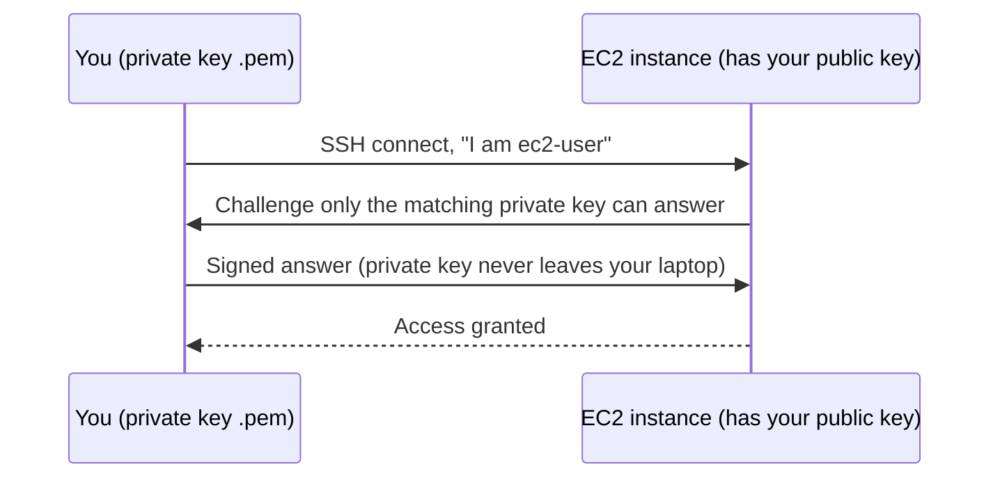
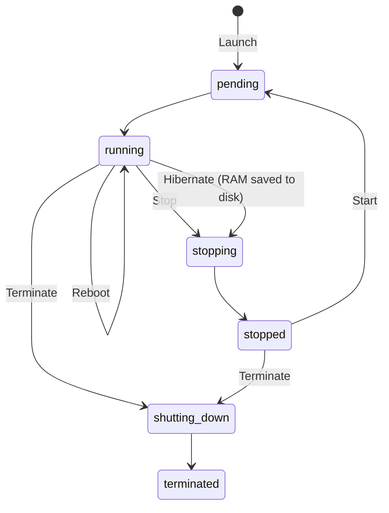
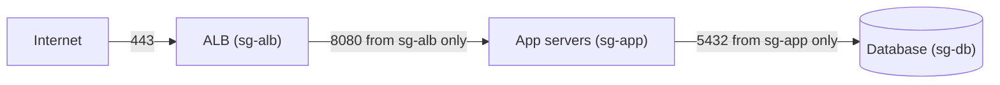
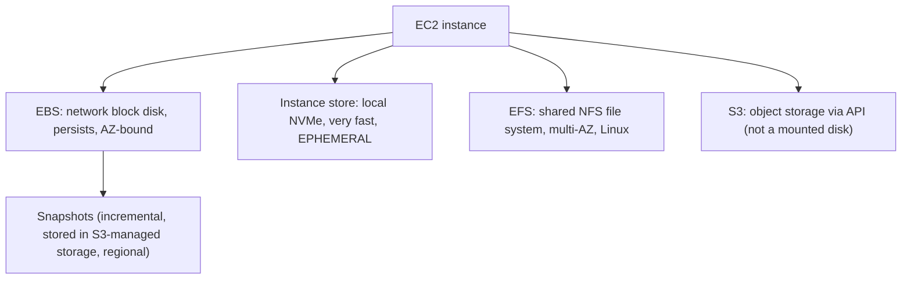
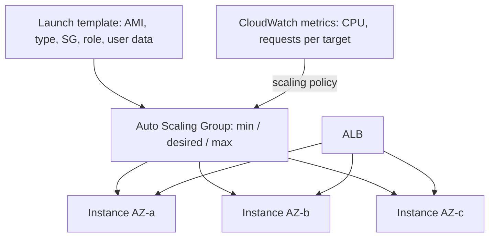
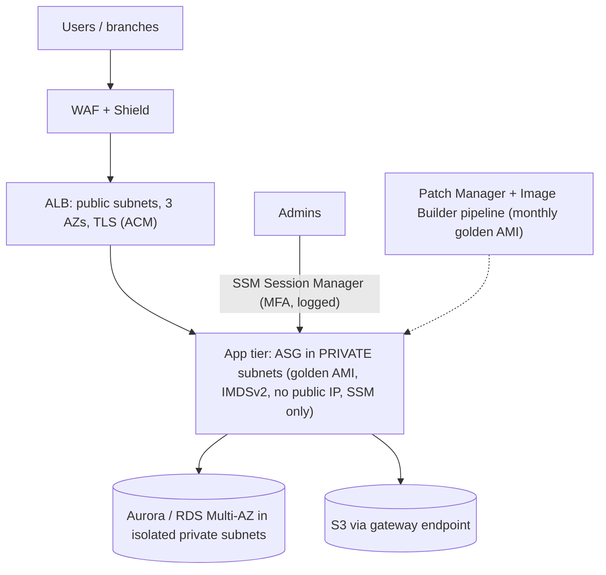

# Amazon EC2: Complete Practical Guide (Equivalent to a 5-Hour Lecture)

> **How to use this file:** Read a section, then do its lab in your own AWS account right away. EC2 is learned by launching, connecting to, breaking and fixing real servers.
> **Cost warning (read this first):** Unlike IAM, EC2 resources **bill while they exist**. Every lab ends with cleanup, and Section 30 has a master cleanup. **Terminate what you finish. Never leave things running overnight.**
> **Free plan note:** Your plan may restrict instance types or services (for example load balancers or large instances). Where a step is blocked, the explanation still teaches the concept. Use the instance type the console marks **Free tier eligible** (Lab 13 shows how to list them).
> **Placeholders:** `ACCOUNT_ID` = your 12-digit account number, `BUCKET` = your S3 lab bucket. Region used: **ap-south-1 (Mumbai)**.
> **Prices and quotas change.** Numbers here are approximate. Verify on the EC2 pricing page and in Service Quotas.

---

## Table of Contents

**Part A: Prerequisites (do not skip)**
1. Virtualization and the hypervisor
2. Server basics: vCPU, RAM, storage, network, OS
3. SSH and key pairs (public/private cryptography)
4. IP addresses: public, private, Elastic
5. Firewalls: stateful vs stateless
6. VPC basics you need for EC2 (subnet, AZ, internet gateway)
7. Boot process, scripts and cloud-init
8. Linux commands you will use in labs
9. Recap: IAM roles and S3 from earlier notes

**Part B: EC2 Core**
10. What is EC2 and when to use it
11. Instance lifecycle and states (billing for each)
12. Lab 0 and Lab 1: Setup and launch your first instance
13. Instance types and families + Lab 2 (explore types)
14. Connecting to instances (SSH, Instance Connect, Session Manager) + Lab 3
15. User data and the Instance Metadata Service (IMDS) + Lab 4 (web server)
16. Security groups in depth + Lab 5
17. IP addressing, Elastic IPs, ENIs + Lab 6
18. EBS volumes, snapshots, instance store + Lab 7
19. AMIs + Lab 8
20. IAM roles for EC2 + Lab 9
21. Purchasing options (On-Demand, Reserved, Savings Plans, Spot, Dedicated, Capacity Reservations) + Lab 10 (Spot)
22. Placement groups, Nitro, enhanced networking, hibernation
23. Monitoring and status checks + Lab 11
24. Load balancing and Auto Scaling + Lab 12
25. **EC2 for data engineering** + Lab 14
26. Pricing and cost optimization
27. Security best practices
28. Troubleshooting
29. Real-world architectures
30. Master cleanup
31. Best practices checklist
32. Exam cheat sheet and 25 practice questions
33. Interview questions and final checklist

---

# PART A: PREREQUISITES

---

## 1. Virtualization and the Hypervisor

A physical server in an AWS data center is big (for example 96 CPU cores, 768 GB RAM). Customers want small slices of it. **Virtualization** makes this possible.

```
        ONE PHYSICAL SERVER
 ┌─────────────────────────────────────────────┐
 │  VM 1 (you)   VM 2 (other)   VM 3 (other)   │  <- virtual machines, each thinks it has its own computer
 │  ┌────────┐   ┌────────┐     ┌────────┐      │
 │  │ OS+app │   │ OS+app │     │ OS+app │      │
 │  └────────┘   └────────┘     └────────┘      │
 ├─────────────────────────────────────────────┤
 │        HYPERVISOR (divides hardware)          │
 ├─────────────────────────────────────────────┤
 │   Physical CPU, RAM, disks, network card      │
 └─────────────────────────────────────────────┘
```
- The **hypervisor** carves hardware into isolated **virtual machines (VMs)**.
- An **EC2 instance = one virtual machine** you rent.
- AWS's current hypervisor technology is the **Nitro System** (dedicated hardware cards + a thin hypervisor). Nearly all modern instance types are **Nitro-based**, which gives near bare-metal performance and strong isolation.

**Analogy:** A large apartment building (physical server). The hypervisor builds walls so each apartment (VM) is private, with its own lock and utilities.

---

## 2. Server Basics

Every server (physical or virtual) is described by five things. EC2 lets you choose each:

| Component | Meaning | EC2 choice |
|---|---|---|
| **vCPU** | Virtual CPU = a thread/core you can use for computation | Instance type (2 vCPU, 8 vCPU...) |
| **RAM** | Memory for running programs and data | Instance type (4 GiB, 64 GiB...) |
| **Storage** | Where files live | **EBS** (network disk) or **Instance Store** (local disk) |
| **Network** | Bandwidth to talk to other things | Instance type ("Up to 5 Gbps", "25 Gbps"...) |
| **Operating System** | Linux or Windows etc. | **AMI** you choose |

**CPU architectures:**
- **x86_64** (Intel/AMD): the traditional default.
- **arm64 (AWS Graviton)**: AWS-designed chips, usually **cheaper per performance** (up to ~20-40% better price/performance). Software must be compiled for arm64 (most Linux software is).

**Scaling vocabulary:**
- **Vertical scaling** = bigger machine (scale **up**/down: change instance type).
- **Horizontal scaling** = more machines (scale **out**/in: Auto Scaling).

---

## 3. SSH and Key Pairs

To log in to a Linux server remotely you use **SSH (Secure Shell)** on **port 22**. AWS avoids passwords and uses **key pairs**.

**Public-key cryptography in one minute:**
- You generate **two linked keys**: a **public key** and a **private key**.
- **Public key** = like a padlock: you can give copies to anyone.
- **Private key** = the only key that opens that padlock: **never share it**.


**In AWS:** When you create a **key pair**, AWS stores the **public key** and puts it on your instance at launch (in `~/.ssh/authorized_keys`). You download the **private key** `.pem` file **once**. If you lose it, you cannot recover it (you'd create a new key pair/instance or use other access methods).

**Permissions rule:** SSH refuses a private key that others can read: `chmod 400 key.pem` (Linux/macOS).

**Default login users by AMI:**
| AMI | Username |
|---|---|
| Amazon Linux 2023 / Amazon Linux 2 | `ec2-user` |
| Ubuntu | `ubuntu` |
| Debian | `admin` |
| RHEL | `ec2-user` (or `cloud-user`) |
| SUSE | `ec2-user` |
| Windows | `Administrator` (password decrypted with the key pair, via RDP port 3389) |

---

## 4. IP Addresses: Public, Private, Elastic

(You saw this in Phase 0. Here is what matters for EC2.)

| Type | Reachable from internet? | Changes when? | Notes |
|---|---|---|---|
| **Private IPv4** | No (inside VPC only) | Stays the same for the instance's life, including stop/start | Used for server-to-server traffic |
| **Public IPv4 (auto-assigned)** | Yes | **Changes every stop/start** (released on stop) | Free-form temporary address |
| **Elastic IP (EIP)** | Yes | **Fixed** until you release it | A static public IPv4 you own |
| **IPv6** | Yes (globally unique) | Stays | No NAT needed |

**Cost fact:** AWS now **charges for every public IPv4 address** (about half a cent per hour, roughly $3.60/month each), whether in use or idle. Under the free plan credits may cover it, but treat public IPv4 as a billable resource, and release unused Elastic IPs.

---

## 5. Firewalls: Stateful vs Stateless

A **firewall** filters network traffic by rules (protocol, port, source).

| Type | Behavior | AWS component |
|---|---|---|
| **Stateful** | Remembers connections: if you allow a request **in**, the **reply** is automatically allowed **out** (and vice versa) | **Security Group** (instance level) |
| **Stateless** | Checks every packet independently; you must allow **both** directions explicitly | **Network ACL** (subnet level) |

Everything about EC2 network security in this guide is **Security Groups**. NACLs are covered in the VPC notes.

---

## 6. VPC Basics You Need for EC2

You will study VPC in depth next. For EC2 you need only this:

```
 Region (ap-south-1)
  └── VPC (your private network, e.g. 172.31.0.0/16)
        ├── Subnet A (in AZ ap-south-1a)  <- an instance lives in ONE subnet, hence ONE AZ
        ├── Subnet B (in AZ ap-south-1b)
        ├── Route table (where traffic goes)
        └── Internet Gateway (door to the internet)
```
- **Subnet** = a slice of the VPC's IP range in **one Availability Zone**. When you launch an EC2, you choose its subnet, which decides its **AZ**.
- **Public subnet** = has a route to an **Internet Gateway** (instances can have public IPs).
- **Private subnet** = no direct route to the internet.
- **Default VPC:** every Region of your account comes with a **default VPC** with public subnets in each AZ, so you can launch instances immediately. We use it in the labs.

---

## 7. Boot Process, Scripts and cloud-init

When an instance first boots, **cloud-init** (software in the AMI) can run **your script** automatically. In AWS this script is called **User Data**. It lets you configure a server (install software, start services) without logging in. This is the foundation of automation and Auto Scaling. (Section 15.)

---

## 8. Linux Commands You Will Use

```bash
whoami            # who am I
pwd; ls -la       # where am I, what is here
sudo <command>    # run as administrator
dnf / yum         # package manager on Amazon Linux (dnf on AL2023)
systemctl status httpd     # check a service
systemctl enable --now httpd
curl http://localhost      # test a web server locally
lsblk; df -hT     # disks and filesystems
tail -f file      # watch a log live
cat file          # print a file
```
(Phase 0 notes covered these in detail.)

---

## 9. Recap: IAM Roles and S3

- An **IAM role** attached to an EC2 (through an **instance profile**) gives the server **temporary credentials** automatically. **Never put access keys on a server.**
- EC2 uses S3 for backups, logs, data. Reading S3 from EC2 in the **same Region is free** of transfer charges.

---

# PART B: EC2 CORE

---

## 10. What is EC2?

**Amazon Elastic Compute Cloud (EC2)** provides **resizable virtual servers (instances)** in the cloud. You pick the hardware size, the OS, the storage and the network, launch in minutes, and pay **per second** (Linux) while running.

**Why "Elastic"?** You can launch 1 or 1,000 instances, grow/shrink on demand, and stop paying when you terminate.

**Typical uses:** web/app servers, batch jobs, databases you manage yourself, bastion hosts, build servers, Kafka/Airflow/self-managed analytics tools, machine learning training, high-performance computing.

**EC2 is IaaS:** AWS manages the hardware; **you** manage OS patches, software, security config (shared responsibility). Managed alternatives (Lambda, Glue, RDS, EMR) reduce your workload, and you should prefer them when they fit. Section 25 gives a decision table.

---

## 11. Instance Lifecycle and States



| State | Compute billed? | EBS billed? | Notes |
|---|---|---|---|
| **pending** | No | n/a | Starting up |
| **running** | **Yes** | Yes | Normal |
| **stopping / stopped** | **No** | **Yes** (volumes + snapshots) | Public IPv4 **released** (unless Elastic IP); RAM contents lost; same private IP kept |
| **stopped → start** | Yes again | | Often lands on **different physical host**; new public IP |
| **terminated** | No | Root volume **deleted by default** (`DeleteOnTermination=true`); extra volumes **kept** by default | **Irreversible.** Instance is gone |
| **Reboot** | Yes (no change) | | Same host, same IPs, **instance-store data survives** |
| **Hibernate** | No compute while hibernated | Yes | RAM saved to encrypted root EBS; restores in-memory state on start |

**Protections:**
- **Termination protection** (`DisableApiTermination`): API/console terminate is refused until you disable it.
- **Stop protection** (`DisableApiStop`).
- **Shutdown behavior:** what happens when the OS runs `shutdown` (stop (default) or terminate).

---

## 12. LAB 0 and LAB 1: Setup and Launch Your First Instance

### Lab 0: Prepare
1. Sign in as your **IAM admin user** (not root), Region **Asia Pacific (Mumbai) ap-south-1**.
2. Make sure your **zero-spend/monthly budget** from earlier is active.
3. Open **CloudShell** and set variables:
```bash
export AWS_DEFAULT_REGION=ap-south-1
ACCOUNT_ID=$(aws sts get-caller-identity --query Account --output text)
echo $ACCOUNT_ID
aws ec2 describe-vpcs --filters Name=isDefault,Values=true --query 'Vpcs[].[VpcId,CidrBlock]' --output table
aws ec2 describe-subnets --filters Name=default-for-az,Values=true \
   --query 'Subnets[].[SubnetId,AvailabilityZone,CidrBlock,MapPublicIpOnLaunch]' --output table
```
You should see a **default VPC** (usually `172.31.0.0/16`) and 3 subnets (one per AZ) with `MapPublicIpOnLaunch = True`. If you deleted the default VPC earlier, create it back: `aws ec2 create-default-vpc`.

### Lab 1: Launch a Linux instance (console, every field explained)

```
EC2 console > Launch instance
```

| Section | Choose | Why |
|---|---|---|
| **Name and tags** | `ec2lab-1` (add tag `Project=aws-learning`) | Tags help cost tracking and cleanup |
| **Application and OS image (AMI)** | **Amazon Linux 2023** (Free tier eligible) | Free OS, AWS-optimized |
| **Architecture** | 64-bit (x86) (or Arm if you choose a Graviton type) | Must match instance type |
| **Instance type** | The one marked **Free tier eligible** (commonly `t3.micro`/`t2.micro`/`t3.small`/`t4g.small`, varies) | Small, cheap |
| **Key pair** | **Create new key pair**: name `ec2lab`, type **RSA**, format **.pem** (OpenSSH) | Downloads the private key once. Save it safely |
| **Network settings > Edit** | VPC: default; Subnet: **No preference** (or pick `ap-south-1a`); **Auto-assign public IP: Enable** | Gives a public IP |
| **Firewall (security groups)** | **Create security group** `ec2lab-sg`; inbound: **SSH (22), Source: My IP** | Only your IP can SSH. **Never use 0.0.0.0/0 for SSH** |
| **Configure storage** | 1 volume, 8 GiB **gp3** | Root volume; leave "Delete on termination = Yes" |
| **Advanced details** | Leave defaults for now (later: IAM role, user data) | |

Click **Launch instance**. Then **View all instances**.

**Watch the lifecycle:** Instance state goes `pending` → `running`; **Status checks** go `Initializing` → `2/2 checks passed` in ~2 minutes.

**Inspect the Details tab:** Instance ID (`i-0abc...`), **Public IPv4**, **Private IPv4**, **AZ**, **VPC/Subnet**, **Security groups**, **AMI ID**, **Key pair name**, **IAM role** (none yet), **Instance type**, **Monitoring** (basic), **Block devices**.

Now continue to Lab 3 (connect) after reading Section 14. Keep this instance running, we reuse it.

---

## 13. Instance Types and Families

### 13.1 Reading an instance name
```
        m  5  a  d  . 2xlarge
        │  │  │  │    └─ size (nano, micro, small, medium, large, xlarge, 2xlarge ... each step ~doubles vCPU/RAM)
        │  │  │  └────── extra capability: d = local NVMe disk, n = network optimized, e = extra, b = EBS optimized, z = high frequency
        │  │  └───────── processor: a = AMD, g = AWS Graviton (arm), i = Intel (often omitted)
        │  └──────────── generation (higher = newer, usually cheaper per performance)
        └─────────────── family: purpose of the machine
```
Examples: `t3.micro`, `m6i.large`, `c7g.xlarge` (Graviton compute), `r6id.2xlarge` (memory + local disk), `i4i.xlarge` (storage).

### 13.2 Families (the main exam and job knowledge)

| Category | Families | Optimized for | Example uses |
|---|---|---|---|
| **General purpose** | **M**, **T** (burstable), Mac | Balanced CPU/RAM/network | Web servers, small DBs, dev/test |
| **Compute optimized** | **C** | High CPU:RAM ratio | Batch processing, video encoding, gaming servers, ML inference |
| **Memory optimized** | **R**, **X**, **z**, High Memory | Lots of RAM | In-memory DBs (Redis), SAP HANA, big Spark joins/caching |
| **Storage optimized** | **I**, **D**, **H** | Very high local disk I/O/throughput | NoSQL (Cassandra), data warehouses, Kafka, Elasticsearch |
| **Accelerated computing** | **P**, **G**, **Inf**, **Trn**, **F**, **DL** | GPUs / ML chips / FPGAs | ML training, inference, graphics |
| **HPC** | **Hpc** | Tightly coupled HPC | Simulations |

**Memory trick:** **C**ompute, **R**AM (memory), **M**ixed (general), **I**/O (storage), **T**iny burst, **P/G** = GPU.

### 13.3 Burstable T instances (very common in labs and small apps)
- Provide a **baseline CPU** level with the ability to **burst** above it using **CPU credits**.
- Idle → earn credits; busy → spend credits.
- **Standard mode:** when credits run out, performance is throttled to baseline.
- **Unlimited mode** (default on T3/T4g): can burst beyond credits, **extra charges** apply for surplus credits.
- Right for: low-average, spiky workloads. Wrong for: sustained 100% CPU (use C/M).

### 13.4 Choosing for data engineering (preview)
| Workload | Good choice |
|---|---|
| Spark/EMR executors, memory-heavy joins | **R / M** family (r6i, r7g...) |
| Kafka brokers, Elasticsearch | **I** (NVMe) or **M** + EBS (st1/gp3) |
| Airflow scheduler/web, Jupyter, small ETL | **t3/m6i** small to medium |
| Spark shuffle spills | Types with local NVMe (`d` suffix: r5d, m6id, i3) |
| CPU-bound transformations | **C** family, or Graviton **c7g** for better price/performance |
| ML training | **P/G** or SageMaker |

### LAB 2: Explore instance types from the CLI (free)
```bash
# Free tier eligible types in this Region
aws ec2 describe-instance-types --filters Name=free-tier-eligible,Values=true \
  --query 'InstanceTypes[].InstanceType' --output text

# Compare a few sizes: vCPU, memory, network, EBS bandwidth
aws ec2 describe-instance-types --instance-types t3.micro m6i.large c7g.large r6i.large \
  --query 'InstanceTypes[].[InstanceType,VCpuInfo.DefaultVCpus,MemoryInfo.SizeInMiB,NetworkInfo.NetworkPerformance,ProcessorInfo.SupportedArchitectures[0]]' \
  --output table

# Which instance types have local NVMe instance store?
aws ec2 describe-instance-types --filters Name=instance-storage-supported,Values=true Name=instance-type,Values=m6id.*,r6id.*,i4i.large \
  --query 'InstanceTypes[].[InstanceType,InstanceStorageInfo.TotalSizeInGB]' --output table
```
**Console exercise:** EC2 > **Instance Types** page: filter vCPU 4, memory 16 GiB; compare **On-Demand price** columns. Then open the **AWS Pricing Calculator** (calculator.aws) and estimate a `t3.medium` Linux instance in Mumbai running 730 hours/month. This habit (estimating cost before building) is expected in interviews.

---

## 14. Connecting to Instances

| Method | Needs inbound port? | Needs key pair? | Best for |
|---|---|---|---|
| **SSH** from your terminal | **Yes, 22** | Yes | Traditional admin |
| **EC2 Instance Connect** (browser) | Yes, 22 (from AWS service IPs) | No (pushes a temporary key) | Quick access in labs |
| **Session Manager (SSM)** | **No inbound ports at all** | No | **Production best practice**, audited, no SSH keys, no public IP needed (with VPC endpoints) |
| **RDP** (Windows) | Yes, 3389 | Yes (decrypt password) | Windows |
| **EC2 Serial Console** | n/a | n/a | Rescue when networking breaks |

### LAB 3: Connect three ways

**A. EC2 Instance Connect (easiest)**
```
EC2 > Instances > select ec2lab-1 > Connect > EC2 Instance Connect tab > Connect
```
A browser terminal opens as `ec2-user`. Run:
```bash
whoami; hostname; uname -m; cat /etc/os-release | head -3
df -hT; free -m; lscpu | head -8
```

**B. SSH from your laptop**
1. Move your key to a safe folder, e.g. `~/.ssh/ec2lab.pem`.
2. Fix permissions:
   - Linux/macOS: `chmod 400 ~/.ssh/ec2lab.pem`
   - Windows PowerShell: `icacls ec2lab.pem /inheritance:r` then `icacls ec2lab.pem /grant:r "$($env:USERNAME):(R)"`
3. Connect (replace the public IP):
```bash
ssh -i ~/.ssh/ec2lab.pem ec2-user@PUBLIC_IPV4
```
Type `yes` to trust the host the first time. If your **home IP changed**, edit the security group rule (My IP) or you will time out.
**Common errors:**
- `Permission denied (publickey)` → wrong user, wrong key, or key permissions.
- `Connection timed out` → security group/NACL/route/public IP problem (not a key problem).
- `UNPROTECTED PRIVATE KEY FILE` → fix with chmod 400.

**C. Session Manager** is done in Lab 9 once the instance has an IAM role.

**Experiment:** In the SG, delete the SSH rule → your existing session may continue (stateful, connection already tracked) but a **new** connection times out. Re-add it.

---

## 15. User Data and the Instance Metadata Service

### 15.1 User data
A script (or cloud-init config) supplied at launch.
- Runs **as root**, **once at first boot** by default (you can configure to run every boot).
- Max size **16 KB**.
- Output logged at `/var/log/cloud-init-output.log` (**first place to look when it fails**).
- Not secret: **never put passwords** in user data (anyone with `ec2:DescribeInstanceAttribute` or IMDS access can read it).

### 15.2 Instance Metadata Service (IMDS)
Every instance can query information about itself at a **link-local address**: `http://169.254.169.254/latest/meta-data/`
- Instance ID, AZ, IPs, security groups, AMI ID, **IAM role temporary credentials**, user data (`/latest/user-data`).
- **IMDSv1:** simple GET (vulnerable to **SSRF attacks** where a web app is tricked into fetching the URL and leaking credentials).
- **IMDSv2:** requires a **session token** first (PUT request), then the token header on every GET. **Use IMDSv2 only** (`HttpTokens=required`). Many compliance frameworks require it.

```bash
TOKEN=$(curl -s -X PUT "http://169.254.169.254/latest/api/token" -H "X-aws-ec2-metadata-token-ttl-seconds: 300")
curl -s -H "X-aws-ec2-metadata-token: $TOKEN" http://169.254.169.254/latest/meta-data/instance-id
curl -s -H "X-aws-ec2-metadata-token: $TOKEN" http://169.254.169.254/latest/meta-data/placement/availability-zone
curl -s -H "X-aws-ec2-metadata-token: $TOKEN" http://169.254.169.254/latest/meta-data/local-ipv4
curl -s -H "X-aws-ec2-metadata-token: $TOKEN" http://169.254.169.254/latest/meta-data/public-ipv4
curl -s -H "X-aws-ec2-metadata-token: $TOKEN" http://169.254.169.254/latest/user-data
```

### LAB 4: Launch a web server with user data + see IMDS
We will launch a second instance configured entirely by a script.

Use the **CLI** this time (it teaches the real automation workflow):
```bash
# 1) Find the latest Amazon Linux 2023 AMI via the public SSM parameter
AMI=$(aws ssm get-parameter --name /aws/service/ami-amazon-linux-latest/al2023-ami-kernel-default-x86_64 \
      --query Parameter.Value --output text)
echo $AMI

# 2) Create a security group for the web server (SSH from My IP + HTTP from anywhere)
VPC=$(aws ec2 describe-vpcs --filters Name=isDefault,Values=true --query 'Vpcs[0].VpcId' --output text)
SG_WEB=$(aws ec2 create-security-group --group-name web-sg --description "web server" --vpc-id $VPC \
          --query GroupId --output text)
MYIP=$(curl -s https://checkip.amazonaws.com)     # NOTE: this is CloudShell's IP, not your laptop's
aws ec2 authorize-security-group-ingress --group-id $SG_WEB --protocol tcp --port 80 --cidr 0.0.0.0/0
echo $SG_WEB

# 3) Write the user data script
cat > userdata.sh << 'EOF'
#!/bin/bash
dnf install -y httpd
systemctl enable --now httpd
TOKEN=$(curl -s -X PUT "http://169.254.169.254/latest/api/token" -H "X-aws-ec2-metadata-token-ttl-seconds: 300")
IID=$(curl -s -H "X-aws-ec2-metadata-token: $TOKEN" http://169.254.169.254/latest/meta-data/instance-id)
AZ=$(curl -s -H "X-aws-ec2-metadata-token: $TOKEN" http://169.254.169.254/latest/meta-data/placement/availability-zone)
echo "<h1>Hello from $IID in $AZ</h1>" > /var/www/html/index.html
EOF

# 4) Launch (replace t3.micro with your free-tier-eligible type if different)
SUBNET=$(aws ec2 describe-subnets --filters Name=default-for-az,Values=true Name=availabilityZone,Values=ap-south-1a \
          --query 'Subnets[0].SubnetId' --output text)
aws ec2 run-instances --image-id $AMI --instance-type t3.micro --subnet-id $SUBNET \
   --security-group-ids $SG_WEB --associate-public-ip-address \
   --user-data file://userdata.sh \
   --metadata-options HttpTokens=required,HttpEndpoint=enabled \
   --tag-specifications 'ResourceType=instance,Tags=[{Key=Name,Value=ec2lab-web},{Key=Project,Value=aws-learning}]' \
   --query 'Instances[0].InstanceId' --output text
```
```bash
# 5) Wait and get the public IP
WEB_ID=<paste instance id>
aws ec2 wait instance-running --instance-ids $WEB_ID
aws ec2 describe-instances --instance-ids $WEB_ID \
  --query 'Reservations[0].Instances[0].[PublicIpAddress,PrivateIpAddress,Placement.AvailabilityZone,State.Name]' --output text
```
Open `http://PUBLIC_IP` in your browser after about 1 to 2 minutes: **"Hello from i-... in ap-south-1a"**.

**Learning checks:**
- Connect via Instance Connect (it will fail because this SG has no SSH rule!). Add SSH rule for Instance Connect or use **Session Manager** in Lab 9. This shows **security groups block everything not allowed**.
- On a connected instance read the log: `sudo cat /var/log/cloud-init-output.log | tail -30`.
- Try IMDSv1 style (without a token): `curl http://169.254.169.254/latest/meta-data/instance-id` → **401 Unauthorized** because we required IMDSv2.

---

## 16. Security Groups in Depth

A **security group (SG)** is a **virtual, stateful firewall attached to an instance's network interface (ENI)**.

### Rules to memorize
| Fact | Detail |
|---|---|
| **Allow rules only** | You **cannot create deny rules** in a security group |
| **Default inbound** | **All denied** (nothing allowed) |
| **Default outbound** | **All allowed** |
| **Stateful** | Return traffic is automatically allowed |
| **Scope** | An SG belongs to **one VPC** (works across AZs in that VPC) |
| **Many-to-many** | An instance can have **multiple SGs** (rules are **combined/unioned**); an SG can be attached to many instances |
| **Rule sources** | A CIDR (`203.0.113.4/32`), another **security group** (very powerful), a **prefix list** |
| **Changes** | Take effect **immediately** for existing connections' new packets |
| **Quotas** | Defaults around 5 SGs per ENI and 60 rules per direction per SG (adjustable) |

### Referencing another security group (the professional pattern)

- `sg-app` allows inbound 8080 **only from `sg-alb`**.
- `sg-db` allows inbound 5432 **only from `sg-app`**.
- New app servers join `sg-app` and are automatically allowed. No IP lists to maintain.

### Typical ports
22 SSH · 80 HTTP · 443 HTTPS · 3389 RDP · 3306 MySQL · 5432 PostgreSQL · 1433 SQL Server · 5439 Redshift · 9092 Kafka · 2049 NFS (EFS).

### Security group vs NACL
| | Security Group | Network ACL |
|---|---|---|
| Level | Instance (ENI) | Subnet |
| State | **Stateful** | **Stateless** |
| Rules | **Allow only** | Allow and **Deny**, numbered order |
| Evaluation | All rules together | First matching rule by number |

### LAB 5: Security groups hands-on (two instances)
Goal: a "bastion" can reach a "private app" over a port, but the internet cannot.

```bash
# SGs
SG_BASTION=$(aws ec2 create-security-group --group-name lab-bastion-sg --description bastion --vpc-id $VPC --query GroupId --output text)
SG_APP=$(aws ec2 create-security-group --group-name lab-app-sg --description app --vpc-id $VPC --query GroupId --output text)

# App allows TCP 8080 ONLY from the bastion SG (no CIDR at all)
aws ec2 authorize-security-group-ingress --group-id $SG_APP --protocol tcp --port 8080 --source-group $SG_BASTION
aws ec2 describe-security-groups --group-ids $SG_APP --query 'SecurityGroups[0].IpPermissions'
```
Launch two instances (same subnet is fine): one with `$SG_BASTION`, one with `$SG_APP`, using the same AMI. On the app instance start a tiny listener through user data:
```bash
cat > app-ud.sh << 'EOF'
#!/bin/bash
mkdir -p /srv/app && echo "secret app data" > /srv/app/index.html
cd /srv/app && nohup python3 -m http.server 8080 &
EOF
APP_ID=$(aws ec2 run-instances --image-id $AMI --instance-type t3.micro --subnet-id $SUBNET \
  --security-group-ids $SG_APP --user-data file://app-ud.sh \
  --tag-specifications 'ResourceType=instance,Tags=[{Key=Name,Value=lab-app}]' --query 'Instances[0].InstanceId' --output text)
BAST_ID=$(aws ec2 run-instances --image-id $AMI --instance-type t3.micro --subnet-id $SUBNET \
  --security-group-ids $SG_BASTION --associate-public-ip-address \
  --tag-specifications 'ResourceType=instance,Tags=[{Key=Name,Value=lab-bastion}]' --query 'Instances[0].InstanceId' --output text)
aws ec2 wait instance-running --instance-ids $APP_ID $BAST_ID
APP_PRIV=$(aws ec2 describe-instances --instance-ids $APP_ID --query 'Reservations[0].Instances[0].PrivateIpAddress' --output text)
echo $APP_PRIV
```
To reach the bastion you need console access: add an **SSH rule from the EC2 Instance Connect range or My IP** on `$SG_BASTION` (console: SG > Edit inbound rules), then Instance Connect to the bastion and run:
```bash
curl -m 5 http://APP_PRIVATE_IP:8080       # works: "secret app data" (allowed by SG reference)
```
Now test from outside: the app instance has **no public IP** and no inbound from the internet, so nothing from the internet can reach it. Remove the SG-reference rule and repeat `curl` from the bastion: it **times out** (no deny message; a blocked packet is silently dropped, so timeouts mean firewall).

**Lesson:** timeouts = firewall/routing; "connection refused" = firewall passed but nothing listening on that port.

---

## 17. IP Addressing, Elastic IPs and ENIs

### 17.1 Elastic Network Interface (ENI)
A **virtual network card**. Every instance has a **primary ENI**. An ENI has: a primary private IPv4, optional secondary private IPs, one Elastic IP per private IP, a public IP, security groups, a MAC address, and a source/destination check flag. You can:
- Create and **attach a second ENI** (multi-homed, e.g., management network).
- **Move an ENI** between instances in the **same AZ** (used for failover: the replacement instance takes over the same private IP/MAC).
- Security groups attach to **ENIs**.

**Source/destination check:** by default an instance only accepts traffic addressed to itself; disable it for NAT/router/firewall appliances.

### 17.2 Elastic IP rules
- Static public IPv4 you **allocate to your account**; associate with an instance/ENI; can be **remapped** to another instance in the same Region (fast failover).
- Default quota **5 per Region**.
- **Billed** (public IPv4 charge); an **unassociated** EIP is the same price: release it.
- Best practice: prefer **DNS names + load balancers** over EIPs.

### 17.3 Enhanced networking
- **ENA (Elastic Network Adapter):** up to 100+ Gbps on supported types, standard on Nitro.
- **EFA (Elastic Fabric Adapter):** OS-bypass networking for HPC/ML (MPI/NCCL) with ultra-low latency.

### LAB 6: Public IP behavior and Elastic IP
```bash
# 1) Note the web instance's current public IP
aws ec2 describe-instances --instance-ids $WEB_ID --query 'Reservations[0].Instances[0].PublicIpAddress' --output text

# 2) Stop then start: public IP changes, private IP stays
aws ec2 stop-instances --instance-ids $WEB_ID && aws ec2 wait instance-stopped --instance-ids $WEB_ID
aws ec2 start-instances --instance-ids $WEB_ID && aws ec2 wait instance-running --instance-ids $WEB_ID
aws ec2 describe-instances --instance-ids $WEB_ID \
  --query 'Reservations[0].Instances[0].[PublicIpAddress,PrivateIpAddress]' --output text
```
Compare: **public changed, private same.**

```bash
# 3) Allocate and associate an Elastic IP
ALLOC=$(aws ec2 allocate-address --domain vpc --query AllocationId --output text)
aws ec2 associate-address --instance-id $WEB_ID --allocation-id $ALLOC
aws ec2 describe-addresses --allocation-ids $ALLOC --query 'Addresses[0].[PublicIp,InstanceId]' --output text

# 4) Stop/start again and verify the EIP stays
aws ec2 stop-instances --instance-ids $WEB_ID && aws ec2 wait instance-stopped --instance-ids $WEB_ID
aws ec2 start-instances --instance-ids $WEB_ID && aws ec2 wait instance-running --instance-ids $WEB_ID
aws ec2 describe-instances --instance-ids $WEB_ID --query 'Reservations[0].Instances[0].PublicIpAddress' --output text

# 5) RELEASE it (important)
aws ec2 disassociate-address --association-id $(aws ec2 describe-addresses --allocation-ids $ALLOC --query 'Addresses[0].AssociationId' --output text)
aws ec2 release-address --allocation-id $ALLOC
```
**Termination protection test:**
```bash
aws ec2 modify-instance-attribute --instance-id $APP_ID --disable-api-termination
aws ec2 terminate-instances --instance-ids $APP_ID          # fails: OperationNotPermitted
aws ec2 modify-instance-attribute --instance-id $APP_ID --no-disable-api-termination
```

---

## 18. Storage for EC2: EBS, Instance Store, EFS

### 18.1 Overview


### 18.2 EBS (Elastic Block Store) fundamentals
- A **network-attached disk** (not physically inside the server), so it persists independently of the instance.
- **Locked to one AZ.** You can attach it only to instances in the **same AZ**.
- Attached to **one instance at a time** (exception: **Multi-Attach** for io1/io2 to multiple Nitro instances in the same AZ, up to 16).
- **Root volume** (boot) deleted on termination by default; **additional volumes** are not deleted by default (check `DeleteOnTermination`).
- You provision **size** (and for some types IOPS/throughput) and pay for it **whether or not data fills it**.
- **Replicated within its AZ** for durability (not across AZs). For cross-AZ/Region protection use **snapshots**.
- **Elastic Volumes:** increase size, change type, adjust IOPS/throughput **without detaching or stopping** (size can only **increase**; wait ~6 hours between modifications of the same volume).

### 18.3 EBS volume types

| Type | Media | Profile | Max perf (approx.) | Boot volume? | Typical use |
|---|---|---|---|---|---|
| **gp3** | SSD | General purpose, **performance independent of size** | Baseline **3,000 IOPS / 125 MiB/s**, up to **16,000 IOPS / 1,000 MiB/s** | Yes | **Default choice** for most workloads (cheaper than gp2) |
| **gp2** | SSD | IOPS tied to size (**3 IOPS per GiB**), burst credits | up to 16,000 IOPS | Yes | Legacy; migrate to gp3 |
| **io2 / io2 Block Express** | SSD | **Provisioned IOPS**, 99.999% durability | up to **64,000** (io2) / **256,000** (Block Express) IOPS | Yes | Critical databases (Oracle, SQL Server) |
| **io1** | SSD | Provisioned IOPS (older) | up to 64,000 IOPS | Yes | Legacy PIOPS |
| **st1** | **HDD** | **Throughput optimized**, cheap, sequential | up to ~500 MiB/s | **No** | Big sequential data: Kafka logs, data warehouse scans, ETL staging |
| **sc1** | **HDD** | **Cold**, cheapest | up to ~250 MiB/s | **No** | Infrequently accessed large data |

**Exam shortcuts:** *Boot volume?* only SSD types (gp2/gp3/io1/io2). *Highest IOPS?* io2 Block Express. *Cheap big throughput?* st1. *Cheapest?* sc1.

### 18.4 Snapshots
- **Point-in-time backup** of a volume, stored durably (managed S3 storage, you can't see it in your buckets).
- **Incremental:** first snapshot copies everything; later ones store only changed blocks. Deleting an older snapshot doesn't break newer ones (AWS keeps required blocks).
- **Regional:** can be **copied across Regions/accounts**, and used to **create a volume in any AZ** (this is how you "move" an EBS volume between AZs).
- **Crash-consistent** by default; for databases quiesce or flush first.
- Features: **Fast Snapshot Restore** (avoid first-read latency), **Recycle Bin** (recover deleted snapshots/AMIs), **Data Lifecycle Manager (DLM)** (automated snapshot schedules), **Snapshot Archive** (cheaper long-term tier, slow restore).

### 18.5 EBS encryption
- Uses **KMS**; encrypts data at rest, data in transit between instance and volume, **snapshots and volumes created from them**.
- Minimal performance impact on Nitro.
- **Account-level "Encryption by default"** per Region can force all new volumes to be encrypted. Enable it.
- **You can't directly encrypt an existing unencrypted volume.** Process: snapshot → **copy snapshot with encryption enabled** → create volume from encrypted snapshot → swap.

### 18.6 Instance Store
- **Local NVMe/SSD attached to the host** physically: **very high IOPS and low latency**, **included in the instance price**.
- **Ephemeral:** data **lost** if the instance is **stopped, hibernated, terminated**, or the underlying hardware fails. **Survives a reboot.**
- Use for **temporary data**: cache, scratch, buffers, Spark shuffle, replicated stores (Cassandra/Kafka with replication).
- Cannot be detached or snapshotted.

### 18.7 EBS vs Instance Store vs EFS vs S3
| | EBS | Instance Store | EFS | S3 |
|---|---|---|---|---|
| Type | Block | Block (local) | File (NFS) | Object |
| Persistence | **Persistent** | **Ephemeral** | Persistent | Persistent |
| Scope | One AZ | One host | **Multi-AZ**, many instances at once | Regional, any |
| Attach to many instances | Mostly no | No | **Yes** (Linux only) | Via API |
| Performance | Good, provisionable | **Highest** | Good, elastic | API throughput |
| Cost | $$ | Free with instance | $$$ | $ |

### LAB 7: EBS: create, attach, format, mount, resize, snapshot, move to another AZ

Use the **web instance** (`$WEB_ID`). Find its AZ:
```bash
AZ=$(aws ec2 describe-instances --instance-ids $WEB_ID --query 'Reservations[0].Instances[0].Placement.AvailabilityZone' --output text)
echo $AZ
```
**1) Create and attach a 4 GiB gp3 volume (same AZ!)**
```bash
VOL=$(aws ec2 create-volume --availability-zone $AZ --size 4 --volume-type gp3 \
      --tag-specifications 'ResourceType=volume,Tags=[{Key=Name,Value=lab-data}]' --query VolumeId --output text)
aws ec2 wait volume-available --volume-ids $VOL
aws ec2 attach-volume --volume-id $VOL --instance-id $WEB_ID --device /dev/sdf
```
**2) Inside the instance** (connect with Instance Connect/SSM; you may need the SSH/SSM access from Lab 3/9):
```bash
lsblk                                   # new disk appears as nvme1n1 (4G), no mountpoint
sudo file -s /dev/nvme1n1               # "data" => no filesystem yet
sudo mkfs -t xfs /dev/nvme1n1           # format
sudo mkdir /data
sudo mount /dev/nvme1n1 /data
df -hT /data
echo "important bank data" | sudo tee /data/note.txt
```
**3) Make the mount permanent (survives reboot)**
```bash
sudo blkid /dev/nvme1n1                  # copy the UUID
echo "UUID=PASTE-UUID-HERE /data xfs defaults,nofail 0 2" | sudo tee -a /etc/fstab
sudo umount /data && sudo mount -a && df -hT /data      # test the fstab entry
```
`nofail` prevents a boot hang if the volume is ever missing. **Always test `mount -a`** (a bad fstab line can stop boot).

**4) Resize live (no downtime)**
```bash
# from CloudShell:
aws ec2 modify-volume --volume-id $VOL --size 8
aws ec2 describe-volumes-modifications --volume-ids $VOL --query 'VolumesModifications[0].ModificationState'
# wait until "optimizing" or "completed", then inside the instance:
lsblk                                    # now 8G
sudo xfs_growfs -d /data                 # grow the filesystem (xfs)
df -hT /data
```
(For the **root** volume, which has a partition, run `sudo growpart /dev/nvme0n1 1` first, then `sudo xfs_growfs -d /`. For ext4 use `resize2fs`.)

**5) Snapshot, then restore into a DIFFERENT AZ**
```bash
SNAP=$(aws ec2 create-snapshot --volume-id $VOL --description "lab snapshot" --query SnapshotId --output text)
aws ec2 wait snapshot-completed --snapshot-ids $SNAP
OTHER_AZ=ap-south-1b      # choose a different AZ from $AZ
VOL2=$(aws ec2 create-volume --snapshot-id $SNAP --availability-zone $OTHER_AZ --volume-type gp3 --query VolumeId --output text)
echo $VOL2
```
This is the **only way** to move a volume to another AZ (volume → snapshot → new volume in the target AZ).

**6) Test encryption by default / copy-encrypt (optional)**
```bash
aws ec2 get-ebs-encryption-by-default
SNAP_ENC=$(aws ec2 copy-snapshot --source-region ap-south-1 --source-snapshot-id $SNAP --encrypted --description "encrypted copy" --query SnapshotId --output text)
```
**7) See instance store in action (read-only exercise):** On an instance type with local NVMe (e.g., `m6id.large`, not free tier; just read): `lsblk` would show an additional unformatted disk; data there is lost on stop. Understand the concept; don't launch unless you accept the small cost.

**Cleanup:** unmount, detach, delete volumes and snapshots:
```bash
aws ec2 detach-volume --volume-id $VOL     # after sudo umount /data and removing the fstab line
aws ec2 delete-volume --volume-id $VOL; aws ec2 delete-volume --volume-id $VOL2
aws ec2 delete-snapshot --snapshot-id $SNAP; aws ec2 delete-snapshot --snapshot-id $SNAP_ENC
```
(Remove the fstab line first, otherwise a later reboot would log a failed mount; `nofail` keeps boot safe.)

---

## 19. AMIs (Amazon Machine Images)

### 19.1 What an AMI contains
A **template to launch instances**: root volume snapshot (OS + software), **launch permissions**, and **block device mappings** (volumes to attach). It's what makes "launch 100 identical servers" possible.

### 19.2 Key facts
- **Regional:** an AMI exists in one Region. To use it elsewhere, **copy** it (AWS copies the underlying snapshots).
- Sources: **AWS-provided** (Amazon Linux, Windows), **AWS Marketplace** (vendor software, may add license fees), **Community AMIs** (use with caution), **your own custom AMIs**.
- Types by root device: **EBS-backed** (most common; can stop/start) vs **instance-store-backed** (legacy; can't stop, only reboot/terminate).
- You can **share** AMIs with specific accounts/Organization, or make public (rarely).
- Creating an AMI creates **EBS snapshots**. **Deregister the AMI and delete its snapshots** to stop costs.
- Architecture must match (x86 vs arm64); virtualization is HVM on modern types.
- **Golden AMI** = hardened, patched, pre-configured image your company standardizes on. Built with **EC2 Image Builder** or Packer.

### 19.3 Why custom AMIs
| Approach | Boot time | Consistency |
|---|---|---|
| Base AMI + long user data script | Slow (installs at boot) | Depends on internet/repos at boot time |
| **Golden/custom AMI** | **Fast**, everything preinstalled | **Immutable**, identical, tested |
(A hybrid is common: bake slow, stable parts into the AMI; use user data for small environment-specific config.)

### LAB 8: Create an AMI and launch a clone
```bash
# 1) Create an AMI from the web server (no-reboot avoids restarting, but file system consistency is not guaranteed)
AMI_NEW=$(aws ec2 create-image --instance-id $WEB_ID --name "ec2lab-web-golden-$(date +%s)" --description "web golden" \
          --no-reboot --query ImageId --output text)
aws ec2 wait image-available --image-ids $AMI_NEW
aws ec2 describe-images --image-ids $AMI_NEW --query 'Images[0].[ImageId,State,BlockDeviceMappings[0].Ebs.SnapshotId]' --output text

# 2) Launch a clone from your AMI: NO user data needed; Apache is already installed and enabled
CLONE=$(aws ec2 run-instances --image-id $AMI_NEW --instance-type t3.micro --subnet-id $SUBNET \
        --security-group-ids $SG_WEB --associate-public-ip-address \
        --tag-specifications 'ResourceType=instance,Tags=[{Key=Name,Value=ec2lab-clone}]' --query 'Instances[0].InstanceId' --output text)
aws ec2 wait instance-running --instance-ids $CLONE
aws ec2 describe-instances --instance-ids $CLONE --query 'Reservations[0].Instances[0].PublicIpAddress' --output text
```
Open the clone's IP: it serves the **same page** (it will show the **old instance's ID**, since the HTML file was baked in). That teaches you: AMIs capture files; per-instance values must be generated at boot (user data/IMDS).

```bash
# 3) (Optional) copy the AMI to Singapore, see it's a separate regional object
aws ec2 copy-image --source-image-id $AMI_NEW --source-region ap-south-1 --region ap-southeast-1 --name "ec2lab-copy"

# 4) CLEAN UP: deregister AMI, then delete its snapshot
SNAP_AMI=$(aws ec2 describe-images --image-ids $AMI_NEW --query 'Images[0].BlockDeviceMappings[0].Ebs.SnapshotId' --output text)
aws ec2 deregister-image --image-id $AMI_NEW
aws ec2 delete-snapshot --snapshot-id $SNAP_AMI
aws ec2 terminate-instances --instance-ids $CLONE
```
(If you copied to Singapore, deregister and delete that copy's snapshot in `--region ap-southeast-1` too.)

---

## 20. IAM Roles for EC2

(This builds on your IAM notes.)
- Create a **role** trusting `ec2.amazonaws.com`, attach permissions, attach it to the instance through an **instance profile**.
- The instance receives **temporary credentials** from IMDS; the CLI/SDK auto-refresh them. **No access keys on disk.**
- Role changes take effect quickly; you can **replace** the role on a running instance (Actions > Security > Modify IAM role).
- **One role per instance** (but a role can serve many instances).
- Least privilege: scope to specific buckets/prefixes. For SSM access attach `AmazonSSMManagedInstanceCore`.

### LAB 9: Instance role: S3 access without keys + Session Manager
**Step 1: Create a role with S3 access to your lab bucket + SSM**
```bash
cat > ec2-trust.json << 'EOF'
{ "Version": "2012-10-17",
  "Statement": [{ "Effect": "Allow", "Principal": { "Service": "ec2.amazonaws.com" }, "Action": "sts:AssumeRole" }] }
EOF
aws iam create-role --role-name EC2LabRole --assume-role-policy-document file://ec2-trust.json
aws iam attach-role-policy --role-name EC2LabRole --policy-arn arn:aws:iam::aws:policy/AmazonSSMManagedInstanceCore

# Scoped S3 permissions to your bucket only (set BUCKET to your S3 lab bucket)
BUCKET=s3lab-yourname-12345
cat > ec2-s3.json << EOF
{ "Version": "2012-10-17",
  "Statement": [
    { "Effect": "Allow", "Action": ["s3:ListBucket"], "Resource": "arn:aws:s3:::$BUCKET" },
    { "Effect": "Allow", "Action": ["s3:GetObject","s3:PutObject"], "Resource": "arn:aws:s3:::$BUCKET/ec2lab/*" }
  ] }
EOF
aws iam put-role-policy --role-name EC2LabRole --policy-name S3LabAccess --policy-document file://ec2-s3.json

# Instance profile (the console creates this automatically; CLI needs it explicitly)
aws iam create-instance-profile --instance-profile-name EC2LabProfile
aws iam add-role-to-instance-profile --instance-profile-name EC2LabProfile --role-name EC2LabRole
```
**Step 2: Attach it to the running web instance**
```bash
sleep 10
aws ec2 associate-iam-instance-profile --instance-id $WEB_ID --iam-instance-profile Name=EC2LabProfile
```
(Console: Instance > Actions > Security > Modify IAM role.)

**Step 3: Connect with Session Manager (no SSH, no open ports)**
Wait about 1 to 3 minutes for the SSM agent to register (Amazon Linux 2023 has the agent preinstalled; the instance needs outbound internet or VPC endpoints). Then:
```
EC2 > Instances > select > Connect > Session Manager tab > Connect
```
or check registration: `aws ssm describe-instance-information --query 'InstanceInformationList[].[InstanceId,PingStatus]' --output text`.
Inside the session:
```bash
aws sts get-caller-identity                # assumed-role/EC2LabRole/i-...
echo "hello from ec2" > h.txt
aws s3 cp h.txt s3://BUCKET/ec2lab/h.txt   # works (allowed prefix)
aws s3 cp h.txt s3://BUCKET/other/h.txt    # AccessDenied (outside prefix)
ls ~/.aws 2>/dev/null || echo "no credentials stored on disk"
```
**Step 4: Run Command (fleet management without logging in)**
```
Systems Manager > Run Command > Run command > AWS-RunShellScript > Command: uptime > Targets: choose your instance > Run
```
**Step 5: Enforce IMDSv2 on an existing instance**
```bash
aws ec2 modify-instance-metadata-options --instance-id $WEB_ID --http-tokens required --http-endpoint enabled
```
**Why this matters in banks:** no inbound ports, no key files, every session logged to CloudWatch/S3, and access controlled by IAM.

---

## 21. Purchasing Options

| Option | How it works | Discount (approx.) | Commitment | Best for |
|---|---|---|---|---|
| **On-Demand** | Pay per second, no commitment | 0% (baseline) | None | New/unpredictable/short workloads |
| **Savings Plans** | Commit to **$ per hour** of usage for 1 or 3 years. **Compute SP** flexible across instance family, size, Region, OS, even Fargate/Lambda; **EC2 Instance SP** locked to a family in a Region | Up to ~66% (Compute) / ~72% (EC2 Instance) | 1 or 3 years | Steady baseline usage with flexibility |
| **Reserved Instances (RI)** | Commit to specific instance attributes for 1 or 3 years. **Standard** (bigger discount, can't change family), **Convertible** (can exchange for another) | Up to ~72% (Standard) / ~66% (Convertible) | 1 or 3 years | Known steady workloads (Savings Plans are now usually preferred) |
| **Spot** | Use **spare capacity**; AWS can reclaim with a **2-minute warning** | Up to **~90%** | None | Fault-tolerant, flexible, stateless/batch: Spark, CI, rendering, ML tuning |
| **Dedicated Hosts** | A **whole physical server** for you; visibility of sockets/cores | Varies | On-demand or reserved | **BYOL** software licensed per socket/core, compliance |
| **Dedicated Instances** | Instances on hardware dedicated to your account (no host control) | Premium | None | Compliance needing single-tenant hardware |
| **On-Demand Capacity Reservation** | **Reserve capacity in a specific AZ**, no discount by itself | 0% (combine with Savings Plan) | None | Guarantee capacity for events/DR |
| **Capacity Blocks for ML** | Reserve GPU capacity for a future time window | | Short term | ML training |

**Analogy (hotel):** On-Demand = walk-in price; Reserved/Savings Plan = long-stay discount; Spot = last-minute empty rooms but you may be asked to leave with short notice; Dedicated Host = renting the entire floor; Capacity Reservation = booking a room you may or may not use (guaranteed availability).

### Spot details (exam favorites)
- Interruption: **2-minute notice** via IMDS (`/latest/meta-data/spot/instance-action`) and EventBridge; also **rebalance recommendation** signals.
- **Spot Instance request types:** one-time or **persistent** (resubmits after interruption). To stop a persistent Spot cleanly you must **cancel the request first, then terminate** the instance (otherwise it relaunches).
- **Spot Fleet / EC2 Fleet:** request a target capacity across many instance types/pools; **allocation strategies** (`price-capacity-optimized` recommended, `lowest-price`, `diversified`, `capacity-optimized`).
- Diversify across **many instance types and AZs** to lower interruption odds.
- Not for: databases without replication, the only copy of data, long non-checkpointed jobs.

### LAB 10: Spot prices and a Spot instance
```bash
# 1) Spot price history for a few types in Mumbai (last hour)
aws ec2 describe-spot-price-history --instance-types t3.micro m6i.large c6i.large \
   --product-descriptions "Linux/UNIX" --start-time $(date -u -d '1 hour ago' +%FT%TZ) \
   --query 'SpotPriceHistory[].[InstanceType,AvailabilityZone,SpotPrice]' --output table | head -20

# 2) Launch a Spot instance (same run-instances command + market option)
SPOT_ID=$(aws ec2 run-instances --image-id $AMI --instance-type t3.micro --subnet-id $SUBNET \
   --instance-market-options 'MarketType=spot,SpotOptions={SpotInstanceType=one-time}' \
   --tag-specifications 'ResourceType=instance,Tags=[{Key=Name,Value=lab-spot}]' \
   --query 'Instances[0].InstanceId' --output text)
aws ec2 describe-instances --instance-ids $SPOT_ID --query 'Reservations[0].Instances[0].InstanceLifecycle' --output text   # "spot"
```
Compare the Spot price to On-Demand in the console's **Instance Types** page. Then **terminate** it:
`aws ec2 terminate-instances --instance-ids $SPOT_ID`.
**Exercise:** In the console Launch wizard > Advanced details > **Purchasing option: Request Spot Instances**, see the options and the "max price" default (the On-Demand price).

---

## 22. Placement Groups, Nitro, Enhanced Networking, Hibernation

### 22.1 Placement groups (control where instances land)

| Strategy | Layout | Limits | Use |
|---|---|---|---|
| **Cluster** | Instances **packed close together in one AZ** (same rack/network segment) | Single AZ | **Lowest latency, highest throughput** (HPC, tightly coupled big data). Risk: a rack failure hits all |
| **Spread** | Each instance on **distinct hardware** | **Max 7 running instances per AZ per group** (can span AZs) | **Small number of critical instances** that must not fail together |
| **Partition** | Instances split into **partitions on separate racks** (no shared hardware between partitions) | Up to **7 partitions per AZ**, hundreds of instances | **Large distributed, rack-aware systems**: **Hadoop/HDFS, Cassandra, Kafka, HBase** |

```
Cluster:    [A B C D E F]            <- one rack zone, super fast, correlated failure
Spread:     [A] [B] [C] [D] [E] [F] [G]   <- 7 separate racks per AZ
Partition:  P1[A B C]  P2[D E F]  P3[G H I]   <- each partition has its own racks
```
Placement group tips: use the same instance type in a cluster group; launch all at once to avoid "insufficient capacity" errors; you can't merge groups; to add an existing instance, stop it and modify placement.

### 22.2 Nitro System
Offloads virtualization, networking, storage and security to dedicated hardware: more resources for your workload, **bare-metal instances** (`*.metal`) available, stronger isolation, enables EBS NVMe interface and features like encryption without CPU cost.

### 22.3 Hibernation
Saves RAM to the **encrypted root EBS volume** and stops the instance; on start the OS and applications resume where they were (fast startup of long-initialized apps). Requirements: supported instance families, **encrypted root volume** with enough space, RAM below a size limit (roughly under 150 GB), enabled at **launch**, limited maximum hibernation duration (documented as 60 days). Not for instance-store-backed instances.

---

## 23. Monitoring and Status Checks

### 23.1 CloudWatch metrics for EC2
| Monitoring | Interval | Cost |
|---|---|---|
| **Basic** | **5 minutes** | Free |
| **Detailed** | **1 minute** | Extra charge |

**Built-in metrics (hypervisor-level):** `CPUUtilization`, `NetworkIn/Out`, `DiskReadOps/WriteOps` (instance store), `StatusCheckFailed*`, `CPUCreditBalance` (T types). EBS volume metrics are separate (`VolumeReadOps`, `VolumeQueueLength`, `BurstBalance` for gp2).
**Not collected by default:** **memory usage, disk space used, swap, processes**: they live **inside the OS**, so install the **CloudWatch Agent** (or use Systems Manager) to publish them.

### 23.2 Status checks
| Check | Tests | Fails when | Fix |
|---|---|---|---|
| **System status check** | AWS infrastructure (host, power, network) | Hardware/host problem | **Stop/start** (moves to new host) or **auto-recover** alarm |
| **Instance status check** | **Your instance's OS/network config** | Bad kernel, full disk, wrong fstab, network misconfig | Reboot, fix OS (console output/serial console) |
| **Attached EBS status check** | Volume reachability/IO | Volume issues | Check EBS |

### 23.3 Alarm actions and auto recovery
CloudWatch alarms on EC2 metrics can: **Stop, Terminate, Reboot, Recover** (moves a failing instance to new hardware keeping the instance ID, private IP, EIP, and metadata; not for instance-store data). Also send **SNS** notifications.

### 23.4 Other observability
- **CloudWatch Logs** via agent (`/var/log/*`, app logs).
- **CloudTrail** records EC2 API calls (who launched/terminated).
- **EC2 console output / screenshot** to debug boot problems.
- **AWS Compute Optimizer** right-sizing recommendations.
- **AWS Health Dashboard** for scheduled retirements and events.

### LAB 11: CPU alarm → email, status checks, console output
```bash
# 1) SNS topic and email
TOPIC=$(aws sns create-topic --name ec2lab-alerts --query TopicArn --output text)
aws sns subscribe --topic-arn $TOPIC --protocol email --notification-endpoint you@example.com
# confirm the subscription email!

# 2) Turn on detailed (1 min) monitoring for faster alarms
aws ec2 monitor-instances --instance-ids $WEB_ID

# 3) Create alarm: average CPU > 60% for 2 consecutive 1-minute periods
aws cloudwatch put-metric-alarm --alarm-name ec2lab-high-cpu \
  --namespace AWS/EC2 --metric-name CPUUtilization --statistic Average --period 60 \
  --evaluation-periods 2 --threshold 60 --comparison-operator GreaterThanThreshold \
  --dimensions Name=InstanceId,Value=$WEB_ID --alarm-actions $TOPIC
```
**4) Generate CPU load** inside the instance (Session Manager/Instance Connect):
```bash
nproc                                                     # number of vCPUs
for i in $(seq $(nproc)); do (while :; do :; done) & done # busy loops, one per vCPU
sleep 240; pkill -f "while :" ; jobs                      # run ~4 minutes, then stop
```
Watch **CloudWatch > Alarms** go `OK` → `In alarm` and receive the email, then return to OK after you stop the load. Look at the **Monitoring** tab graphs. T-family: watch **CPUCreditBalance** drop.

**5) Status checks and console output**
```bash
aws ec2 describe-instance-status --instance-ids $WEB_ID --query 'InstanceStatuses[0].[SystemStatus.Status,InstanceStatus.Status]' --output text
aws ec2 get-console-output --instance-id $WEB_ID --latest --output text | tail -20
```
**6) Auto-recovery alarm (system check)** (console: Instance > Status checks > Create alarm > Action: Recover).

**Optional: memory metrics with CloudWatch Agent** (needs a role with `CloudWatchAgentServerPolicy`):
```bash
sudo dnf install -y amazon-cloudwatch-agent
sudo /opt/aws/amazon-cloudwatch-agent/bin/amazon-cloudwatch-agent-config-wizard   # answer prompts: memory, disk
sudo /opt/aws/amazon-cloudwatch-agent/bin/amazon-cloudwatch-agent-ctl -a fetch-config -m ec2 -s -c file:/opt/aws/amazon-cloudwatch-agent/bin/config.json
```
Then find `mem_used_percent` under **CloudWatch > Metrics > CWAgent**.

---

## 24. Load Balancing and Auto Scaling

### 24.1 Why
One server = single point of failure and a capacity ceiling. **Many servers behind a load balancer, managed by an Auto Scaling Group**, give **high availability** and **elasticity**.

### 24.2 Elastic Load Balancing (ELB)
| Type | Layer | Protocols | Use |
|---|---|---|---|
| **Application Load Balancer (ALB)** | 7 | HTTP/HTTPS, WebSocket, gRPC | **Web apps**, path/host-based routing, microservices, Lambda targets |
| **Network Load Balancer (NLB)** | 4 | TCP/UDP/TLS | Extreme performance, **static IP/EIP per AZ**, ultra-low latency |
| **Gateway Load Balancer (GWLB)** | 3 | GENEVE | Deploy third-party firewalls/inspection appliances |
| **Classic LB** | 4/7 | legacy | **Deprecated**, avoid |

Concepts: **listener** (port/protocol), **rules**, **target group** (instances/IPs/Lambda), **health checks**, **cross-zone load balancing**, **sticky sessions**, **connection draining (deregistration delay)**, **TLS termination with ACM certificates**, **SNI**.

### 24.3 Auto Scaling Group (ASG)



| Concept | Meaning |
|---|---|
| **Launch template** | Versioned blueprint for instances (AMI, type, key, SGs, IAM profile, user data, tags, Spot options). Replaces deprecated **launch configurations** |
| **Min / Desired / Max** | Lower bound, current target, upper bound of instance count |
| **Multi-AZ** | ASG spreads instances across chosen subnets/AZs and **rebalances** |
| **Health checks** | **EC2 status** (default) and/or **ELB health checks** (recommended with a load balancer); unhealthy instances are **replaced automatically** (self-healing) |
| **Health check grace period** | Time to let new instances boot before checking health |
| **Scaling policies** | **Target tracking** (e.g., keep average CPU at 50%, simplest and recommended), **Step** scaling, **Simple** scaling, **Scheduled** (known peaks like month-end), **Predictive** (ML forecast) |
| **Cooldown / warm-up** | Avoid thrashing; time before a new instance's metrics count |
| **Termination policy** | Default: pick the AZ with the most instances, then the instance with the oldest launch template/closest to billing hour |
| **Lifecycle hooks** | Pause at launch/terminate to run custom actions (drain data, register) |
| **Warm pools** | Pre-initialized stopped instances for faster scale-out |
| **Instance refresh** | Rolling replacement when you update the launch template/AMI |
| **Mixed instances policy** | Combine multiple types and **On-Demand + Spot** with allocation strategy |
| **Suspend processes / Protect from scale-in** | Operational controls |

Common scaling metrics: `ASGAverageCPUUtilization`, `ALBRequestCountPerTarget`, `ASGAverageNetworkIn/Out`, custom metrics (e.g., SQS queue depth per instance for worker fleets: a **data engineering** favorite).

Scaling vocabulary: **scale out** = add instances, **scale in** = remove.

### LAB 12: ALB + Auto Scaling group with live scaling
> Cost: 2 to 4 small instances + 1 ALB for ~30-45 minutes ≈ a few rupees. **Delete everything at the end.**

**Step 1: Create the launch template (console, clearest for learning)**
```
EC2 > Launch Templates > Create launch template
Name: lab-web-lt
AMI: Amazon Linux 2023
Instance type: t3.micro (free-tier eligible one)
Key pair: none needed (we use SSM)
Security group: web-sg (HTTP 80 from anywhere)  <- created in Lab 4, or create with 80 inbound
Advanced > IAM instance profile: EC2LabProfile
Advanced > Detailed CloudWatch monitoring: Enable
Advanced > Metadata version: V2 only (token required)
Advanced > User data: paste the web server script from Lab 4
Create template
```
**Step 2: Create a target group and ALB**
```
EC2 > Target Groups > Create > Instances > Name: lab-tg > HTTP:80 > VPC default > Health check path "/" > Next > (no targets) > Create
EC2 > Load Balancers > Create > Application Load Balancer
  Name: lab-alb | Internet-facing | IPv4 | VPC default | Mappings: select 2 AZs (subnets)
  Security group: a NEW SG "alb-sg" allowing HTTP 80 from 0.0.0.0/0
  Listener HTTP:80 > forward to lab-tg
  Create load balancer
```
Make instance security group **web-sg allow port 80 only from `alb-sg`** (replace the 0.0.0.0/0 rule with a **source security group**), to practice the professional pattern.

**Step 3: Create the Auto Scaling group**
```
EC2 > Auto Scaling Groups > Create
Name: lab-asg | Launch template: lab-web-lt (latest)
Network: default VPC | choose 2 or 3 subnets in different AZs
Load balancing: Attach to existing load balancer > target group lab-tg
Health checks: [x] Turn on Elastic Load Balancing health checks | grace period 120 s
Group size: Desired 2, Min 2, Max 4
Scaling policy: Target tracking scaling > Metric: Average CPU utilization > Target 50 > warm-up 60 s
Create Auto Scaling group
```
**Step 4: Verify**
- ASG **Activity** tab shows 2 instances launched, in different AZs.
- Target group shows 2 **healthy** targets.
- Visit the **ALB DNS name** in a browser and refresh repeatedly: you alternate between **different instance IDs/AZs** (load balancing).

**Step 5: Prove self-healing**
```bash
aws ec2 terminate-instances --instance-ids <one instance id from the ASG>
```
Watch the ASG detect the missing instance and **launch a replacement automatically** (desired capacity stays 2). Traffic continues from the healthy instance (high availability).

**Step 6: Scale out under load**
Connect to one instance with Session Manager and burn CPU on all vCPUs:
```bash
for i in $(seq $(nproc)); do (while :; do :; done) & done
```
(Do it on **both** instances for faster effect.) In 3 to 6 minutes the average CPU passes 50% and the ASG **adds instances** up to the max of 4 (check **Activity** and the CloudWatch alarm created by the policy, `TargetTracking-...AlarmHigh`). Stop the load (`pkill -f "while :"` or terminate) and later see **scale in** back to 2 (takes ~15 minutes due to the low alarm period; you may skip waiting).

**Step 7: Scheduled action (concept)**
ASG > Automatic scaling > Scheduled actions > Create: set desired capacity 4 at 09:00 and 2 at 18:00 (a real "business hours" pattern).

**Cleanup (order matters):**
```
1. ASG: delete the Auto Scaling group (terminates its instances)
2. Load balancer: delete lab-alb
3. Target group: delete lab-tg
4. Launch template: delete lab-web-lt
5. Security groups: delete alb-sg (after ALB gone)
```

---

## 25. EC2 for Data Engineering

### 25.1 Where EC2 appears in a data engineer's life
| Use | Explanation |
|---|---|
| **Bastion/jump host** | Reach private RDS/Redshift/EMR in private subnets (prefer **SSM port forwarding** over open SSH) |
| **Self-managed tools** | Airflow, Kafka, NiFi, Superset/Metabase, JupyterHub, Debezium, Presto/Trino when not using managed services |
| **EMR is EC2 underneath** | **Primary (master), Core, Task nodes** are EC2 instances. Use **Spot for task nodes**, On-Demand for primary/core. Knowing instance types/EBS matters for Spark tuning |
| **Custom ETL runners** | Python scripts/containers on EC2 pulling from APIs/DBs into S3 |
| **Data generation and load tests** | Create synthetic datasets, stress pipelines |
| **Migration helpers** | Tools bridging on-prem to AWS |
| **Mount S3** | **Mountpoint for Amazon S3** on EC2 for file-like access to S3 data |

### 25.2 EC2 vs the managed alternatives (decision table)
| Need | Prefer | Why |
|---|---|---|
| Run small code on events (file arrives) | **Lambda** | No servers, pay per ms; 15-min limit |
| Spark ETL without managing clusters | **AWS Glue** | Serverless Spark; pay per DPU |
| Big, custom Hadoop/Spark ecosystem control | **EMR** (on EC2/EKS/Serverless) | Managed cluster software |
| Containers | **ECS/EKS on Fargate** | No instance management |
| SQL on S3 | **Athena** | Serverless |
| Long-running custom/legacy software, special OS/licensing, full control | **EC2** | Only option |
| Steady 24x7 workload at scale | EC2 + Savings Plans (or managed) | Cost control |

**Interview rule:** "Use the most managed service that meets the requirement; fall back to EC2 when you need control, specific software, or lift-and-shift."

### 25.3 Performance and cost levers for data workloads
- **Graviton (arm64)** for lower cost/higher perf on Spark, Kafka clients (check library support).
- **Instance store NVMe** (`d` types, `i` family) for shuffle/spill.
- **EBS gp3** with tuned IOPS/throughput; **st1** for sequential Kafka/log storage.
- **Placement:** **partition placement groups** for Kafka/Hadoop; **same AZ** for chatty nodes to avoid **cross-AZ transfer charges** (~$0.01/GB each way).
- **Spot** for stateless Spark task nodes and batch workers, with checkpointing and retry.
- **VPC gateway endpoint for S3** to avoid NAT costs when private instances read the lake.
- **Right-size** with Compute Optimizer; **schedule** dev instances off at night (Instance Scheduler or ASG scheduled actions).

### LAB 14: Data pipeline worker on EC2: generate Parquet, write partitioned to S3 with an instance role
Use the web instance with `EC2LabRole` attached (Lab 9) via Session Manager.
```bash
sudo dnf install -y python3-pip
pip3 install --user pandas pyarrow boto3 numpy
cat > gen.py << 'EOF'
import boto3, io, numpy as np, pandas as pd
BUCKET = "BUCKET"           # <-- put your S3 lab bucket name
n = 100_000
rng = np.random.default_rng(1)
dates = pd.date_range("2026-11-01", "2026-11-02").strftime("%Y-%m-%d")
df = pd.DataFrame({
    "txn_id": np.arange(n),
    "customer_id": rng.integers(1, 5000, n),
    "amount": np.round(rng.random(n) * 10000, 2),
    "txn_date": rng.choice(dates, n),
})
s3 = boto3.client("s3")
for d, part in df.groupby("txn_date"):
    buf = io.BytesIO()
    part.drop(columns="txn_date").to_parquet(buf, index=False)
    key = f"ec2lab/curated/txn_date={d}/part-0000.parquet"      # Hive-style partition
    s3.put_object(Bucket=BUCKET, Key=key, Body=buf.getvalue())
    print("wrote", key, len(buf.getvalue()), "bytes")
EOF
python3 gen.py
aws s3 ls s3://BUCKET/ec2lab/curated/ --recursive --human-readable
```
This demonstrates the real pattern: **compute (EC2) with an IAM role writing partitioned Parquet to the S3 data lake**, with no stored credentials. The role only allows `ec2lab/*`, which enforces least privilege. Later, an Athena table can sit on `ec2lab/curated/`.

---

## 26. Pricing and Cost Optimization

### 26.1 What you pay for
| Component | Notes |
|---|---|
| **Instance time** | **Per second** (60 s minimum) for Linux; Windows/RHEL/SUSE add license cost; some Marketplace AMIs bill hourly |
| **EBS** | GB-month provisioned + extra IOPS/throughput + snapshot storage |
| **Public IPv4 / Elastic IPs** | Hourly charge per address |
| **Data transfer** | In: free. **Out to internet: charged.** Cross-AZ and cross-Region: charged. Same-AZ private: free |
| **Load balancers** | Hourly + LCU usage |
| **NAT Gateway** | Hourly + per-GB (frequent surprise) |
| **Monitoring** | Detailed monitoring, custom metrics, logs |
| **Spot/RI/SP** | Pricing model changes (see Section 21) |

### 26.2 What stops costing money
| Action | Compute | EBS | Public IP |
|---|---|---|---|
| Stop | stops | **continues** | released (EIP continues to bill) |
| Terminate | stops | root deleted, extra volumes may remain | released |
| **Snapshots/AMIs** | n/a | **continue to bill until deleted** | n/a |

### 26.3 Optimization checklist
1. **Right-size** (Compute Optimizer, CloudWatch CPU/memory).
2. **Savings Plans** for steady baseline; **Spot** for fault-tolerant; **Graviton**.
3. **Auto Scaling** + schedules instead of over-provisioning.
4. **gp3 over gp2**; delete unattached volumes and old snapshots/AMIs.
5. **Release unused EIPs**; avoid unnecessary public IPs (use private subnets + SSM).
6. **Stop dev/test at night** (Instance Scheduler / EventBridge).
7. Keep traffic **same-AZ/Region** where possible; **VPC endpoints** instead of NAT for S3/DynamoDB.
8. Tag everything; use **Cost Explorer** by tag/service/usage type; **budgets** with alerts.

---

## 27. Security Best Practices

1. **Never open 22/3389 to 0.0.0.0/0.** Prefer **Session Manager** (no inbound ports).
2. **Least-privilege security groups**; reference SGs, not broad CIDRs; separate SGs per tier.
3. **Private subnets** for app/data tiers; only load balancers/bastions public.
4. **IAM instance roles**, never access keys on instances.
5. **IMDSv2 required**; limit hop count to 1 for non-container workloads.
6. **Encrypt EBS** (default encryption on), encrypt snapshots/AMIs; protect KMS keys.
7. **Patch**: Systems Manager Patch Manager; rebuild **golden AMIs** regularly; **Amazon Inspector** for vulnerabilities.
8. **Key pairs**: unique per environment; protect private keys; rotate; prefer SSM.
9. **Logging**: CloudTrail, VPC Flow Logs, CloudWatch agent, GuardDuty for threat detection.
10. **Limit blast radius**: separate accounts for prod/dev; SCPs.
11. **Disable unused ports/services**, harden the OS (CIS benchmarks).
12. **Tag** for ownership and data classification; enable **termination protection** on critical instances.

**Shared responsibility reminder:** AWS secures hypervisor/hardware; **you** secure guest OS, patches, SGs, IAM, data.

---

## 28. Troubleshooting

| Symptom | Likely cause and fix |
|---|---|
| **SSH: Connection timed out** | SG lacks port 22 from your **current** IP; no public IP; subnet route lacks Internet Gateway; NACL blocks; instance not running; corporate firewall blocks 22 |
| **SSH: Permission denied (publickey)** | Wrong **username** (ec2-user/ubuntu), wrong key pair, wrong key file, key perms too open |
| **SSH: Connection refused** | Reached the instance, but sshd not running/port blocked locally |
| **Web page not loading** | SG port 80/443 missing, app not running (`systemctl status httpd`), using https vs http, instance in private subnet |
| **User data didn't run** | Missing shebang `#!/bin/bash`; script error → `/var/log/cloud-init-output.log`; user data runs only on **first boot**; script >16 KB |
| **Status check failed (instance)** | OS-level problem: full disk, bad `/etc/fstab`, kernel panic: view **console output**, use **serial console**, or attach the root volume to a rescue instance |
| **Status check failed (system)** | Host issue: **stop/start** (not just reboot) to migrate hosts |
| **InsufficientInstanceCapacity** | AWS lacks capacity for that type in that AZ: retry, try another AZ/type, use Capacity Reservation |
| **InstanceLimitExceeded / VcpuLimitExceeded** | Account vCPU **quota**: request an increase in **Service Quotas** (new accounts start low) |
| **Volume won't attach** | **Different AZ**, volume in use, wrong device name |
| **Disk full / out of inodes** | `df -h; df -i`, clean, resize volume, then `xfs_growfs`/`resize2fs` |
| **Volume not mounted after reboot** | Missing/incorrect `/etc/fstab` entry (use UUID + `nofail`) |
| **Can't reach internet from private instance** | Needs **NAT Gateway/instance** route (or VPC endpoints) |
| **SSM Session Manager not available** | No instance profile with `AmazonSSMManagedInstanceCore`, no outbound path to SSM endpoints, agent not running, wrong Region |
| **AccessDenied from CLI on EC2** | Role lacks permission, wrong resource ARN, stale credentials (env vars override role), IMDSv2 blocked by hop limit in containers |
| **ASG not scaling** | Max reached, cooldown/warm-up, metric not breaching (basic 5-min monitoring slows it), wrong target, health check grace period too short causing replacement loops |
| **ALB 502/503/504** | No healthy targets, SG between ALB and targets wrong, app crashes, slow responses (timeout) |
| **Instance terminated immediately after launch** | EBS limit, KMS key permission issues, volume count limits, AMI snapshot issue (check **State transition reason**) |

**Debug toolkit:**
```bash
aws ec2 describe-instances --instance-ids i-... --query 'Reservations[0].Instances[0].StateReason'
aws ec2 get-console-output --instance-id i-... --latest --output text
sudo tail -100 /var/log/cloud-init-output.log
sudo journalctl -xe
```

---

## 29. Real-World Architectures

### 29.1 Banking: three-tier, highly available, locked down

Controls: SG-to-SG rules, EBS encryption with CMKs, CloudTrail + Config rules, GuardDuty, VPC Flow Logs, no SSH keys, quarterly access reviews, Savings Plans for the baseline, DR in a second Region (AMI copy + replicated data).

### 29.2 Healthcare
HIPAA-eligible EC2 with **encrypted EBS**, dedicated tenancy only if required, **audit logging**, instances in private subnets, access exclusively via **SSM**, PHI stored on encrypted EBS/S3, de-identified analytics on separate accounts.

### 29.3 Enterprise data platform
Self-managed **Airflow** (scheduler/web on `m` instances, workers in an **ASG scaled by queue depth**), **Kafka brokers** on `i`/`m` with EBS st1/gp3 in a **partition placement group** across 3 AZs, **EMR clusters** (Spot task nodes) launched per job, **bastion replaced by SSM port forwarding**, everything built from **golden AMIs** and CloudFormation/Terraform, with **tag-based cost allocation per domain team**.

---

## 30. Master Cleanup (Do This Now)

Run these in CloudShell (Region ap-south-1) and verify empty results:
```bash
# 1) Running or stopped instances created for labs
aws ec2 describe-instances --filters "Name=instance-state-name,Values=pending,running,stopping,stopped" \
  --query 'Reservations[].Instances[].[InstanceId,State.Name,Tags[?Key==`Name`]|[0].Value]' --output table
# terminate them (replace ids):
# aws ec2 terminate-instances --instance-ids i-aaa i-bbb

# 2) Auto Scaling groups, load balancers, target groups, launch templates
aws autoscaling describe-auto-scaling-groups --query 'AutoScalingGroups[].AutoScalingGroupName'
aws elbv2 describe-load-balancers --query 'LoadBalancers[].LoadBalancerArn'
aws elbv2 describe-target-groups --query 'TargetGroups[].TargetGroupArn'
aws ec2 describe-launch-templates --query 'LaunchTemplates[].LaunchTemplateName'

# 3) Volumes (available = unattached = still billing)
aws ec2 describe-volumes --query 'Volumes[].[VolumeId,State,Size]' --output table
# 4) Snapshots and AMIs you own
aws ec2 describe-snapshots --owner-ids self --query 'Snapshots[].[SnapshotId,VolumeSize,Description]' --output table
aws ec2 describe-images --owners self --query 'Images[].[ImageId,Name]' --output table
# 5) Elastic IPs
aws ec2 describe-addresses --query 'Addresses[].[PublicIp,AllocationId,InstanceId]' --output table
# 6) Security groups you created (delete after instances are gone)
aws ec2 describe-security-groups --query 'SecurityGroups[?GroupName!=`default`].[GroupId,GroupName]' --output table
# 7) Key pairs
aws ec2 describe-key-pairs --query 'KeyPairs[].KeyName'
# 8) CloudWatch alarms, SNS topics, IAM role/profile from labs
aws cloudwatch delete-alarms --alarm-names ec2lab-high-cpu
aws sns delete-topic --topic-arn $TOPIC
aws iam remove-role-from-instance-profile --instance-profile-name EC2LabProfile --role-name EC2LabRole
aws iam delete-instance-profile --instance-profile-name EC2LabProfile
aws iam delete-role-policy --role-name EC2LabRole --policy-name S3LabAccess
aws iam detach-role-policy --role-name EC2LabRole --policy-arn arn:aws:iam::aws:policy/AmazonSSMManagedInstanceCore
aws iam delete-role --role-name EC2LabRole
```
Delete security groups with: `aws ec2 delete-security-group --group-id sg-...` (remove references between groups first; the **bastion/app** SG that references each other must be handled in order). Delete key pairs: `aws ec2 delete-key-pair --key-name ec2lab`. Also **check other Regions** if you accidentally launched elsewhere (switch the Region selector or loop through `aws ec2 describe-regions`).

**Next day:** open **Cost Explorer** grouped by **Usage type** and confirm no running EC2/EBS/IPv4 charges.

---

## 31. Best Practices Checklist

1. Choose instance type by workload profile; **start small, measure, right-size**.
2. Prefer **latest generation** and consider **Graviton**.
3. **gp3** for general EBS; encrypt by default; snapshot with **DLM**; delete orphaned volumes.
4. **Golden AMIs** + **launch templates**; immutable infrastructure; infrastructure as code.
5. **Never hardcode keys**: roles only. **IMDSv2 required.**
6. **No public SSH**: use **SSM**. Private subnets for everything but load balancers.
7. **Multi-AZ** with **ALB + ASG** for availability; **health checks** tied to the load balancer.
8. **Savings Plans/RI** for baseline, **Spot** for flexible work, **On-Demand** for the rest.
9. **Monitor**: CloudWatch alarms + agent for memory/disk; logs to CloudWatch; **CloudTrail**, **GuardDuty**.
10. **Tag** consistently (Name, Owner, Env, CostCenter, Data classification).
11. **Termination protection** on critical, stateful instances.
12. **Backups tested** by restoring them; cross-Region copies for DR.
13. Keep **quotas** in mind and request increases before launches.
14. **Clean up** after every lab.

---

## 32. Exam Cheat Sheet and Practice Questions

### 32.1 Facts to memorize
- EC2 = virtual servers (IaaS); **Nitro** hypervisor; billed **per second** (Linux, 60 s minimum).
- **Instance names:** family + generation + attributes + size. **C** compute, **R/X** memory, **I/D** storage, **M/T** general, **P/G** GPU, `g` = Graviton, `a` = AMD, `d` = local NVMe, `n` = network.
- **T instances** burst with CPU credits; **Unlimited** mode may incur extra cost.
- **Stop:** no compute charge, EBS continues, public IP changes; **Terminate:** gone, root EBS deleted by default; **Reboot:** same host, IPs retained, instance store kept.
- **Public IP changes on stop/start; Elastic IP static**; 5 EIPs/Region default; public IPv4 is billed.
- **Security groups:** stateful, allow-only, default deny in / allow out, can reference other SGs, applied to ENIs, multiple SGs = union. **NACL:** stateless, subnet-level, allow+deny.
- **EBS:** AZ-bound, network block storage, persists; snapshots incremental and regional; move across AZ via snapshot; encrypt existing volume via snapshot copy; **gp3 default**, **io2** for highest IOPS, **st1/sc1** HDD (not bootable); Elastic Volumes resize live; Multi-Attach io1/io2 same AZ.
- **Instance store:** ephemeral, highest IOPS, lost on stop/terminate/failure, survives reboot.
- **EFS:** shared NFS, multi-AZ, Linux only.
- **AMI:** regional, copyable, includes root snapshot; custom/golden AMIs speed launches.
- **User data:** root, first boot, 16 KB, logs in cloud-init-output.log; **metadata** at 169.254.169.254; **IMDSv2** token-based.
- **Purchasing:** On-Demand; Savings Plans (Compute most flexible); RI (Standard/Convertible); **Spot** (up to ~90%, 2-min warning, cancel request before terminate for persistent); **Dedicated Host** (BYOL/socket-core visibility); Dedicated Instance; **Capacity Reservation** (AZ capacity, no discount).
- **Placement groups:** **Cluster** (low latency, one AZ), **Spread** (max 7/AZ/group), **Partition** (up to 7 partitions/AZ; Hadoop/Cassandra/Kafka).
- **Monitoring:** basic 5 min, detailed 1 min; memory/disk-space need **CloudWatch Agent**; **system vs instance** status checks; alarm actions **Recover/Reboot/Stop/Terminate**.
- **ELB:** ALB (L7 HTTP), NLB (L4, static IP, extreme performance), GWLB (appliances). **ASG:** launch template, min/desired/max, multi-AZ, health checks, target tracking/scheduled/predictive.
- **Hibernate:** RAM to encrypted root EBS.
- **Session Manager** = no inbound ports, no key pair, IAM-controlled, logged.
- Same-Region S3 ↔ EC2 transfer is free; data **out** to internet charged; cross-AZ charged.

### 32.2 25 scenario questions (try first, then read answers)

**Q1.** A batch job runs nightly for 3 hours, tolerates interruption and restarts, and must be as cheap as possible.
**A:** **Spot Instances** (with checkpointing/retry, diversified types).

**Q2.** A company has software licensed per physical socket/core and must use its existing license.
**A:** **Dedicated Hosts**.

**Q3.** A steady 24x7 workload will run for 3 years across changing instance families and Regions.
**A:** **Compute Savings Plan (3-year)**.

**Q4.** A workload needs guaranteed capacity in one AZ for a short event but can't commit for a year.
**A:** **On-Demand Capacity Reservation**.

**Q5.** HPC nodes need the lowest latency and highest throughput between them.
**A:** **Cluster placement group** (single AZ, enhanced networking/EFA).

**Q6.** Run Cassandra/Kafka/HDFS, wanting rack-level fault isolation for a large cluster.
**A:** **Partition placement group**.

**Q7.** Six critical instances must never share hardware.
**A:** **Spread placement group**.

**Q8.** An EC2 data disk must survive instance termination and be encrypted; the data is in another AZ now.
**A:** Use **EBS** (not instance store); to move AZ, **snapshot → create volume in target AZ**; enable **EBS encryption**.

**Q9.** Need the highest possible local IOPS for temporary scratch data.
**A:** **Instance store (NVMe)**: but the data is ephemeral.

**Q10.** Database needs consistently >64,000 IOPS with the highest durability.
**A:** **io2 Block Express**.

**Q11.** Large sequential log processing, cost-sensitive, not boot disk.
**A:** **st1** (throughput optimized HDD).

**Q12.** Encrypt an existing unencrypted EBS volume.
**A:** Create **snapshot → copy snapshot with encryption → create volume** from it → swap/attach.

**Q13.** An application on EC2 must read from S3 securely.
**A:** **IAM role via instance profile** (no access keys); least-privilege policy.

**Q14.** Admins must access private instances without opening ports or managing SSH keys and with session logging.
**A:** **AWS Systems Manager Session Manager** (role with `AmazonSSMManagedInstanceCore`).

**Q15.** Web server instances must accept HTTP only from the load balancer.
**A:** Instance SG inbound **port 80 with source = the ALB's security group**.

**Q16.** After stop/start, the public IP changed and DNS broke.
**A:** Use an **Elastic IP** (or better, a load balancer + DNS name / Route 53 alias).

**Q17.** Need to know memory utilization of EC2 instances in CloudWatch.
**A:** Install and configure the **CloudWatch agent** (memory isn't a default metric).

**Q18.** A failing instance's *system* status check (host problem). Automatic remediation?
**A:** CloudWatch alarm with **EC2 Recover** action (or stop/start).

**Q19.** Maintain exactly N healthy instances and replace failed ones automatically across AZs.
**A:** **Auto Scaling group** (multi-AZ) with ELB health checks.

**Q20.** Scale web servers to keep average CPU at 50% automatically.
**A:** ASG **target tracking scaling policy** on average CPU.

**Q21.** A predictable traffic spike every month-end.
**A:** **Scheduled scaling** (or predictive scaling).

**Q22.** Static IP addresses per AZ and extreme network performance for TCP traffic.
**A:** **Network Load Balancer**.

**Q23.** Route requests by URL path (`/api` vs `/images`) to different server groups.
**A:** **Application Load Balancer** path-based routing with multiple target groups.

**Q24.** Speed up instance launches that currently spend 10 minutes installing software.
**A:** Create a **custom (golden) AMI** with the software preinstalled (optionally Image Builder).

**Q25.** An instance should resume with its in-memory state after being stopped.
**A:** **Hibernation** (enabled at launch, encrypted root volume).

---

## 33. Interview Questions and Final Checklist

### Interview questions (answer aloud)
1. What is EC2 and how is it different from Lambda and containers?
2. Explain instance families and how to pick a type for a Spark job vs a Kafka broker.
3. What happens to an instance's IPs, storage and billing on stop, start, reboot and terminate?
4. Compare EBS, instance store and EFS.
5. How do EBS snapshots work, and how do you move a volume to another AZ/Region?
6. How do you secure access to private instances without opening SSH?
7. Walk through security groups vs NACLs, with a three-tier example.
8. What is user data? What's IMDS and why use IMDSv2?
9. How do you launch 100 identical servers quickly and keep them patched?
10. Explain On-Demand, Savings Plans, Reserved, Spot, Dedicated Hosts and when you'd use each.
11. How would you design a highly available web tier on EC2?
12. Explain Auto Scaling policies and how you'd scale a worker fleet processing an SQS queue.
13. How do you troubleshoot "I can't SSH to my instance"?
14. How do you reduce EC2 costs for a data platform?
15. When would you choose EC2 for data engineering over Glue/EMR/Lambda?
16. What are placement groups and when would you use each?

**Answer structure:** *what → why → how it works → example → pitfall.*

### Final self-check (tick when you can do it without notes)
- [ ] Explain virtualization, instance lifecycle and billing per state
- [ ] Decode any instance type name and choose a family for a workload
- [ ] Launch an instance via console **and** CLI; connect via Instance Connect/SSH/SSM
- [ ] Write user data to configure a web server; read cloud-init logs; use IMDSv2
- [ ] Build SG rules with SG-to-SG references; explain stateful vs stateless
- [ ] Attach, format, mount, persist, resize and snapshot an EBS volume; move it across AZs
- [ ] Explain instance store vs EBS vs EFS and which survives what
- [ ] Create and share/copy an AMI; explain golden AMIs
- [ ] Attach an IAM role and prove no keys exist on the instance
- [ ] Compare all purchasing options and Spot interruption handling
- [ ] Explain the three placement group strategies
- [ ] Create a CloudWatch alarm and interpret status checks
- [ ] Build ALB + ASG, observe self-healing and scale-out
- [ ] Run the master cleanup and verify zero running resources

**Next topic:** **VPC** (subnets, route tables, Internet Gateway, NAT, security groups vs NACLs, VPC endpoints, peering/Transit Gateway), the network that all your instances, databases and data services live in. Everything you did here with the default VPC will make real sense once you build your own.
