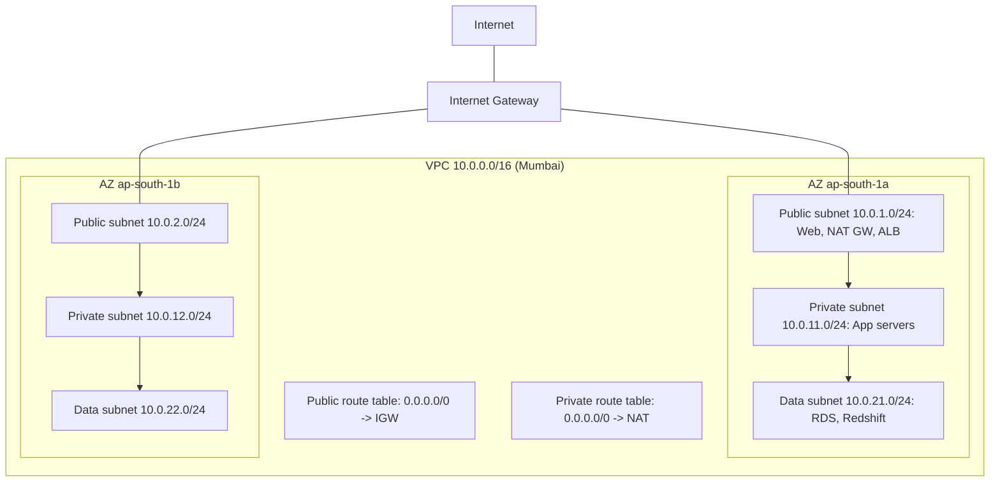
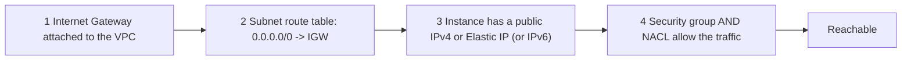
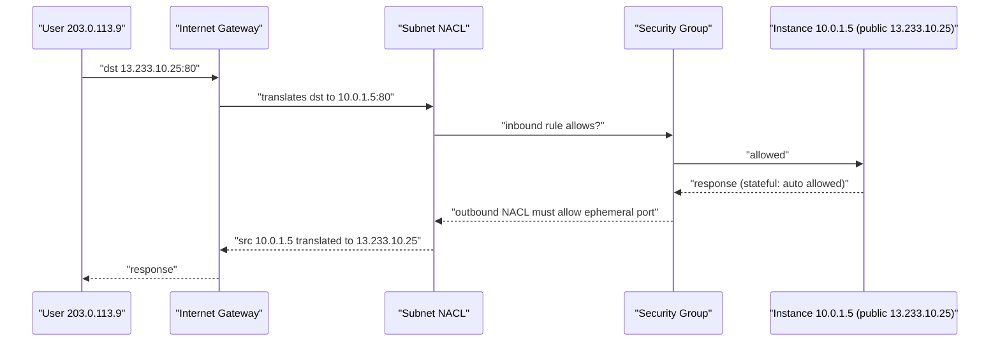
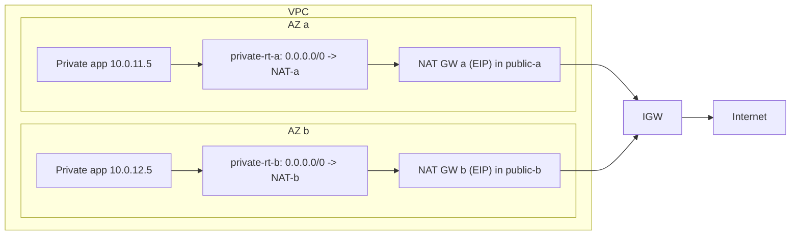
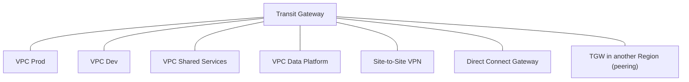
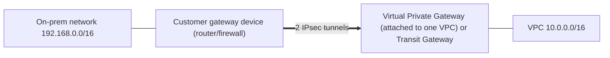
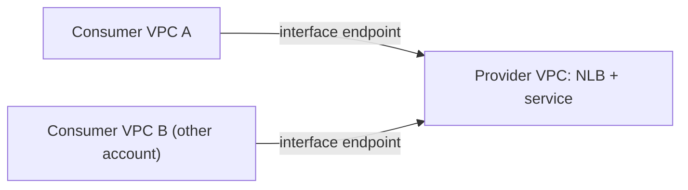
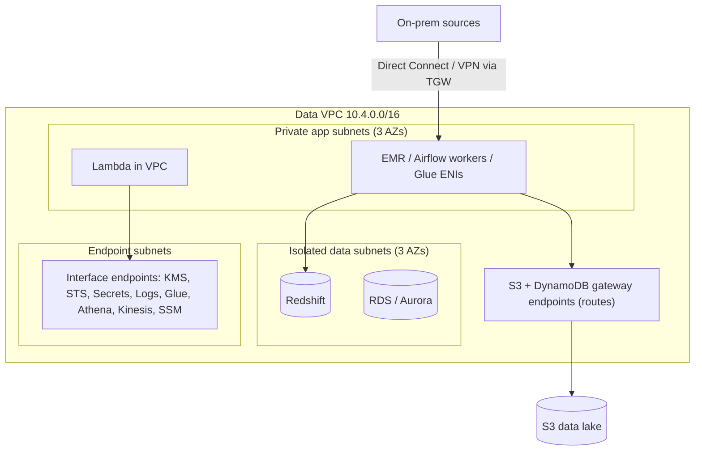
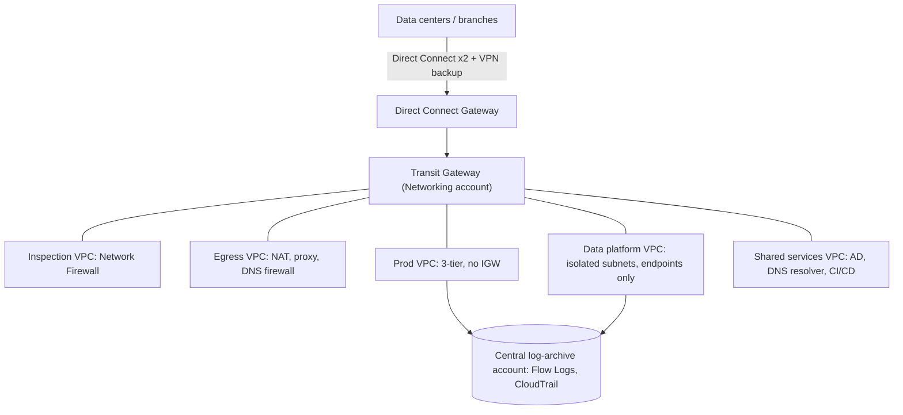

# Amazon VPC: Complete Practical Guide (Equivalent to a 5-Hour Lecture)

> **How to use this file:** Read a section, then immediately do its lab in your own AWS account. In this guide you **build a real VPC from nothing**, break it on purpose, and fix it. That is how networking becomes intuitive.
> **Cost warning:** A VPC, subnets, route tables, internet gateways, security groups and NACLs are **free**. These things **cost money while they exist**: **NAT Gateway**, **interface VPC endpoints**, **Transit Gateway attachments**, **VPN connections**, **public IPv4 addresses / Elastic IPs**, **EC2 instances**, **Flow Logs storage**. Labs flag them and each ends with cleanup. **Run the master cleanup in Section 31.**
> **Free plan note:** Your plan may restrict some services. If a step is blocked, the explanation still teaches the concept.
> **Region used:** ap-south-1 (Mumbai). **Prices and quotas change**, so treat numbers as approximate and verify on the pricing pages and in Service Quotas.
> **Prior notes assumed:** IAM, S3, EC2 (the labs reuse a role/instance profile called `EC2LabProfile`; Lab 3 shows how to recreate it quickly).

---

## Table of Contents

**Part A: Prerequisites (do not skip)**
1. How data travels: layers, ports, ephemeral ports
2. IP addresses and binary
3. CIDR and subnet math (deep) + Lab 1
4. Private vs public IPs, RFC 1918, NAT concept
5. Routing basics: route tables, default route, longest prefix match
6. Gateways, DNS and DHCP
7. Firewalls: stateful vs stateless (recap)
8. VPN, IPsec and BGP in plain words
9. Recap: EC2 and security groups

**Part B: VPC Core**
10. What is a VPC (and the default VPC)
11. VPC CIDR, subnets, reserved IPs, secondary CIDR
12. Route tables
13. Internet Gateway and what makes a subnet "public" + Lab 0 and Lab 2 (build your VPC) + Lab 3 (public instance and break/fix drills)
14. Private subnets and how to reach them + Lab 4
15. NAT Gateway, NAT instance, Egress-only IGW + Lab 5
16. VPC endpoints (Gateway and Interface) + Lab 6 and Lab 7
17. Security groups vs Network ACLs (deep) + Lab 8
18. VPC peering + Lab 9
19. Transit Gateway + Lab 13
20. Hybrid connectivity: Site-to-Site VPN, Direct Connect, Client VPN + Lab 14
21. DNS in a VPC, DHCP options, Route 53 Resolver
22. VPC Flow Logs + Lab 10
23. Reachability Analyzer and other tools + Lab 11
24. PrivateLink, VPC sharing, Network Firewall, WAF
25. IPv6 + Lab 12
26. **VPC for data engineering** + Lab 15
27. Pricing and cost optimization
28. Security best practices
29. Troubleshooting: connectivity checklists
30. Real-world architectures (bank, hospital, enterprise)
31. Master cleanup
32. Best practices checklist
33. Exam cheat sheet and 25 practice questions
34. Interview questions and final checklist

---

# PART A: PREREQUISITES

---

## 1. How Data Travels: Layers, Ports, Ephemeral Ports

### 1.1 The layers (simplified TCP/IP model)
```
Layer 7  Application   HTTP, HTTPS, SSH, DNS, SQL        <- what your software speaks
Layer 4  Transport     TCP / UDP + PORT numbers           <- which program on the machine
Layer 3  Network       IP addresses, ROUTING              <- which machine, and the path to it
Layer 2  Data link     MAC addresses, Ethernet            <- the local cable/wifi hop
```
In AWS you configure mostly **layer 3 and 4**: IP ranges, routes, and port-based firewalls. **ALB** works at **layer 7**, **NLB** at **layer 4**.

### 1.2 Packets
Data is chopped into small **packets**. Each carries: **source IP, destination IP, protocol, source port, destination port, payload**. Routers read the destination IP and forward the packet hop by hop.

### 1.3 Ports and the client/server pattern
- A **server** listens on a **well-known port** (HTTPS 443, SSH 22, PostgreSQL 5432).
- A **client** (your browser) picks a random **ephemeral port** (typically **1024-65535**; Linux often 32768-60999, Windows 49152-65535) as its source port.

```
Your laptop 203.0.113.9:51234   ---request--->   Web server 13.233.10.25:443
Your laptop 203.0.113.9:51234   <---response---   Web server 13.233.10.25:443
```
**Why you must care:** a **stateless firewall (NACL)** that allows inbound 443 must **also allow outbound traffic to the ephemeral port range**, otherwise the response is dropped. This is a top exam and real-life gotcha (Lab 8).

### 1.4 Protocols
- **TCP:** reliable, connection-based (web, SSH, databases).
- **UDP:** fast, connectionless (DNS queries, video, VoIP).
- **ICMP:** control messages (`ping`, "destination unreachable"). Often blocked by default, so **ping failing doesn't prove anything is broken** (it may just be blocked).

---

## 2. IP Addresses and Binary

An IPv4 address is **32 bits**, written as 4 numbers (each 0-255, one **octet** = 8 bits).
```
192.168.1.10
= 11000000 . 10101000 . 00000001 . 00001010
```
Binary place values for one octet: `128 64 32 16 8 4 2 1`.
Example: `10` = 8 + 2 = `00001010`. `192` = 128 + 64 = `11000000`. `255` = `11111111`.

An IP address has two parts: a **network part** (which network) and a **host part** (which device in it). **CIDR** tells you where the boundary is.

---

## 3. CIDR and Subnet Math (Deep)

### 3.1 CIDR notation
`10.0.0.0/16` means: the **first 16 bits are fixed (network)**, the remaining **32 − 16 = 16 bits are free (hosts)**.
```
10.0.0.0/16
11111111.11111111.00000000.00000000   <- the "subnet mask" 255.255.0.0 (first 16 bits are 1)
 network part  | host part
Range: 10.0.0.0  ->  10.0.255.255   (2^16 = 65,536 addresses)
```

### 3.2 The master formula
**Total addresses = 2^(32 − prefix).** Bigger prefix number = smaller network.

| CIDR | Host bits | Total IPs | **Usable in an AWS subnet (total − 5)** | Subnet mask |
|---|---|---|---|---|
| `/16` | 16 | 65,536 | 65,531 (max VPC size) | 255.255.0.0 |
| `/20` | 12 | 4,096 | 4,091 | 255.255.240.0 |
| `/22` | 10 | 1,024 | 1,019 | 255.255.252.0 |
| `/23` | 9 | 512 | 507 | 255.255.254.0 |
| `/24` | 8 | 256 | **251** | 255.255.255.0 |
| `/25` | 7 | 128 | 123 | 255.255.255.128 |
| `/26` | 6 | 64 | 59 | 255.255.255.192 |
| `/27` | 5 | 32 | 27 | 255.255.255.224 |
| `/28` | 4 | 16 | **11** (smallest AWS subnet) | 255.255.255.240 |

AWS allows VPC CIDRs between **/16 and /28**, and subnets within the same range.

### 3.3 Finding the range quickly (block size trick)
For a prefix inside an octet, the **block size** = 2^(host bits in that octet).
- `/24` → whole 4th octet is host: block 256 → `10.0.5.0/24` = `10.0.5.0 – 10.0.5.255`.
- `/26` → 6 host bits → block **64** in the 4th octet: subnets start at 0, 64, 128, 192.
  `10.0.0.0/26` = .0–.63; `10.0.0.64/26` = .64–.127; `.128/26` = .128–.191; `.192/26` = .192–.255.
- `/20` → 12 host bits: 4 in the 3rd octet (block **16**) + all 8 in the 4th. `10.0.16.0/20` = `10.0.16.0 – 10.0.31.255`.

### 3.4 Splitting a VPC into subnets
`10.0.0.0/16` split into **four equal subnets** → need 2 extra bits → `/18`:
```
10.0.0.0/18    10.0.0.0   - 10.0.63.255
10.0.64.0/18   10.0.64.0  - 10.0.127.255
10.0.128.0/18  10.0.128.0 - 10.0.191.255
10.0.192.0/18  10.0.192.0 - 10.0.255.255
```
Each extra bit **halves** the range and **doubles** the number of subnets.

### 3.5 Subnets must not overlap and must fit
Two ranges **overlap** if any address belongs to both. `10.0.1.0/24` and `10.0.1.128/25` overlap (the /25 sits inside the /24). Overlapping CIDRs between VPCs also **prevent peering and Transit Gateway routing**, which is why companies keep a central **IP address plan**.

### 3.6 Planning guidance (real-world)
| Decision | Advice |
|---|---|
| VPC size | `/16` is typical (65k IPs); don't make it tiny, because resizing means adding secondary CIDRs |
| Subnet size | `/24` for small tiers, `/20-/22` for big ones (EKS pods, EMR, Glue ENIs, Lambda ENIs consume many IPs) |
| Tiers | public / private-app / private-data (+ maybe "endpoints" subnets) in **each AZ** |
| Overlap | Give every VPC and on-prem network a **unique non-overlapping** range |
| Reserve | Leave unused blocks for future subnets |

Example **company IP plan** for `10.0.0.0/8`:
```
10.0.0.0/16   Prod VPC, ap-south-1
10.1.0.0/16   Staging VPC
10.2.0.0/16   Dev VPC
10.3.0.0/16   Shared services VPC
10.4.0.0/16   Data platform VPC
10.100.0.0/16 On-premises data centers
```

### LAB 1: CIDR practice (paper + Python, free)
**On paper** (answers below):
1. How many IPs in `10.0.0.0/20`?
2. What's the range of `172.16.32.0/21`?
3. Split `10.0.0.0/24` into 4 equal subnets.
4. Do `10.1.0.0/16` and `10.1.200.0/24` overlap?
5. How many **usable AWS** IPs in a `/27`?

**Answers:** (1) 2^12 = 4,096. (2) /21 → 11 host bits: 3 in the 3rd octet (block 8) → `172.16.32.0 – 172.16.39.255`. (3) `/26`s: `.0/26 .64/26 .128/26 .192/26`. (4) Yes (the /24 is inside the /16). (5) 32 − 5 = **27**.

**With Python** (works in CloudShell, no install):
```bash
python3 - << 'EOF'
import ipaddress as ip
net = ip.ip_network("10.0.0.0/16")
print("VPC:", net, "addresses:", net.num_addresses)
print("First 4 /24 subnets:", [str(s) for s in list(net.subnets(new_prefix=24))[:4]])
a = ip.ip_network("10.0.1.0/24"); b = ip.ip_network("10.0.1.128/25")
print("overlap?", a.overlaps(b))
print("range:", ip.ip_network("172.16.32.0/21")[0], "-", ip.ip_network("172.16.32.0/21")[-1])
print("AWS usable in /27:", ip.ip_network("10.0.0.0/27").num_addresses - 5)
EOF
```
Keep this snippet; you'll use it to plan every VPC.

---

## 4. Private vs Public IPs, RFC 1918, NAT Concept

### 4.1 Private ranges (RFC 1918): not routable on the public internet
| Range | CIDR | Size |
|---|---|---|
| 10.0.0.0 – 10.255.255.255 | `10.0.0.0/8` | 16.7 million |
| 172.16.0.0 – 172.31.255.255 | `172.16.0.0/12` | 1 million |
| 192.168.0.0 – 192.168.255.255 | `192.168.0.0/16` | 65 thousand |
(Also `100.64.0.0/10` shared address space, which AWS allows as a **secondary VPC CIDR** for things like EKS pods.)

Everything else is **public** (globally unique, routable on the internet).
AWS only allows you to use private ranges (and 100.64.0.0/10) for VPC CIDRs. Avoid the `169.254.0.0/16` link-local range and `172.17.0.0/16` if you run Docker.

### 4.2 NAT (Network Address Translation): the idea
Private addresses cannot talk directly to the internet. A **NAT device** rewrites the packet's source address to its own public address and remembers the mapping.
```
Private server 10.0.11.5:40000 ---> [NAT: public 13.233.1.1] ---> Internet site
                                  rewrites source to 13.233.1.1:61000
Reply comes back to 13.233.1.1:61000 -> NAT looks up the table -> forwards to 10.0.11.5:40000
```
- **Outbound connections** started from inside work.
- **Inbound connections** started from the internet to the private server **cannot** get in (no mapping exists). That is why NAT is both a connectivity tool and a **security feature** ("private servers can fetch updates but cannot be reached from outside").

**Two kinds in AWS:**
- **Internet Gateway** does a **1:1 NAT** between an instance's private IP and its public/Elastic IP (for instances that *have* public IPs).
- **NAT Gateway** does **many-to-one NAT** for private instances without public IPs (Section 15).

---

## 5. Routing Basics

A **route table** is a list of rules: *"for destination X, send the packet to target Y"*.

| Destination | Target |
|---|---|
| `10.0.0.0/16` | local |
| `0.0.0.0/0` | igw-123 |

### 5.1 Key ideas
- **Local route:** traffic inside the VPC CIDR is delivered automatically ("local"). You **cannot delete it**. This is why every subnet in a VPC can reach every other subnet by default (subject to SGs/NACLs).
- **Default route `0.0.0.0/0`:** "everything else" (the internet, or a path toward it).
- **Longest prefix match:** if multiple routes match, the **most specific** (largest prefix number) wins.

Example: destination `10.1.5.20`
| Route | Matches? |
|---|---|
| `0.0.0.0/0 → igw` | yes (prefix /0) |
| `10.1.0.0/16 → pcx-1` | yes (prefix /16) |
| `10.1.5.0/24 → tgw-9` | yes (prefix /24) ← **wins** |

### 5.2 Routing is a one-way decision
Each side must have a route **back**. Many "it connects one way but not the other" problems are a **missing return route** (peering and VPN labs show this).

---

## 6. Gateways, DNS and DHCP

- **Gateway:** a door to another network (internet gateway, NAT gateway, VPN gateway, transit gateway).
- **DNS:** converts names to IPs. Inside a VPC, AWS provides a resolver at **VPC base address + 2** (e.g., `10.0.0.2`) and `169.254.169.253`.
- **DHCP:** automatically hands each instance its IP, DNS server, domain name and NTP. In AWS this is a **DHCP options set** attached to the VPC.

---

## 7. Firewalls: Stateful vs Stateless (Recap)

| | Security Group | Network ACL |
|---|---|---|
| Level | Instance / ENI | **Subnet** |
| Stateful? | **Yes** (return traffic auto-allowed) | **No** (must allow both directions) |
| Rules | **Allow only** | **Allow and Deny**, evaluated in **number order** |
| Default | Inbound deny all, outbound allow all | **Default NACL allows all**; a **new custom NACL denies all** |

You will see both in depth in Section 17.

---

## 8. VPN, IPsec and BGP in Plain Words

- **VPN (Virtual Private Network):** an **encrypted tunnel** over the public internet connecting two private networks (or a user to a network).
- **IPsec:** the standard protocol suite used to encrypt such tunnels (Site-to-Site VPN uses IPsec).
- **BGP (Border Gateway Protocol):** a routing protocol that lets two networks **automatically advertise** their IP ranges to each other (dynamic routing), instead of typing static routes.
- **Dedicated private line (Direct Connect):** a physical fiber from your office/data center to AWS; **private and consistent**, not over the public internet.

---

## 9. Recap: EC2 and Security Groups

- An EC2 instance lives in **one subnet** (hence one AZ), with a **primary ENI**, **private IP**, optional **public IP/EIP**, and **security groups attached to the ENI**.
- SG rules can reference **other SGs**. Timeouts usually mean firewall/route problems, "connection refused" means reachable but nothing is listening.
- You used the **default VPC** in EC2 labs. Now you build your own.

---

# PART B: VPC CORE

---

## 10. What is a VPC?

A **Virtual Private Cloud (VPC)** is **your own logically isolated private network inside AWS**, where you define the IP range, subnets, routing, gateways and firewall rules. Resources like EC2, RDS, Redshift, EMR, Lambda (optionally), ECS/EKS run **inside** it.

**Analogy:** AWS is a huge office tower. A **VPC** is **your company's private floor**: you choose how it's divided into rooms (**subnets**), where the doors to the street are (**gateways**), the corridors (**routes**), and the security guards (**security groups/NACLs**). Other companies' floors are invisible to you.

### 10.1 Scope
```
AWS Account
 └── Region (ap-south-1)
      └── VPC (spans ALL AZs in the Region)
           ├── Subnet (lives in exactly ONE AZ)
           │     └── EC2 / RDS / ENIs ...
           ├── Route tables
           ├── Internet Gateway (one per VPC at most)
           ├── NAT Gateways, Endpoints, Peering, TGW attachments...
           └── Security groups and Network ACLs
```
- A VPC belongs to **one Region** and **spans all AZs** there.
- A **subnet belongs to one AZ**. To be highly available, create subnets in **multiple AZs** and spread resources.
- Default quota: about **5 VPCs per Region** per account (adjustable), many subnets per VPC.

### 10.2 The default VPC
Every Region in your account has a **default VPC** (usually `172.31.0.0/16`) with:
- A **public subnet in each AZ** (`/20` each),
- An **Internet Gateway** attached,
- A **main route table** with `0.0.0.0/0 → igw`,
- A **default security group** and **default NACL** (allow all),
- **Auto-assign public IPv4 = yes** on subnets.
It exists so beginners can launch instances immediately. **Real production uses custom VPCs.** You can delete a default VPC and recreate it with `aws ec2 create-default-vpc`.

### 10.3 Component map


---

## 11. VPC CIDR, Subnets, Reserved IPs, Secondary CIDR

### 11.1 Subnet types (by routing, not by a checkbox)
| Type | Route to internet? | Typical contents |
|---|---|---|
| **Public subnet** | Route `0.0.0.0/0 → Internet Gateway` | Load balancers, NAT gateways, bastions, public web servers |
| **Private subnet** | No direct route to IGW; may go out via **NAT** (`0.0.0.0/0 → NAT GW`) | App servers, EMR, Glue ENIs, Lambda in VPC |
| **Isolated/Data subnet** | **No route to the internet at all** (only local, endpoints, maybe peering) | Databases, data warehouses, sensitive stores |
| **VPN-only subnet** | Route to a virtual private gateway | On-prem-only access |

**There is no "public" checkbox.** A subnet is *public* because of its **route table**.

### 11.2 The 5 reserved IPs in every subnet
For subnet `10.0.1.0/24`:
| Address | Use |
|---|---|
| `10.0.1.0` | Network address |
| `10.0.1.1` | **VPC router** |
| `10.0.1.2` | **Amazon DNS** resolver (for the VPC: base+2) |
| `10.0.1.3` | Reserved for future use |
| `10.0.1.255` | Broadcast (reserved; broadcast not supported) |
So a `/24` has **251** usable addresses.

### 11.3 Adding CIDR blocks
- A VPC has one **primary IPv4 CIDR** (cannot be changed) and can add **secondary CIDRs** (default up to 5 IPv4 blocks, adjustable) when you run out of space. Secondary blocks must not overlap existing ones.
- You can also add an **IPv6 CIDR** (Amazon-provided `/56`; each subnet gets a `/64`).

### 11.4 Subnet settings
- **Auto-assign public IPv4**: new instances in that subnet get a public IP.
- **Auto-assign IPv6**.
- **Subnet is tied to an AZ** at creation and **cannot be moved**.
- **Subnet CIDR cannot be edited**; to change, create a new subnet and migrate.

### 11.5 Fixed VPC rules to memorize
- **Only one Internet Gateway per VPC**, and an IGW attaches to **one VPC**.
- Subnets **cannot span AZs**.
- **Each subnet is associated with exactly one route table** and **one NACL**.
- DNS attributes: `enableDnsSupport` (VPC resolver on, default true) and `enableDnsHostnames` (instances get DNS names, default false in custom VPCs, true in default VPC).

---

## 12. Route Tables

### 12.1 Facts
| Fact | Detail |
|---|---|
| **Main route table** | Automatically created; used by any subnet **not explicitly associated** with another table. Best practice: **keep the main route table private/empty** (only `local`) and create **explicit custom tables** for public subnets |
| **Custom route table** | You create; associate to subnets |
| **Association** | A subnet has **one** route table; a route table can serve **many** subnets |
| **Local route** | Automatic, undeletable, covers VPC CIDR(s) |
| **Targets** | `igw-`, `nat-`, `vgw-`, `tgw-`, `pcx-` (peering), `vpce-` (gateway endpoint), `eni-`, `eigw-`, `local` |
| **Gateway route table** | Associated with an IGW/VGW (edge association) for inspection patterns |
| **Propagation** | A VGW/TGW can **propagate** routes into a table automatically |
| **Evaluation** | **Longest prefix match** |

### 12.2 Typical tables
```
PUBLIC-RT                         PRIVATE-RT-A (for AZ a)
10.0.0.0/16   -> local            10.0.0.0/16   -> local
0.0.0.0/0     -> igw-abc          0.0.0.0/0     -> nat-aaa   (NAT in AZ a)
                                  pl-xxxx (S3)  -> vpce-s3   (gateway endpoint)

DATA-RT (isolated)
10.0.0.0/16   -> local
pl-xxxx (S3)  -> vpce-s3          (no internet route at all)
```

---

## 13. Internet Gateway and What Makes a Subnet "Public"

### 13.1 Internet Gateway (IGW)
- A **managed, horizontally scaled, highly available** component: no bandwidth limit, no single point of failure, **free** (you pay for public IPs).
- Two jobs: (1) a **target** in route tables for internet-bound traffic, (2) performs **1:1 NAT** between an instance's **private IP and its public/Elastic IPv4 address**.

### 13.2 The four conditions for an instance to be reachable from the internet

**Miss any one and it fails.** This four-point checklist is the key to solving "can't reach my instance from the internet" questions.

### 13.3 Packet journey (inbound web request)


### LAB 0: Explore the default VPC (CLI, free)
```bash
export AWS_DEFAULT_REGION=ap-south-1
ACCOUNT_ID=$(aws sts get-caller-identity --query Account --output text)

# The default VPC
aws ec2 describe-vpcs --filters Name=isDefault,Values=true \
  --query 'Vpcs[0].[VpcId,CidrBlock,DhcpOptionsId]' --output text
DVPC=$(aws ec2 describe-vpcs --filters Name=isDefault,Values=true --query 'Vpcs[0].VpcId' --output text)

# Subnets, AZs and sizes
aws ec2 describe-subnets --filters Name=vpc-id,Values=$DVPC \
  --query 'Subnets[].[SubnetId,AvailabilityZone,CidrBlock,AvailableIpAddressCount,MapPublicIpOnLaunch]' --output table

# Route table: find the 0.0.0.0/0 -> igw route
aws ec2 describe-route-tables --filters Name=vpc-id,Values=$DVPC \
  --query 'RouteTables[].Routes[].[DestinationCidrBlock,GatewayId]' --output table

# Internet gateway, SG, NACL
aws ec2 describe-internet-gateways --filters Name=attachment.vpc-id,Values=$DVPC --query 'InternetGateways[].InternetGatewayId'
aws ec2 describe-security-groups --filters Name=vpc-id,Values=$DVPC Name=group-name,Values=default \
  --query 'SecurityGroups[0].[GroupId,IpPermissions,IpPermissionsEgress]'
aws ec2 describe-network-acls --filters Name=vpc-id,Values=$DVPC --query 'NetworkAcls[0].Entries'
```
Notice: `/20` subnets (4,096 addresses, `AvailableIpAddressCount` ≈ 4,091), one per AZ, all public. **Console:** open **VPC > Your VPCs / Subnets / Route tables / Internet gateways / Security groups / Network ACLs** and click through each tab (**Resource map** on the VPC page draws the whole picture).

### LAB 2: Build your own VPC from scratch (public + private subnets in 2 AZs)

**Target design**
```
lab-vpc 10.0.0.0/16
  AZ a: public 10.0.1.0/24    private 10.0.11.0/24
  AZ b: public 10.0.2.0/24    private 10.0.12.0/24
  IGW attached; public-rt (0.0.0.0/0 -> IGW) on both public subnets; private-rt on both private subnets
```

**Option A: Console (learn each piece)**
```
VPC > Your VPCs > Create VPC > "VPC only"
  Name: lab-vpc | IPv4 CIDR: 10.0.0.0/16 | no IPv6 | Tenancy: Default > Create
Select lab-vpc > Actions > Edit VPC settings > [x] Enable DNS hostnames

VPC > Subnets > Create subnet > VPC: lab-vpc
  lab-public-a   ap-south-1a   10.0.1.0/24
  lab-public-b   ap-south-1b   10.0.2.0/24
  lab-private-a  ap-south-1a   10.0.11.0/24
  lab-private-b  ap-south-1b   10.0.12.0/24
For the two public subnets: Actions > Edit subnet settings > [x] Enable auto-assign public IPv4

VPC > Internet gateways > Create > Name lab-igw > Create > Actions > Attach to VPC > lab-vpc

VPC > Route tables > Create > Name lab-public-rt > VPC lab-vpc
  Routes > Edit > Add route: 0.0.0.0/0 -> Internet Gateway lab-igw
  Subnet associations > Edit explicit associations > lab-public-a, lab-public-b
VPC > Route tables > Create > Name lab-private-rt > VPC lab-vpc
  Subnet associations > lab-private-a, lab-private-b      (only local route, no internet)
```
**Option B: Console wizard "VPC and more"**
```
VPC > Create VPC > "VPC and more": preview diagram, choose number of AZs (2), public (2) and private (2) subnets, NAT gateways (None for now), S3 gateway endpoint (Yes), then Create.
```
It builds everything above in one click. Great for speed, but build manually once to understand it. (NAT gateways in the wizard cost money, so choose **None** for now.)

**Option C: CLI script (repeatable; this is what Infrastructure as Code is based on)**
```bash
export AWS_DEFAULT_REGION=ap-south-1
VPC_ID=$(aws ec2 create-vpc --cidr-block 10.0.0.0/16 \
   --tag-specifications 'ResourceType=vpc,Tags=[{Key=Name,Value=lab-vpc}]' --query Vpc.VpcId --output text)
aws ec2 modify-vpc-attribute --vpc-id $VPC_ID --enable-dns-hostnames "{\"Value\":true}"

mk_subnet () {  # name cidr az
  aws ec2 create-subnet --vpc-id $VPC_ID --cidr-block $2 --availability-zone $3 \
    --tag-specifications "ResourceType=subnet,Tags=[{Key=Name,Value=$1}]" --query Subnet.SubnetId --output text
}
PUB_A=$(mk_subnet lab-public-a  10.0.1.0/24  ap-south-1a)
PUB_B=$(mk_subnet lab-public-b  10.0.2.0/24  ap-south-1b)
PRIV_A=$(mk_subnet lab-private-a 10.0.11.0/24 ap-south-1a)
PRIV_B=$(mk_subnet lab-private-b 10.0.12.0/24 ap-south-1b)
aws ec2 modify-subnet-attribute --subnet-id $PUB_A --map-public-ip-on-launch
aws ec2 modify-subnet-attribute --subnet-id $PUB_B --map-public-ip-on-launch

IGW=$(aws ec2 create-internet-gateway --tag-specifications 'ResourceType=internet-gateway,Tags=[{Key=Name,Value=lab-igw}]' \
      --query InternetGateway.InternetGatewayId --output text)
aws ec2 attach-internet-gateway --internet-gateway-id $IGW --vpc-id $VPC_ID

PUB_RT=$(aws ec2 create-route-table --vpc-id $VPC_ID --tag-specifications 'ResourceType=route-table,Tags=[{Key=Name,Value=lab-public-rt}]' --query RouteTable.RouteTableId --output text)
aws ec2 create-route --route-table-id $PUB_RT --destination-cidr-block 0.0.0.0/0 --gateway-id $IGW
aws ec2 associate-route-table --route-table-id $PUB_RT --subnet-id $PUB_A
aws ec2 associate-route-table --route-table-id $PUB_RT --subnet-id $PUB_B

PRIV_RT=$(aws ec2 create-route-table --vpc-id $VPC_ID --tag-specifications 'ResourceType=route-table,Tags=[{Key=Name,Value=lab-private-rt}]' --query RouteTable.RouteTableId --output text)
aws ec2 associate-route-table --route-table-id $PRIV_RT --subnet-id $PRIV_A
aws ec2 associate-route-table --route-table-id $PRIV_RT --subnet-id $PRIV_B

echo "VPC=$VPC_ID PUB_A=$PUB_A PUB_B=$PUB_B PRIV_A=$PRIV_A PRIV_B=$PRIV_B IGW=$IGW PUB_RT=$PUB_RT PRIV_RT=$PRIV_RT"
```
> **Write these IDs down.** CloudShell variables vanish if the session restarts. To rediscover later: `VPC_ID=$(aws ec2 describe-vpcs --filters Name=tag:Name,Values=lab-vpc --query 'Vpcs[0].VpcId' --output text)` and similarly for subnets by tag.

**Verify:**
```bash
aws ec2 describe-route-tables --filters Name=vpc-id,Values=$VPC_ID \
  --query 'RouteTables[].[Tags[?Key==`Name`]|[0].Value,Routes[].[DestinationCidrBlock,GatewayId]]' --output json
```
On the console, open lab-vpc > **Resource map**: public subnets link to `lab-public-rt` (with IGW), private subnets link to `lab-private-rt` (local only).

### LAB 3: Launch a public web server in your VPC, then BREAK it and fix it

**Prep (skip if `EC2LabProfile` exists from the EC2 notes):**
```bash
cat > ec2-trust.json << 'EOF'
{ "Version":"2012-10-17","Statement":[{"Effect":"Allow","Principal":{"Service":"ec2.amazonaws.com"},"Action":"sts:AssumeRole"}] }
EOF
aws iam create-role --role-name EC2LabRole --assume-role-policy-document file://ec2-trust.json
aws iam attach-role-policy --role-name EC2LabRole --policy-arn arn:aws:iam::aws:policy/AmazonSSMManagedInstanceCore
aws iam create-instance-profile --instance-profile-name EC2LabProfile
aws iam add-role-to-instance-profile --instance-profile-name EC2LabProfile --role-name EC2LabRole
sleep 10
```
(If the S3 permissions are missing, add the S3 inline policy as in the EC2 notes; Lab 6 needs S3 access.)

```bash
AMI=$(aws ssm get-parameter --name /aws/service/ami-amazon-linux-latest/al2023-ami-kernel-default-x86_64 --query Parameter.Value --output text)

# Security group: HTTP from anywhere, no SSH (we use SSM/EICE)
SG_WEB=$(aws ec2 create-security-group --group-name lab-web-sg --description "web" --vpc-id $VPC_ID --query GroupId --output text)
aws ec2 authorize-security-group-ingress --group-id $SG_WEB --protocol tcp --port 80 --cidr 0.0.0.0/0

cat > web-ud.sh << 'EOF'
#!/bin/bash
dnf install -y httpd
systemctl enable --now httpd
TOKEN=$(curl -s -X PUT "http://169.254.169.254/latest/api/token" -H "X-aws-ec2-metadata-token-ttl-seconds: 300")
IID=$(curl -s -H "X-aws-ec2-metadata-token: $TOKEN" http://169.254.169.254/latest/meta-data/instance-id)
AZ=$(curl -s -H "X-aws-ec2-metadata-token: $TOKEN" http://169.254.169.254/latest/meta-data/placement/availability-zone)
echo "<h1>lab-vpc web: $IID in $AZ</h1>" > /var/www/html/index.html
EOF

WEB_ID=$(aws ec2 run-instances --image-id $AMI --instance-type t3.micro --subnet-id $PUB_A \
  --security-group-ids $SG_WEB --iam-instance-profile Name=EC2LabProfile \
  --metadata-options HttpTokens=required --user-data file://web-ud.sh \
  --tag-specifications 'ResourceType=instance,Tags=[{Key=Name,Value=lab-web}]' --query 'Instances[0].InstanceId' --output text)
aws ec2 wait instance-running --instance-ids $WEB_ID
WEB_IP=$(aws ec2 describe-instances --instance-ids $WEB_ID --query 'Reservations[0].Instances[0].PublicIpAddress' --output text)
echo $WEB_IP
```
(Use your free-tier-eligible type if `t3.micro` isn't allowed.) After about 1 to 2 minutes open `http://$WEB_IP` in a browser. **It works** because all four conditions from Section 13.2 hold.

**The break-and-fix drills (do them one at a time; restore after each)**

| # | Break | Symptom | How you'd diagnose | Fix |
|---|---|---|---|---|
| 1 | Delete the `0.0.0.0/0 → IGW` route in `lab-public-rt` | Page **times out** | Subnet's route table has no internet route | `aws ec2 create-route --route-table-id $PUB_RT --destination-cidr-block 0.0.0.0/0 --gateway-id $IGW` |
| 2 | Revoke the SG's port 80 rule: `aws ec2 revoke-security-group-ingress --group-id $SG_WEB --protocol tcp --port 80 --cidr 0.0.0.0/0` | **Times out** | SG has no inbound rule | `authorize-security-group-ingress` again |
| 3 | Launch a second instance in `$PUB_A` with `--no-associate-public-ip-address` | Instance has **no public IP** → unreachable | Instance details show no public IPv4 | Associate an Elastic IP, or relaunch with public IP |
| 4 | `aws ec2 detach-internet-gateway --internet-gateway-id $IGW --vpc-id $VPC_ID` (needs no public-IP resources active... if it errors with "mapped public addresses", that itself teaches you IGW dependencies) | Total outage | VPC has no IGW | Reattach IGW |
| 5 | Add a **NACL deny** for port 80 (Lab 8 teaches this fully) | Times out although SG/route are right | NACL on the subnet | Remove deny rule |

After each break use the **four-condition checklist** from Section 13.2 and fix it. Restore the working state before moving on.

---

## 14. Private Subnets and How to Reach Them

### 14.1 Why private
Databases, app servers and data platforms should **not** have public IPs or a route to the internet. Even if a security group is misconfigured, no inbound path exists. This is **defense in depth**.

### 14.2 How admins reach instances in private subnets
| Method | How | Notes |
|---|---|---|
| **AWS Systems Manager Session Manager** | Agent + IAM role; needs a path to SSM endpoints (NAT or **interface endpoints**) | **Recommended**: no inbound ports, no keys, logged |
| **EC2 Instance Connect Endpoint (EICE)** | An endpoint in the VPC that tunnels SSH/RDP to private instances using IAM, with **no public IP and no bastion** | Free (you pay normal data transfer). IAM-controlled and logged in CloudTrail |
| **Bastion host (jump box)** | A hardened instance in a public subnet; you SSH to it, then hop to private instances | Legacy pattern: needs patching, keys, an open port |
| **VPN / Direct Connect** | Private network access from your office | For corporate users |

### LAB 4: Launch a private instance and reach it with EC2 Instance Connect Endpoint
```bash
# Security groups: private instance allows SSH only from the EICE's SG
SG_EICE=$(aws ec2 create-security-group --group-name lab-eice-sg --description "eice" --vpc-id $VPC_ID --query GroupId --output text)
SG_PRIV=$(aws ec2 create-security-group --group-name lab-private-sg --description "private instances" --vpc-id $VPC_ID --query GroupId --output text)
aws ec2 authorize-security-group-ingress --group-id $SG_PRIV --protocol tcp --port 22 --source-group $SG_EICE
# EICE security group allows all outbound by default (it needs to reach port 22 of the instance)

# Create the EICE in a private subnet
EICE=$(aws ec2 create-instance-connect-endpoint --subnet-id $PRIV_A --security-group-ids $SG_EICE \
       --query InstanceConnectEndpoint.InstanceConnectEndpointId --output text)
aws ec2 describe-instance-connect-endpoints --instance-connect-endpoint-ids $EICE --query 'InstanceConnectEndpoints[0].State'
# wait until "create-complete" (a few minutes)

# Launch the private instance: NO public IP
PRIV_ID=$(aws ec2 run-instances --image-id $AMI --instance-type t3.micro --subnet-id $PRIV_A \
  --security-group-ids $SG_PRIV --no-associate-public-ip-address --iam-instance-profile Name=EC2LabProfile \
  --metadata-options HttpTokens=required \
  --tag-specifications 'ResourceType=instance,Tags=[{Key=Name,Value=lab-private}]' --query 'Instances[0].InstanceId' --output text)
aws ec2 wait instance-running --instance-ids $PRIV_ID
aws ec2 describe-instances --instance-ids $PRIV_ID --query 'Reservations[0].Instances[0].[PrivateIpAddress,PublicIpAddress]' --output text
```
**Connect:** Console: **EC2 > Instances > lab-private > Connect > EC2 Instance Connect > "Connect using EC2 Instance Connect Endpoint"**, or from CloudShell:
```bash
aws ec2-instance-connect ssh --instance-id $PRIV_ID --connection-type eice
```
Inside the private instance run the **isolation test**:
```bash
curl -m 5 https://checkip.amazonaws.com || echo "NO INTERNET (as designed)"
sudo dnf check-update 2>&1 | tail -2        # may fail or hang: no route out
ip route | head -3                          # default via the subnet router 10.0.11.1
```
You reached a server with **no public IP, no bastion, no open internet port**, yet it has **no outbound internet**. Section 15 fixes the outbound side.

---

## 15. NAT Gateway, NAT Instance, Egress-only IGW

### 15.1 NAT Gateway (managed, the default choice)
Lets **private-subnet instances start outbound connections** (OS updates, API calls, package downloads) while **blocking inbound connections from the internet**.

| Fact | Detail |
|---|---|
| Placement | Lives in a **public subnet** and needs an **Elastic IP** (public NAT) |
| Scope | **Zonal**: it exists in **one AZ**. If that AZ fails, its NAT is gone |
| Routing | Private route table: `0.0.0.0/0 → nat-xxxx`. NAT's own subnet needs `0.0.0.0/0 → IGW` |
| Scale | Automatic: starts at 5 Gbps, scales to ~100 Gbps |
| Security | **No security group** on a NAT gateway (NACLs on its subnet apply). Instances' SGs control their own outbound |
| Protocols | TCP, UDP, ICMP. No inbound port forwarding |
| Cost | **Hourly charge + per-GB processed** (a classic bill surprise) plus public IPv4 |
| HA design | **One NAT per AZ**, each private route table pointing to the NAT in its own AZ (avoids a cross-AZ dependency and cross-AZ data charges) |
| Private NAT gateway | A variant with **no EIP** for private-to-private translation (e.g., overlapping on-prem ranges via TGW/VPN) |
| Regional NAT mode | AWS has been adding a Regional availability mode that spans AZs automatically; check current docs before relying on it for design answers |



### 15.2 NAT Instance (legacy)
An EC2 instance configured as a NAT (Amazon Linux with IP forwarding, **source/destination check disabled**, Elastic IP, SG you control). Cheaper at tiny scale, you can use SG/port forwarding/bastion roles, but **you** manage patching, scaling and failover. Exams still mention it; production uses NAT Gateway.

| | NAT Gateway | NAT Instance |
|---|---|---|
| Availability | HA within an AZ | You build failover |
| Bandwidth | Up to ~100 Gbps | Depends on instance type |
| Maintenance | AWS | You |
| Security groups | No | Yes |
| Port forwarding / bastion use | No | Possible |
| Cost | Hourly + GB | Instance cost |

### 15.3 Egress-only Internet Gateway (IPv6)
IPv6 addresses are all public, so there's no NAT. To let IPv6 instances **go out** but block inbound, use an **Egress-only Internet Gateway** (route `::/0 → eigw-xxxx`). It's stateful and IPv6-only.

### LAB 5: Add a NAT gateway so the private instance can reach the internet (small cost)
```bash
# 1) Elastic IP + NAT gateway in the PUBLIC subnet
EIP_ALLOC=$(aws ec2 allocate-address --domain vpc --query AllocationId --output text)
NAT_ID=$(aws ec2 create-nat-gateway --subnet-id $PUB_A --allocation-id $EIP_ALLOC \
   --tag-specifications 'ResourceType=natgateway,Tags=[{Key=Name,Value=lab-nat-a}]' --query NatGateway.NatGatewayId --output text)
aws ec2 wait nat-gateway-available --nat-gateway-ids $NAT_ID
NAT_IP=$(aws ec2 describe-addresses --allocation-ids $EIP_ALLOC --query 'Addresses[0].PublicIp' --output text)
echo "NAT public IP: $NAT_IP"

# 2) Point the private route table's default route at the NAT
aws ec2 create-route --route-table-id $PRIV_RT --destination-cidr-block 0.0.0.0/0 --nat-gateway-id $NAT_ID
```
**3) Test inside the private instance (EICE session):**
```bash
curl -m 10 https://checkip.amazonaws.com        # prints the NAT gateway's EIP!
sudo dnf check-update | head -3                 # package repos reachable now
```
The "public IP" the internet sees for your private server is the **NAT's Elastic IP**.

**4) Prove inbound is impossible:** try `curl http://$NAT_IP` from your browser or CloudShell: it doesn't reach the private instance (the NAT forwards nothing inbound).

**5) Explore the break:** delete the route (`aws ec2 delete-route --route-table-id $PRIV_RT --destination-cidr-block 0.0.0.0/0`) → internet stops again. Also notice the NAT subnet **must** have the IGW route (it is in `lab-public-rt`, so yes).

**6) CLEAN UP the NAT immediately after testing (it bills hourly):**
```bash
aws ec2 delete-route --route-table-id $PRIV_RT --destination-cidr-block 0.0.0.0/0
aws ec2 delete-nat-gateway --nat-gateway-id $NAT_ID
aws ec2 wait nat-gateway-deleted --nat-gateway-ids $NAT_ID 2>/dev/null || sleep 60
aws ec2 release-address --allocation-id $EIP_ALLOC
```
(The next two labs deliberately run **without** NAT, using endpoints.)

---

## 16. VPC Endpoints

### 16.1 Why endpoints
Without endpoints, a private instance reaching **S3, DynamoDB, KMS, SSM, CloudWatch, STS, Glue...** goes: private subnet → **NAT** → internet → AWS public endpoint. That costs NAT money and sends traffic out of your private network. **VPC endpoints** let you reach AWS services **privately over the AWS network**.

### 16.2 Two (plus) types

| | **Gateway endpoint** | **Interface endpoint (AWS PrivateLink)** |
|---|---|---|
| Services | **S3** and **DynamoDB** only | **Most AWS services** (SSM, KMS, STS, Secrets Manager, CloudWatch, SNS, SQS, Glue, Athena, ECR, Kinesis...) and partner/own services; S3 also has an interface endpoint (for on-prem/other-Region access) |
| How it works | A **route table entry** (target `vpce-xxx`, destination is the service's **prefix list**) | An **ENI with a private IP** in your subnet(s) + (usually) **private DNS** so the normal service name resolves to that IP |
| Cost | **Free** | **Hourly per AZ + per GB** |
| Security | **Endpoint policy** (resource-based), bucket policy conditions (`aws:SourceVpce`) | **Endpoint policy** + **security group on the ENI** |
| Reachable from on-prem/peered VPC? | **No** (only from within the VPC via route tables) | **Yes** (via VPN/DX/peering/TGW, since it's an IP in your VPC) |
| Region | Same Region as the service | Same Region (cross-Region has special options) |
| Others | | **Gateway Load Balancer endpoint** (for security appliances) |

**Memory aid:** "**G**ateway = **G**ratis (free), only **S3 and DynamoDB**, uses **routes**. **I**nterface = **I**P address (ENI), many services, costs money."

### 16.3 Endpoint policies
A JSON policy attached to an endpoint that limits what can be done through it:
```json
{
  "Version": "2012-10-17",
  "Statement": [{
    "Effect": "Allow",
    "Principal": "*",
    "Action": ["s3:GetObject","s3:PutObject","s3:ListBucket"],
    "Resource": ["arn:aws:s3:::BUCKET","arn:aws:s3:::BUCKET/*"]
  }]
}
```
Default policy = full access. A restrictive endpoint policy is a **data-exfiltration control** (stops someone copying your data into an attacker's bucket from inside the VPC). **Gotcha:** Amazon Linux package repositories are served from S3, so over-restrictive endpoint policies break `dnf` unless you also allow the AL2023 repo bucket pattern (for example `arn:aws:s3:::al2023-repos-ap-south-1-*/*`).

### 16.4 Forcing S3 access through your endpoint (bucket side)
```json
{
  "Sid": "OnlyFromMyVPCEndpoint",
  "Effect": "Deny",
  "Principal": "*",
  "Action": "s3:*",
  "Resource": ["arn:aws:s3:::BUCKET","arn:aws:s3:::BUCKET/*"],
  "Condition": { "StringNotEquals": { "aws:SourceVpce": "vpce-0123456789abcdef" } }
}
```
> **Danger:** this denies **everyone** (including you in the console/CLI outside the VPC) and can lock you out. Always add an exception for an admin role (e.g., `ArnNotLike aws:PrincipalArn`) or test on a throwaway bucket. Root can still fix a bucket policy lockout.

### LAB 6: S3 Gateway endpoint: private subnet reaches S3 with NO NAT and NO internet
Prereq: private instance `$PRIV_ID` has `EC2LabProfile` with S3 access to your lab bucket (see EC2 Lab 9), and the **NAT route is deleted** (end of Lab 5). Set `BUCKET=s3lab-yourname-12345` (your S3 lab bucket).

```bash
# 1) Create the Gateway endpoint and attach it to the private route table
S3_VPCE=$(aws ec2 create-vpc-endpoint --vpc-id $VPC_ID --vpc-endpoint-type Gateway \
   --service-name com.amazonaws.ap-south-1.s3 --route-table-ids $PRIV_RT \
   --query VpcEndpoint.VpcEndpointId --output text)
aws ec2 describe-route-tables --route-table-ids $PRIV_RT --query 'RouteTables[0].Routes[].[DestinationPrefixListId,DestinationCidrBlock,GatewayId]' --output table
```
You'll see a new route whose destination is a **prefix list** (`pl-...`, the S3 IP ranges) and target `vpce-...`.

**2) Test inside the private instance (EICE session):**
```bash
aws s3 ls s3://BUCKET/ --region ap-south-1                 # WORKS via the endpoint
echo "from private subnet" > p.txt && aws s3 cp p.txt s3://BUCKET/ec2lab/p.txt   # works if your role allows ec2lab/*
curl -m 5 https://checkip.amazonaws.com || echo "still no general internet"       # fails
```
S3 works, and general internet access doesn't. That's the **isolated data-subnet pattern** used in banks.

**3) Restrict with an endpoint policy:**
```bash
cat > vpce-policy.json << EOF
{ "Version":"2012-10-17","Statement":[{
  "Effect":"Allow","Principal":"*",
  "Action":["s3:GetObject","s3:PutObject","s3:ListBucket"],
  "Resource":["arn:aws:s3:::$BUCKET","arn:aws:s3:::$BUCKET/*"] }]}
EOF
aws ec2 modify-vpc-endpoint --vpc-endpoint-id $S3_VPCE --policy-document file://vpce-policy.json
```
Now from the private instance: `aws s3 ls s3://BUCKET/` works; `aws s3 ls s3://some-other-bucket/` is denied **by the endpoint policy** (error mentions the VPC endpoint policy), even if the IAM role would allow it. (Reset to full access later with `--reset-policy` if you want `dnf` to work.)

**4) Read-only exercise:** think through why a bucket policy with `aws:SourceVpce` plus an endpoint policy gives **two-sided control** (the VPC can only reach approved buckets, and approved buckets can only be reached from the VPC).

### LAB 7: Interface endpoints: Session Manager into a private instance with no NAT (small cost)
Goal: reach `$PRIV_ID` using **Session Manager** while the subnet has **no internet and no NAT**.
```bash
# SG for the endpoint ENIs: allow HTTPS from inside the VPC
SG_VPCE=$(aws ec2 create-security-group --group-name lab-vpce-sg --description "interface endpoints" --vpc-id $VPC_ID --query GroupId --output text)
aws ec2 authorize-security-group-ingress --group-id $SG_VPCE --protocol tcp --port 443 --cidr 10.0.0.0/16

# Three interface endpoints required by SSM (one AZ keeps cost low for the lab)
for svc in ssm ssmmessages ec2messages; do
  aws ec2 create-vpc-endpoint --vpc-id $VPC_ID --vpc-endpoint-type Interface \
    --service-name com.amazonaws.ap-south-1.$svc --subnet-ids $PRIV_A --security-group-ids $SG_VPCE \
    --private-dns-enabled --query VpcEndpoint.VpcEndpointId --output text
done
aws ec2 describe-vpc-endpoints --filters Name=vpc-id,Values=$VPC_ID --query 'VpcEndpoints[].[VpcEndpointId,ServiceName,State]' --output table
```
Wait until all are `available`, then **restart the SSM agent** on the instance (or reboot) and check registration:
```bash
aws ssm describe-instance-information --query 'InstanceInformationList[].[InstanceId,PingStatus]' --output text
```
Then **EC2 > Instances > lab-private > Connect > Session Manager**. You now have a shell on a server with **no public IP, no NAT, no SSH port, no internet**. This is the pattern of a locked-down bank.

**Why private DNS matters:** with `--private-dns-enabled`, the name `ssm.ap-south-1.amazonaws.com` resolves **inside the VPC** to the endpoint's **private IPs**. Prove it from the instance: `getent hosts ssm.ap-south-1.amazonaws.com` shows a `10.0.11.x` address.

**Cost:** each interface endpoint charges hourly per AZ + per GB; three endpoints for an hour is cents. **Delete them after the lab** (Section 31):
```bash
for ep in $(aws ec2 describe-vpc-endpoints --filters Name=vpc-id,Values=$VPC_ID Name=vpc-endpoint-type,Values=Interface --query 'VpcEndpoints[].VpcEndpointId' --output text); do
  aws ec2 delete-vpc-endpoints --vpc-endpoint-ids $ep; done
```

---

## 17. Security Groups vs Network ACLs (Deep)

### 17.1 Comparison (memorize this table)
| | **Security Group** | **Network ACL** |
|---|---|---|
| Applies to | ENI/instance | **Subnet** (all traffic entering/leaving) |
| Stateful | **Yes** | **No** |
| Rule types | **Allow only** | **Allow and Deny** |
| Rule order | All rules evaluated together | **Numbered**, lowest first, **first match wins** |
| Default (custom) | Inbound: none, Outbound: all | **Custom NACL: deny all in and out**; **Default NACL: allow all** |
| Sources | CIDRs, SGs, prefix lists | **CIDRs only** |
| Association | Many per instance | **One NACL per subnet** (a NACL can serve many subnets) |
| Typical use | Primary instance-level control | **Secondary layer**: block specific bad IPs/CIDRs, subnet-wide guardrails |
| Same-subnet traffic | Evaluated | **Not evaluated** (NACL doesn't filter traffic between instances in the same subnet) |

### 17.2 How both apply in sequence
```
Inbound:   Internet -> IGW -> [Subnet NACL: inbound rules] -> [SG: inbound rules] -> Instance
Outbound:  Instance -> [SG: outbound] -> [Subnet NACL: outbound rules] -> IGW -> Internet
Between subnets in the VPC: leaves source subnet via its NACL outbound, enters destination subnet via its NACL inbound.
```
**Both must allow**, and an explicit **NACL deny** beats everything.

### 17.3 NACL rule evaluation example
Inbound rules on a NACL:
| # | Type | Port | Source | Action |
|---|---|---|---|---|
| 90 | TCP | 80 | `203.0.113.9/32` | **DENY** |
| 100 | TCP | 80 | `0.0.0.0/0` | ALLOW |
| * | All | All | `0.0.0.0/0` | DENY (implicit last) |
Traffic from `203.0.113.9` hits rule **90 first → denied** even though rule 100 would allow it. Everyone else matches 100. (Leave gaps like 100, 200, 300 so you can insert rules later.)

### 17.4 Ephemeral ports and stateless rules
Typical **web subnet NACL** (stateless):
- Inbound: allow TCP **80/443** from `0.0.0.0/0`; allow TCP **1024-65535** from `0.0.0.0/0` (return traffic for connections the **instance** initiates, like `dnf`).
- Outbound: allow TCP **1024-65535** to `0.0.0.0/0` (responses to clients); allow TCP **80/443** to `0.0.0.0/0` (instance's own web calls).
Forgetting the ephemeral range is the #1 NACL mistake.

### 17.5 When to use which
- Day-to-day: **security groups** (reference SGs, least privilege).
- **NACLs:** emergency IP blocking, compliance requirement for subnet-level controls, extra isolation of data subnets (e.g., data subnets accept traffic only from app-subnet CIDRs). Don't over-engineer them; they're error-prone.

### LAB 8: NACLs hands-on: default, custom, ephemeral ports, and a deny rule
Use the **public web instance** from Lab 3 (its subnet `$PUB_A`). Make sure the page works first.
```bash
# 1) Create a CUSTOM NACL (denies everything by default) and associate it with the public subnet
NACL_ID=$(aws ec2 create-network-acl --vpc-id $VPC_ID \
   --tag-specifications 'ResourceType=network-acl,Tags=[{Key=Name,Value=lab-nacl}]' --query NetworkAcl.NetworkAclId --output text)
ASSOC=$(aws ec2 describe-network-acls --filters Name=association.subnet-id,Values=$PUB_A \
   --query "NetworkAcls[0].Associations[?SubnetId=='$PUB_A'].NetworkAclAssociationId" --output text)
aws ec2 replace-network-acl-association --association-id $ASSOC --network-acl-id $NACL_ID
```
**Test:** the web page now **times out** (custom NACL = deny all). Your SG and route are fine; the NACL is the blocker.

```bash
# 2) Allow inbound HTTP only
aws ec2 create-network-acl-entry --network-acl-id $NACL_ID --ingress --rule-number 100 \
   --protocol tcp --port-range From=80,To=80 --cidr-block 0.0.0.0/0 --rule-action allow
```
**Test again: still times out!** The request gets in, but the **response** can't leave (no outbound rule). This is the stateless lesson.
```bash
# 3) Allow outbound ephemeral ports
aws ec2 create-network-acl-entry --network-acl-id $NACL_ID --egress --rule-number 100 \
   --protocol tcp --port-range From=1024,To=65535 --cidr-block 0.0.0.0/0 --rule-action allow
```
**Now the page works.**

```bash
# 4) Add a deny for YOUR laptop's public IP with a LOWER rule number than the allow
MYIP=<your laptop public IP from https://checkip.amazonaws.com>
aws ec2 create-network-acl-entry --network-acl-id $NACL_ID --ingress --rule-number 90 \
   --protocol tcp --port-range From=80,To=80 --cidr-block $MYIP/32 --rule-action deny
```
Your browser is **blocked** while anyone else would get through (test from your phone on mobile data, which has a different IP, to see it still works). Change the deny to number **110** (higher than the allow at 100) using `delete-network-acl-entry` + recreate: the deny now has **no effect** because rule 100 matched first. That proves "lowest number wins".

```bash
# 5) Restore the default NACL association and delete the custom one
DEFAULT_NACL=$(aws ec2 describe-network-acls --filters Name=vpc-id,Values=$VPC_ID Name=default,Values=true --query 'NetworkAcls[0].NetworkAclId' --output text)
ASSOC2=$(aws ec2 describe-network-acls --filters Name=association.subnet-id,Values=$PUB_A \
   --query "NetworkAcls[0].Associations[?SubnetId=='$PUB_A'].NetworkAclAssociationId" --output text)
aws ec2 replace-network-acl-association --association-id $ASSOC2 --network-acl-id $DEFAULT_NACL
aws ec2 delete-network-acl --network-acl-id $NACL_ID
```

---

## 18. VPC Peering

### 18.1 What it is
A **networking connection between two VPCs** that lets them communicate using **private IPs**, as if on the same network. Traffic stays on the AWS backbone (not the internet). Works **same-account or cross-account**, **same-Region or cross-Region** (cross-Region traffic is encrypted).

### 18.2 Rules (exam gold)
| Rule | Detail |
|---|---|
| **No overlapping CIDRs** | Peering cannot be created if the VPCs' CIDR ranges overlap |
| **Not transitive** | If A↔B and B↔C, **A cannot reach C** through B. You'd need A↔C or a Transit Gateway |
| **No edge-to-edge routing** | A peer can't use your IGW, NAT, VPN, Direct Connect or gateway endpoints |
| **Routes needed on BOTH sides** | Add `peer CIDR → pcx-xxx` to the relevant route tables in both VPCs |
| **Security groups & NACLs** | Must allow the traffic; **SG references across peered VPCs** work (same Region) |
| **DNS** | Enable "DNS resolution from peer" if you want private DNS names to resolve to private IPs |
| **Not scalable** | Full mesh needs N×(N−1)/2 connections, so use **Transit Gateway** at scale |
| **Request/accept** | Requester asks, accepter accepts (auto-accepted if same account via CLI in many cases, else accept explicitly) |
| **Cost** | No hourly charge; **data transfer charges** apply across AZs/Regions |

### LAB 9: Peer two VPCs and prove it (and see non-transitivity conceptually)
```bash
# VPC 2 with a non-overlapping CIDR and one subnet
VPC2=$(aws ec2 create-vpc --cidr-block 10.1.0.0/16 --tag-specifications 'ResourceType=vpc,Tags=[{Key=Name,Value=lab-vpc2}]' --query Vpc.VpcId --output text)
SUB2=$(aws ec2 create-subnet --vpc-id $VPC2 --cidr-block 10.1.1.0/24 --availability-zone ap-south-1a \
       --tag-specifications 'ResourceType=subnet,Tags=[{Key=Name,Value=lab-vpc2-sub}]' --query Subnet.SubnetId --output text)

# A server in VPC 2 (no public IP) serving a page on 8080
cat > srv2-ud.sh << 'EOF'
#!/bin/bash
mkdir -p /srv/app && echo "hello from VPC2 (10.1.0.0/16)" > /srv/app/index.html
cd /srv/app && nohup python3 -m http.server 8080 > /dev/null 2>&1 &
EOF
SG2=$(aws ec2 create-security-group --group-name lab-vpc2-sg --description vpc2 --vpc-id $VPC2 --query GroupId --output text)
aws ec2 authorize-security-group-ingress --group-id $SG2 --protocol tcp --port 8080 --cidr 10.0.0.0/16
SRV2=$(aws ec2 run-instances --image-id $AMI --instance-type t3.micro --subnet-id $SUB2 --security-group-ids $SG2 \
   --no-associate-public-ip-address --user-data file://srv2-ud.sh \
   --tag-specifications 'ResourceType=instance,Tags=[{Key=Name,Value=lab-vpc2-srv}]' --query 'Instances[0].InstanceId' --output text)
aws ec2 wait instance-running --instance-ids $SRV2
SRV2_IP=$(aws ec2 describe-instances --instance-ids $SRV2 --query 'Reservations[0].Instances[0].PrivateIpAddress' --output text); echo $SRV2_IP
```
**Test BEFORE peering** (from the lab-vpc private instance via EICE/SSM): `curl -m 5 http://$SRV2_IP:8080` → **times out** (no route).

```bash
# Create + accept the peering connection
PCX=$(aws ec2 create-vpc-peering-connection --vpc-id $VPC_ID --peer-vpc-id $VPC2 --query VpcPeeringConnection.VpcPeeringConnectionId --output text)
aws ec2 accept-vpc-peering-connection --vpc-peering-connection-id $PCX

# Routes on BOTH sides
aws ec2 create-route --route-table-id $PRIV_RT --destination-cidr-block 10.1.0.0/16 --vpc-peering-connection-id $PCX
VPC2_RT=$(aws ec2 describe-route-tables --filters Name=vpc-id,Values=$VPC2 Name=association.main,Values=true --query 'RouteTables[0].RouteTableId' --output text)
aws ec2 create-route --route-table-id $VPC2_RT --destination-cidr-block 10.0.0.0/16 --vpc-peering-connection-id $PCX
```
**Test AFTER:** from the lab-vpc private instance: `curl -m 5 http://$SRV2_IP:8080` → **"hello from VPC2"**. 

**Break-and-fix drills:** (a) remove the route on VPC2's side → the TCP handshake can't return → **timeout** (missing return route). (b) Remove the SG rule → timeout. (c) Try peering `lab-vpc` with a new VPC whose CIDR is `10.0.0.0/16` → **fails** (overlap). (d) Think: if you also peered VPC2 with a VPC3, could lab-vpc reach VPC3 via VPC2? **No (non-transitive).**

---

## 19. Transit Gateway (TGW)

### 19.1 What it is
A **regional hub (virtual router)** that connects **many VPCs, VPNs and Direct Connect** with **transitive routing**. Each connection is an **attachment**. It replaces a mesh of peerings with **hub-and-spoke**.



### 19.2 Key facts
| Concept | Detail |
|---|---|
| **Attachments** | VPC, VPN, Direct Connect Gateway, TGW peering, Connect (SD-WAN) |
| **Route tables** | TGW has its own route tables; **association** (which table an attachment uses to decide where packets go) and **propagation** (attachments advertise their routes into tables). Use multiple tables for **segmentation** (e.g., Dev can't reach Prod) |
| **Your VPC route tables** | Still need a route `other-CIDR → tgw-xxx` |
| **Scale** | Thousands of attachments; high bandwidth per VPC attachment (up to tens of Gbps) |
| **Cross-account** | Share through **AWS RAM** |
| **Cross-Region** | **Inter-Region peering** between TGWs |
| **Inspection pattern** | Route all traffic through an **inspection VPC** (Network Firewall/appliances) using appliance mode |
| **Cost** | **Hourly per attachment + per-GB data processed** (more than peering for simple cases) |
| **Overlapping CIDRs** | Still not allowed unless you use NAT tricks |

**Peering vs TGW:**
| | Peering | Transit Gateway |
|---|---|---|
| Topology | 1:1 | Hub-and-spoke |
| Transitive | No | **Yes** |
| Cost | Cheaper (data transfer only) | Attachment-hours + data |
| Scale | Poor beyond a few VPCs | Excellent |
| Central inspection/segmentation | No | **Yes** |

### LAB 13 (optional, small hourly cost; do it quickly and delete): TGW connecting two VPCs
```bash
TGW=$(aws ec2 create-transit-gateway --description lab-tgw --query TransitGateway.TransitGatewayId --output text)
aws ec2 wait transit-gateway-available --transit-gateway-ids $TGW 2>/dev/null || sleep 90

ATT1=$(aws ec2 create-transit-gateway-vpc-attachment --transit-gateway-id $TGW --vpc-id $VPC_ID --subnet-ids $PRIV_A --query TransitGatewayVpcAttachment.TransitGatewayAttachmentId --output text)
ATT2=$(aws ec2 create-transit-gateway-vpc-attachment --transit-gateway-id $TGW --vpc-id $VPC2  --subnet-ids $SUB2   --query TransitGatewayVpcAttachment.TransitGatewayAttachmentId --output text)
# wait ~2-3 minutes until both attachments are "available"
aws ec2 describe-transit-gateway-vpc-attachments --transit-gateway-attachment-ids $ATT1 $ATT2 --query 'TransitGatewayVpcAttachments[].State'

# Routes in each VPC toward the TGW (replace the peering routes if you still have them: delete peering routes first to avoid overlap)
aws ec2 create-route --route-table-id $PRIV_RT --destination-cidr-block 10.1.0.0/16 --transit-gateway-id $TGW
aws ec2 create-route --route-table-id $VPC2_RT --destination-cidr-block 10.0.0.0/16 --transit-gateway-id $TGW
```
(The default TGW route table auto-associates and propagates, so the VPCs learn each other.) Repeat the `curl` test from Lab 9. **Delete attachments, then the TGW** right after:
```bash
aws ec2 delete-transit-gateway-vpc-attachment --transit-gateway-attachment-id $ATT1
aws ec2 delete-transit-gateway-vpc-attachment --transit-gateway-attachment-id $ATT2
# wait for "deleted", then:
aws ec2 delete-transit-gateway --transit-gateway-id $TGW
```
If you don't want to spend even a few cents, **read the commands and diagram** and do it only if you want hands-on experience.

---

## 20. Hybrid Connectivity: Site-to-Site VPN, Direct Connect, Client VPN

### 20.1 Site-to-Site VPN (IPsec over the internet)

| Component | Meaning |
|---|---|
| **Virtual Private Gateway (VGW)** | AWS-side VPN concentrator attached to **one VPC** |
| **Transit Gateway** | Alternative AWS-side endpoint for many VPCs |
| **Customer Gateway (CGW)** | An AWS **resource** describing your on-prem device (its public IP, ASN) |
| **VPN connection** | The link with **two tunnels** (two AZs/endpoints) for redundancy |
| **Routing** | **Static** routes or **dynamic BGP**; enable **route propagation** on the VPC route table |
| **Speed** | Up to about **1.25 Gbps per tunnel** |
| **Setup time** | Minutes to hours |
| **Encryption** | **IPsec** (yes) |
| **Cost** | Per VPN connection-hour + data transfer |
Variants: **Accelerated VPN** (via Global Accelerator edge), **VPN over Direct Connect**.

### 20.2 Direct Connect (DX)
A **dedicated private network connection** from your data center/colo to AWS through a **Direct Connect location**.
| Fact | Detail |
|---|---|
| **Capacity** | Dedicated: 1, 10, 100 Gbps; Hosted (via partner): 50 Mbps to 25 Gbps+ |
| **Benefits** | **Consistent low latency**, higher throughput, **lower data-transfer-out cost** than internet, private path |
| **Encryption** | **Not encrypted by default**; add **MACsec** (on supported dedicated connections) or run **IPsec VPN over DX** |
| **Virtual interfaces (VIFs)** | **Private VIF** → VPC (via VGW or **Direct Connect Gateway**); **Public VIF** → AWS public services (S3, etc.) over private line; **Transit VIF** → Transit Gateway via DX Gateway |
| **Direct Connect Gateway** | Connects a DX to **multiple VPCs in different Regions/accounts** |
| **Lead time** | **Weeks to months** (physical cross-connect) |
| **Resiliency** | One connection = single point of failure. **Maximum resiliency** = redundant connections at **two or more DX locations**; commonly **VPN as backup** |
| **Link aggregation (LAG)** | Bundle ports for more bandwidth |

**Exam logic:** *Need fast, consistent, private, high-volume transfer (big data migration, hybrid analytics)?* → **Direct Connect**. *Need quick, cheap, encrypted connectivity?* → **Site-to-Site VPN**. *Need both, encrypted and consistent?* → **DX + VPN**. *Backup for DX?* → **VPN** (or second DX).

### 20.3 AWS Client VPN
Managed **OpenVPN-based** remote-access VPN for **individual users** (laptops) to reach VPC/on-prem resources, authenticating with Active Directory, SAML (SSO) or certificates. Different from Site-to-Site (network-to-network).

### 20.4 Other hybrid pieces
- **AWS VPN CloudHub:** multiple sites connect to one VGW and talk to each other through it.
- **AWS DataSync / Storage Gateway / Transfer Family** for data movement (they run over these links).

### LAB 14: Read-through lab (no resources required)
Walk through, on paper or in the console **without creating billable VPNs**:
1. VPC console > **Customer gateways > Create** (you can enter a dummy public IP like `203.0.113.12` and ASN `65000`): free until a VPN connection exists. Delete afterwards.
2. VPC > **Virtual private gateways > Create** (free until attached and used), and see **Attach to VPC**.
3. Open **Site-to-Site VPN connections > Create** and read the form (routing options, tunnel options, IKE versions) **but cancel** (a connection bills hourly).
4. Draw the architecture for a bank branch: **two** VPN tunnels + **route propagation** + backup path. Delete the CGW/VGW you created.

---

## 21. DNS in a VPC, DHCP Options, Route 53 Resolver

### 21.1 Amazon-provided DNS
- Resolver at **VPC base + 2** (e.g., `10.0.0.2`) and `169.254.169.253`. Returns:
  - Private IPs for instance private DNS names (`ip-10-0-1-5.ap-south-1.compute.internal`),
  - Public DNS names resolving to public IPs outside, **private IPs inside** the VPC,
  - Records from **Route 53 private hosted zones** associated with the VPC.
- VPC attributes: **`enableDnsSupport`** must be true for the resolver to work; **`enableDnsHostnames`** gives instances public DNS names. **Both** are required for **private hosted zones** and for **interface endpoint private DNS**.

### 21.2 DHCP option sets
Define domain name, DNS servers, NTP, NetBIOS for **all instances in a VPC**. One set per VPC; you **replace** (not edit) a set. Used to point instances to corporate DNS in hybrid designs.

### 21.3 Route 53 private hosted zones (PHZ)
DNS records visible **only inside associated VPCs** (e.g., `db.bank.internal → 10.0.21.15`). Great for stable internal names for databases and services.

### 21.4 Route 53 Resolver for hybrid DNS
| Endpoint | Direction | Use |
|---|---|---|
| **Inbound endpoint** | On-prem → AWS | On-prem DNS servers can resolve **AWS private names** |
| **Outbound endpoint** + **forwarding rules** | AWS → on-prem | VPC resources can resolve **corporate domain names** (e.g., `corp.bank.com`) |
Also **Route 53 Resolver DNS Firewall** to block malicious domains from the VPC.

### Quick check (free)
```bash
aws ec2 describe-vpc-attribute --vpc-id $VPC_ID --attribute enableDnsSupport
aws ec2 describe-vpc-attribute --vpc-id $VPC_ID --attribute enableDnsHostnames
aws ec2 describe-dhcp-options --query 'DhcpOptions[].DhcpConfigurations' --output json | head -20
```
On an instance: `cat /etc/resolv.conf` shows `nameserver 10.0.0.2`; `nslookup s3.ap-south-1.amazonaws.com` shows the resolution (with a gateway endpoint it still returns public IPs; the **route table** steers it privately, a common point of confusion).

---

## 22. VPC Flow Logs

### 22.1 What they are
**Metadata about IP traffic** going to and from network interfaces: **not packet contents**. Use for troubleshooting connectivity, security analysis, compliance, cost analysis.

### 22.2 Scope and destinations
| Attach to | Captures |
|---|---|
| **VPC** | All ENIs in the VPC |
| **Subnet** | All ENIs in that subnet |
| **ENI** | One interface |
**Destinations:** **CloudWatch Logs**, **S3** (cheapest for bulk; query with **Athena**), **Kinesis Data Firehose**. Filter: **ACCEPT**, **REJECT** or **ALL**. Aggregation interval 1 or 10 minutes. Logs are **not real-time** (delivery delay of several minutes).

### 22.3 Default record format (v2)
```
version account-id interface-id srcaddr dstaddr srcport dstport protocol packets bytes start end action log-status
2 123456789012 eni-0abc 203.0.113.9 10.0.1.5 51234 22 6 1 60 1730520000 1730520060 REJECT OK
```
Read it: `203.0.113.9:51234 → 10.0.1.5:22`, protocol **6 = TCP** (17 = UDP, 1 = ICMP), **REJECT** = blocked by an SG or NACL. You can use **custom formats** with extra fields (`vpc-id`, `subnet-id`, `instance-id`, `pkt-srcaddr`, `flow-direction`, `tcp-flags`, `az-id`, `traffic-path`...).

### 22.4 Reading ACCEPT/REJECT correctly
- **Inbound REJECT:** blocked by SG **or** NACL.
- **Outbound REJECT:** blocked by NACL (SG responses are stateful).
- **ACCEPT inbound but no reply seen** → check NACL outbound (stateless) or the application.
- SG rejects mean no matching allow; NACL rejects mean a deny/absence of allow.

### 22.5 Not logged
Traffic to **Amazon DNS** resolver (unless you use your own DNS), **instance metadata (169.254.169.254)**, **DHCP**, **Windows license activation**, **Time Sync (169.254.169.123)**, traffic to the **VPC router reserved IP**, and traffic between an **endpoint interface and a Network Load Balancer interface**. (Flow logs record **at the ENI** so some intra-host traffic looks different.)

### 22.6 Cost
Charged for **log ingestion/storage** (CloudWatch Logs or S3/Firehose). Use S3 + lifecycle for volume, and narrow the filter.

### LAB 10: Enable Flow Logs, generate REJECT and ACCEPT records, read them
```bash
BUCKET=s3lab-yourname-12345
aws ec2 create-flow-logs --resource-type VPC --resource-ids $VPC_ID --traffic-type ALL \
   --log-destination-type s3 --log-destination arn:aws:s3:::$BUCKET/vpcflow/ \
   --max-aggregation-interval 60 \
   --tag-specifications 'ResourceType=vpc-flow-log,Tags=[{Key=Name,Value=lab-flow}]'
aws ec2 describe-flow-logs --filter Name=resource-id,Values=$VPC_ID --query 'FlowLogs[].[FlowLogId,FlowLogStatus,LogDestination]' --output table
```
(The service adds the needed bucket policy automatically; if it errors, add the log-delivery statement shown in the error or the docs.)

**Generate traffic**
- ACCEPT: browse the web server page `http://$WEB_IP` a few times.
- REJECT: try `ssh ec2-user@$WEB_IP` from your laptop (port 22 is not allowed), or `nc -zv $WEB_IP 22`, and port-scan a few random ports (only your own instance!).
**Wait about 10 to 15 minutes**, then:
```bash
aws s3 ls s3://$BUCKET/vpcflow/ --recursive | tail -5
KEY=$(aws s3api list-objects-v2 --bucket $BUCKET --prefix vpcflow/ --query 'Contents[-1].Key' --output text)
aws s3 cp s3://$BUCKET/$KEY /tmp/flow.log.gz && zcat /tmp/flow.log.gz | head -5
echo "---- rejects ----"; zcat /tmp/flow.log.gz | awk '$13=="REJECT"' | head
echo "---- top talkers (bytes) ----"; zcat /tmp/flow.log.gz | awk 'NR>1{b[$4" -> "$5]+=$10} END{for(k in b) print b[k],k}' | sort -nr | head
```
Find your laptop's IP with `dstport 22` and `REJECT`: proof that an SG blocked SSH. **Later (Athena phase)** you will create an Athena table over `vpcflow/` and query with SQL (`WHERE action='REJECT'`, group by `srcaddr`). That is a real security-analytics pipeline: **VPC Flow Logs → S3 → Glue catalog → Athena**.

**Cleanup:** `aws ec2 delete-flow-logs --flow-log-ids <id>` and delete `s3://BUCKET/vpcflow/`.

---

## 23. Reachability Analyzer and Other Tools

| Tool | What it does |
|---|---|
| **Reachability Analyzer** | **Static analysis** of the configuration (route tables, SGs, NACLs, gateways, peering, TGW) between a source and destination. Tells you **if a path exists, and which component blocks it**, without sending packets. (Small per-analysis fee) |
| **Network Access Analyzer** | Finds **unintended network access** (e.g., "any path from the internet to my data subnets") |
| **VPC Traffic Mirroring** | Copies actual packets from ENIs to a monitoring appliance (deep inspection) |
| **Flow Logs** | Observed traffic metadata |
| **CloudTrail / AWS Config** | Who changed what network config; compliance rules |
| **Network Manager / CloudWatch Internet Monitor** | Global network visibility |
| **AWS Network Firewall / WAF / Shield** | Active protection (Section 24) |

### LAB 11: Reachability Analyzer: let AWS tell you why it can't connect
```bash
# Path: Internet Gateway -> web instance, TCP 80  (should be reachable)
PATH1=$(aws ec2 create-network-insights-path --source $IGW --destination $WEB_ID --protocol tcp --destination-port 80 \
        --query NetworkInsightsPath.NetworkInsightsPathId --output text)
AN1=$(aws ec2 start-network-insights-analysis --network-insights-path-id $PATH1 --query NetworkInsightsAnalysis.NetworkInsightsAnalysisId --output text)
sleep 30
aws ec2 describe-network-insights-analyses --network-insights-analysis-ids $AN1 \
   --query 'NetworkInsightsAnalyses[0].[Status,NetworkPathFound]' --output text
```
Expect `succeeded True`. Now **break** it: remove the SG port 80 rule (Lab 3 drill #2), rerun a new analysis → `NetworkPathFound False` and the `Explanations` list names the **security group** that blocks. Try also **private instance → VPC2 server** before peering routes exist: the explanation points to **no route to destination**. This tool saves hours of guessing.
```bash
aws ec2 describe-network-insights-analyses --network-insights-analysis-ids $AN1 --query 'NetworkInsightsAnalyses[0].Explanations'
```
(Restore the SG rule afterwards.)

---

## 24. PrivateLink, VPC Sharing, Network Firewall, WAF

### 24.1 AWS PrivateLink (endpoint services)
Expose **your service** (behind a **Network Load Balancer** or Gateway LB) to **other VPCs/accounts** privately **without peering, internet, or CIDR coordination**. Consumers create an **interface endpoint** to your **endpoint service**.
- One-directional (consumer → provider only), supports **overlapping CIDRs**, scales to thousands of consumers. Used by SaaS vendors and for shared platform APIs.


### 24.2 VPC sharing (AWS RAM)
The **owner account** shares **subnets** with other accounts in the Organization. Participants launch resources into shared subnets, **without owning the VPC**. Central network team controls routing/NAT/endpoints; app teams control their instances. Reduces VPC sprawl and cost (fewer NATs/endpoints).

### 24.3 AWS Network Firewall
Managed **stateful/stateless firewall** with intrusion prevention and domain filtering, deployed in **firewall subnets**; typical in an **inspection VPC** with Transit Gateway for centralized egress/ingress control.

### 24.4 Other protection layers
- **AWS WAF** (layer 7 rules on ALB/CloudFront/API Gateway), **Shield** (DDoS), **GuardDuty** (threat detection using Flow Logs/DNS logs), **Security Hub**, **Route 53 Resolver DNS Firewall**.

### 24.5 Layered defense summary
```
Edge:         CloudFront + WAF + Shield
VPC edge:     Network Firewall (inspection), NACLs
Instance:     Security Groups
Identity:     IAM, endpoint policies, bucket policies
Data:         KMS encryption
Visibility:   Flow Logs, CloudTrail, GuardDuty
```

---

## 25. IPv6 in a VPC

- Add an **Amazon-provided IPv6 CIDR (/56)**; assign **/64** to subnets. IPv6 addresses are **globally unique and public**; there is no NAT.
- Route `::/0 → IGW` for public IPv6 subnets; use an **Egress-only IGW** for **outbound-only** IPv6.
- Security groups and NACLs need **separate IPv6 rules**.
- **Dual-stack** = IPv4 + IPv6. IPv6-only subnets are supported for some workloads. Benefit: avoids public IPv4 charges and NAT costs.

### LAB 12 (optional, free): enable IPv6 and use an egress-only gateway
```bash
aws ec2 associate-vpc-cidr-block --vpc-id $VPC_ID --amazon-provided-ipv6-cidr-block
V6=$(aws ec2 describe-vpcs --vpc-ids $VPC_ID --query 'Vpcs[0].Ipv6CidrBlockAssociationSet[0].Ipv6CidrBlock' --output text); echo $V6
# take the first /64 out of the /56, e.g. if V6 = 2406:da1a:abc:de00::/56 then use 2406:da1a:abc:de00::/64
aws ec2 associate-subnet-cidr-block --subnet-id $PRIV_A --ipv6-cidr-block <your /64>
EIGW=$(aws ec2 create-egress-only-internet-gateway --vpc-id $VPC_ID --query EgressOnlyInternetGateway.EgressOnlyInternetGatewayId --output text)
aws ec2 create-route --route-table-id $PRIV_RT --destination-ipv6-cidr-block ::/0 --egress-only-internet-gateway-id $EIGW
```
Idea to remember: IPv6 private instances get outbound internet through the **egress-only IGW with no NAT cost**, while inbound remains blocked.

---

## 26. VPC for Data Engineering

Networking knowledge separates a data engineer who can **build** from one who can **debug** pipelines. Here is where VPC shows up.

### 26.1 Which data services live "in" your VPC?
| Service | VPC relationship |
|---|---|
| **S3, Athena, Glue Catalog, Lake Formation, Kinesis Data Streams/Firehose, DynamoDB** | Regional/managed (no VPC needed). Private access from a VPC via **gateway endpoint (S3, DynamoDB)** or **interface endpoints** (Kinesis, Athena, Glue, etc.) |
| **RDS / Aurora** | Run **in your VPC** in a **DB subnet group** (subnets in ≥2 AZs); private subnets, access via SGs |
| **Redshift** | Cluster in a **cluster subnet group**; public accessibility off in prod; **Enhanced VPC Routing** forces COPY/UNLOAD traffic through the VPC (so you need S3 endpoints/NAT) |
| **EMR** | Cluster nodes are **EC2 in a subnet** (usually private); needs S3 endpoint/NAT, SGs for master/core |
| **Glue jobs/crawlers accessing JDBC sources** | Use a **Glue Connection** that runs ENIs **in your VPC subnet**; needs **S3 gateway endpoint**, routes to the DB, and a **self-referencing security group** (all TCP from itself) |
| **Lambda** | Runs outside your VPC by default. If configured with a VPC, it gets ENIs in your subnets, so **it loses internet access** unless there's a **NAT** (or endpoints for AWS services) |
| **MWAA (Airflow)** | Runs in **your VPC** (2 private subnets in different AZs); needs NAT or endpoints for S3, SQS, CloudWatch, KMS, ECR |
| **DMS** | **Replication instance** sits in a **subnet group**; needs routes to source/target DBs |
| **SageMaker, ECS/EKS, OpenSearch, MSK (Kafka)** | Deployed in VPC subnets |
| **QuickSight** | Accesses VPC data sources via **VPC connections** |

### 26.2 Reference "data platform" VPC

Key design rules:
- **Data stores in isolated subnets** (no internet route).
- **S3 gateway endpoint on every private route table** (free; saves NAT cost on terabytes).
- **Interface endpoints** for services touched constantly (KMS, STS, CloudWatch Logs, Secrets Manager, Glue, Athena, SSM) so you can run with **no NAT at all** in regulated environments.
- **Plenty of IPs**: EMR/Glue/Lambda/MWAA can consume many ENIs/IPs, so use `/20`-`/22` private subnets.
- **Multi-AZ** subnets for every managed service that requires it (RDS subnet group, MWAA, Redshift RA3/Serverless).

### 26.3 Classic data-pipeline networking failures (and fixes)
| Symptom | Root cause | Fix |
|---|---|---|
| **Glue job hangs/times out connecting to JDBC DB** | No route from Glue's subnet to DB, DB SG blocks Glue SG, or no S3 endpoint/NAT for Glue's own calls | Allow DB SG from Glue connection SG; add **S3 gateway endpoint**; ensure self-referencing SG |
| **Glue error: "Could not find S3 endpoint or NAT gateway for subnetId"** | Glue in VPC subnet without S3 path | Create **S3 gateway endpoint** (or NAT) on that subnet's route table |
| **Lambda in VPC can't call external API or AWS service** | VPC Lambda has no internet | Put Lambda in **private subnet with NAT**, or add **interface endpoints** for AWS services |
| **Redshift COPY from S3 fails after enabling Enhanced VPC Routing** | Traffic now follows VPC routes, no path to S3 | Add **S3 gateway endpoint** to the cluster subnets' route tables |
| **EMR cluster stuck/failed in private subnet** | Missing endpoints for S3/logging or NAT | Add S3 gateway + required interface endpoints |
| **MWAA environment creation fails/unhealthy** | Private subnets without NAT/endpoints, SG blocks self traffic | Provide NAT or endpoints (S3, SQS, KMS, CloudWatch, ECR...), SG allowing self |
| **RDS "DB subnet group doesn't meet AZ coverage"** | Subnets from only one AZ | Include subnets in ≥2 AZs |
| **Huge NAT bill** | Spark/Glue reading TBs of S3 through NAT | **S3 gateway endpoint** |
| **Cross-AZ data charges** | Chatty cluster nodes spread across AZs / NAT in other AZ | Place chatty nodes in same AZ, **NAT per AZ** |
| **On-prem DB reachable only over VPN, intermittent** | Single VPN tunnel/DX, missing return routes, MTU/overlapping CIDR | Redundant tunnels, propagate routes, plan CIDRs |

### LAB 15: Prepare your VPC for a data platform (free steps + checklist)
```bash
# DB subnet group (needs subnets in >=2 AZs) used by RDS/Aurora later; free to create
aws rds create-db-subnet-group --db-subnet-group-name lab-db-subnets --db-subnet-group-description "lab private subnets" \
   --subnet-ids $PRIV_A $PRIV_B
aws rds describe-db-subnet-groups --db-subnet-group-name lab-db-subnets --query 'DBSubnetGroups[0].[VpcId,Subnets[].SubnetAvailabilityZone.Name]'

# Redshift cluster subnet group (free)
aws redshift create-cluster-subnet-group --cluster-subnet-group-name lab-redshift-subnets \
   --description "lab" --subnet-ids $PRIV_A $PRIV_B

# Self-referencing SG for Glue connections (all TCP from itself)
SG_GLUE=$(aws ec2 create-security-group --group-name lab-glue-sg --description "glue connection" --vpc-id $VPC_ID --query GroupId --output text)
aws ec2 authorize-security-group-ingress --group-id $SG_GLUE --protocol tcp --port 0-65535 --source-group $SG_GLUE
```
**Checklist to apply later when you build Glue/Redshift/EMR/MWAA labs:**
1. Subnets in ≥2 AZs. 2. S3 gateway endpoint attached to each private route table. 3. Interface endpoints (KMS, STS, Logs, Secrets Manager, Glue) **or** a NAT. 4. SGs: DB allows port from app/Glue SG; Glue SG self-referencing. 5. Enough free IPs per subnet. 6. DNS support + hostnames enabled. 7. Flow Logs on.
**Cleanup:** `aws rds delete-db-subnet-group --db-subnet-group-name lab-db-subnets`, `aws redshift delete-cluster-subnet-group --cluster-subnet-group-name lab-redshift-subnets`, delete `$SG_GLUE`.

---

## 27. Pricing and Cost Optimization

| Item | Cost |
|---|---|
| **VPC, subnets, route tables, SGs, NACLs, IGW, peering connection itself, gateway endpoints** | **Free** |
| **NAT Gateway** | **Hourly** (~$0.045/hr class) **+ per GB processed** (~$0.045/GB class) **+ public IPv4**, usually **one of the largest surprise network costs** |
| **Interface endpoints** | **Per AZ per hour + per GB** |
| **Public IPv4 / Elastic IP** | Hourly per address (even idle) |
| **Transit Gateway** | **Per attachment-hour + per GB** |
| **Site-to-Site VPN** | **Per connection-hour** + data transfer |
| **Direct Connect** | **Port-hour** + data transfer out (cheaper than internet egress) |
| **Data transfer** | In: free. **Out to internet: charged.** **Cross-AZ: ~$0.01/GB each direction.** Cross-Region: charged. Same-AZ private: free |
| **Flow Logs** | Ingestion + storage |
| **Reachability Analyzer** | Small fee per analysis |
| **Network Firewall** | Endpoint-hour + per-GB |

**Optimization checklist**
1. **S3/DynamoDB gateway endpoints everywhere** (free, removes NAT data charges).
2. **One NAT per AZ** only where needed; consider **shared egress VPC** via TGW for many accounts; delete NATs in dev at night.
3. Replace NAT with **interface endpoints** where traffic is mostly to a few AWS services.
4. Keep **chatty workloads in the same AZ**; avoid cross-AZ NAT routing.
5. Prefer **IPv6/egress-only** to dodge public IPv4 and NAT charges.
6. Remove **idle Elastic IPs**, unused endpoints, forgotten VPNs/TGW attachments.
7. Use **Direct Connect** for sustained high-volume hybrid transfer.
8. Use **Cost Explorer** grouped by **Usage type** (look for `NatGateway-Bytes`, `DataTransfer-Regional-Bytes`, `PublicIPv4`) and set **budgets**.

---

## 28. Security Best Practices

1. **Layered security:** SG (primary), NACL (secondary), IAM, endpoint policies, encryption.
2. **Least privilege SGs:** reference SGs, avoid `0.0.0.0/0` except for 80/443 on load balancers; **never** open 22/3389/DB ports to the world.
3. **Tiered subnets:** public (LB/NAT only), private (app), isolated (data). **No public IPs on app/data instances.**
4. **Use SSM Session Manager / EICE** instead of bastions with open SSH.
5. **Endpoints** with restrictive **endpoint policies** to prevent data exfiltration; use `aws:SourceVpce` conditions on sensitive buckets.
6. **Flow Logs on** for all VPCs (to a central log account), analyzed with Athena/GuardDuty.
7. **No IGW in data/regulated VPCs**; enforce with an **SCP** that denies `ec2:CreateInternetGateway`/`AttachInternetGateway` in those accounts.
8. **Encrypt** in transit (TLS) and at rest (KMS).
9. **Segment** environments with **separate VPCs/accounts** and TGW route tables.
10. **Monitor changes** with CloudTrail + AWS Config (rules for open SGs, default VPC use, public subnets).
11. **Delete or lock down the default VPC** in production accounts.
12. **Plan CIDRs centrally** to avoid overlaps.

---

## 29. Troubleshooting: Connectivity Checklists

### 29.1 "I can't reach my instance from the internet"
Check in this order:
1. **Instance state/status checks** OK? Application listening? (`ss -tlnp`)
2. **Public IP/EIP** present?
3. Subnet **route table** has `0.0.0.0/0 → IGW`? IGW attached?
4. **Security group** inbound allows your port from your **current** IP?
5. **NACL** (inbound **and** outbound ephemeral) allows it?
6. **OS firewall** (`firewalld`/iptables)?
7. Using the right port/protocol (http vs https)?
Tools: **Reachability Analyzer**, Flow Logs (REJECT?), `curl -v`.

### 29.2 "My private instance can't reach the internet"
1. Private route table has `0.0.0.0/0 → NAT`? (and **not** IGW)
2. NAT gateway **available**, in a **public subnet**, with an **EIP**?
3. The NAT's subnet route table has `0.0.0.0/0 → IGW`?
4. NACLs on both subnets allow traffic + ephemeral returns?
5. Instance SG outbound allows it? DNS working (`nslookup`)?
6. If using endpoints instead: route/endpoint exists, endpoint SG allows 443, **private DNS enabled**, endpoint policy permits.

### 29.3 "Two VPCs/on-prem can't talk"
1. **CIDR overlap?** 2. Peering **active**/TGW attachment **available**? 3. **Routes on both sides** (and propagation)? 4. SGs/NACLs allow the peer's CIDR? 5. DNS resolution settings? 6. Transitive assumption (A→B→C) invalid with peering?

### 29.4 Symptom table
| Symptom | Likely cause |
|---|---|
| **Timeout** | Firewall (SG/NACL) or routing |
| **Connection refused** | Reached host; nothing listening on port / OS firewall |
| **Works one way only** | Missing return route, stateless NACL ephemeral ports, asymmetric routing |
| **DNS name doesn't resolve** | `enableDnsSupport` off, wrong resolver, no private DNS on endpoint, PHZ not associated |
| **Intermittent drops on long idle** | NAT/NLB idle timeout (NAT: 350 s TCP), enable keepalives |
| **Slow/expensive S3 access** | No gateway endpoint; traffic via NAT |
| **Peering works from A to B but not B to A** | Missing route in B's table |
| **Can't delete VPC** | Dependencies: instances, ENIs, endpoints, NAT, IGW, peering, subnets, SGs; delete in order (Section 31) |

---

## 30. Real-World Architectures

### 30.1 Bank: multi-account network architecture

Controls: **SCPs** deny IGW creation in prod/data accounts, **TGW route tables** segment Prod/Non-prod, **Route 53 Resolver** endpoints for hybrid DNS, **PrivateLink** to SaaS providers, all AWS API access via **interface endpoints**, **GuardDuty + Flow Logs** analytics, **AWS Config** rules for open SGs.

### 30.2 Healthcare (HIPAA-style)
Isolated VPCs for PHI, **no internet gateway**, PHI buckets accessible **only through gateway endpoints with `aws:SourceVpce`** conditions, partner access through **PrivateLink**, **VPN/DX** to hospitals, full **Flow Log** retention for audits, **de-identified** analytics in a separate VPC/account.

### 30.3 Enterprise data platform
Hub-and-spoke with **TGW**, **shared VPC (RAM)** for data teams, **Glue/EMR/MWAA in private subnets** with **S3/KMS/Glue/STS endpoints**, **Redshift in isolated subnets**, on-prem Oracle/SQL Server sources connected over **DX + DMS**, **Flow Logs → S3 → Athena** for network analytics.

### 30.4 Typical 3-tier web app (exam favorite)
**ALB in public subnets (2-3 AZs)** → **app ASG in private subnets** (NAT per AZ for updates) → **RDS Multi-AZ in isolated subnets**; SG chain `alb-sg → app-sg → db-sg`; S3 gateway endpoint; CloudFront + WAF in front.

---

## 31. Master Cleanup (Do This Now)

Order matters because AWS blocks deletion of things that still have dependencies. Re-discover IDs by tag if your shell restarted:
```bash
export AWS_DEFAULT_REGION=ap-south-1
VPC_ID=$(aws ec2 describe-vpcs --filters Name=tag:Name,Values=lab-vpc --query 'Vpcs[0].VpcId' --output text)
VPC2=$(aws ec2 describe-vpcs --filters Name=tag:Name,Values=lab-vpc2 --query 'Vpcs[0].VpcId' --output text)
echo $VPC_ID $VPC2
```
**1) Instances** (all in lab VPCs)
```bash
IDS=$(aws ec2 describe-instances --filters Name=vpc-id,Values=$VPC_ID,$VPC2 Name=instance-state-name,Values=pending,running,stopping,stopped \
      --query 'Reservations[].Instances[].InstanceId' --output text)
[ -n "$IDS" ] && aws ec2 terminate-instances --instance-ids $IDS && aws ec2 wait instance-terminated --instance-ids $IDS
```
**2) Billable network items first:** NAT gateways (then release EIPs), interface endpoints, TGW attachments/TGW, VPN connections, EICE, flow logs
```bash
for n in $(aws ec2 describe-nat-gateways --filter Name=vpc-id,Values=$VPC_ID Name=state,Values=available,pending --query 'NatGateways[].NatGatewayId' --output text); do aws ec2 delete-nat-gateway --nat-gateway-id $n; done
for e in $(aws ec2 describe-vpc-endpoints --filters Name=vpc-id,Values=$VPC_ID --query 'VpcEndpoints[].VpcEndpointId' --output text); do aws ec2 delete-vpc-endpoints --vpc-endpoint-ids $e; done
for e in $(aws ec2 describe-instance-connect-endpoints --filters Name=vpc-id,Values=$VPC_ID --query 'InstanceConnectEndpoints[].InstanceConnectEndpointId' --output text); do aws ec2 delete-instance-connect-endpoint --instance-connect-endpoint-id $e; done
for f in $(aws ec2 describe-flow-logs --filter Name=resource-id,Values=$VPC_ID --query 'FlowLogs[].FlowLogId' --output text); do aws ec2 delete-flow-logs --flow-log-ids $f; done
aws ec2 describe-addresses --query 'Addresses[].[PublicIp,AllocationId,AssociationId]' --output table    # release leftover EIPs:  aws ec2 release-address --allocation-id eipalloc-...
```
(Wait a few minutes for NAT/endpoints/EICE to reach **deleted**; ENIs they used disappear after.)

**3) Peering connection, TGW leftovers**
```bash
for p in $(aws ec2 describe-vpc-peering-connections --filters Name=status-code,Values=active --query 'VpcPeeringConnections[].VpcPeeringConnectionId' --output text); do aws ec2 delete-vpc-peering-connection --vpc-peering-connection-id $p; done
```
**4) Route tables, subnets, IGW, SGs, NACLs, then VPC** (for each VPC)
```bash
cleanup_vpc () {
  V=$1
  # non-main route tables: disassociate then delete
  for rt in $(aws ec2 describe-route-tables --filters Name=vpc-id,Values=$V --query 'RouteTables[?Associations[0].Main!=`true`].RouteTableId' --output text); do
    for a in $(aws ec2 describe-route-tables --route-table-ids $rt --query 'RouteTables[0].Associations[?Main!=`true`].RouteTableAssociationId' --output text); do aws ec2 disassociate-route-table --association-id $a; done
    aws ec2 delete-route-table --route-table-id $rt
  done
  # subnets
  for s in $(aws ec2 describe-subnets --filters Name=vpc-id,Values=$V --query 'Subnets[].SubnetId' --output text); do aws ec2 delete-subnet --subnet-id $s; done
  # internet gateway
  for g in $(aws ec2 describe-internet-gateways --filters Name=attachment.vpc-id,Values=$V --query 'InternetGateways[].InternetGatewayId' --output text); do
    aws ec2 detach-internet-gateway --internet-gateway-id $g --vpc-id $V; aws ec2 delete-internet-gateway --internet-gateway-id $g; done
  # security groups (non-default)
  for sg in $(aws ec2 describe-security-groups --filters Name=vpc-id,Values=$V --query 'SecurityGroups[?GroupName!=`default`].GroupId' --output text); do aws ec2 delete-security-group --group-id $sg; done
  # custom NACLs
  for n in $(aws ec2 describe-network-acls --filters Name=vpc-id,Values=$V --query 'NetworkAcls[?IsDefault!=`true`].NetworkAclId' --output text); do aws ec2 delete-network-acl --network-acl-id $n; done
  aws ec2 delete-vpc --vpc-id $V
}
cleanup_vpc $VPC_ID; cleanup_vpc $VPC2
```
If a **security group deletion fails** because groups reference each other, delete the referencing rules first (`revoke-security-group-ingress`) or retry after deleting others. If the **VPC delete fails**, list leftovers: `aws ec2 describe-network-interfaces --filters Name=vpc-id,Values=$V` (ENIs from endpoints/Lambda/EICE), then remove them.

**5) Other lab objects:** RDS/Redshift subnet groups (Lab 15), IAM role/instance profile from Lab 3 if you created them just for this, flow log S3 prefix, `aws ec2 delete-network-insights-path/analysis`:
```bash
for a in $(aws ec2 describe-network-insights-analyses --query 'NetworkInsightsAnalyses[].NetworkInsightsAnalysisId' --output text); do aws ec2 delete-network-insights-analysis --network-insights-analysis-id $a; done
for p in $(aws ec2 describe-network-insights-paths --query 'NetworkInsightsPaths[].NetworkInsightsPathId' --output text); do aws ec2 delete-network-insights-path --network-insights-path-id $p; done
```
**Verify next day** in **Cost Explorer** (group by usage type): no `NatGateway`, `VpcEndpoint`, `TransitGateway` or `PublicIPv4` charges remain.

---

## 32. Best Practices Checklist

1. **Plan CIDRs** centrally, `/16` VPCs, no overlaps with other VPCs or on-prem.
2. **Subnets in ≥2 (ideally 3) AZs**, tiered: public / private-app / isolated-data.
3. **Route tables explicit**; keep the main route table without internet routes.
4. **NAT per AZ** (or interface/gateway endpoints) and route tables per AZ.
5. **Gateway endpoints for S3/DynamoDB everywhere**; interface endpoints for chatty AWS services.
6. **SG-to-SG rules**, least privilege; NACLs only as a secondary layer, kept simple.
7. **No public IPs on private tiers**; admin via **SSM/EICE**.
8. **Flow Logs enabled** and centralized; GuardDuty on.
9. **Hybrid:** DX with VPN backup (or two DX), **BGP**, Resolver endpoints for DNS.
10. **Use Transit Gateway** beyond a handful of VPCs; **PrivateLink** for service exposure.
11. **Infrastructure as Code** (CloudFormation/Terraform) for every network; no click-ops in prod.
12. **Tag** everything; budgets and Cost Explorer for NAT/transfer charges.
13. **Guardrails:** SCPs/Config rules for open SGs, IGWs in restricted accounts, default VPC usage.
14. **Test with Reachability Analyzer** before and after changes.
15. **Clean up labs.**

---

## 33. Exam Cheat Sheet and Practice Questions

### 33.1 Facts to memorize
- **VPC = regional**, spans all AZs; **subnet = one AZ**; **one IGW per VPC**; CIDR **/16 to /28**; primary CIDR can't be changed, **secondary CIDRs** allowed; **5 reserved IPs** per subnet.
- **Public subnet = route to IGW**. Instance needs **public/Elastic IP** too, plus SG/NACL allowing.
- **Default VPC:** `172.31.0.0/16`, public subnets, IGW, auto public IPs.
- **Route tables:** local route undeletable, **longest prefix match**, **one table per subnet**, main table = fallback.
- **NAT Gateway:** in **public** subnet, **EIP**, **zonal**, no SG, outbound only, 5→100 Gbps, **one per AZ for HA**. **NAT instance:** disable **source/dest check**.
- **Egress-only IGW:** IPv6 outbound only.
- **Gateway endpoints:** **S3 + DynamoDB**, free, **route table + prefix list**; **Interface endpoints:** ENI, **PrivateLink**, many services, paid, **SG**, private DNS, reachable from on-prem/peered.
- **SG:** stateful, allow-only, instance-level; **NACL:** stateless, allow+deny, numbered, subnet-level, **custom NACL denies all by default**, **default NACL allows all**, **ephemeral ports 1024-65535**.
- **Peering:** no overlap, **non-transitive**, routes both sides, cross-account/Region, no edge-to-edge.
- **TGW:** hub-and-spoke, **transitive**, route tables, RAM sharing, inter-Region peering, attachment + data fees.
- **VPN:** IPsec, **2 tunnels**, VGW/TGW + CGW, BGP/static, ~1.25 Gbps/tunnel. **DX:** dedicated, consistent, not encrypted by default, **private/public/transit VIF**, DX Gateway, weeks to provision, **backup with VPN**.
- **Client VPN** = user remote access.
- **Flow Logs:** VPC/subnet/ENI, to CloudWatch/S3/Firehose, ACCEPT/REJECT, **metadata only**, not real-time.
- **Reachability Analyzer:** static config analysis. **PrivateLink:** service exposure without peering. **RAM:** share subnets/TGW.
- **DNS:** VPC+2 resolver, `enableDnsSupport` + `enableDnsHostnames` for PHZ; **Route 53 Resolver** inbound/outbound for hybrid DNS.
- **Cost:** NAT hourly + GB; interface endpoints hourly + GB; cross-AZ ~ $0.01/GB; public IPv4 hourly.

### 33.2 25 scenario questions (try first, then read answers)

**Q1.** Instances in a private subnet must download OS patches but must not be reachable from the internet.
**A:** **NAT Gateway** in a public subnet + route `0.0.0.0/0 → NAT` in the private route table.

**Q2.** A private subnet reads/writes terabytes to S3 monthly and NAT costs are high.
**A:** **S3 Gateway VPC endpoint** (free) added to the route table.

**Q3.** NAT gateway in AZ-a fails during an AZ outage; apps in AZ-b lose internet. Fix?
**A:** **One NAT gateway per AZ**, each AZ's private route table pointing to its local NAT.

**Q4.** An instance in a public subnet with a correct SG is unreachable from the internet.
**A:** Check **IGW route in the subnet's route table**, **public/Elastic IP**, **NACL**.

**Q5.** A NACL allows inbound 443 but users still time out.
**A:** **Stateless**: outbound **ephemeral ports (1024-65535)** not allowed.

**Q6.** Block a single malicious IP quickly across a whole subnet.
**A:** **NACL deny rule** with a **lower number** than allow rules (security groups can't deny).

**Q7.** Two VPCs with overlapping CIDRs need to connect.
**A:** **Not possible by peering/TGW routing**; re-IP one VPC, or use **PrivateLink** (service exposure), or a **private NAT gateway** design.

**Q8.** VPC A peered with B, B peered with C. Can A reach C?
**A:** **No**: peering is **non-transitive**; peer A-C directly or use **Transit Gateway**.

**Q9.** Connect 50 VPCs and on-premises with centralized routing and segmentation.
**A:** **Transit Gateway** (route tables for segmentation, DX/VPN attachments).

**Q10.** Fast, consistent, private connectivity for large data transfers from on-prem; must also be encrypted.
**A:** **Direct Connect + IPsec VPN over it** (or MACsec where supported).

**Q11.** Quick, inexpensive encrypted connectivity to AWS within hours.
**A:** **Site-to-Site VPN** (two tunnels).

**Q12.** Backup connectivity if the single Direct Connect link fails.
**A:** **Site-to-Site VPN** (or a second DX at another location for maximum resiliency).

**Q13.** Remote employees need secure access to VPC resources from laptops.
**A:** **AWS Client VPN**.

**Q14.** A private instance must call AWS APIs (SSM, KMS, STS) with no internet/NAT.
**A:** **Interface VPC endpoints (PrivateLink)** with private DNS and an SG allowing 443.

**Q15.** Which endpoint type supports access from on-premises over VPN/DX?
**A:** **Interface endpoints** (they have private IPs in your VPC); gateway endpoints aren't reachable from on-prem.

**Q16.** Prevent data exfiltration to buckets outside your account from inside a VPC.
**A:** **Restrictive endpoint policy** on the S3 gateway endpoint (and bucket policy with `aws:SourceVpce`).

**Q17.** Expose your internal API to hundreds of customer VPCs without peering and with overlapping CIDRs.
**A:** **AWS PrivateLink** (NLB + endpoint service; consumers create interface endpoints).

**Q18.** Find out *why* instance A can't reach instance B without sending traffic.
**A:** **VPC Reachability Analyzer**.

**Q19.** Determine which IPs are being rejected by your firewall rules.
**A:** **VPC Flow Logs** (REJECT) analyzed in CloudWatch Logs Insights/Athena.

**Q20.** IPv6 instances in a private subnet need outbound internet but no inbound.
**A:** **Egress-only Internet Gateway** (`::/0 → eigw`).

**Q21.** NAT instance not forwarding traffic.
**A:** **Disable source/destination check** on the instance, correct routes, SG.

**Q22.** Lambda moved into a VPC and can no longer reach the internet.
**A:** VPC Lambda needs a **NAT gateway** (in public subnet) or **VPC endpoints** for AWS services.

**Q23.** Hybrid DNS: on-prem must resolve private Route 53 names and VPC must resolve corporate names.
**A:** **Route 53 Resolver inbound and outbound endpoints** with forwarding rules.

**Q24.** Share one VPC's subnets with several accounts in the Organization to reduce NATs/VPCs.
**A:** **VPC sharing via AWS Resource Access Manager (RAM)**.

**Q25.** What makes a subnet "public" in AWS?
**A:** Its **route table has a route to an Internet Gateway** (`0.0.0.0/0 → igw`). (Instances still need public IPs.)

---

## 34. Interview Questions and Final Checklist

### Interview questions (answer aloud, 1-2 minutes)
1. Explain a VPC, subnets, route tables and gateways using a simple analogy.
2. What makes a subnet public vs private? How does an instance reach the internet in each?
3. Design a VPC for a 3-tier application across 3 AZs: CIDRs, subnets, NAT, endpoints.
4. Security groups vs NACLs: differences and when you'd use each.
5. NAT Gateway vs NAT Instance vs Egress-only IGW.
6. Gateway endpoint vs interface endpoint: differences, costs, and examples.
7. How do you connect 20 VPCs? Peering vs Transit Gateway.
8. How would you connect on-premises to AWS securely and reliably? VPN vs Direct Connect.
9. How do you troubleshoot "instance can't reach the internet" step by step?
10. Explain VPC Flow Logs: what they show, what they don't, how you'd analyze them.
11. A Glue job in a VPC can't read from S3: what do you check?
12. How do you reduce NAT data-processing and cross-AZ charges for big data workloads?
13. How would you secure a data lake network-wise for a bank (no internet)?
14. What is PrivateLink and when do you use it instead of peering?
15. How do you plan IP addressing across many accounts and on-prem?

**Answer structure:** *what it is → why it exists → how it works → example → pitfall/cost.*

### Final self-check (tick when you can do it without notes)
- [ ] Compute IP counts/ranges for any CIDR; split a /16 into subnets; spot overlaps
- [ ] Explain why a subnet is public (route to IGW) and list the four reachability conditions
- [ ] Build a VPC with public/private subnets in 2 AZs and launch instances in them
- [ ] Reach a private instance via EICE/SSM without a bastion or public IP
- [ ] Configure NAT Gateway and explain zonal HA design and costs
- [ ] Set up S3 gateway and SSM interface endpoints; use endpoint policies
- [ ] Explain stateful vs stateless; build a NACL with correct ephemeral port rules and a deny
- [ ] Create a VPC peering connection with routes on both sides; explain non-transitivity
- [ ] Compare peering vs Transit Gateway vs PrivateLink; VPN vs Direct Connect
- [ ] Enable and read VPC Flow Logs; use Reachability Analyzer
- [ ] Describe how Glue/Lambda/EMR/Redshift/MWAA depend on VPC networking
- [ ] Run the master cleanup and verify no NAT/endpoint/TGW/EIP charges remain

**Next topic:** Move into the **Architecture Essentials** phase: **databases (RDS/Aurora/DynamoDB), load balancing, Route 53 and CloudFront**, where the VPC you can now design and troubleshoot becomes the foundation for every service. Alternatively, if you'd like a compact **Lambda + CLI/SDK (boto3)** chapter first to finish Phase 1, say so and we'll do that next.
