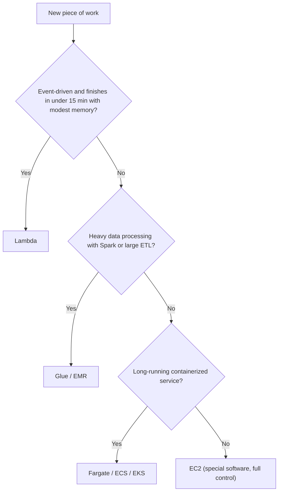
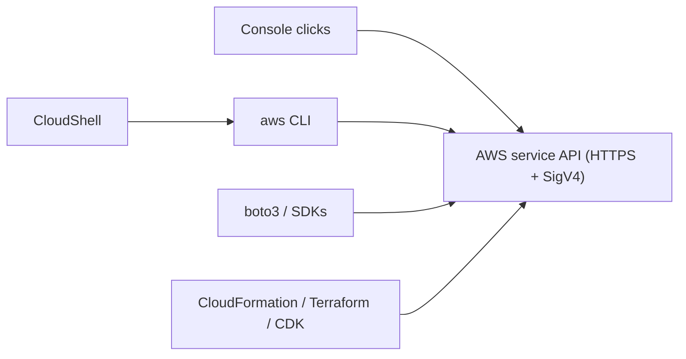
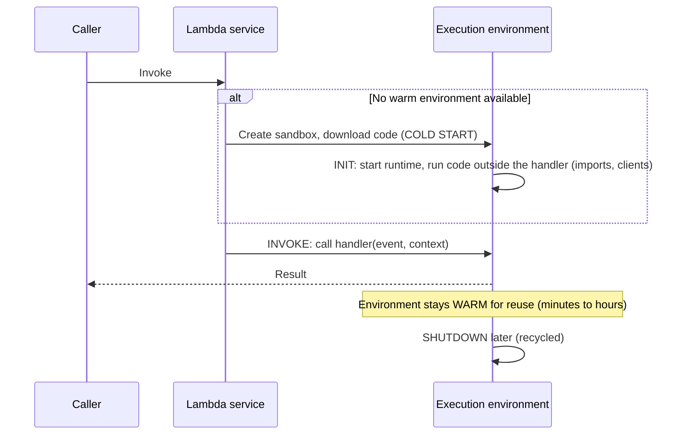
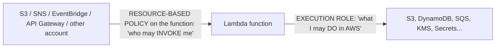
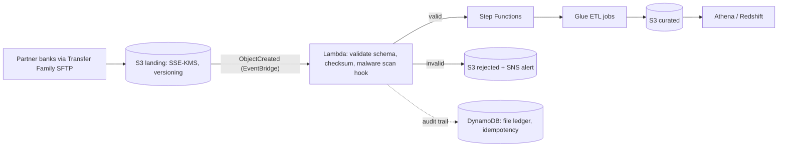

# AWS Compute & Access: CloudShell, CLI, SDK (boto3) and Lambda
### Complete Practical Guide (Equivalent to a 5-Hour Lecture)

> **How to use this file:** Read a section, then do its lab in your own AWS account. In this guide you will write real Lambda functions, trigger them from S3, SQS and schedules, break them on purpose, read the logs, and fix them. You will also learn the three "doors" into AWS that every data engineer lives in: **CloudShell, the AWS CLI, and the boto3 SDK**.
> **Cost:** Lambda has a generous **always-free tier** (about 1 million requests and 400,000 GB-seconds per month). Everything here is far inside it. The only things that can cost money are leftovers: **log groups, queues, SSM parameters, a VPC NAT (optional lab), and forgotten schedules**. Section 30 has a master cleanup.
> **Region:** ap-south-1 (Mumbai). **Limits, runtimes and prices change.** Where I give numbers, treat them as "approximately right" and verify in the Lambda docs, Service Quotas and the pricing page.
> **Prior notes assumed:** IAM, S3, EC2, VPC. Labs reuse your S3 lab bucket (`BUCKET`) and, optionally, `lab-vpc`.

---

## Table of Contents

**Part A: Prerequisites (do not skip)**
1. Serverless and event-driven thinking
2. The AWS compute map (where Lambda fits)
3. Everything is an API: REST, signing, credentials (why console = CLI = SDK)
4. JSON and Python essentials for this guide
5. Stateless functions, execution environments, concurrency (the mental model)
6. Synchronous vs asynchronous vs polling communication
7. Recap: IAM roles, resource policies, S3 and VPC points you need

**Part B: Access tools**
8. AWS CloudShell + Lab 0
9. AWS CLI v2 in depth + Lab 1
10. boto3 (Python SDK) in depth + Lab 2

**Part C: Lambda**
11. Lambda fundamentals: anatomy, handler, context, limits, runtimes
12. The execution environment lifecycle: INIT, INVOKE, cold starts + Lab 3 (first function in the console)
13. Permissions: execution role vs resource-based policy + Lab 4 (deploy with CLI, versions, aliases)
14. Invocation models and event sources + event shapes
15. Lab 5: S3-triggered CSV validator
16. Configuration: memory/CPU, timeout, env vars, secrets, /tmp, architecture + Lab 6
17. Packaging: layers, container images, dependencies + Lab 7
18. Error handling: retries, DLQ, destinations, idempotency + Lab 8
19. Event source mappings: SQS, Kinesis, DynamoDB + Lab 9
20. Scheduling with EventBridge + Lab 10
21. Function URLs, API Gateway, ALB, edge functions + Lab 11
22. Concurrency and scaling + Lab 12
23. Lambda and VPC networking + Lab 13
24. Monitoring and observability + Lab 14
25. Pricing and cost optimization
26. **Lambda for data engineering** (patterns, limits, when NOT to use) + Lab 15
27. Security best practices
28. Troubleshooting
29. Real-world architectures (bank, hospital, enterprise)
30. Master cleanup
31. Best practices checklist
32. Exam cheat sheet and 25 practice questions
33. Interview questions and final checklist

---

# PART A: PREREQUISITES

---

## 1. Serverless and Event-Driven Thinking

### 1.1 What "serverless" really means
There are still servers, but **you don't provision, patch, scale or pay for idle ones**. You hand AWS your code, and AWS runs it when needed.

| Aspect | Traditional server (EC2) | Serverless (Lambda) |
|---|---|---|
| Provisioning | You pick instance size and count | You pick **memory** only |
| Scaling | You configure Auto Scaling | **Automatic**, from 0 to thousands |
| Idle cost | Pay while running, even if idle | **Pay only while code runs** (per ms) |
| Patching/OS | You | AWS |
| Long-running work | Unlimited | **Max 15 minutes** per invocation |
| State | Local disk, memory persist | **Stateless** (assume nothing survives) |

**Analogy:** EC2 is owning a taxi (you pay for it even when parked). Lambda is a ride-hailing app (you pay per ride, and AWS finds a car instantly).

### 1.2 Event-driven architecture
Instead of a program that runs continuously and polls ("is there a new file yet?"), things **react to events**:
```
EVENT (a file lands in S3)  ->  TRIGGER  ->  FUNCTION runs  ->  RESULT (record validated, message sent)
```
Events come from AWS services (S3 upload, SQS message, schedule, DynamoDB change) or from users (an HTTP request). This style is **loosely coupled** (producers don't know consumers), **scalable** and **cost-efficient**. It is the core of modern data pipelines.

### 1.3 Function as a Service (FaaS)
You write **one function** (a small unit of code), AWS handles everything around it. Lambda is AWS's FaaS.

---

## 2. The AWS Compute Map (Where Lambda Fits)

| Service | You manage | Best for | Max run time |
|---|---|---|---|
| **EC2** | OS, software, scaling | Full control, long-running, special software | Unlimited |
| **Lambda** | Code only | Event-driven, short tasks, glue logic | **15 min** |
| **ECS / EKS on Fargate** | Containers (not servers) | Long-running containers, microservices | Unlimited |
| **AWS Batch** | Job definitions | Large batch compute (on EC2/Spot/Fargate) | Hours+ |
| **AWS Glue** | ETL scripts | Serverless Spark/Python ETL on big data | Hours |
| **EMR** | Cluster config | Big data frameworks (Spark, Hive) with control | Long |
| **Elastic Beanstalk / App Runner / Lightsail** | App code / simple setup | Easy web app hosting | Unlimited |
| **Outposts / Local Zones** | Hardware / edge | On-prem or low-latency AWS | n/a |

**Choosing quickly (data engineering):**


---

## 3. Everything is an API: Why Console = CLI = SDK

Every AWS action is an **HTTPS API request** to a service endpoint, for example:
```
POST https://lambda.ap-south-1.amazonaws.com/2015-03-31/functions/myfn/invocations
Authorization: AWS4-HMAC-SHA256 Credential=AKIA.../20261102/ap-south-1/lambda/aws4_request, SignedHeaders=..., Signature=...
```
- **SigV4 signing:** your tool computes a cryptographic **signature** from your secret key + request details. AWS recomputes it to confirm *who you are* (authentication). The **secret key itself is never sent**.
- **Credentials:** access key + secret (+ session token for temporary credentials).
- **Region:** each request goes to a **regional endpoint** (`service.region.amazonaws.com`).


**Big idea:** console, CLI, SDK and IaC are **four front-ends to the same API**. Learn the CLI and the SDK and you can automate everything the console does. IAM evaluates each call identically.

---

## 4. JSON and Python Essentials for This Guide

### 4.1 JSON (you saw this in IAM)
Objects `{ }`, lists `[ ]`, strings in double quotes, no trailing commas. Lambda **events and responses are JSON**.

### 4.2 Python you need
```python
# variables and f-strings
name = "Asha"; amount = 2500.5
print(f"{name} paid {amount:.2f}")

# dict and list
event = {"name": "Asha", "items": [1, 2, 3]}
print(event["name"], event.get("missing", "default"))       # .get avoids KeyError

# functions
def add(a, b=0):
    return a + b

# loops, comprehension
squares = [x * x for x in range(5)]

# exceptions
try:
    int("abc")
except ValueError as e:
    print("bad:", e)
finally:
    print("always runs")

# json
import json
text = json.dumps({"a": 1}); data = json.loads(text)

# modules/packages
import os; print(os.environ.get("HOME"))
```
Tip: In Lambda, **`print()` goes to CloudWatch Logs**.

---

## 5. Stateless Functions, Execution Environments, Concurrency

### 5.1 Stateless
A function may run on **any** machine, many times in parallel, and the machine may be **recycled** at any moment. Rules:
- Don't keep important data in memory or `/tmp` between invocations.
- Store state in **S3, DynamoDB, RDS, SQS, Parameter Store**.
- Make operations **idempotent** (safe to run twice). Reason: events are delivered **at least once**, so duplicates happen. Example: "set status = PAID" is idempotent, "add 100 to balance" is not.

### 5.2 Execution environment
Lambda runs your code inside a small, isolated **micro-VM sandbox** (Firecracker) called an **execution environment**: it has your code, the runtime (e.g., Python), a `/tmp` folder, and allocated memory/CPU. Environments are **created on demand and reused** for later invocations (warm), then eventually destroyed.

### 5.3 Concurrency in one formula
```
Concurrent executions  ≈  requests per second  ×  average duration (seconds)
```
Example: 100 requests/s × 0.5 s = **50** executions in flight → Lambda needs **50 environments** running at once. One environment handles **one request at a time**; ten simultaneous requests = ten environments. This is what "Lambda scales horizontally" means.

---

## 6. Synchronous vs Asynchronous vs Polling

How a caller and Lambda interact decides **retries, errors and responses**:

| Pattern | Who waits? | Example | Error handling |
|---|---|---|---|
| **Synchronous** | Caller **waits** for the result | API Gateway, ALB, SDK `invoke` (RequestResponse), Function URL | Caller sees the error and decides to retry |
| **Asynchronous** | Caller **fires and forgets** (Lambda queues the event, returns 202) | S3 events, SNS, EventBridge, SDK `invoke` with `Event` | **Lambda retries** (up to 2 times by default), then DLQ/destination |
| **Polling (event source mapping)** | **Lambda polls** a queue/stream and calls your function with batches | SQS, Kinesis, DynamoDB Streams, Kafka/MSK | Depends on the source: retry the batch until success/expiry |

Remember this table; Section 14 and almost every exam question build on it.

---

## 7. Recap of Needed Concepts

- **IAM role:** Lambda's **execution role** gives the function its AWS permissions (trusted by `lambda.amazonaws.com`).
- **Resource-based policy:** controls **who may invoke** the function (S3, SNS, EventBridge, another account).
- **S3 event keys are URL-encoded** (spaces become `+`), so decode with `unquote_plus`.
- **VPC:** by default a function runs **outside your VPC** (with internet). Putting it **in a VPC** gives access to private resources but **removes internet** unless you add NAT/endpoints (Section 23).
- Avoid **loops**: a function triggered by uploads to a prefix must not write into that same prefix.

---

# PART B: ACCESS TOOLS

---

## 8. AWS CloudShell

### 8.1 What it is
A **browser-based shell** inside the AWS console (icon in the top bar). It is **pre-authenticated as the console user/role**, so you need **no access keys**. It's a Linux (Amazon Linux) environment with:
- **AWS CLI v2** preinstalled, plus Python 3, pip, Node.js, git, jq, vim, zip/unzip, curl, and more (you can install other tools with `sudo`).
- **About 1 GB of persistent storage** in your home directory per Region (files outside `$HOME` are lost when the session ends; the home is kept for a period of inactivity, reported as around 120 days).
- Free to use (you pay only for AWS resources you create), modest compute (about 1 vCPU, 2 GB RAM).
- **Idle sessions time out** (roughly 20 to 30 minutes), and shell variables are lost then, so **write down IDs**.
- **Per-Region environments:** CloudShell in Mumbai is separate from CloudShell in Virginia.
- **Upload/download files:** Actions menu.
- **VPC environments:** you can attach CloudShell to a VPC subnet to reach private resources.
- Needs IAM permissions (e.g., `AWSCloudShellFullAccess`). The **permissions of your commands = your console identity's permissions**.

### 8.2 CloudShell vs local CLI vs other options
| | CloudShell | Local CLI | Cloud IDEs / VS Code + AWS Toolkit |
|---|---|---|---|
| Setup | None | Install + `aws configure` | Install plugin |
| Credentials | Automatic (temporary) | Keys or SSO | Profiles |
| Persistence | 1 GB home | Your disk | Your disk |
| Best for | Quick labs, one-off admin, learning | Daily scripting, CI | Development |
(AWS Cloud9 is closed to new customers, so favor VS Code or other IDEs.)

### LAB 0: Tour of CloudShell
1. Sign in as your **IAM admin user** (not root), Region **ap-south-1**. Click the **CloudShell icon** (top bar).
2. Run:
```bash
aws --version                          # AWS CLI v2
aws sts get-caller-identity            # who am I? (note: Arn shows your IAM user)
python3 --version; pip --version; jq --version; zip -v | head -1
pwd; df -h $HOME | tail -1             # home and storage
echo $AWS_REGION                       # region of this environment
aws configure list                     # where credentials come from (container/env)
```
3. Try the **Actions** menu: create a text file then **Download file**; **Upload file**. Open a **new tab** (+).
4. Set your working variables (re-run these every time the session resets):
```bash
export AWS_DEFAULT_REGION=ap-south-1
ACCOUNT_ID=$(aws sts get-caller-identity --query Account --output text)
BUCKET=s3lab-yourname-12345        # your S3 lab bucket from the S3 notes
echo $ACCOUNT_ID $BUCKET
mkdir -p ~/lambdalab && cd ~/lambdalab
```

---

## 9. AWS CLI v2 in Depth

### 9.1 Command structure
```
aws  <service>  <operation>  [--parameters]  [global options]
aws  s3api      list-objects-v2   --bucket my-bucket   --prefix raw/   --output table   --region ap-south-1
```
Operations map **1:1 to API calls** (`list-objects-v2` = `ListObjectsV2`). Help is built in: `aws help`, `aws lambda help`, `aws lambda create-function help`.

### 9.2 Configuration and credentials
Files in `~/.aws/`:
```
~/.aws/credentials      [default]  aws_access_key_id = ...   aws_secret_access_key = ...
~/.aws/config           [default]  region = ap-south-1   output = json
                        [profile dev]  region = ap-south-1  role_arn = ...  source_profile = default
```
**Credential precedence (highest first):**
1. Command-line options (`--profile`, `--region`)
2. Environment variables (`AWS_ACCESS_KEY_ID`, `AWS_SECRET_ACCESS_KEY`, `AWS_SESSION_TOKEN`, `AWS_PROFILE`, `AWS_REGION` / `AWS_DEFAULT_REGION`)
3. Assume-role / **SSO** / web identity profile settings
4. Credentials file, config file
5. **Container credentials** (ECS task role) and **EC2 instance profile**

Debug with `aws configure list` and `aws sts get-caller-identity`. A stale `AWS_ACCESS_KEY_ID` env variable silently overrides your role. Classic bug.

**Profiles:** `aws configure --profile dev`, then `aws s3 ls --profile dev` or `export AWS_PROFILE=dev`.
**Assume role profile:**
```ini
[profile readonly]
role_arn = arn:aws:iam::123456789012:role/DataReadRole
source_profile = default
mfa_serial = arn:aws:iam::123456789012:mfa/asha   # optional: prompts for MFA code
```
**SSO profile (recommended for humans):** `aws configure sso` then `aws sso login --profile myprofile`.

### 9.3 Output control
| Option | Effect |
|---|---|
| `--output json` (default) / `table` / `text` / `yaml` | Format |
| `--query '<JMESPath>'` | **Client-side** filter/shape of the JSON result |
| `--filters` / `--filter` | **Server-side** filtering (service specific; reduces data returned) |
| `--no-cli-pager` or `AWS_PAGER=""` | Disable the pager (useful in scripts) |

### 9.4 JMESPath (`--query`) cheat sheet
```
Users[0]                          first element
Users[].UserName                  list of one field from each element
Users[?contains(UserName,`admin`)].UserName      filter with a function (note backticks for literals)
Reservations[].Instances[].[InstanceId,State.Name]     multi-field rows
Buckets[?CreationDate>=`2026-01-01`].Name
sort_by(Users,&CreateDate)[-1].UserName           newest user
length(Buckets)                   count
```
Use **`--query` for shaping**, **server-side filters** when you can (they're faster for large accounts).

### 9.5 Pagination
Most `list/describe` operations return **pages**. The CLI auto-paginates by default. Controls: `--page-size N` (size of each API call), `--max-items N` (total returned; adds a `NextToken`), `--starting-token TOKEN` (resume), `--no-paginate` (first page only).

### 9.6 Other must-know features
- **`--dry-run`** (EC2 and some services): check permissions without doing the action.
- **`--generate-cli-skeleton`** + **`--cli-input-json file.json`**: build complex commands from a JSON template.
- **Waiters:** `aws ec2 wait instance-running --instance-ids i-...`, `aws lambda wait function-updated --function-name x`.
- **`--debug`:** shows signing, endpoints, retries (great for diagnosing credentials/region problems).
- **Aliases:** `~/.aws/cli/alias` file for shortcuts.
- **`--cli-auto-prompt`:** interactive command completion.
- **Retry modes** via `AWS_RETRY_MODE=standard|adaptive`, `AWS_MAX_ATTEMPTS`.
- **Exit codes:** `0` success, `1` S3 transfer failure, `2` usage/skipped files, `130` interrupted, `252` syntax error, `253` configuration error, `254` service error, `255` general failure. Use `$?` in scripts.

### LAB 1: CLI workout
```bash
cd ~/lambdalab

# 1) Who am I, what's my config
aws sts get-caller-identity
aws configure list
aws configure set region ap-south-1
aws configure get region

# 2) Output formats
aws ec2 describe-regions --output table | head -15
aws ec2 describe-regions --query 'Regions[].RegionName' --output text
aws ec2 describe-regions --query 'Regions[?starts_with(RegionName, `ap-`)].RegionName' --output yaml

# 3) JMESPath practice on your own account
aws iam list-users --query 'Users[].[UserName,CreateDate]' --output table
aws s3api list-buckets --query 'Buckets[?contains(Name, `s3lab`)].Name' --output text
aws ec2 describe-availability-zones --query 'AvailabilityZones[].[ZoneName,ZoneId,State]' --output table

# 4) Pagination: walk through a bucket 2 items at a time
aws s3api list-objects-v2 --bucket $BUCKET --max-items 2 --page-size 1
# copy the "NextToken" from the output, then:
# aws s3api list-objects-v2 --bucket $BUCKET --max-items 2 --starting-token <NextToken>

# 5) Skeleton input: see every parameter an operation accepts
aws lambda create-function --generate-cli-skeleton | head -30

# 6) Dry run (permission check without creating anything)
aws ec2 run-instances --image-id ami-12345678 --instance-type t3.micro --dry-run 2>&1 | tail -2
#   "DryRunOperation" = you'd be allowed; "UnauthorizedOperation" = you wouldn't

# 7) A personal alias
mkdir -p ~/.aws/cli
cat > ~/.aws/cli/alias << 'EOF'
[toplevel]
whoami = sts get-caller-identity
buckets = s3api list-buckets --query 'Buckets[].Name' --output text
EOF
aws whoami
aws buckets

# 8) Debug: see the signing and endpoint
aws s3api head-bucket --bucket $BUCKET --debug 2>&1 | grep -E "endpoint|Region|Signature" | head -5

# 9) Exit codes in scripts
aws s3 ls s3://this-bucket-does-not-exist-12345 ; echo "exit code: $?"
```
**Reflect:** Every CLI call is one signed API request; `--query` runs on your side; waiters poll for you.

---

## 10. boto3 (the Python SDK)

### 10.1 What it is
**boto3** is AWS's Python SDK: it signs requests, retries, paginates and parses responses so you call AWS from Python. It is **preinstalled in the Lambda Python runtime** (but the bundled version can lag; bundle your own if you need the newest features) and available in CloudShell. Other SDKs (Java, JavaScript, Go, .NET...) work the same way.

### 10.2 Clients, resources, sessions
| Concept | Meaning | Advice |
|---|---|---|
| **Client** | Low-level, 1:1 with API operations, returns dictionaries | **Use this** (complete and supported) |
| **Resource** | Object-oriented high-level wrapper (e.g., `s3.Bucket(...)`) | In maintenance mode; no new features; fine for quick scripts |
| **Session** | Holds credentials/profile/region config; make clients from it | Use for explicit profiles/regions or assuming roles |

```python
import boto3
s3 = boto3.client("s3", region_name="ap-south-1")
session = boto3.Session(profile_name="dev", region_name="ap-south-1")
s3_dev = session.client("s3")
```

### 10.3 Credentials
boto3 uses the **same provider chain** as the CLI: explicit parameters → environment variables → shared files/SSO/assume-role profiles → container credentials → **instance/Lambda role credentials**. **Never hardcode keys.** In Lambda and EC2, the **role** is picked up automatically.

### 10.4 Config: retries and timeouts
```python
from botocore.config import Config
cfg = Config(region_name="ap-south-1",
             retries={"max_attempts": 8, "mode": "standard"},   # or "adaptive"
             connect_timeout=5, read_timeout=30)
s3 = boto3.client("s3", config=cfg)
```
SDKs retry **throttling and transient errors** with exponential backoff and jitter automatically.

### 10.5 Pagination and waiters
```python
paginator = s3.get_paginator("list_objects_v2")
for page in paginator.paginate(Bucket="my-bucket", Prefix="raw/"):
    for obj in page.get("Contents", []):
        print(obj["Key"], obj["Size"])
```
A single `list_objects_v2` returns at most **1,000 keys**; **always use paginators** or you'll silently miss data. Waiters: `ec2.get_waiter("instance_running").wait(InstanceIds=[...])`.

### 10.6 Error handling
```python
from botocore.exceptions import ClientError
try:
    s3.get_object(Bucket="b", Key="missing.csv")
except ClientError as e:
    code = e.response["Error"]["Code"]            # e.g. NoSuchKey, AccessDenied, NoSuchBucket
    status = e.response["ResponseMetadata"]["HTTPStatusCode"]
    print(code, status, e.response["Error"]["Message"])
```
Common codes: `NoSuchKey`, `NoSuchBucket`, `AccessDenied`, `ThrottlingException`/`SlowDown`, `ResourceNotFoundException`, `ValidationException`, `ConditionalCheckFailedException`. Note `head_object` on a missing key reports code **`"404"`** (HEAD has no body). Only catch the errors you can handle; let others bubble up.

### 10.7 S3 specifics
- `upload_file` / `download_file` use the **transfer manager** (automatic multipart, parallel, retries). `put_object` / `get_object` are single calls.
- `get_object()["Body"]` is a **streaming** object: `.read()` loads it all in memory; for big files iterate in chunks (`iter_chunks`) or use `download_file`.
- Presigned URLs: `generate_presigned_url("get_object", Params={...}, ExpiresIn=300)`.

### 10.8 Assume a role in code
```python
sts = boto3.client("sts")
creds = sts.assume_role(RoleArn="arn:aws:iam::ACCOUNT:role/DataReadRole",
                        RoleSessionName="job1", DurationSeconds=900)["Credentials"]
s3_as_role = boto3.client("s3",
    aws_access_key_id=creds["AccessKeyId"],
    aws_secret_access_key=creds["SecretAccessKey"],
    aws_session_token=creds["SessionToken"])
```

### 10.9 Good habits
Create clients **once** (outside Lambda handlers), use paginators, set timeouts/retries, log with `logging`, handle `ClientError`, use IAM roles, and test with mocks such as **moto** or **Stubber** (not real AWS).

### LAB 2: boto3 workout in CloudShell
```bash
cd ~/lambdalab
cat > boto_lab.py << 'EOF'
import json, sys, boto3
from botocore.config import Config
from botocore.exceptions import ClientError

BUCKET = sys.argv[1]
cfg = Config(region_name="ap-south-1", retries={"max_attempts": 8, "mode": "standard"}, connect_timeout=5, read_timeout=30)
s3 = boto3.client("s3", config=cfg)
sts = boto3.client("sts", config=cfg)

print("1) Who am I:", sts.get_caller_identity()["Arn"])

print("2) Buckets containing 'lab':", [b["Name"] for b in s3.list_buckets()["Buckets"] if "lab" in b["Name"]])

print("3) Upload with the transfer manager")
with open("sample.json", "w") as f: json.dump({"hello": "boto3"}, f)
s3.upload_file("sample.json", BUCKET, "lambdalab/sample.json")

print("4) Count objects with a paginator")
total = size = 0
for page in s3.get_paginator("list_objects_v2").paginate(Bucket=BUCKET):
    for o in page.get("Contents", []):
        total += 1; size += o["Size"]
print(f"   {total} objects, {size} bytes")

print("5) Read an object")
body = s3.get_object(Bucket=BUCKET, Key="lambdalab/sample.json")["Body"].read()
print("  ", json.loads(body))

print("6) Error handling")
for fn, label in [(lambda: s3.get_object(Bucket=BUCKET, Key="does/not/exist"), "get_object"),
                  (lambda: s3.head_object(Bucket=BUCKET, Key="does/not/exist"), "head_object")]:
    try: fn()
    except ClientError as e:
        print(f"   {label}: code={e.response['Error']['Code']} http={e.response['ResponseMetadata']['HTTPStatusCode']}")

print("7) Presigned URL (valid 120 s)")
print("  ", s3.generate_presigned_url("get_object", Params={"Bucket": BUCKET, "Key": "lambdalab/sample.json"}, ExpiresIn=120)[:90], "...")
EOF
python3 boto_lab.py $BUCKET
```
Observe the **different error codes** for `get_object` (`NoSuchKey`) vs `head_object` (`404`). Try deliberately breaking things: wrong bucket name (`NoSuchBucket`), or run with a profile that lacks S3 permissions (`AccessDenied`). **Compare** with the CLI: `aws s3api head-object --bucket $BUCKET --key lambdalab/sample.json`. Same API, different front-end.

---

# PART C: LAMBDA

---

## 11. Lambda Fundamentals

### 11.1 What it is
**AWS Lambda** runs your code in response to events without managing servers. You upload a **function** (code + configuration); Lambda provides the runtime, scaling, and high availability across multiple AZs. You pay for **requests and duration**.

### 11.2 Anatomy of a function
```
Function = Code (handler) + Runtime + Configuration (memory, timeout, env vars, role, VPC, architecture)
                          + Triggers (event sources) + Permissions (execution role + resource policy)
```
**Handler:** the entry point Lambda calls, written as `file_name.function_name` (e.g., `lambda_function.lambda_handler`).
```python
def lambda_handler(event, context):
    # event: JSON input converted to a Python dict (shape depends on the trigger)
    # context: runtime information (request id, function name, time left, memory...)
    return {"statusCode": 200, "body": "ok"}      # return value (JSON-serializable)
```
**Context object** (Python): `aws_request_id`, `function_name`, `function_version`, `invoked_function_arn`, `memory_limit_in_mb`, `log_group_name`, `log_stream_name`, `get_remaining_time_in_millis()` (use it to stop gracefully before timeout).

### 11.3 Runtimes and architectures
- **Managed runtimes:** Python, Node.js, Java, .NET, Ruby (versions are added and **deprecated over time**, so pick a currently supported one, e.g., Python 3.12 or newer shown in the console).
- **OS-only runtimes** (`provided.al2023`) for Go, Rust, C++ or custom runtimes.
- **Container images** up to 10 GB (any language/runtime that implements the Lambda Runtime API).
- **Architectures:** **x86_64** or **arm64 (Graviton2)**. arm64 is typically about **20% cheaper per GB-second** and often faster; native dependencies must be built for the chosen architecture.

### 11.4 Limits (approximate; verify in docs)
| Item | Limit |
|---|---|
| **Timeout** | **1 s to 900 s (15 min)**; default 3 s |
| **Memory** | **128 MB to 10,240 MB** (in 1 MB steps); **CPU scales with memory** (about 1 vCPU at ~1,769 MB, up to 6 vCPUs at 10 GB) |
| **/tmp (ephemeral storage)** | **512 MB default**, configurable up to **10,240 MB** |
| **Deployment package (ZIP)** | **50 MB zipped** (direct upload), **250 MB unzipped** including layers; **container image up to 10 GB** |
| **Layers** | Up to **5 per function** |
| **Environment variables** | **4 KB total** |
| **Payload (synchronous)** | **6 MB** request and response |
| **Payload (asynchronous)** | **256 KB** (a recent change may raise this; check docs) |
| **Concurrency** | Default account limit about **1,000 per Region** (new accounts may start lower; request increases in Service Quotas) |
| **Functions per Region** | Thousands (adjustable) |
| **Invocation frequency** | No hard cap; governed by concurrency |
| **File descriptors/processes** | Limited (e.g., 1,024 file descriptors) |

> **Exam anchors:** **15 minutes**, **10 GB memory**, **10 GB /tmp**, **6 MB sync payload**, **250 MB unzipped**, **10 GB container image**, **4 KB env vars**, **5 layers**.

---

## 12. The Execution Environment Lifecycle and Cold Starts



| Phase | What happens | Billing note |
|---|---|---|
| **INIT** | Create environment, load runtime, run your **top-level code** (imports, client creation, loading config) | Init time is **billed** in more cases than before (check current pricing) |
| **INVOKE** | Runs the handler, up to the timeout | Billed per ms |
| **SHUTDOWN** | Environment removed | |

**Cold start** = the extra latency when a new environment must be created (typically tens to hundreds of ms for Python/Node; **seconds for large Java/.NET or big packages/VPC in older days**). **Warm start** = reuses an environment (no INIT).

**Optimizing for the lifecycle (very practical):**
```python
import boto3, os                      # imports run once per environment (INIT)
s3 = boto3.client("s3")               # create clients OUTSIDE the handler -> reused across invocations
TABLE = os.environ["TABLE"]

def lambda_handler(event, context):   # runs every invocation
    ...
```
- Initialize SDK clients, DB connections, parsed config, ML models **outside** the handler.
- `/tmp` persists across warm invocations of the **same environment** (use as a cache, never as truth).
- To reduce cold starts: keep packages small, use arm64/newer runtimes, avoid heavy imports, use **Provisioned Concurrency** (pre-initialized environments), **SnapStart** (snapshot-based fast init for Java and now other runtimes), or keep the function warm only if truly needed (scheduled pings are a hack).

### LAB 3: Your first Lambda function (console)
```
Lambda console > Create function > Author from scratch
Function name: lab-hello-console
Runtime: Python 3.12 (or newest offered)
Architecture: arm64
Permissions: "Create a new role with basic Lambda permissions"
Create function
```
Replace the code in the editor and click **Deploy**:
```python
import json, os, time

# INIT-phase code: runs once per environment
INIT_TIME = time.time()
print("INIT: new execution environment created")

def lambda_handler(event, context):
    print("EVENT:", json.dumps(event))
    print("Function:", context.function_name, "| version:", context.function_version)
    print("Remaining ms at start:", context.get_remaining_time_in_millis())
    name = event.get("name", "world")
    return {
        "message": f"Hello, {name}!",
        "request_id": context.aws_request_id,
        "environment_age_seconds": round(time.time() - INIT_TIME, 1),
        "stage": os.environ.get("STAGE", "not-set"),
    }
```
**Test it:**
```
Test tab > Create new test event > name: t1 > JSON: {"name": "Asha"} > Save > Test
```
Look at the **Execution results**: the JSON response, the **Log output** and the summary:
```
REPORT RequestId: ... Duration: 1.52 ms  Billed Duration: 2 ms  Memory Size: 128 MB  Max Memory Used: 38 MB  Init Duration: 95.12 ms
```
- `Init Duration` appears only on **cold starts**.
- Click **Test** again quickly: the `Init Duration` disappears and `environment_age_seconds` grows. **Warm start**, proving environment reuse.

**Add an environment variable:** Configuration > Environment variables > Edit > `STAGE = dev` > Save. Test again: `"stage": "dev"`. (A configuration change forces new environments, so the next run is a cold start.)

**See the logs:** Monitor > **View CloudWatch logs**, open the latest log stream (`2026/11/02/[$LATEST]abcd...`). Each environment writes to its own stream.

**Experiment:** Set Configuration > General > Timeout to 1 s and add `time.sleep(2)` to the handler: the invocation fails with `Task timed out after 1.00 seconds`. Remove the sleep and restore the timeout.

---

## 13. Permissions: Execution Role vs Resource-Based Policy

Two **different** permission directions. Confusing them is the #1 Lambda security error.



| | **Execution role** | **Resource-based policy (function policy)** |
|---|---|---|
| Question | What can my function **do**? | Who can **invoke** my function? |
| Type | IAM role (identity-based permissions) | Policy attached to the function |
| Trust | Role trusted by `lambda.amazonaws.com` | Principal is the caller (`s3.amazonaws.com`, `events.amazonaws.com`, account ID...) |
| Managed by | `iam create-role`, attach policies | `lambda add-permission` |
| Example | Allow `s3:GetObject` on `raw/*` | Allow `s3.amazonaws.com` to invoke, only for `source-arn` = my bucket |

**Execution role essentials**
- Trust policy: `{"Principal":{"Service":"lambda.amazonaws.com"},"Action":"sts:AssumeRole"}`.
- Always include logging: **`AWSLambdaBasicExecutionRole`** (CreateLogGroup/Stream, PutLogEvents).
- Other common managed policies: `AWSLambdaSQSQueueExecutionRole`, `AWSLambdaKinesisExecutionRole`, `AWSLambdaDynamoDBExecutionRole`, `AWSLambdaVPCAccessExecutionRole`.
- **Least privilege**: grant exact actions on exact ARNs (prefixes), not `*`.
- Whoever **creates** the function needs `iam:PassRole` on that role (you saw this in IAM Lab 12).

**Resource policy essentials (secure pattern)**
```bash
aws lambda add-permission --function-name myfn --statement-id s3invoke \
  --action lambda:InvokeFunction --principal s3.amazonaws.com \
  --source-arn arn:aws:s3:::my-bucket --source-account 123456789012
```
`--source-arn` and `--source-account` stop the **confused deputy** problem (another account's bucket with the same name can't trigger your function). Console-created triggers add this for you; CLI/IaC requires you to add it.

### LAB 4: Deploy a function entirely from the CLI, use versions and aliases
```bash
cd ~/lambdalab

# 1) Execution role
cat > lambda-trust.json << 'EOF'
{ "Version": "2012-10-17",
  "Statement": [{ "Effect": "Allow", "Principal": { "Service": "lambda.amazonaws.com" }, "Action": "sts:AssumeRole" }] }
EOF
aws iam create-role --role-name lab-lambda-role --assume-role-policy-document file://lambda-trust.json
aws iam attach-role-policy --role-name lab-lambda-role \
   --policy-arn arn:aws:iam::aws:policy/service-role/AWSLambdaBasicExecutionRole
ROLE_ARN=arn:aws:iam::$ACCOUNT_ID:role/lab-lambda-role
sleep 10     # IAM propagation

# 2) Function code v1
cat > lambda_function.py << 'EOF'
import os
def lambda_handler(event, context):
    return {"version": "v1", "greeting": f"Hello {event.get('name','world')}", "stage": os.environ.get("STAGE","none")}
EOF
zip function.zip lambda_function.py        # (fallback: python3 -m zipfile -c function.zip lambda_function.py)

# 3) Create the function
aws lambda create-function --function-name lab-hello-cli --runtime python3.12 \
  --role $ROLE_ARN --handler lambda_function.lambda_handler --zip-file fileb://function.zip \
  --timeout 10 --memory-size 128 --architectures arm64 --environment 'Variables={STAGE=dev}'
aws lambda wait function-active-v2 --function-name lab-hello-cli 2>/dev/null || sleep 10

# 4) Invoke synchronously (CLI v2 needs this flag for raw JSON payloads)
aws lambda invoke --function-name lab-hello-cli --payload '{"name":"Asha"}' \
  --cli-binary-format raw-in-base64-out --log-type Tail \
  --query 'LogResult' --output text out.json | base64 -d
cat out.json; echo
```
You see the response and the REPORT log line, straight from the CLI.

```bash
# 5) Tail logs live
aws logs tail /aws/lambda/lab-hello-cli --since 10m
# (add --follow in a second tab while you invoke again)

# 6) Publish immutable VERSION 1, create alias "prod" -> v1
aws lambda publish-version --function-name lab-hello-cli --description "first release"
aws lambda create-alias --function-name lab-hello-cli --name prod --function-version 1

# 7) Change the code (v2) and publish
sed -i 's/"v1"/"v2"/' lambda_function.py && zip -q function.zip lambda_function.py
aws lambda update-function-code --function-name lab-hello-cli --zip-file fileb://function.zip > /dev/null
aws lambda wait function-updated --function-name lab-hello-cli
aws lambda publish-version --function-name lab-hello-cli --description "second release"

# 8) Canary: alias prod sends 90% to v1 and 10% to v2
aws lambda update-alias --function-name lab-hello-cli --name prod --function-version 1 \
  --routing-config '{"AdditionalVersionWeights":{"2":0.1}}'
for i in $(seq 1 20); do
  aws lambda invoke --function-name lab-hello-cli:prod --payload '{}' --cli-binary-format raw-in-base64-out /tmp/o.json > /dev/null
  python3 -c "import json;print(json.load(open('/tmp/o.json'))['version'], end=' ')"
done; echo
```
Mostly `v1` with roughly 2 out of 20 `v2`. That's a **canary release**.
```bash
# 9) Promote: point prod fully at v2, or roll back to v1 (instant)
aws lambda update-alias --function-name lab-hello-cli --name prod --function-version 2 --routing-config '{}'
aws lambda get-alias --function-name lab-hello-cli --name prod
aws lambda list-versions-by-function --function-name lab-hello-cli --query 'Versions[].[Version,Description]' --output table
```
**Concepts proven:**
- **`$LATEST`** is mutable; **published versions are immutable** snapshots (code + config).
- **Aliases** are named pointers (`prod`, `dev`) that triggers and callers use, so you can deploy, shift traffic gradually (**weighted aliases**), and **roll back instantly** without changing event sources.
- ARN forms: `...:function:name` (unqualified, $LATEST), `...:function:name:1` (version), `...:function:name:prod` (alias).

---

## 14. Invocation Models and Event Sources

### 14.1 Three models
| Model | How invoked | Retries | Typical sources |
|---|---|---|---|
| **Synchronous** | Caller waits (`RequestResponse`) | **None automatic**; caller handles errors | API Gateway, ALB, Function URL, Cognito, CloudFront (Lambda@Edge), SDK/CLI invoke, Step Functions (sync), Lex |
| **Asynchronous** | Lambda queues event, returns **202** (`Event`) | **2 retries by default** (0-2 configurable), event may wait up to **6 h** (max event age configurable 60 s to 6 h), then DLQ/destination | **S3**, **SNS**, **EventBridge**, SES, CloudFormation, CodeCommit, IoT, SDK invoke type `Event` |
| **Poll-based event source mapping (ESM)** | **Lambda polls** and invokes with batches | Source-specific (see Section 19) | **SQS**, **Kinesis**, **DynamoDB Streams**, **MSK/self-managed Kafka**, **Amazon MQ**, DocumentDB |

### 14.2 Event shapes you will meet
**S3 event (note the encoded key):**
```json
{ "Records": [ {
    "eventSource": "aws:s3", "eventName": "ObjectCreated:Put",
    "s3": { "bucket": { "name": "my-bucket" },
            "object": { "key": "incoming/my+file+%282%29.csv", "size": 1024 } } } ] }
```
→ decode: `urllib.parse.unquote_plus(key)` gives `incoming/my file (2).csv`.

**SQS event:**
```json
{ "Records": [ { "messageId": "...", "body": "{\"order_id\": 1}", "attributes": {...}, "eventSource": "aws:sqs" } ] }
```
**EventBridge scheduled event:** `{"source":"aws.events","detail-type":"Scheduled Event","time":"2026-11-02T10:00:00Z",...}`
**API Gateway/Function URL (payload v2):** `{"requestContext":{...},"rawPath":"/hello","queryStringParameters":{"name":"Asha"},"body":"...","isBase64Encoded":false}`
**Kinesis:** records with base64 `data`. **DynamoDB Streams:** `Records[].dynamodb.NewImage`.

Always **print the event** when starting a new integration. Never guess the shape.

### 14.3 Response conventions
- Async/poll sources ignore your return value (except special cases like partial batch responses).
- API Gateway/Function URL/ALB expect an **HTTP-shaped** response: `{"statusCode":200,"headers":{...},"body":"string"}` (body must be a **string**).

---

## 15. LAB 5: S3-Triggered CSV Validator (a real data-engineering pattern)

**Goal:** When a CSV lands in `incoming/`, Lambda validates it, then moves it to `validated/` (good) or `rejected/` (bad, with an error report). We write to **different prefixes** to avoid trigger loops.

```bash
cd ~/lambdalab

# 1) Function code
cat > validator.py << 'EOF'
import csv, io, json, urllib.parse
import boto3

s3 = boto3.client("s3")                      # created once per environment
REQUIRED = ["order_id", "customer", "amount", "status"]

def lambda_handler(event, context):
    summary = []
    for rec in event["Records"]:
        bucket = rec["s3"]["bucket"]["name"]
        key = urllib.parse.unquote_plus(rec["s3"]["object"]["key"])     # keys arrive URL-encoded
        if not key.startswith("incoming/"):
            print("skip (not in incoming/):", key)
            continue

        text = s3.get_object(Bucket=bucket, Key=key)["Body"].read().decode("utf-8")
        reader = csv.DictReader(io.StringIO(text))
        errors, rows = [], 0
        if reader.fieldnames != REQUIRED:
            errors.append(f"bad header: {reader.fieldnames}")
        else:
            for line_no, row in enumerate(reader, start=2):
                rows += 1
                try:
                    float(row["amount"])
                except (TypeError, ValueError):
                    errors.append(f"line {line_no}: invalid amount {row.get('amount')!r}")

        name = key.split("/", 1)[1]
        dest_prefix = "rejected/" if errors else "validated/"
        s3.copy_object(Bucket=bucket, Key=dest_prefix + name, CopySource={"Bucket": bucket, "Key": key})
        if errors:
            s3.put_object(Bucket=bucket, Key=f"rejected/{name}.errors.json",
                          Body=json.dumps({"file": key, "errors": errors}, indent=2).encode())
        s3.delete_object(Bucket=bucket, Key=key)
        result = {"file": key, "rows": rows, "errors": len(errors), "moved_to": dest_prefix + name}
        print(json.dumps(result))
        summary.append(result)
    return summary
EOF
zip -q validator.zip validator.py

# 2) Role with least-privilege S3 access to the specific prefixes
cat > validator-s3.json << EOF
{ "Version": "2012-10-17",
  "Statement": [
    { "Effect": "Allow", "Action": ["s3:GetObject","s3:DeleteObject"], "Resource": "arn:aws:s3:::$BUCKET/incoming/*" },
    { "Effect": "Allow", "Action": "s3:PutObject", "Resource": ["arn:aws:s3:::$BUCKET/validated/*","arn:aws:s3:::$BUCKET/rejected/*"] }
  ] }
EOF
aws iam put-role-policy --role-name lab-lambda-role --policy-name validator-s3 --policy-document file://validator-s3.json

# 3) Create the function
aws lambda create-function --function-name lab-csv-validator --runtime python3.12 --role $ROLE_ARN \
  --handler validator.lambda_handler --zip-file fileb://validator.zip --timeout 30 --memory-size 256 --architectures arm64
aws lambda wait function-active-v2 --function-name lab-csv-validator 2>/dev/null || sleep 10

# 4) RESOURCE-BASED POLICY: allow S3 (this bucket, this account) to invoke the function
aws lambda add-permission --function-name lab-csv-validator --statement-id s3invoke \
  --action lambda:InvokeFunction --principal s3.amazonaws.com \
  --source-arn arn:aws:s3:::$BUCKET --source-account $ACCOUNT_ID

# 5) Bucket notification: ObjectCreated on incoming/*.csv -> the function
#    WARNING: this REPLACES any existing notification config on the bucket (e.g., your SNS lab)
cat > s3-notif.json << EOF
{ "LambdaFunctionConfigurations": [{
    "LambdaFunctionArn": "arn:aws:lambda:ap-south-1:$ACCOUNT_ID:function:lab-csv-validator",
    "Events": ["s3:ObjectCreated:*"],
    "Filter": { "Key": { "FilterRules": [ {"Name":"prefix","Value":"incoming/"}, {"Name":"suffix","Value":".csv"} ] } } }] }
EOF
aws s3api put-bucket-notification-configuration --bucket $BUCKET --notification-configuration file://s3-notif.json
```
**Test with a good file and a bad file:**
```bash
cat > good.csv << 'EOF'
order_id,customer,amount,status
1,Asha,2500,PAID
2,Ravi,1800,FAILED
EOF
cat > bad.csv << 'EOF'
order_id,customer,amount,status
1,Asha,2500,PAID
2,Ravi,eighteen hundred,FAILED
3,Meena,,PAID
EOF
aws s3 cp good.csv "s3://$BUCKET/incoming/good file (1).csv"      # name with spaces and brackets on purpose
aws s3 cp bad.csv  s3://$BUCKET/incoming/bad.csv
sleep 10
aws s3 ls s3://$BUCKET/validated/ ; aws s3 ls s3://$BUCKET/rejected/
aws s3 cp s3://$BUCKET/rejected/bad.csv.errors.json - 
aws logs tail /aws/lambda/lab-csv-validator --since 5m
```
**Expected:** `validated/good file (1).csv`; `rejected/bad.csv` + `rejected/bad.csv.errors.json` listing line 3 and 4 problems; log lines with the JSON summary. (The spaces and brackets in the name prove the **URL-decoding** matters; remove `unquote_plus` and watch it fail with `NoSuchKey`.)

**Break-and-fix drills**
| Break | Symptom | Fix |
|---|---|---|
| Remove `add-permission` (`aws lambda remove-permission --function-name lab-csv-validator --statement-id s3invoke`) and re-upload | Nothing happens; `put-bucket-notification-configuration` would also fail validation if done after | Re-add the permission |
| Remove the `s3:DeleteObject` permission from the role | Function logs `AccessDenied` on delete; file copied but left in `incoming/` (and an **async retry** may re-run it: duplicates!) | Restore permission; think **idempotency** |
| Change the filter to prefix-less and have the function write into `incoming/` | **Infinite loop** (never do this; it can burn money) | Separate prefixes/buckets |
| Upload a file that doesn't end in `.csv` | No invocation | Filter works |
Read **Section 18** to see why a failing async invocation runs 3 times.

---

## 16. Configuration: Memory/CPU, Timeout, Env Vars, Secrets, /tmp

### 16.1 Memory = CPU = price
You choose **memory only**; Lambda allocates **CPU and network proportionally**. More memory means more CPU, so CPU-bound code **finishes faster**. Cost = memory (GB) × billed duration (s), so doubling memory that halves duration costs **about the same but is faster**; sometimes cheaper. **Find the sweet spot by measuring** (or use the open-source **AWS Lambda Power Tuning** tool and **AWS Compute Optimizer** recommendations).

### 16.2 Timeout
Set the timeout to a bit above the **worst realistic duration**, not the 900 s max. When integrated with SQS, keep **queue visibility timeout ≥ 6 × function timeout** (AWS guidance) so messages aren't redelivered mid-processing. With API Gateway the integration timeout is **29 s** by default for REST APIs.

### 16.3 Environment variables
Plain-text key-value config (4 KB total). Encrypted at rest by default with a Lambda-managed KMS key; you can use your own KMS key and **encryption helpers**. **Don't store secrets in plain variables.**

### 16.4 Secrets and config
| Option | Use |
|---|---|
| **SSM Parameter Store** (String/SecureString) | Configuration and simple secrets, cheap |
| **AWS Secrets Manager** | Database credentials with automatic rotation |
| **AppConfig / Lambda extensions** | Dynamic config with caching |
Read secrets in **INIT** (outside the handler) or cache them, because calling the service on every invocation adds latency and cost. For SSM `SecureString` with the default AWS-managed key, `ssm:GetParameter` is enough; with a customer managed key, also grant `kms:Decrypt`.

### 16.5 Ephemeral storage `/tmp` and other storage
- `/tmp`: 512 MB to 10 GB (extra billed), **per environment**, not shared, may vanish.
- **EFS mount** (needs VPC): shared persistent file system (e.g., ML models, big libraries).
- **S3** for durable data; **layers** for read-only shared code in `/opt`.

### 16.6 Architecture choice
arm64 for savings (verify dependencies); x86_64 if native libs aren't available for ARM.

### LAB 6: Measure memory vs duration vs cost; use SSM for secrets
**Part A: A CPU-bound function and a memory experiment**
```bash
cd ~/lambdalab
cat > cpu.py << 'EOF'
import time
def lambda_handler(event, context):
    n = event.get("n", 3_000_000)
    t = time.time(); s = 0
    for i in range(n):
        s += (i * i) % 7
    return {"sum": s, "seconds": round(time.time() - t, 3)}
EOF
zip -q cpu.zip cpu.py
aws lambda create-function --function-name lab-cpu --runtime python3.12 --role $ROLE_ARN \
   --handler cpu.lambda_handler --zip-file fileb://cpu.zip --timeout 60 --memory-size 128 --architectures arm64
aws lambda wait function-active-v2 --function-name lab-cpu 2>/dev/null || sleep 10

for MEM in 128 256 512 1024 1769 3008; do
  aws lambda update-function-configuration --function-name lab-cpu --memory-size $MEM > /dev/null
  aws lambda wait function-updated --function-name lab-cpu
  # warm-up (cold start) then measured run
  aws lambda invoke --function-name lab-cpu --payload '{}' --cli-binary-format raw-in-base64-out /tmp/w.json > /dev/null
  LOG=$(aws lambda invoke --function-name lab-cpu --payload '{}' --cli-binary-format raw-in-base64-out \
        --log-type Tail --query LogResult --output text /tmp/o.json | base64 -d | grep REPORT)
  BILLED=$(echo "$LOG" | sed -n 's/.*Billed Duration: \([0-9]*\) ms.*/\1/p')
  python3 - << EOF
mem=$MEM; ms=$BILLED
gbs = (mem/1024) * (ms/1000)
print(f"memory={mem:>5} MB  billed={ms:>6} ms  GB-seconds={gbs:.4f}")
EOF
done
```
**Read the results:** duration drops sharply as memory rises (up to about 1,769 MB where one full vCPU is reached; beyond that a **single-threaded** Python loop stops improving, but cost keeps rising). The cheapest-and-fastest setting is usually near that knee. **Takeaway:** tune memory with data.

**Part B: Parameter Store secret**
```bash
aws ssm put-parameter --name /lab/db_password --type SecureString --value 'S3cr3t-from-ssm' --overwrite
cat > secret.py << 'EOF'
import os, boto3
ssm = boto3.client("ssm")
_cache = {}                                       # lives across warm invocations

def get_secret(name):
    if name not in _cache:
        _cache[name] = ssm.get_parameter(Name=name, WithDecryption=True)["Parameter"]["Value"]
    return _cache[name]

def lambda_handler(event, context):
    pw = get_secret(os.environ["DB_PASSWORD_PARAM"])
    return {"password_length": len(pw), "note": "never log the secret itself"}
EOF
zip -q secret.zip secret.py
aws lambda create-function --function-name lab-secret --runtime python3.12 --role $ROLE_ARN \
   --handler secret.lambda_handler --zip-file fileb://secret.zip --timeout 10 --architectures arm64 \
   --environment 'Variables={DB_PASSWORD_PARAM=/lab/db_password}'
aws lambda wait function-active-v2 --function-name lab-secret 2>/dev/null || sleep 10
aws lambda invoke --function-name lab-secret --payload '{}' --cli-binary-format raw-in-base64-out /tmp/s.json; cat /tmp/s.json; echo
```
First invoke fails with `AccessDeniedException ... ssm:GetParameter`. **Fix** by granting the role least privilege:
```bash
cat > ssm-read.json << EOF
{ "Version":"2012-10-17","Statement":[{ "Effect":"Allow","Action":"ssm:GetParameter",
  "Resource":"arn:aws:ssm:ap-south-1:$ACCOUNT_ID:parameter/lab/*" }]}
EOF
aws iam put-role-policy --role-name lab-lambda-role --policy-name ssm-read --policy-document file://ssm-read.json
sleep 10
aws lambda invoke --function-name lab-secret --payload '{}' --cli-binary-format raw-in-base64-out /tmp/s.json; cat /tmp/s.json; echo
```
Works now. **Lesson:** the **execution role** governs what the function can read; the **secret never sits in code or plain env vars**.

---

## 17. Packaging: Layers, Container Images, Dependencies

### 17.1 Dependencies
Lambda's Python runtime includes `boto3`/`botocore`, but **not** `requests`, `pandas`, `numpy`, etc. Options:
1. **Bundle in the ZIP:** `pip install -r requirements.txt -t package/` then zip (watch the 50 MB/250 MB limits).
2. **Layers:** a ZIP of libraries mounted at **`/opt`** (Python libs go under `python/`). Share across functions, keep deployment ZIPs small, **up to 5 layers**, total 250 MB unzipped with code. Layers are **versioned and immutable**.
3. **Container images** (up to 10 GB): for big ML/data libraries; built with a Lambda base image and pushed to **ECR**.
4. **AWS-provided layers:** e.g., **AWS SDK for pandas (awswrangler)** adds pandas, numpy, pyarrow and `awswrangler`, great for data engineering (add it from the console: *Add a layer > AWS layers > AWSSDKPandas-Python312*).

**Native dependency gotcha:** libraries with compiled code must match the **function architecture** (x86_64 vs arm64) and the Lambda OS. Build on Amazon Linux or with `pip install --platform manylinux2014_aarch64 --only-binary=:all:` (arm64) / `manylinux2014_x86_64` (x86_64).

### 17.2 When to choose what
| Need | Choice |
|---|---|
| A few pure-Python libs | Layer or bundle |
| pandas/pyarrow/numpy for ETL | **AWS SDK for pandas layer** |
| Large ML frameworks, >250 MB | **Container image** |
| Same libs across many functions | **Layer** (or container base) |

### LAB 7: Build and use your own layer
```bash
cd ~/lambdalab
mkdir -p layer/python
pip install requests -t layer/python --quiet           # pure-Python friendly; we'll use x86_64 for safety
(cd layer && zip -qr ../requests-layer.zip python)
ls -lh requests-layer.zip

LAYER_ARN=$(aws lambda publish-layer-version --layer-name lab-requests \
   --zip-file fileb://requests-layer.zip --compatible-runtimes python3.12 --compatible-architectures x86_64 \
   --query LayerVersionArn --output text)
echo $LAYER_ARN

cat > usereq.py << 'EOF'
import requests                                  # comes from the layer in /opt/python
def lambda_handler(event, context):
    r = requests.get("https://checkip.amazonaws.com", timeout=5)
    return {"egress_ip": r.text.strip(), "requests_version": requests.__version__}
EOF
zip -q usereq.zip usereq.py
aws lambda create-function --function-name lab-layer-demo --runtime python3.12 --role $ROLE_ARN \
   --handler usereq.lambda_handler --zip-file fileb://usereq.zip --timeout 15 --architectures x86_64 --layers $LAYER_ARN
aws lambda wait function-active-v2 --function-name lab-layer-demo 2>/dev/null || sleep 10
aws lambda invoke --function-name lab-layer-demo --payload '{}' --cli-binary-format raw-in-base64-out /tmp/l.json; cat /tmp/l.json; echo
```
It prints a public IP from outside your VPC (functions are not in a VPC by default). **Break test:** create the function **without** `--layers` (`aws lambda update-function-configuration --function-name lab-layer-demo --layers`) and see `No module named 'requests'`. Then re-attach.

---

## 18. Error Handling: Retries, DLQ, Destinations, Idempotency

### 18.1 What kinds of failures exist
| Failure | Meaning |
|---|---|
| **Function error** | Your code raised an exception, timed out, or ran out of memory (`Runtime.OutOfMemory`) |
| **Invocation error** | Lambda couldn't run it: throttled (429), bad payload, permissions |
| **Service error** | AWS-side issue (5xx) |

### 18.2 Retry behavior
| Invocation type | Behavior |
|---|---|
| **Synchronous** | **No automatic retry**; the caller gets the error (API Gateway returns 502/500) |
| **Asynchronous** | **Up to 2 retries** (configurable 0-2): first retry about **1 minute** after failure, second about **2 minutes** after; the event may be held up to **6 h** (configurable max age); throttled events are retried with backoff for up to the max age. After the final failure: **DLQ or on-failure destination** (otherwise the event is discarded) |
| **SQS ESM** | Failed batch becomes visible again after the **visibility timeout**, retried until it succeeds or hits `maxReceiveCount` → **SQS DLQ** |
| **Kinesis/DynamoDB Streams ESM** | **Retries the same batch until success or the record expires** (blocks that shard!); options: **bisect batch on error**, **max retry attempts**, **max record age**, **on-failure destination**, **partial batch response** |

### 18.3 DLQ vs Destinations
| | **Dead-letter queue (DLQ)** | **Destinations (preferred)** |
|---|---|---|
| Targets | SQS or SNS | SQS, SNS, Lambda, EventBridge (**on success** and **on failure**) |
| Content | Original event only | Event **plus context** (error, request IDs, response payload) |
| Scope | Async only | Async (and ESM failures for stream sources) |
Rule: use **destinations** for new designs; DLQ remains an exam favorite. Note an SQS **source queue's own DLQ** (redrive policy) is separate from a Lambda DLQ.

### 18.4 Idempotency (do not skip)
Because delivery is **at least once** and retries exist, your function **will** see duplicates. Design for it:
- Use **natural idempotency keys** (file key + ETag/version, order_id) and check/record them in **DynamoDB** with a conditional write.
- Prefer **upserts** and "set" semantics over "increment".
- **AWS Lambda Powertools** (Python) provides an idempotency utility, structured logging, tracing, metrics and batch processing helpers.

### LAB 8: Watch async retries, then capture failures in a destination
```bash
cd ~/lambdalab
cat > boom.py << 'EOF'
import json, time
def lambda_handler(event, context):
    print("ATTEMPT at", time.strftime("%H:%M:%S"), "event:", json.dumps(event))
    raise RuntimeError("simulated failure")
EOF
zip -q boom.zip boom.py
aws lambda create-function --function-name lab-boom --runtime python3.12 --role $ROLE_ARN \
   --handler boom.lambda_handler --zip-file fileb://boom.zip --timeout 10 --architectures arm64
aws lambda wait function-active-v2 --function-name lab-boom 2>/dev/null || sleep 10

# 1) SYNC invoke: the error comes back to YOU, no retry
aws lambda invoke --function-name lab-boom --payload '{"id":1}' --cli-binary-format raw-in-base64-out /tmp/b.json
cat /tmp/b.json; echo      # {"errorMessage":"simulated failure","errorType":"RuntimeError",...}; header FunctionError: Unhandled

# 2) ASYNC invoke: returns 202 immediately, Lambda retries in the background
aws lambda invoke --function-name lab-boom --invocation-type Event --payload '{"id":2}' --cli-binary-format raw-in-base64-out /tmp/b2.json
echo "waiting ~3.5 minutes to see the original attempt + 2 retries..."
sleep 220
aws logs filter-log-events --log-group-name /aws/lambda/lab-boom --filter-pattern '"ATTEMPT"' --query 'events[].message' --output text
```
You should see **three ATTEMPT lines** (one original, one about a minute later, one about two minutes after that). That's the default async retry policy.

**3) Add an on-failure destination (SQS)**
```bash
QURL=$(aws sqs create-queue --queue-name lab-boom-failures --query QueueUrl --output text)
QARN=$(aws sqs get-queue-attributes --queue-url $QURL --attribute-names QueueArn --query Attributes.QueueArn --output text)
cat > sqs-send.json << EOF
{ "Version":"2012-10-17","Statement":[{ "Effect":"Allow","Action":"sqs:SendMessage","Resource":"$QARN" }]}
EOF
aws iam put-role-policy --role-name lab-lambda-role --policy-name boom-sqs-send --policy-document file://sqs-send.json
sleep 10
aws lambda put-function-event-invoke-config --function-name lab-boom \
  --maximum-retry-attempts 0 --maximum-event-age-in-seconds 3600 \
  --destination-config "{\"OnFailure\":{\"Destination\":\"$QARN\"}}"
aws lambda invoke --function-name lab-boom --invocation-type Event --payload '{"id":3}' --cli-binary-format raw-in-base64-out /tmp/b3.json
sleep 15
aws sqs receive-message --queue-url $QURL --max-number-of-messages 1 --query 'Messages[0].Body' --output text | python3 -m json.tool
```
The message contains the **original payload** (`requestPayload`), the **error** (`responsePayload`), request IDs and the **condition** (`RetriesExhausted`). Far richer than a DLQ. **Cleanup later** (Section 30).

---

## 19. Event Source Mappings: SQS, Kinesis, DynamoDB

### 19.1 How polling works
You create an **event source mapping (ESM)**; Lambda's **pollers** read the source and **invoke your function synchronously with a batch**. You don't write polling code.

### 19.2 Comparison

| | **SQS (standard)** | **SQS FIFO** | **Kinesis Data Streams** | **DynamoDB Streams** | **Kafka (MSK/self-managed)** |
|---|---|---|---|---|---|
| Ordering | Best effort | **Per message group** | **Per shard** | **Per item key/shard** | Per partition |
| Scaling | Pollers scale with queue depth (up to concurrency limits; **max concurrency** setting available) | One concurrent batch per message group | **1 concurrent batch per shard** (raise with **parallelization factor up to 10**) | Per shard | Per partition |
| Batching | `BatchSize` (up to 10,000 for standard with batching window), `MaximumBatchingWindowInSeconds` | batch up to 10 | `BatchSize` up to 10,000, window up to 300 s | similar | similar |
| On failure | Message returns after **visibility timeout**, then **DLQ** by `maxReceiveCount` | Blocks the message group | **Retries until expiry**; blocks shard unless you configure **bisect/max-retries/max-age/destination** | same as Kinesis | configurable |
| Partial failure | **`ReportBatchItemFailures`** | supported | supported (sequence number) | supported | supported |
| Retention | Up to 14 days in queue | | 24 h to 365 days | 24 h | |
| Key metric | `ApproximateAgeOfOldestMessage` | | **`IteratorAge`** (lag) | `IteratorAge` | offset lag |

### 19.3 Partial batch responses (very practical)
If one record in a batch of 10 fails, without special handling **the whole batch** is retried (so 9 good ones are processed again!). With **`ReportBatchItemFailures`** your function returns only the **failed IDs**:
```python
return {"batchItemFailures": [{"itemIdentifier": "message-id-that-failed"}]}
```
Lambda deletes the successful messages and retries only the failed ones.

### 19.4 SQS-specific rules
- **Visibility timeout ≥ 6 × function timeout** (plus batching window).
- Configure a **DLQ on the source queue** (redrive policy `maxReceiveCount` 3-5) for poison messages.
- Use **`MaximumConcurrency`** on the ESM to protect downstream systems (e.g., a database) from being overwhelmed by Lambda's scaling.
- Standard SQS = **at-least-once**, so idempotent consumers.

### LAB 9: SQS → Lambda with batching, a poison message and a DLQ
```bash
cd ~/lambdalab
# 1) Queues: main queue with a DLQ (after 3 failed receives a message moves to the DLQ)
DLQ_URL=$(aws sqs create-queue --queue-name lab-orders-dlq --query QueueUrl --output text)
DLQ_ARN=$(aws sqs get-queue-attributes --queue-url $DLQ_URL --attribute-names QueueArn --query Attributes.QueueArn --output text)
cat > q-attrs.json << EOF
{ "VisibilityTimeout": "60",
  "RedrivePolicy": "{\"deadLetterTargetArn\":\"$DLQ_ARN\",\"maxReceiveCount\":\"3\"}" }
EOF
Q_URL=$(aws sqs create-queue --queue-name lab-orders --attributes file://q-attrs.json --query QueueUrl --output text)
Q_ARN=$(aws sqs get-queue-attributes --queue-url $Q_URL --attribute-names QueueArn --query Attributes.QueueArn --output text)

# 2) Consumer function with partial batch failure reporting
cat > consumer.py << 'EOF'
import json
def lambda_handler(event, context):
    failures = []
    for r in event["Records"]:
        try:
            body = json.loads(r["body"])
            if body.get("poison"):
                raise ValueError("bad record")
            print("PROCESSED", body)
        except Exception as e:
            print("FAILED", r["messageId"], str(e))
            failures.append({"itemIdentifier": r["messageId"]})
    return {"batchItemFailures": failures}
EOF
zip -q consumer.zip consumer.py
aws iam attach-role-policy --role-name lab-lambda-role --policy-arn arn:aws:iam::aws:policy/service-role/AWSLambdaSQSQueueExecutionRole
sleep 10
aws lambda create-function --function-name lab-consumer --runtime python3.12 --role $ROLE_ARN \
  --handler consumer.lambda_handler --zip-file fileb://consumer.zip --timeout 10 --architectures arm64
aws lambda wait function-active-v2 --function-name lab-consumer 2>/dev/null || sleep 10

# 3) The event source mapping
aws lambda create-event-source-mapping --function-name lab-consumer --event-source-arn $Q_ARN \
  --batch-size 5 --maximum-batching-window-in-seconds 5 --function-response-types ReportBatchItemFailures

# 4) Send 9 good messages and 1 poison message
for i in 1 2 3 4 5 6 7 8 9; do aws sqs send-message --queue-url $Q_URL --message-body "{\"order_id\": $i}" > /dev/null; done
aws sqs send-message --queue-url $Q_URL --message-body '{"order_id": 99, "poison": true}' > /dev/null

# 5) Watch it work (the poison is retried ~3 times, then lands in the DLQ after the visibility timeouts ~3 minutes)
sleep 30; aws logs tail /aws/lambda/lab-consumer --since 2m | grep -E "PROCESSED|FAILED"
sleep 150
aws sqs get-queue-attributes --queue-url $DLQ_URL --attribute-names ApproximateNumberOfMessages --query Attributes
aws sqs receive-message --queue-url $DLQ_URL --query 'Messages[0].Body' --output text
```
You'll see the 9 good orders processed **once** (thanks to `ReportBatchItemFailures` they were **not** re-processed when the poison failed), the poison attempted multiple times, then it sits in the **DLQ** for inspection. Remove `--function-response-types` and repeat to see good messages **processed repeatedly** (the duplicate problem).

**Stop the mapping when finished:** `aws lambda list-event-source-mappings --function-name lab-consumer --query 'EventSourceMappings[0].UUID' --output text` then `aws lambda delete-event-source-mapping --uuid <UUID>`.

---

## 20. Scheduling with EventBridge

Run functions on a timetable (the cloud "cron"):
- **EventBridge rule (schedule):** `rate(5 minutes)` or `cron(0 2 * * ? *)` (six fields: minute hour day-of-month month day-of-week year; **UTC**; one of day-of-month/day-of-week must be `?`).
- **EventBridge Scheduler:** newer, more flexible (time zones, one-time schedules, retries, flexible windows, large scale).
- Needs a **resource policy** letting `events.amazonaws.com` invoke the function (console adds it automatically).
- Typical data uses: nightly extracts, hourly API pulls to S3, triggering Glue/Athena queries, compaction, cleanups, SLA checks.

### LAB 10: Hourly-style ingestion simulator (use a 1-minute rate for the lab)
```bash
cd ~/lambdalab
cat > ingest.py << EOF
import boto3, json, os, random, datetime
s3 = boto3.client("s3")
BUCKET = os.environ["BUCKET"]

def lambda_handler(event, context):
    now = datetime.datetime.utcnow()
    record = {"ts": now.isoformat(), "sensor": "S-" + str(random.randint(1, 5)), "value": round(random.uniform(10, 90), 2)}
    key = f"lambdalab/ingest/dt={now:%Y-%m-%d}/hour={now:%H}/{now:%M%S}.json"      # Hive-style partitions
    s3.put_object(Bucket=BUCKET, Key=key, Body=json.dumps(record).encode())
    print("wrote", key, record)
    return {"key": key}
EOF
zip -q ingest.zip ingest.py
cat > ingest-s3.json << EOF2
{ "Version":"2012-10-17","Statement":[{ "Effect":"Allow","Action":"s3:PutObject","Resource":"arn:aws:s3:::$BUCKET/lambdalab/ingest/*" }]}
EOF2
aws iam put-role-policy --role-name lab-lambda-role --policy-name ingest-s3 --policy-document file://ingest-s3.json
sleep 10
aws lambda create-function --function-name lab-ingest --runtime python3.12 --role $ROLE_ARN \
  --handler ingest.lambda_handler --zip-file fileb://ingest.zip --timeout 15 --architectures arm64 \
  --environment "Variables={BUCKET=$BUCKET}"
aws lambda wait function-active-v2 --function-name lab-ingest 2>/dev/null || sleep 10

# Schedule: every minute for the lab (use rate(1 hour) or a cron in real life)
RULE_ARN=$(aws events put-rule --name lab-ingest-schedule --schedule-expression "rate(1 minute)" --query RuleArn --output text)
aws lambda add-permission --function-name lab-ingest --statement-id events-invoke \
  --action lambda:InvokeFunction --principal events.amazonaws.com --source-arn $RULE_ARN
LAMBDA_ARN=arn:aws:lambda:ap-south-1:$ACCOUNT_ID:function:lab-ingest
aws events put-targets --rule lab-ingest-schedule --targets "Id"="1","Arn"="$LAMBDA_ARN"

sleep 150
aws s3 ls s3://$BUCKET/lambdalab/ingest/ --recursive | tail -5
```
Files appear every minute under **Hive-style partitions** (`dt=.../hour=...`). **Stop the schedule right away** (it keeps running forever otherwise):
```bash
aws events disable-rule --name lab-ingest-schedule
# full removal later in Section 30:  aws events remove-targets --rule lab-ingest-schedule --ids 1 && aws events delete-rule --name lab-ingest-schedule
```
**Note:** EventBridge is **at-least-once**; make writes idempotent (the key includes the minute/second, so duplicates would just overwrite).

---

## 21. Function URLs, API Gateway, ALB, Edge Functions

| Option | What | Notes |
|---|---|---|
| **Lambda Function URL** | Built-in dedicated **HTTPS endpoint** for one function (`https://<id>.lambda-url.<region>.on.aws`) | Free, simple, auth **NONE** (public) or **AWS_IAM** (SigV4), CORS support, no throttling/usage plans/custom domain (use CloudFront) |
| **API Gateway HTTP API** | Cheaper, simpler API front door | JWT/Lambda authorizers, routes, custom domains, throttling |
| **API Gateway REST API** | Full-featured (API keys, usage plans, request validation, caching, WAF) | Pricier; **29 s** integration timeout default |
| **ALB** | Lambda as a **target group**; path/host routing | When you already use ALB |
| **Lambda@Edge** | Runs at CloudFront edge (viewer/origin request/response), more capable, region-limited triggers | Customize content, auth at edge |
| **CloudFront Functions** | Very light JS at edge, sub-ms, high scale | Header rewrites, redirects, simple auth |

API-style functions must return the HTTP shape:
```python
import json
def lambda_handler(event, context):
    name = (event.get("queryStringParameters") or {}).get("name", "world")
    return {"statusCode": 200, "headers": {"content-type": "application/json"},
            "body": json.dumps({"hello": name})}      # body must be a STRING
```

### LAB 11: A public JSON endpoint with a Function URL (short-lived)
```bash
cd ~/lambdalab
cat > api.py << 'EOF'
import json
def lambda_handler(event, context):
    name = (event.get("queryStringParameters") or {}).get("name", "world")
    return {"statusCode": 200, "headers": {"content-type": "application/json"},
            "body": json.dumps({"hello": name, "path": event.get("rawPath")})}
EOF
zip -q api.zip api.py
aws lambda create-function --function-name lab-api --runtime python3.12 --role $ROLE_ARN \
  --handler api.lambda_handler --zip-file fileb://api.zip --timeout 5 --architectures arm64
aws lambda wait function-active-v2 --function-name lab-api 2>/dev/null || sleep 10

URL=$(aws lambda create-function-url-config --function-name lab-api --auth-type NONE --query FunctionUrl --output text)
aws lambda add-permission --function-name lab-api --statement-id public-url \
  --action lambda:InvokeFunctionUrl --principal "*" --function-url-auth-type NONE
echo $URL
curl -s "${URL}hello?name=Asha"; echo
```
If you get **403 Forbidden**, newer function URLs may also require an **`lambda:InvokeFunction`** permission statement for the same principal; add it:
```bash
aws lambda add-permission --function-name lab-api --statement-id public-invoke \
  --action lambda:InvokeFunction --principal "*" 
```
(**Security reminder:** this endpoint is public until you delete it. For real use choose `--auth-type AWS_IAM` or put API Gateway/CloudFront with auth in front.) **Delete it now:**
```bash
aws lambda delete-function-url-config --function-name lab-api
```
**Explore (console):** Lambda > lab-api > Configuration > Function URL; Add trigger > **API Gateway** to see the HTTP API option.

---

## 22. Concurrency and Scaling

### 22.1 How scaling works
Lambda scales by **creating more execution environments**. Each function can add a large number of new environments per interval (documented as about **1,000 additional concurrent executions every 10 seconds per function** under the current scaling model), bounded by the **account concurrency limit** (shared by all functions in the Region). Beyond the limit: **throttling**.

### 22.2 Concurrency controls
| Control | What it does | Cost |
|---|---|---|
| **Unreserved (default)** | Function competes in the shared account pool | Free |
| **Reserved concurrency** | **Guarantees** a slice for this function **and caps** it at that number (also a **safety brake**: set to 1 to serialize, or to protect a database) | Free |
| **Provisioned concurrency** | Keeps N environments **pre-initialized** (no cold starts); applies to a **version or alias** | **Billed continuously** (cheaper per-ms usage rate) |
| **ESM max concurrency (SQS)** | Limit how many concurrent invocations the SQS poller creates | Free |
| **Application Auto Scaling** | Schedule/scale provisioned concurrency | |

### 22.3 Throttling behavior
- **Sync:** caller gets **429 `TooManyRequestsException`** (API Gateway returns 429/502).
- **Async:** Lambda **retries** with backoff for up to the max event age (default 6 h), then DLQ/destination.
- **SQS ESM:** pollers back off; messages stay in queue (and may hit `maxReceiveCount` if throttled too long: size the DLQ policy well).
- **Kinesis/DynamoDB:** processing slows; `IteratorAge` rises.

### 22.4 Worked example
Traffic 200 req/s, average duration 400 ms → concurrency ≈ 200 × 0.4 = **80**. If the account limit is 1,000 and another function consumes 950, yours can't scale beyond 50 → throttles. Fix: **reserve** capacity for critical functions, request a **limit increase**, or reduce duration.

### LAB 12: Reserved concurrency and throttling
> New accounts may have a low concurrency limit (even 10), in which case Lambda won't let you reserve concurrency that would drop the unreserved pool below its minimum (100). If you get that error, skip the reserved-concurrency part, read **Section 22**, and request a quota increase later.

```bash
cd ~/lambdalab
cat > slow.py << 'EOF'
import time
def lambda_handler(event, context):
    time.sleep(8)
    return {"done": True}
EOF
zip -q slow.zip slow.py
aws lambda create-function --function-name lab-slow --runtime python3.12 --role $ROLE_ARN \
  --handler slow.lambda_handler --zip-file fileb://slow.zip --timeout 15 --architectures arm64
aws lambda wait function-active-v2 --function-name lab-slow 2>/dev/null || sleep 10

aws lambda put-function-concurrency --function-name lab-slow --reserved-concurrent-executions 1

for i in 1 2 3; do
  ( aws lambda invoke --function-name lab-slow --payload '{}' --cli-binary-format raw-in-base64-out /tmp/c$i.json \
      > /tmp/c$i.status 2>&1; echo "call $i: $(tail -1 /tmp/c$i.status)" ) &
done; wait
```
With reserved concurrency **1** and 8-second calls, only **one** call succeeds at a time; the others fail with **`TooManyRequestsException` (429)**. Check the **Throttles** metric in CloudWatch (Lambda > Monitor). Then remove the cap:
```bash
aws lambda delete-function-concurrency --function-name lab-slow
```
Repeat the three parallel calls: **all succeed** (three environments created at once). You just saw **concurrency = parallel executions** in action.

---

## 23. Lambda and VPC Networking

### 23.1 Default: outside your VPC
A function runs in an **AWS-managed network** with **internet access**, but **cannot reach private resources** in your VPC (RDS in private subnets, internal ALBs, Redshift, ElastiCache).

### 23.2 VPC-enabled functions
Configure **subnets + security groups**; Lambda creates **ENIs** (via shared "Hyperplane" ENIs, so no big cold-start penalty any more) in your subnets. Consequences:
- Can reach **private resources**.
- **Loses internet access** (even in a public subnet, because the function ENI has no public IP). To restore:
  - **NAT Gateway** (function in **private** subnets; route `0.0.0.0/0 → NAT`), or
  - **VPC endpoints** for AWS services: **S3/DynamoDB gateway endpoints**, interface endpoints for SQS, SNS, KMS, Secrets Manager, STS, CloudWatch Logs, etc.
- Needs the **`AWSLambdaVPCAccessExecutionRole`** (permission to manage ENIs).
- Use **≥2 subnets in different AZs** for resilience.
- Plan **IP capacity** (ENIs per function/subnet/SG combination, shared).
- Database connections: use **RDS Proxy** to pool connections (Lambda can create thousands).

| Need | Setup |
|---|---|
| Call public API only | No VPC |
| Query RDS in private subnet | VPC + SG to DB (+ RDS Proxy) |
| Call RDS **and** an external API | VPC + private subnet + NAT |
| Call RDS **and** S3 only | VPC + S3 gateway endpoint (no NAT needed) |

### LAB 13 (optional): See Lambda lose the internet inside a VPC
Prerequisite: your `lab-vpc` and private subnets from the VPC notes still exist (skip if you cleaned them up; read instead).
```bash
VPC_ID=$(aws ec2 describe-vpcs --filters Name=tag:Name,Values=lab-vpc --query 'Vpcs[0].VpcId' --output text)
PRIV_A=$(aws ec2 describe-subnets --filters Name=tag:Name,Values=lab-private-a --query 'Subnets[0].SubnetId' --output text)
PRIV_B=$(aws ec2 describe-subnets --filters Name=tag:Name,Values=lab-private-b --query 'Subnets[0].SubnetId' --output text)
SG_L=$(aws ec2 create-security-group --group-name lab-lambda-sg --description "lambda" --vpc-id $VPC_ID --query GroupId --output text)

aws iam attach-role-policy --role-name lab-lambda-role --policy-arn arn:aws:iam::aws:policy/service-role/AWSLambdaVPCAccessExecutionRole
sleep 10
aws lambda update-function-configuration --function-name lab-layer-demo \
   --vpc-config SubnetIds=$PRIV_A,$PRIV_B,SecurityGroupIds=$SG_L
aws lambda wait function-updated --function-name lab-layer-demo
aws lambda invoke --function-name lab-layer-demo --payload '{}' --cli-binary-format raw-in-base64-out /tmp/v.json; cat /tmp/v.json; echo
```
The call to `checkip.amazonaws.com` now **times out** (private subnet, no NAT). Add a NAT (see VPC Lab 5) and it works again, or switch the function back (`--vpc-config SubnetIds=[],SecurityGroupIds=[]`). **Remove the VPC config before cleanup** so ENIs/SGs can be deleted.

---

## 24. Monitoring and Observability

### 24.1 The three pillars for Lambda
| Pillar | Tool |
|---|---|
| **Logs** | **CloudWatch Logs**: log group `/aws/lambda/<function>`; one stream per environment. **`print`/`logging` output**, plus system lines `START`, `END`, **`REPORT`** |
| **Metrics** | **CloudWatch Metrics** (namespace `AWS/Lambda`): `Invocations`, `Errors`, `Throttles`, `Duration`, `ConcurrentExecutions`, `UnreservedConcurrentExecutions`, `ProvisionedConcurrencyUtilization`, `IteratorAge`, `DeadLetterErrors`, `AsyncEventsDropped`, `Init Duration` (in logs/Insights) |
| **Traces** | **AWS X-Ray** (enable *Active tracing*) shows time across services; **Lambda Insights** (extension) for system metrics (CPU, memory, network) |

### 24.2 The REPORT line
```
REPORT RequestId: abc Duration: 120.5 ms Billed Duration: 121 ms Memory Size: 256 MB Max Memory Used: 88 MB Init Duration: 210.3 ms
```
- **Max Memory Used** close to **Memory Size** → risk of OOM; raise memory.
- **Init Duration** → cold start cost.
- **Billed Duration** is rounded to **1 ms**.

### 24.3 Good logging practice
- Use Python `logging` with **JSON structured logs** (`{"level":"INFO","order_id":123,"msg":"processed"}`) so **Logs Insights** can query fields.
- Include a **correlation ID** (request ID).
- **Never log secrets/PII.**
- **Set log retention** (default is **never expire**, so costs grow forever): `aws logs put-retention-policy --log-group-name /aws/lambda/x --retention-in-days 14`.
- **Alarms** on `Errors`, `Throttles`, `Duration` (p95/p99), `IteratorAge`, and DLQ depth.

### LAB 14: Logs Insights, alarm and tracing
**1) CloudWatch Logs Insights** (console: CloudWatch > Logs Insights > select log groups `/aws/lambda/lab-cpu`, `lab-csv-validator`):
```
filter @type = "REPORT"
| stats count() as invocations,
        avg(@duration) as avg_ms, max(@duration) as max_ms,
        max(@maxMemoryUsed/1024/1024) as max_mem_mb,
        avg(@initDuration) as avg_init_ms
  by bin(5m)
| sort bin desc
```
Find errors:
```
fields @timestamp, @message
| filter @message like /ERROR|Exception|Traceback|timed out/
| sort @timestamp desc
| limit 20
```
**2) Alarm + email on errors**
```bash
TOPIC=$(aws sns create-topic --name lab-lambda-alerts --query TopicArn --output text)
aws sns subscribe --topic-arn $TOPIC --protocol email --notification-endpoint you@example.com   # confirm via email
aws cloudwatch put-metric-alarm --alarm-name lab-boom-errors --namespace AWS/Lambda --metric-name Errors \
  --dimensions Name=FunctionName,Value=lab-boom --statistic Sum --period 60 --evaluation-periods 1 \
  --threshold 1 --comparison-operator GreaterThanOrEqualToThreshold --treat-missing-data notBreaching \
  --alarm-actions $TOPIC
aws lambda invoke --function-name lab-boom --payload '{}' --cli-binary-format raw-in-base64-out /tmp/e.json > /dev/null
```
Within a minute or two the alarm goes **ALARM** and emails you.
**3) Retention and tracing**
```bash
for f in lab-hello-cli lab-csv-validator lab-cpu lab-boom lab-consumer lab-ingest lab-api lab-slow lab-secret lab-layer-demo; do
  aws logs put-retention-policy --log-group-name /aws/lambda/$f --retention-in-days 7 2>/dev/null
done
aws lambda update-function-configuration --function-name lab-csv-validator --tracing-config Mode=Active
```
(Tracing needs the role to have X-Ray write permission: attach `AWSXRayDaemonWriteAccess` if segments don't appear.) Then open **CloudWatch > X-Ray traces / Service map** after another upload.

---

## 25. Pricing and Cost Optimization

### 25.1 What you pay for
| Item | Notes (approx.) |
|---|---|
| **Requests** | About **$0.20 per 1 million** |
| **Duration** | **GB-seconds** = memory (GB) × billed seconds; about **$0.0000167 per GB-s on x86**, arm64 roughly **20% cheaper**; billed in **1 ms** increments |
| **Init duration** | Billed in more situations than before (check current docs) |
| **Provisioned concurrency** | Per GB-s provisioned (continuous) + discounted duration |
| **Ephemeral storage** | Beyond 512 MB per GB-s |
| **Data transfer** | Standard AWS data transfer rules; same-Region to S3 free |
| **Free tier (always)** | ~**1M requests** and **400,000 GB-seconds** per month |
| **Indirect** | CloudWatch Logs ingestion/storage, API Gateway, NAT gateway (for VPC functions), KMS, X-Ray |

### 25.2 Worked example
3 million invocations/month, 200 ms each, 512 MB:
- GB-seconds = 3,000,000 × 0.2 s × 0.5 GB = **300,000 GB-s** → inside the 400,000 free → **$0 duration**.
- Requests: (3M − 1M free) = 2M × $0.20/M = **$0.40**.
Total ≈ **$0.40/month**. A comparable always-on EC2 instance costs far more (but not necessarily for sustained heavy workloads).

### 25.3 Break-even thinking
Lambda is cheapest for **spiky/intermittent** workloads. For **steady, high, long-running** utilization (e.g., 24×7 heavy compute), **EC2/Fargate with Savings Plans** can be cheaper. Estimate both.

### 25.4 Optimization checklist
1. **Right-size memory** (measure).  2. Use **arm64**.  3. Reduce duration: reuse clients, batch work, avoid unnecessary calls.  4. **Batch** SQS/Kinesis (fewer invocations).  5. **Filter events** at the source (S3 prefix/suffix, EventBridge patterns, **ESM event filtering**) so you don't invoke for irrelevant events.  6. **Set log retention** and sensible log levels.  7. Avoid **provisioned concurrency** unless latency demands it; schedule it.  8. Use **VPC endpoints** instead of NAT where possible.  9. Prevent **runaway loops** with reserved concurrency + budgets/alarms.  10. Don't have Lambda "wait" (sleep/poll) for other services; use **Step Functions**.

---

## 26. Lambda for Data Engineering

### 26.1 Where Lambda shines
| Pattern | Flow | Why Lambda |
|---|---|---|
| **File arrival validation/routing** | S3 `incoming/` → Lambda → validate/rename/move or reject | Per-file, event-driven (Lab 5) |
| **Trigger an ETL pipeline** | S3 / EventBridge → Lambda → `glue.start_job_run` or **Step Functions** `start_execution` | Lightweight glue |
| **Stream enrichment** | Kinesis/Firehose → Lambda (transform) → S3/DynamoDB/OpenSearch | Per-record logic (Firehose transform Lambda: 6 MB payload, must return `recordId`, `result`, `data`) |
| **Scheduled API ingestion** | EventBridge → Lambda → call API → write JSON/Parquet to S3 | Cron without servers (Lab 10) |
| **CDC processing** | DynamoDB Streams → Lambda → S3/Elasticsearch/other tables | Native stream integration |
| **Small transformations** | CSV→Parquet for modest files (with the pandas layer) | Quick and cheap (Lab 15) |
| **Query orchestration** | Lambda → `athena.start_query_execution` → check status → notify | Pipeline steps |
| **Notifications / quality alerts** | Glue/Athena finished → EventBridge → Lambda → Slack/SNS | Reactions |
| **Data API** | Function URL/API Gateway → Lambda → Athena/DynamoDB | Serverless data access |
| **Housekeeping** | Scheduled cleanup, tagging, compaction triggers, partition repair (`MSCK REPAIR`/`glue.batch_create_partition`) | Cron + SDK |

### 26.2 Where Lambda does NOT fit
- **Large files/huge datasets** (> 10 GB memory, > 15 min): use **Glue** (Spark), **EMR**, **Batch**, **Athena CTAS**.
- **Heavy joins/aggregations across TBs**: Spark engines.
- **Long-polling or waiting**: use **Step Functions** (wait states, retries, callbacks) rather than sleeping in Lambda.
- **Persistent connections/stateful servers**: containers/EC2.
- **Very high steady throughput** where per-ms cost exceeds containers.

### 26.3 Orchestration: Lambda vs Step Functions
Don't chain functions by calling Lambda from Lambda (cost, coupling, error handling). Use **AWS Step Functions** for multi-step workflows: retries, catch, parallel, map, wait, human approval, **direct SDK integrations** (start Glue, Athena, EMR without writing Lambda).

### 26.4 Data-pipeline pitfalls
| Pitfall | Fix |
|---|---|
| Reading a 5 GB file into memory | Stream/chunk, use Glue, or raise memory/ephemeral storage carefully |
| Timeout on bigger files | Split work, use Step Functions Map, or Glue |
| Duplicate processing | Idempotency keys, `ReportBatchItemFailures`, conditional writes |
| Infinite S3 loops | Separate prefixes/buckets, filters, reserved concurrency |
| Too many tiny invocations from small files | Batch with SQS/Firehose, compaction |
| DB connection storms | **RDS Proxy**, reuse connections outside handler, reserved concurrency |
| `NoSuchKey` due to encoded names | `unquote_plus` |
| Kinesis shard blocked by a poison record | Bisect batch, max retry/age, on-failure destination |
| Lambda in VPC can't reach S3 | S3 gateway endpoint |
| Hidden costs | Log retention, NAT, Provisioned Concurrency |

### LAB 15: Event-driven CSV → partitioned Parquet with the AWS SDK for pandas layer
**Goal:** a CSV dropped into `lambdalab/raw/` is converted to **Parquet partitioned by date** in `lambdalab/curated/`.

**1) Create the function (code)**
```bash
cd ~/lambdalab
cat > to_parquet.py << 'EOF'
import urllib.parse
import awswrangler as wr                        # provided by the AWS SDK for pandas layer
import pandas as pd

def lambda_handler(event, context):
    for rec in event["Records"]:
        bucket = rec["s3"]["bucket"]["name"]
        key = urllib.parse.unquote_plus(rec["s3"]["object"]["key"])
        df = wr.s3.read_csv(f"s3://{bucket}/{key}")
        df["txn_date"] = pd.to_datetime(df["txn_time"]).dt.strftime("%Y-%m-%d")
        out = f"s3://{bucket}/lambdalab/curated/transactions/"
        res = wr.s3.to_parquet(df=df, path=out, dataset=True, partition_cols=["txn_date"], mode="append", compression="snappy")
        print({"rows": len(df), "files": res["paths"]})
    return "ok"
EOF
zip -q to_parquet.zip to_parquet.py

cat > pq-s3.json << EOF
{ "Version":"2012-10-17","Statement":[
  { "Effect":"Allow","Action":"s3:GetObject","Resource":"arn:aws:s3:::$BUCKET/lambdalab/raw/*" },
  { "Effect":"Allow","Action":["s3:PutObject","s3:ListBucket","s3:GetBucketLocation"],
    "Resource":["arn:aws:s3:::$BUCKET","arn:aws:s3:::$BUCKET/lambdalab/curated/*"] } ]}
EOF
aws iam put-role-policy --role-name lab-lambda-role --policy-name to-parquet-s3 --policy-document file://pq-s3.json
sleep 10
aws lambda create-function --function-name lab-to-parquet --runtime python3.12 --role $ROLE_ARN \
  --handler to_parquet.lambda_handler --zip-file fileb://to_parquet.zip --timeout 60 --memory-size 1024 --architectures x86_64
aws lambda wait function-active-v2 --function-name lab-to-parquet 2>/dev/null || sleep 10
```
**2) Attach the AWS-managed layer (console):**
```
Lambda > lab-to-parquet > Layers > Add a layer > AWS layers > AWSSDKPandas-Python312 (choose the latest version, x86_64) > Add
```
(The layer's ARN varies by Region and version, so selecting it in the console avoids typos. Ensure the **runtime and architecture match** the layer.)

**3) Allow S3 to invoke and wire the trigger.** Because this **replaces** the bucket's notification config, include the earlier validator rule too (or accept replacing it):
```bash
aws lambda add-permission --function-name lab-to-parquet --statement-id s3invoke \
  --action lambda:InvokeFunction --principal s3.amazonaws.com --source-arn arn:aws:s3:::$BUCKET --source-account $ACCOUNT_ID
cat > s3-notif2.json << EOF
{ "LambdaFunctionConfigurations": [
  { "LambdaFunctionArn": "arn:aws:lambda:ap-south-1:$ACCOUNT_ID:function:lab-csv-validator",
    "Events": ["s3:ObjectCreated:*"],
    "Filter": { "Key": { "FilterRules": [ {"Name":"prefix","Value":"incoming/"}, {"Name":"suffix","Value":".csv"} ] } } },
  { "LambdaFunctionArn": "arn:aws:lambda:ap-south-1:$ACCOUNT_ID:function:lab-to-parquet",
    "Events": ["s3:ObjectCreated:*"],
    "Filter": { "Key": { "FilterRules": [ {"Name":"prefix","Value":"lambdalab/raw/"}, {"Name":"suffix","Value":".csv"} ] } } } ] }
EOF
aws s3api put-bucket-notification-configuration --bucket $BUCKET --notification-configuration file://s3-notif2.json
```
**4) Test**
```bash
cat > txns.csv << 'EOF'
txn_id,customer_id,amount,txn_time
1,101,2500.50,2026-11-01 09:15:00
2,102,1800.00,2026-11-01 11:42:10
3,101,900.25,2026-11-02 08:05:33
4,103,4100.00,2026-11-02 15:20:45
EOF
aws s3 cp txns.csv s3://$BUCKET/lambdalab/raw/txns_20261102.csv
sleep 20
aws s3 ls s3://$BUCKET/lambdalab/curated/transactions/ --recursive
aws logs tail /aws/lambda/lab-to-parquet --since 5m
```
**Expected:** two partitions, `txn_date=2026-11-01/` and `txn_date=2026-11-02/`, each with a `.snappy.parquet` file. This is a mini **raw → curated** zone transform triggered by an event. Later (Athena phase) you can create a table over `lambdalab/curated/transactions/`. **Think it through:** what happens if the file is 8 GB? (Memory and timeout fail: that's when you switch to **Glue**.) What happens if the same file is uploaded twice? (`mode="append"` creates duplicates, so design **idempotency**, e.g., overwrite partitions or dedupe by key.)

---

## 27. Security Best Practices

1. **Least-privilege execution roles**, one per function (or per purpose); scope to exact ARNs/prefixes; no `*:*`.
2. **Resource policies with `SourceArn` and `SourceAccount`**; never `Principal: "*"` for invoke unless intentionally public (and then with auth).
3. **Secrets in Secrets Manager/SSM**, not in code or plain env vars; cache them; rotate.
4. **Encrypt env vars** with a customer managed KMS key when needed; encrypt S3/SQS/DynamoDB data used by functions.
5. **VPC only when required**; if so, private subnets, SGs with least access, endpoints instead of broad NAT.
6. **Function URL auth**: prefer `AWS_IAM` or front with API Gateway/CloudFront + WAF.
7. **Dependency hygiene:** pin versions, scan (Inspector scans Lambda code and dependencies), trusted layers only (a malicious layer = code execution in your function).
8. **Code signing** (AWS Signer) to enforce trusted deployments.
9. **Input validation:** treat `event` as untrusted (injection, path traversal in S3 keys).
10. **Logging without secrets/PII**; set retention; ship to a central account.
11. **Concurrency limits** as blast-radius control; budgets/alarms for runaway invocations.
12. **Separate accounts** for prod/dev; deploy via CI/CD with OIDC roles (no static keys).
13. **Shared responsibility:** AWS secures the runtime/OS; **you** secure code, dependencies, IAM and data.

---

## 28. Troubleshooting

| Symptom | Likely cause and fix |
|---|---|
| **`Task timed out after N seconds`** | Timeout too low, slow downstream call, VPC without route (hangs on connect). Raise timeout/memory, add connect timeouts, check NAT/endpoints |
| **`Runtime.OutOfMemory` / `Max Memory Used` = Memory Size** | Increase memory; stream data; reduce payload |
| **`AccessDeniedException` calling AWS** | Execution role lacks the action/resource (or KMS permission); fix role policy |
| **Trigger never fires (S3/EventBridge/SNS)** | Missing **resource-based policy** (`add-permission`), wrong prefix/suffix filter, wrong ARN/alias, trigger on `$LATEST` vs alias mismatch, rule disabled |
| **`Unable to validate the following destination configurations` (S3)** | S3 can't invoke the function: add permission first, then configure notification |
| **`No module named 'x'`** | Dependency not packaged/layer missing, wrong folder (`python/` in layer), runtime/architecture mismatch |
| **`Unable to import module 'handler'`** | Wrong handler string (`file.function`), file not at ZIP root, syntax/import error at INIT |
| **`Runtime.ImportModuleError` with native libs (`.so`, `GLIBC`)** | Built on the wrong OS/architecture; rebuild for Lambda (Amazon Linux/arm64 vs x86_64) |
| **`TooManyRequestsException` (429)** | Throttled: account limit or reserved concurrency cap; raise limits, reduce concurrency, retry with backoff |
| **Function runs 3 times for one event** | **Async retries** after errors; make idempotent; configure retries/destinations |
| **SQS messages processed repeatedly/stuck** | Visibility timeout too short (< 6× timeout), no partial batch handling, no DLQ/maxReceiveCount |
| **Kinesis `IteratorAge` growing** | Slow/failing function, poison record blocking shard; add bisect/max-retry/max-age, parallelization factor, more shards |
| **Works in console test, fails from trigger** | Different **event shape**; inspect real event with `print(json.dumps(event))` |
| **API returns 502 "Malformed Lambda proxy response"** | Return value isn't `{"statusCode","headers","body"}` with a **string** body |
| **VPC Lambda can't reach internet/AWS service** | No NAT/endpoint; wrong subnet; SG egress; missing `AWSLambdaVPCAccessExecutionRole` |
| **Cold starts too slow** | Reduce package/imports, arm64, provisioned concurrency/SnapStart, avoid VPC mis-sizing, increase memory |
| **Costs spiking** | Infinite loop, retries storm, huge logs, NAT traffic; check `Invocations`, set concurrency limits and budgets |
| **`ResourceConflictException` on update** | A previous update is in progress; use `aws lambda wait function-updated` |
| **CloudWatch Logs missing** | Role lacks `AWSLambdaBasicExecutionRole`, or log group KMS/permissions issue |
| **`ENI` deletion errors during VPC cleanup** | Detach function from VPC first and wait; ENIs release after minutes |

**Debug routine:** (1) read the **log stream** end-to-end; (2) print the **event**; (3) reproduce with `aws lambda invoke` and a saved event; (4) check **role** (CloudTrail `AccessDenied`) and **resource policy**; (5) check **metrics** (Errors/Throttles/Duration); (6) check network (VPC) and quotas.

---

## 29. Real-World Architectures

### 29.1 Bank: regulated file-ingestion and validation

Controls: least-privilege roles per function, **KMS CMKs**, VPC endpoints, **CloudTrail data events**, **reserved concurrency**, **DLQ/destinations**, alarms to the SOC, code signing, deployment via CI/CD with OIDC.

### 29.2 Healthcare: PHI event processing
HL7/FHIR messages → API Gateway/SQS → Lambda (de-identify/tokenize) → encrypted S3 + DynamoDB; **Lambda in private subnets** with **interface endpoints**; **no internet**; audit logs retained; separate de-identified analytics bucket.

### 29.3 Enterprise: event-driven data platform
S3/EventBridge/SQS fan-out; Lambda for validation, routing, small transforms and notifications; **Step Functions** orchestrating **Glue/EMR/Athena**; **Kinesis → Lambda → S3/DynamoDB** for near-real-time features; **EventBridge Scheduler** for housekeeping; centralized observability (Powertools + Logs Insights + X-Ray); **tag-based cost allocation**.

### 29.4 Serverless API pattern
CloudFront + WAF → API Gateway (HTTP API) → Lambda → DynamoDB/Aurora (via RDS Proxy); Cognito authorizer; reserved concurrency; provisioned concurrency for latency-critical routes.

---

## 30. Master Cleanup (Do This Now)

```bash
export AWS_DEFAULT_REGION=ap-south-1
ACCOUNT_ID=$(aws sts get-caller-identity --query Account --output text)

# 1) Stop triggers FIRST (so nothing keeps invoking)
aws events disable-rule --name lab-ingest-schedule 2>/dev/null
aws events remove-targets --rule lab-ingest-schedule --ids 1 2>/dev/null
aws events delete-rule --name lab-ingest-schedule 2>/dev/null
for u in $(aws lambda list-event-source-mappings --query 'EventSourceMappings[].UUID' --output text); do aws lambda delete-event-source-mapping --uuid $u; done
aws s3api put-bucket-notification-configuration --bucket $BUCKET --notification-configuration '{}'
aws lambda delete-function-url-config --function-name lab-api 2>/dev/null

# 2) Remove VPC config from the VPC lab function (if you did Lab 13), then delete its SG later
aws lambda update-function-configuration --function-name lab-layer-demo --vpc-config SubnetIds=[],SecurityGroupIds=[] 2>/dev/null

# 3) Delete functions
for f in lab-hello-console lab-hello-cli lab-csv-validator lab-cpu lab-secret lab-layer-demo lab-boom lab-consumer lab-ingest lab-api lab-slow lab-to-parquet; do
  aws lambda delete-function --function-name $f 2>/dev/null && echo "deleted $f"
done

# 4) Layer versions
for v in $(aws lambda list-layer-versions --layer-name lab-requests --query 'LayerVersions[].Version' --output text 2>/dev/null); do
  aws lambda delete-layer-version --layer-name lab-requests --version-number $v; done

# 5) Log groups (they are NOT deleted with the function)
for lg in $(aws logs describe-log-groups --log-group-name-prefix /aws/lambda/lab- --query 'logGroups[].logGroupName' --output text); do
  aws logs delete-log-group --log-group-name $lg; done

# 6) SQS queues, SNS topic, alarms, SSM parameter
for q in lab-orders lab-orders-dlq lab-boom-failures; do
  U=$(aws sqs get-queue-url --queue-name $q --query QueueUrl --output text 2>/dev/null) && aws sqs delete-queue --queue-url $U; done
aws cloudwatch delete-alarms --alarm-names lab-boom-errors
aws sns delete-topic --topic-arn $(aws sns list-topics --query "Topics[?contains(TopicArn,'lab-lambda-alerts')].TopicArn" --output text)
aws ssm delete-parameter --name /lab/db_password

# 7) IAM role and its policies
for p in $(aws iam list-attached-role-policies --role-name lab-lambda-role --query 'AttachedPolicies[].PolicyArn' --output text); do aws iam detach-role-policy --role-name lab-lambda-role --policy-arn $p; done
for p in $(aws iam list-role-policies --role-name lab-lambda-role --query 'PolicyNames[]' --output text); do aws iam delete-role-policy --role-name lab-lambda-role --policy-name $p; done
aws iam delete-role --role-name lab-lambda-role

# 8) VPC lab leftovers (if Lab 13): aws ec2 delete-security-group --group-id <lab-lambda-sg>
# 9) S3 test data: aws s3 rm s3://$BUCKET/lambdalab/ --recursive ; incoming/ validated/ rejected/ prefixes if you want
```
**Verify:** `aws lambda list-functions --query 'Functions[].FunctionName'` returns nothing from the lab; `aws events list-rules --query 'Rules[].Name'`, `aws sqs list-queues` and `aws logs describe-log-groups --log-group-name-prefix /aws/lambda/` are clean.

---

## 31. Best Practices Checklist

1. Keep functions **small and single-purpose**; separate handler from business logic (testable).
2. Initialize **clients/connections outside the handler**; cache config/secrets.
3. Make everything **idempotent**; expect duplicates and retries.
4. Right-size **memory/timeout** with data; use **arm64**.
5. Use **destinations/DLQs**, **partial batch responses**, queue **DLQs**, and sensible visibility timeouts.
6. **Least-privilege roles** and **SourceArn/SourceAccount** on resource policies.
7. Use **versions + aliases** for safe deployments (canary/rollback); deploy with **IaC** and CI/CD (no console cowboys in prod).
8. **Structured logging**, log retention, metrics, alarms, X-Ray; **Powertools**.
9. Avoid **Lambda-to-Lambda** chains; use **Step Functions/EventBridge/SQS**.
10. Prevent **loops** (separate prefixes), use **reserved concurrency** as a brake.
11. Use **VPC only if needed**; endpoints before NAT; **RDS Proxy** for databases.
12. Keep packages small; **layers** for shared libs; containers for heavy dependencies.
13. **Filter events at the source** to cut invocations and cost.
14. Know when to use **Glue/EMR/Batch/Fargate** instead.
15. **Clean up** and tag resources.

---

## 32. Exam Cheat Sheet and Practice Questions

### 32.1 Facts to memorize
**CloudShell / CLI / SDK**
- CloudShell: browser shell, **pre-authenticated**, CLI v2 included, **1 GB persistent home** per Region, no keys needed.
- CLI credential order: **command line → env vars → profiles/SSO/assume-role → config files → container/instance role**. Use `--profile`, `--region`, `--query` (JMESPath), `--output`, `--dry-run`, waiters, pagination.
- **Use IAM roles, not access keys, on EC2/Lambda.** boto3: **client** vs resource; **paginators**; **`ClientError`**; auto-retries with backoff; **S3 `list_objects_v2` returns max 1,000 keys**.

**Lambda**
- **Max 15 min**, **128 MB-10 GB** memory (CPU proportional), **/tmp up to 10 GB**, **6 MB sync payload**, **250 MB unzipped / 50 MB zipped**, **10 GB container image**, **4 KB env vars**, **5 layers**.
- **Handler(event, context)**; code outside handler runs at **INIT** (reuse clients); **cold vs warm start**.
- **Execution role** = what the function can do; **resource-based policy** = who can invoke it.
- **Sync** (API Gateway, ALB, SDK, Function URL) = **no retry**. **Async** (S3, SNS, EventBridge) = **2 retries**, up to **6 h**, then **DLQ/destination**. **Polling ESM** (SQS, Kinesis, DynamoDB Streams, Kafka).
- **SQS:** visibility timeout ≥ **6× function timeout**; **partial batch response**; DLQ on queue. **Kinesis/DynamoDB Streams:** **one batch per shard** (parallelization factor up to 10), retries **until success/expiry** (can block shard), **IteratorAge** metric.
- **Concurrency** = rate × duration; **reserved** (guarantee + cap, free), **provisioned** (no cold starts, paid); throttles: sync 429, async retry.
- **Versions** immutable, **aliases** are pointers with **weighted routing**; **provisioned concurrency** attaches to version/alias.
- **VPC Lambda:** private access, **no internet without NAT**; **RDS Proxy** for DB connections.
- **Destinations** (success/failure; SQS/SNS/Lambda/EventBridge) > DLQ (SQS/SNS only).
- **Function URL:** HTTPS endpoint, auth NONE/AWS_IAM. **Lambda@Edge** (CloudFront, more power) vs **CloudFront Functions** (light, sub-ms).
- **S3 event keys are URL-encoded.** Avoid **recursive triggers**.
- **SnapStart** reduces cold starts (Java and additional runtimes); **provisioned concurrency** for any runtime.
- Pricing: **requests + GB-seconds (1 ms)**; free **1M requests + 400,000 GB-s/month**; arm64 cheaper.
- Orchestration: **Step Functions**, not Lambda chains. Big data: **Glue/EMR**.

### 32.2 25 scenario questions (try first, then read answers)

**Q1.** A function must run for 40 minutes. Which option?
**A:** Not Lambda (**15 min max**): use **Fargate/ECS, Batch, Glue, or EC2**, or split the work with **Step Functions**.

**Q2.** New CSV files land in S3 and must be validated automatically with minimal ops.
**A:** **S3 event notification (or EventBridge) → Lambda**.

**Q3.** An S3-triggered Lambda reprocesses its own output endlessly.
**A:** Writing back to the triggering prefix creates a **loop**; use a **different prefix/bucket** and filters (plus reserved concurrency as a brake).

**Q4.** Who can invoke the function, and what can it do in AWS: which two policies?
**A:** **Resource-based policy** (who invokes) and **execution role** (what it can do).

**Q5.** Reduce cold-start latency for a latency-sensitive Python API.
**A:** **Provisioned concurrency** (on an alias/version), smaller package/imports, arm64/newer runtime (SnapStart for supported runtimes).

**Q6.** A function must not consume more than 10 concurrent executions to protect a database.
**A:** **Reserved concurrency = 10** (or SQS ESM **maximum concurrency**), plus **RDS Proxy**.

**Q7.** Lambda in a VPC can't call a public API.
**A:** Needs a **NAT Gateway** in a public subnet (function in private subnets) or an alternate path; VPC Lambda has **no internet by default**.

**Q8.** Lambda in a VPC must read/write S3 without internet or NAT.
**A:** **S3 gateway VPC endpoint** (route table entry).

**Q9.** An SQS-triggered function times out and messages are processed twice.
**A:** **Visibility timeout** too short (should be ≥ 6× function timeout) and consumer must be **idempotent**.

**Q10.** One bad record in a batch of 10 causes all 10 to be retried.
**A:** Enable **`ReportBatchItemFailures`** (partial batch response) and return failed IDs.

**Q11.** Messages that always fail keep cycling. How to isolate them?
**A:** **DLQ on the source SQS queue** with `maxReceiveCount`.

**Q12.** Async function fails; keep the failed event and error context for analysis.
**A:** **On-failure destination** (SQS/SNS/EventBridge/Lambda), or a DLQ.

**Q13.** A Kinesis consumer is stuck because of one malformed record.
**A:** Configure **bisect batch on error**, **maximum retry attempts**, **maximum record age**, and an **on-failure destination**; monitor **IteratorAge**.

**Q14.** Process Kinesis shards faster without adding shards.
**A:** Increase the ESM **parallelization factor** (up to 10 batches per shard, order preserved per partition key).

**Q15.** Deploy a new version to 10% of traffic and roll back instantly if problems occur.
**A:** **Versions + alias with weighted routing**; move the alias back to the previous version.

**Q16.** Share a library across 20 functions.
**A:** **Lambda layer** (versioned).

**Q17.** A 2 GB ML library doesn't fit the ZIP limit.
**A:** **Container image** (up to 10 GB) from ECR.

**Q18.** Store database credentials for Lambda securely with rotation.
**A:** **AWS Secrets Manager** (cache outside handler); never plain env vars.

**Q19.** Trigger a function every day at 02:00 UTC.
**A:** **EventBridge schedule** (`cron(0 2 * * ? *)`) / EventBridge Scheduler.

**Q20.** Function needs more CPU for a computation.
**A:** **Increase memory** (CPU scales with it); consider multi-threading/processes for multi-vCPU sizes.

**Q21.** Customize responses at the CDN edge with very low latency and massive scale (simple header edits).
**A:** **CloudFront Functions** (Lambda@Edge for heavier logic).

**Q22.** A user gets 502 from API Gateway while Lambda "succeeds".
**A:** Response isn't in **proxy format** (`statusCode`, `headers`, string `body`).

**Q23.** Orchestrate a multi-step ETL with retries, parallel branches and waits.
**A:** **AWS Step Functions** (with direct service integrations) instead of chaining Lambdas.

**Q24.** An EC2 app must call AWS APIs from a script; where do credentials come from?
**A:** The **instance profile role** via IMDS (SDK/CLI picks it up automatically); no access keys.

**Q25.** A CLI command works in CloudShell but fails locally with `AccessDenied`.
**A:** Different **identity/profile**: check `aws sts get-caller-identity`, env vars overriding profile, and the permissions of that identity (CloudShell uses your console identity).

---

## 33. Interview Questions and Final Checklist

### Interview questions (answer aloud, 1-2 minutes each)
1. What is Lambda and when would you not use it?
2. Explain the Lambda execution lifecycle and how to minimize cold-start impact.
3. Difference between synchronous, asynchronous, and event-source-mapping invocations. How do retries differ?
4. Explain the execution role vs resource-based policy with an S3 trigger example.
5. How does Lambda scale? What are reserved and provisioned concurrency?
6. How do you design an idempotent S3→Lambda ingestion pipeline?
7. How do you handle poison messages in SQS and Kinesis consumers?
8. How would you connect Lambda to a private RDS database safely at scale?
9. How do you deploy safely: versions, aliases, canary, rollback, IaC?
10. How do you tune Lambda cost and performance?
11. When would you choose Lambda vs Glue vs Fargate vs EC2 for a data transformation?
12. How do you manage dependencies (layers vs containers)?
13. What do you monitor in production Lambda?
14. Explain the AWS CLI credential resolution order and how you'd debug the wrong identity being used.
15. In boto3, why use paginators and how do you handle `ClientError`s?
16. What is CloudShell and when is it better or worse than a local CLI?

**Answer structure:** *what it is → why it exists → how it works → example → pitfall/cost.*

### Final self-check (tick when you can do it without notes)
- [ ] Explain serverless, event-driven design, and sync vs async vs polling
- [ ] Use CloudShell and the CLI fluently: profiles, `--query`, pagination, waiters, dry-run, exit codes
- [ ] Write boto3 code with clients, paginators, retries, `ClientError` handling, presigned URLs
- [ ] Create, invoke, update and read logs of a Lambda function (console and CLI)
- [ ] Explain handler/context, INIT vs INVOKE, cold vs warm, and reuse of clients
- [ ] Distinguish execution role vs resource policy; add S3/EventBridge invoke permissions correctly
- [ ] Publish versions, use aliases with weighted routing, roll back
- [ ] Build an S3-triggered pipeline with URL-decoding and loop-safe prefixes
- [ ] Tune memory with measurements and explain the price/performance curve
- [ ] Configure async retries, destinations, SQS DLQ, partial batch failures
- [ ] Explain concurrency (reserved vs provisioned), throttling and VPC networking implications
- [ ] Add monitoring: Logs Insights, alarms, retention, X-Ray
- [ ] Decide Lambda vs Glue/Fargate/EC2 for data workloads
- [ ] Run the master cleanup (triggers first, then functions, logs, queues, role)

**Next topic:** This completes **Phase 1 (core services)**. Next is **Phase 2: Architecture Essentials**, starting with **databases: RDS, Aurora, DynamoDB and ElastiCache**, then **load balancing, Route 53 and CloudFront**, using the VPC, IAM and Lambda skills you now have (for example Lambda reading DynamoDB, RDS in your private subnets, and S3 → Lambda → database pipelines).
