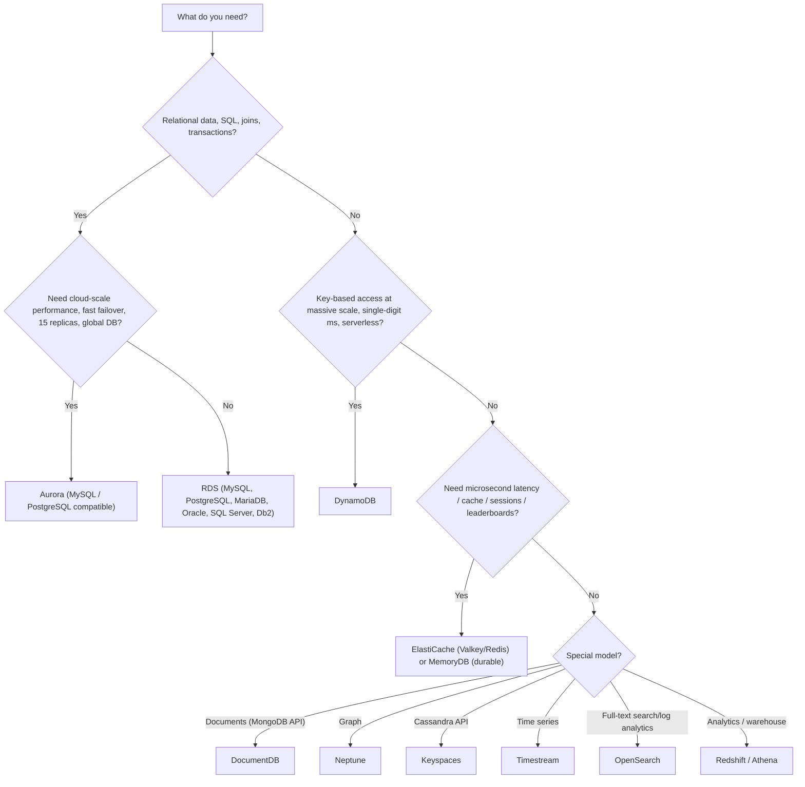
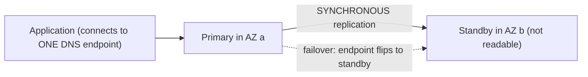
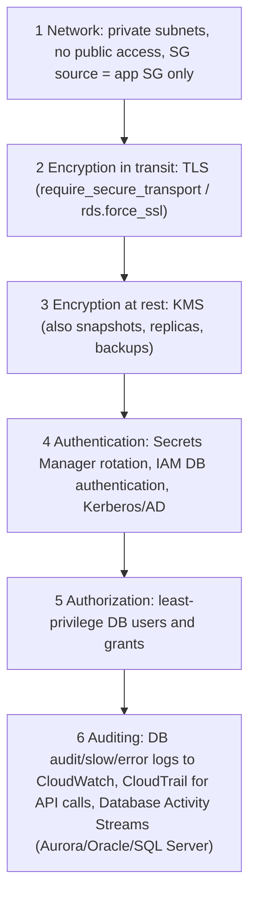
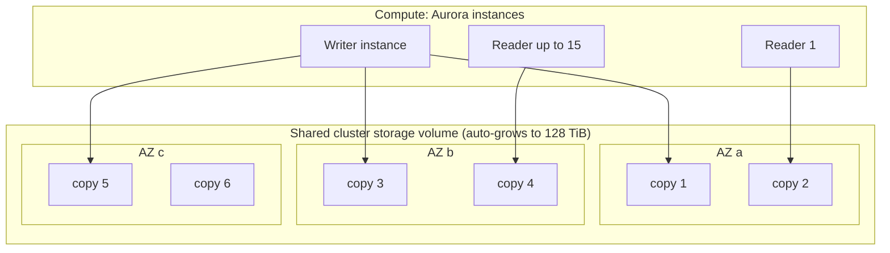
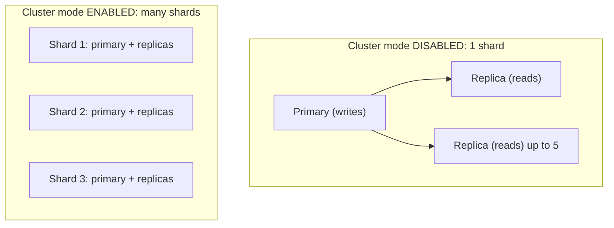
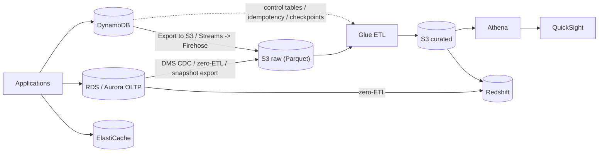
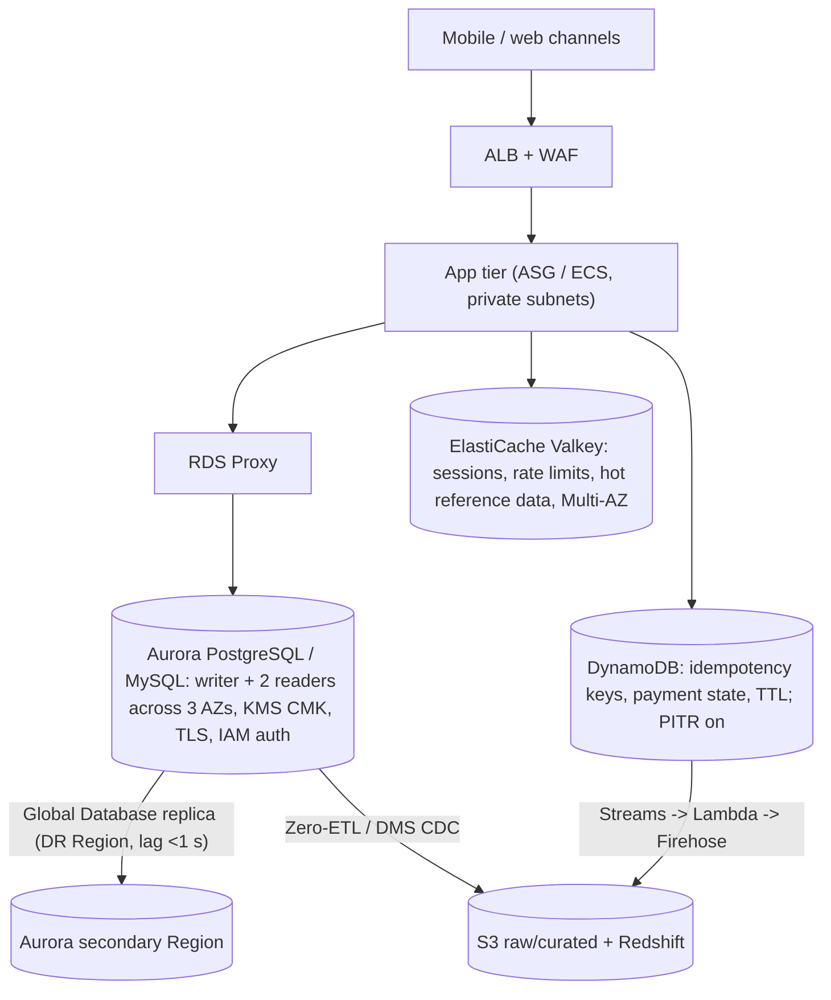

# AWS Databases: RDS, Aurora, DynamoDB and ElastiCache
### Complete Practical Guide (Equivalent to a 5-Hour Lecture)

> **How to use this file:** Read a section, then do its lab in your own AWS account. You will launch a real MySQL database, fail it over, replicate it, restore it after a "disaster", build an Aurora cluster, model and query DynamoDB tables, and put a cache in front of a database and watch latency drop.
> **Cost warning (read first):** Databases **bill by the hour while they exist**, even when idle. Typical lab costs are small (a few rupees per hour for micro/serverless sizes), but **forgetting them is the classic surprise bill**. Every lab ends with cleanup and Section 33 has a **master cleanup**. **Delete instances, replicas, clusters, snapshots, cache nodes and tables when you finish.** DynamoDB on-demand and the small tables here cost almost nothing.
> **Free plan note:** your plan may restrict some database classes or features. If a step is blocked, the explanation still teaches the concept.
> **Region:** ap-south-1 (Mumbai). **Engine versions, limits, prices and some product names change** (for example Performance Insights is being superseded by CloudWatch Database Insights, and ElastiCache now promotes Valkey). Where I give numbers, treat them as "approximately right" and verify in the docs and pricing pages.
> **Prior notes assumed:** IAM, S3, EC2, VPC, Lambda/CLI/boto3. Labs use the **default VPC** so they work even if you deleted `lab-vpc`; in real life put databases in **private subnets**.

---

## Table of Contents

**Part A: Prerequisites (do not skip)**
1. What a database is and the types of data
2. Relational vs NoSQL; the five NoSQL families
3. SQL in 10 minutes (keys, joins, indexes, transactions)
4. ACID vs BASE, CAP theorem, consistency models
5. OLTP vs OLAP (where each AWS service fits)
6. Replication, failover, backups, RPO and RTO
7. Scaling databases: vertical, read replicas, sharding/partitioning
8. Caching concepts (cache-aside, TTL, eviction)
9. Connections and connection pooling
10. Managed vs self-managed databases (why RDS exists)
11. Choosing the right AWS database (decision guide)

**Part B: Amazon RDS**
12. RDS fundamentals: engines, instance classes, storage, subnet groups
13. Lab 0 and Lab 1: Prepare and launch your first RDS MySQL
14. Multi-AZ deployments + Lab 2
15. Read replicas + Lab 3
16. Backups, snapshots, PITR + Lab 4
17. Security: network, encryption, auth, parameter groups + Lab 5
18. Monitoring and maintenance + Lab 6
19. RDS Proxy, Blue/Green, RDS Custom
20. RDS pricing and cost optimization

**Part C: Amazon Aurora**
21. Aurora architecture and features + Lab 7
22. Aurora for data engineering (export, zero-ETL) + Lab 8

**Part D: Amazon DynamoDB**
23. DynamoDB fundamentals: tables, items, keys, partitions
24. Capacity modes, RCU/WCU math, consistency
25. Operations, expressions, conditional writes, transactions + Lab 9
26. Data modeling and single-table design + Lab 10
27. Indexes, TTL, Streams, Global Tables, DAX + Lab 11
28. Backup, PITR, export/import, capacity measurement + Lab 12

**Part E: Amazon ElastiCache**
29. ElastiCache: Valkey/Redis vs Memcached, topologies, patterns + Lab 13

**Part F: Putting it together**
30. **Databases for data engineering** (CDC, extracts, zero-ETL, serving) + Lab 14
31. Other AWS databases at a glance
32. Troubleshooting
33. Master cleanup
34. Real-world architectures (bank, hospital, enterprise)
35. Best practices checklist
36. Exam cheat sheet and 30 practice questions
37. Interview questions and final checklist

---

# PART A: PREREQUISITES

---

## 1. What a Database Is and the Types of Data

A **database** is an organized system for **storing, retrieving, updating and protecting data**, designed so many users/applications can use it safely at the same time. A **DBMS** (database management system) is the software (MySQL, PostgreSQL, DynamoDB...).

### 1.1 Kinds of data
| Type | Shape | Example |
|---|---|---|
| **Structured** | Fixed rows/columns, strict schema | Bank transactions, customers |
| **Semi-structured** | Self-describing, flexible fields | JSON documents, logs, events |
| **Unstructured** | No fixed schema | Images, PDFs, audio |

Databases handle structured and semi-structured data. Unstructured files live in **S3**; the database stores a **pointer** (the S3 key).

### 1.2 Why not just use files or S3?
A database provides things files don't: **fast lookups by key or condition (indexes)**, **concurrent safe updates (transactions)**, **constraints** (uniqueness, relationships), **query languages**, **durability guarantees**, and **access control**.

---

## 2. Relational vs NoSQL; the Five NoSQL Families

| | **Relational (SQL)** | **NoSQL** |
|---|---|---|
| Data model | Tables with rows and columns, relationships via keys | Key-value, document, wide-column, graph, in-memory... |
| Schema | **Fixed**, defined before data (schema-on-write) | **Flexible**, evolves easily |
| Queries | **SQL**, joins, aggregations, ad-hoc | Access by key/index; limited or no joins; designed around known access patterns |
| Transactions | Strong **ACID**, multi-row/table | Varies (DynamoDB supports transactions with limits) |
| Scaling | Mostly **vertical** + read replicas (Aurora scales storage/reads well) | Mostly **horizontal** by design |
| Best for | Complex relationships, reporting-style queries, consistent business data | Massive scale, low latency, simple access patterns, flexible data |

**The five NoSQL families (and AWS services)**
| Family | Idea | AWS service |
|---|---|---|
| **Key-value** | `key -> value` lookups, ultra fast | **DynamoDB**, ElastiCache |
| **Document** | JSON-like documents with nested fields | **DynamoDB** (document attrs), **DocumentDB** (MongoDB-compatible) |
| **Wide-column** | Rows with dynamic columns, huge scale | **Keyspaces** (Cassandra-compatible) |
| **Graph** | Nodes and relationships | **Neptune** |
| **In-memory** | Data in RAM, microsecond latency | **ElastiCache**, **MemoryDB** |
(Also: time-series = **Timestream**; search = **OpenSearch**; warehouse = **Redshift**.)

---

## 3. SQL in 10 Minutes (Keys, Joins, Indexes, Transactions)

### 3.1 Concepts
- **Table** = collection of rows; **row** = one record; **column** = one attribute.
- **Primary key (PK):** uniquely identifies a row (`customer_id`).
- **Foreign key (FK):** a column referencing another table's PK (`orders.customer_id → customers.customer_id`), enforcing relationships.
- **Normalization:** splitting data into related tables to avoid duplication (customers in one table, orders in another).
- **Index:** a **separate sorted structure (usually a B-tree)** that lets the database find rows without scanning the whole table. Speeds reads, **slows writes** (indexes must be updated) and uses storage.

### 3.2 Statements
```sql
-- DDL (structure)
CREATE TABLE customers (customer_id INT PRIMARY KEY, name VARCHAR(50), city VARCHAR(50));
-- DML (data)
INSERT INTO customers VALUES (1,'Asha','Mumbai');
UPDATE customers SET city='Pune' WHERE customer_id=1;
DELETE FROM customers WHERE customer_id=1;
-- Query
SELECT c.name, SUM(o.amount) AS total
FROM customers c JOIN orders o ON o.customer_id = c.customer_id
WHERE o.status = 'PAID'
GROUP BY c.name HAVING SUM(o.amount) > 1000 ORDER BY total DESC LIMIT 10;
```
Joins: **INNER** (matching in both), **LEFT** (all left + matches), etc. (You practiced in Phase 0.)

### 3.3 Transactions
A **transaction** groups statements into one all-or-nothing unit:
```sql
START TRANSACTION;
UPDATE accounts SET balance = balance - 500 WHERE id = 1;
UPDATE accounts SET balance = balance + 500 WHERE id = 2;
COMMIT;      -- or ROLLBACK;  to undo everything
```
If the system crashes between the two updates, the database restores a **consistent** state (neither or both applied).

### 3.4 Query plans
`EXPLAIN SELECT ...` shows how the database will run a query (full table scan vs index lookup). This is how you tune performance (Lab 1).

---

## 4. ACID vs BASE, CAP Theorem, Consistency Models

### 4.1 ACID (relational guarantees)
| Letter | Meaning | Bank example |
|---|---|---|
| **A**tomicity | All or nothing | Debit and credit both happen or neither |
| **C**onsistency | Data always satisfies rules/constraints | Balance never violates constraints |
| **I**solation | Concurrent transactions don't see each other's half-done work | Two transfers don't corrupt each other |
| **D**urability | Once committed, it survives crashes | Confirmed payment isn't lost |

### 4.2 BASE (many NoSQL systems)
**B**asically **A**vailable, **S**oft state, **E**ventually consistent: favors availability and scale; replicas may briefly disagree.

### 4.3 CAP theorem
During a **network partition** (nodes can't talk), a distributed system must choose between **Consistency** (every read sees the latest write, may refuse requests) and **Availability** (always answers, maybe with stale data). **Partition tolerance** is not optional in distributed systems. Real systems let you **tune** the trade-off (DynamoDB lets you choose strongly vs eventually consistent reads).

### 4.4 Consistency models
| Model | Meaning |
|---|---|
| **Strong consistency** | A read returns the **most recent committed write** |
| **Eventual consistency** | Replicas converge **soon** (often milliseconds); a read right after a write may return old data |
| **Read-after-write** | You see your own writes (S3 provides this) |
Eventual reads are **faster/cheaper**; strong reads are **safer** for money/inventory logic.

---

## 5. OLTP vs OLAP

| | **OLTP** (transactions) | **OLAP** (analytics) |
|---|---|---|
| Workload | Many small reads/writes ("record this payment") | Few huge scans/aggregations ("revenue by region by month") |
| Latency | Milliseconds | Seconds to minutes |
| Storage | Usually **row-oriented** | **Columnar** |
| AWS | **RDS, Aurora, DynamoDB**, ElastiCache | **Redshift, Athena, EMR**, lake on S3 |
| Data engineer's job | **Extract from here** (carefully, without hurting production) | **Load into here** |
Never run heavy analytics on your production OLTP primary; use **replicas, exports, CDC, or zero-ETL** to feed analytics systems (Section 30).

---

## 6. Replication, Failover, Backups, RPO and RTO

- **Replication:** copying data to another node. **Synchronous** (write confirmed only after the copy is written: no data loss, higher latency) vs **asynchronous** (confirmed immediately, copy follows: faster, small lag/loss risk).
- **Primary/replica (leader/follower):** writes go to the primary; replicas serve reads or stand by.
- **Failover:** promoting a standby/replica when the primary fails; applications reconnect (often through a **DNS name** that flips to the new primary).
- **Backups:** **full snapshot** + **transaction logs** (MySQL **binlog**, PostgreSQL **WAL**, SQL Server logs) enable **point-in-time recovery (PITR)**: restore to any second within the retention window, by restoring a snapshot and replaying logs.
- **RPO (Recovery Point Objective):** maximum **data loss** you can tolerate (time).
- **RTO (Recovery Time Objective):** maximum **downtime** you can tolerate.
- **HA ≠ backup.** Multi-AZ protects against hardware/AZ failure, but a mistaken `DROP TABLE` replicates instantly to the standby. You need **backups/PITR** for human error.

---

## 7. Scaling Databases

| Approach | How | Limits |
|---|---|---|
| **Vertical** (scale up) | Bigger instance (more CPU/RAM/IOPS) | Hardware ceiling, usually needs restart/failover |
| **Read replicas** (scale reads) | Copies serve read traffic | Writes still hit one primary; replica lag |
| **Caching** | Put hot data in memory (ElastiCache/DAX) | Staleness, invalidation |
| **Sharding / partitioning** (scale writes) | Split data across multiple databases by key | App complexity; DynamoDB does this automatically |
| **Serverless** | Capacity auto-adjusts (Aurora Serverless v2, DynamoDB on-demand) | Cost model differs |

---

## 8. Caching Concepts

A **cache** keeps copies of frequently read data in fast storage (RAM) to **reduce latency and database load**.

| Pattern | How it works | Pros / cons |
|---|---|---|
| **Cache-aside (lazy loading)** | App checks cache; on **miss**, reads DB, **stores in cache**, returns | Only needed data cached; first request slow; data can be stale |
| **Write-through** | App writes to cache and DB together | Cache always fresh; extra write latency; caches never-read data |
| **Write-behind** | Write to cache, DB updated asynchronously | Fast writes; risk of loss |
| **TTL (time to live)** | Entries expire automatically | Bounds staleness |
| **Eviction** | When memory is full, remove entries (LRU = least recently used) | Policy choice matters |

Concepts: **hit rate** (hits/(hits+misses)), **cache stampede / thundering herd** (many requests miss simultaneously after expiry and slam the DB; mitigate with jittered TTLs, locking, request coalescing), **invalidation** ("the hardest problem": delete/update the cache entry when data changes).

---

## 9. Connections and Connection Pooling

Each database connection consumes memory and a slot (`max_connections`). Opening connections is slow. Applications use **connection pools** (reuse a fixed set). Problem scenario: **Lambda** can spawn thousands of concurrent environments, each opening connections, which **exhausts the database** ("Too many connections"). Solutions: **RDS Proxy** (managed pooling), reuse connections outside the handler, reserved concurrency limits, or use DynamoDB for such workloads.

---

## 10. Managed vs Self-Managed Databases

| Task | Self-managed on EC2 | Managed (RDS/Aurora/DynamoDB) |
|---|---|---|
| Hardware, OS install and patching | You | **AWS** |
| Database installation/upgrades | You | AWS (you choose windows) |
| Backups, PITR | You script it | **Automated** |
| Replication/HA/failover | You build and test | **Click or a flag** |
| Monitoring, metrics | You | Built-in CloudWatch |
| OS-level access (SSH) | **Yes** | **No** (except RDS Custom) |
| Custom plugins, full control | Maximum | Limited |
**Rule:** use managed services unless you need OS-level control or unsupported features. (RDS "shared responsibility": AWS runs the infrastructure and engine patching; **you** manage schema, queries, users, security groups, parameters and data.)

---

## 11. Choosing the Right AWS Database


**Quick table**
| Requirement | Choice |
|---|---|
| Lift-and-shift of Oracle/SQL Server | **RDS** (or RDS Custom) |
| New high-performance relational app | **Aurora** |
| Shopping cart, sessions, IoT, gaming, idempotency ledger | **DynamoDB** |
| Speed up reads of a hot dataset | **ElastiCache** (or **DAX** for DynamoDB) |
| Reporting over TBs | **Redshift / Athena**, not RDS |
| Bursty/unknown relational workload | **Aurora Serverless v2** |

---

# PART B: AMAZON RDS

---

## 12. RDS Fundamentals

### 12.1 What RDS is
**Amazon Relational Database Service** is a **managed relational database** service. You choose an engine and size; AWS provisions, patches, backs up, monitors and can replicate it.

### 12.2 Engines
**MySQL, PostgreSQL, MariaDB, Oracle, SQL Server, Db2**, plus **Aurora** (a separate AWS-built engine family, Part C). **RDS Custom** (Oracle, SQL Server) gives OS/database access for legacy apps needing customization.

### 12.3 DB instance, class and storage
- **DB instance** = the database server (like an EC2 you can't SSH into) with its own **endpoint** (DNS name).
- **Instance classes:** `db.t4g/t3` (burstable, dev/test), `db.m6g/m7g/m5` (general), `db.r6g/r7g/r5` (memory-optimized: typical production), `db.x2g` (very high memory). `g` = Graviton (cheaper).
- **Storage types:** **gp3** (default SSD, tune IOPS/throughput), **gp2** (legacy), **io1/io2 Block Express** (provisioned IOPS for demanding workloads). Up to about **64 TiB** for most engines (SQL Server less); **storage autoscaling** can grow storage automatically up to a max you set.
- **Storage can grow but not shrink.** Plan accordingly (restore into a smaller instance via dump/DMS if you must shrink).

### 12.4 Placement: subnet groups
A **DB subnet group** is a set of **subnets in ≥2 AZs** where RDS may place your instance (and standby). Required for any VPC deployment.
- **Publicly accessible = No** (production): the instance gets only a private IP.
- Network access is controlled by **security groups** (MySQL **3306**, PostgreSQL **5432**, SQL Server **1433**, Oracle **1521**, MariaDB 3306).

### 12.5 Parameter groups and option groups
- **Parameter group:** engine configuration (`max_connections`, `require_secure_transport`, `slow_query_log`). **Dynamic** parameters apply immediately; **static** need a **reboot**. The default group is read-only; **create your own**.
- **Option group:** optional engine features (Oracle/SQL Server/MySQL add-ons like native backup/restore, Oracle TDE).

### 12.6 What AWS manages vs what you manage
| AWS | You |
|---|---|
| Hardware, OS, patching, engine installation | Schema design, queries, indexing |
| Automated backups, Multi-AZ failover mechanics | Backup retention choice, DR plan |
| Storage durability, monitoring metrics | Security groups, IAM, encryption choices, DB users |
| Engine minor-version patching (in your window) | Major-version upgrades, parameter tuning, capacity sizing |

---

## 13. LAB 0 and LAB 1: Prepare and Launch Your First RDS MySQL

### Lab 0: Network and client setup
We need (a) a **DB subnet group**, (b) security groups, and (c) a small **EC2 client** in the same VPC (RDS has no public endpoint, and CloudShell isn't inside your VPC) to run SQL.
```bash
export AWS_DEFAULT_REGION=ap-south-1
ACCOUNT_ID=$(aws sts get-caller-identity --query Account --output text)
BUCKET=s3lab-yourname-12345                 # your S3 lab bucket (used in Lab 14)
mkdir -p ~/dblab && cd ~/dblab

DVPC=$(aws ec2 describe-vpcs --filters Name=isDefault,Values=true --query 'Vpcs[0].VpcId' --output text)
SUBNETS=$(aws ec2 describe-subnets --filters Name=vpc-id,Values=$DVPC --query 'Subnets[].SubnetId' --output text)
echo $DVPC; echo $SUBNETS

# Security groups: DB allows 3306 ONLY from the client SG
SG_CLIENT=$(aws ec2 create-security-group --group-name db-lab-client-sg --description "db lab client" --vpc-id $DVPC --query GroupId --output text)
SG_DB=$(aws ec2 create-security-group --group-name db-lab-db-sg --description "db lab databases" --vpc-id $DVPC --query GroupId --output text)
aws ec2 authorize-security-group-ingress --group-id $SG_DB --protocol tcp --port 3306 --source-group $SG_CLIENT

# DB subnet group (subnets in multiple AZs)
aws rds create-db-subnet-group --db-subnet-group-name lab-db-subnets --db-subnet-group-description "db lab subnets" --subnet-ids $SUBNETS
```
**Client instance role** (SSM access, read the DB secret, write extracts to your S3 prefix):
```bash
cat > trust.json << 'EOF'
{ "Version":"2012-10-17","Statement":[{"Effect":"Allow","Principal":{"Service":"ec2.amazonaws.com"},"Action":"sts:AssumeRole"}] }
EOF
aws iam create-role --role-name db-lab-client-role --assume-role-policy-document file://trust.json
aws iam attach-role-policy --role-name db-lab-client-role --policy-arn arn:aws:iam::aws:policy/AmazonSSMManagedInstanceCore
cat > client-policy.json << EOF
{ "Version":"2012-10-17","Statement":[
  { "Effect":"Allow","Action":["secretsmanager:GetSecretValue"],"Resource":"arn:aws:secretsmanager:ap-south-1:$ACCOUNT_ID:secret:rds!*" },
  { "Effect":"Allow","Action":["s3:PutObject","s3:GetObject"],"Resource":"arn:aws:s3:::$BUCKET/dblab/*" },
  { "Effect":"Allow","Action":["s3:ListBucket"],"Resource":"arn:aws:s3:::$BUCKET" } ] }
EOF
aws iam put-role-policy --role-name db-lab-client-role --policy-name client --policy-document file://client-policy.json
aws iam create-instance-profile --instance-profile-name db-lab-client-profile
aws iam add-role-to-instance-profile --instance-profile-name db-lab-client-profile --role-name db-lab-client-role
sleep 10

AMI=$(aws ssm get-parameter --name /aws/service/ami-amazon-linux-latest/al2023-ami-kernel-default-x86_64 --query Parameter.Value --output text)
CLIENT_ID=$(aws ec2 run-instances --image-id $AMI --instance-type t3.micro --security-group-ids $SG_CLIENT \
  --iam-instance-profile Name=db-lab-client-profile --associate-public-ip-address \
  --metadata-options HttpTokens=required \
  --tag-specifications 'ResourceType=instance,Tags=[{Key=Name,Value=db-lab-client}]' --query 'Instances[0].InstanceId' --output text)
aws ec2 wait instance-running --instance-ids $CLIENT_ID; echo $CLIENT_ID
```
(Use your free-tier-eligible instance type if `t3.micro` isn't allowed. The client has a public IP only so SSM can reach its endpoints; it accepts **no inbound** traffic.) Connect later with **EC2 > Instances > db-lab-client > Connect > Session Manager** and install tools:
```bash
# inside the client (Session Manager):
sudo dnf install -y mariadb105 python3-pip
pip3 install --user pymysql redis boto3 pandas pyarrow
export AWS_DEFAULT_REGION=ap-south-1
mysql --version
```
(The MariaDB client talks to MySQL fine. If `dnf` can't find `mariadb105`, run `dnf search mariadb`.)

### Lab 1: Launch RDS MySQL and use it
```bash
aws rds create-db-instance --db-instance-identifier lab-mysql \
  --engine mysql --db-instance-class db.t4g.micro \
  --allocated-storage 20 --storage-type gp3 --storage-encrypted \
  --master-username admin --manage-master-user-password \
  --db-name labdb --db-subnet-group-name lab-db-subnets --vpc-security-group-ids $SG_DB \
  --no-publicly-accessible --no-multi-az --backup-retention-period 7 \
  --enable-cloudwatch-logs-exports error slowquery \
  --tags Key=Project,Value=aws-learning
aws rds wait db-instance-available --db-instance-identifier lab-mysql        # about 5-10 minutes
aws rds describe-db-instances --db-instance-identifier lab-mysql \
  --query 'DBInstances[0].[Endpoint.Address,Endpoint.Port,EngineVersion,AvailabilityZone,MasterUserSecret.SecretArn]' --output text
```
(If `db.t4g.micro` isn't offered to your plan, try `db.t3.micro`.) What you set: **`--manage-master-user-password`** makes RDS create and **rotate the master password in Secrets Manager** (no password in your shell history); **`--storage-encrypted`** uses KMS (encryption must be chosen at creation); **`--no-publicly-accessible`** keeps it private.

Save the outputs:
```bash
EP=$(aws rds describe-db-instances --db-instance-identifier lab-mysql --query 'DBInstances[0].Endpoint.Address' --output text)
SECRET_ARN=$(aws rds describe-db-instances --db-instance-identifier lab-mysql --query 'DBInstances[0].MasterUserSecret.SecretArn' --output text)
echo "EP=$EP"; echo "SECRET_ARN=$SECRET_ARN"
```
**Connect from the client (Session Manager)** (paste your EP and SECRET_ARN):
```bash
EP=<paste endpoint>; SECRET_ARN=<paste secret arn>
SECRET=$(aws secretsmanager get-secret-value --secret-id $SECRET_ARN --query SecretString --output text)
export MYSQL_PWD=$(echo $SECRET | python3 -c "import sys,json;print(json.load(sys.stdin)['password'])")
mysql -h $EP -u admin labdb -e "SELECT VERSION(), NOW(), @@hostname;"
```
**Run SQL:** open an interactive session `mysql -h $EP -u admin labdb` and execute:
```sql
CREATE TABLE customers (
  customer_id INT PRIMARY KEY AUTO_INCREMENT, name VARCHAR(50), city VARCHAR(50));
CREATE TABLE orders (
  order_id INT PRIMARY KEY AUTO_INCREMENT, customer_id INT, amount DECIMAL(10,2),
  status VARCHAR(10), created_at DATETIME DEFAULT CURRENT_TIMESTAMP,
  FOREIGN KEY (customer_id) REFERENCES customers(customer_id));
INSERT INTO customers (name, city) VALUES ('Asha','Mumbai'),('Ravi','Pune'),('Meena','Mumbai'),('John','Delhi');
INSERT INTO orders (customer_id, amount, status) VALUES (1,2500,'PAID'),(2,1800,'FAILED'),(3,3200,'PAID'),(1,900,'PAID');

SELECT c.name, SUM(o.amount) AS total FROM customers c JOIN orders o USING (customer_id)
WHERE o.status='PAID' GROUP BY c.name ORDER BY total DESC;

-- Foreign key enforces integrity (this FAILS):
INSERT INTO orders (customer_id, amount, status) VALUES (999, 10, 'PAID');
```
**Transactions (ACID in action)**
```sql
CREATE TABLE accounts (id INT PRIMARY KEY, owner VARCHAR(20), balance DECIMAL(10,2)) ENGINE=InnoDB;
INSERT INTO accounts VALUES (1,'Asha',5000),(2,'Ravi',1000);
START TRANSACTION;
UPDATE accounts SET balance = balance - 500 WHERE id = 1;
UPDATE accounts SET balance = balance + 500 WHERE id = 2;
SELECT * FROM accounts;      -- you see the new balances
ROLLBACK;                    -- undo everything
SELECT * FROM accounts;      -- back to 5000 / 1000
```
**Indexes: see the difference**
```sql
CREATE TABLE digits (d INT); INSERT INTO digits VALUES (0),(1),(2),(3),(4),(5),(6),(7),(8),(9);
CREATE TABLE big_orders (order_id INT PRIMARY KEY AUTO_INCREMENT, customer_id INT, amount DECIMAL(10,2),
                         status VARCHAR(10), created_at DATETIME DEFAULT CURRENT_TIMESTAMP);
INSERT INTO big_orders (customer_id, amount, status)
SELECT FLOOR(1+RAND()*5000), ROUND(RAND()*10000,2), ELT(1+FLOOR(RAND()*3),'PAID','FAILED','PENDING')
FROM digits a, digits b, digits c, digits d, digits e;          -- 100,000 rows
SELECT COUNT(*) FROM big_orders;

EXPLAIN SELECT * FROM big_orders WHERE customer_id = 123;       -- type: ALL (full scan), rows ~100000
CREATE INDEX idx_customer ON big_orders (customer_id);
EXPLAIN SELECT * FROM big_orders WHERE customer_id = 123;       -- type: ref, rows ~20  (index lookup!)
```
**Lesson:** the index turns a 100,000-row scan into a ~20-row lookup. **Connections:** `SHOW PROCESSLIST;` and `SHOW VARIABLES LIKE 'max_connections';` (RDS sets it from instance memory).

---

## 14. Multi-AZ Deployments

### 14.1 What Multi-AZ does
It provides **high availability**, not read scaling.

**Multi-AZ DB instance (classic):**

- **Synchronous** replication to a **standby in another AZ**; the standby **cannot serve reads**.
- Automatic failover on: **AZ outage**, **primary failure**, **storage failure**, **instance class change**, **OS patching/maintenance**, or **manual reboot with failover**.
- Failover typically takes **60-120 seconds**; the **same endpoint (DNS CNAME)** points to the new primary. Applications must **reconnect** and **respect DNS TTL** (a Java app caching DNS forever keeps hitting the dead IP).
- **Backups and snapshots are taken from the standby**, avoiding I/O impact on the primary.
- Cost: **about 2×** (two instances' compute and storage).

**Multi-AZ DB cluster** (MySQL/PostgreSQL only): **one writer + two readable standbys** in 3 AZs with **semi-synchronous** replication, **faster failover (typically under about 35 seconds)**, lower commit latency, **reader endpoint** to use the standbys for reads. A middle path between classic Multi-AZ and Aurora.

**Single-AZ:** cheapest, no automatic failover (downtime while AWS repairs/restores).

### 14.2 Multi-AZ vs read replicas (a top exam table)
| | **Multi-AZ** | **Read replica** |
|---|---|---|
| Purpose | **High availability / DR in-Region** | **Scale reads**, DR, reporting |
| Replication | **Synchronous** | **Asynchronous** (lag) |
| Readable? | **No** (instance deployment) | **Yes** |
| Failover | **Automatic** | **Manual promotion** |
| Endpoint | **Same endpoint** | **Own endpoint** per replica |
| Region | Same Region (two AZs) | Same AZ/Region **or cross-Region** |
| Backups from | Standby | Not applicable |

### LAB 2: Convert to Multi-AZ and measure a real failover
```bash
aws rds modify-db-instance --db-instance-identifier lab-mysql --multi-az --apply-immediately
aws rds wait db-instance-available --db-instance-identifier lab-mysql     # 10-20 minutes (it builds the standby from a snapshot)
aws rds describe-db-instances --db-instance-identifier lab-mysql \
  --query 'DBInstances[0].[MultiAZ,AvailabilityZone,SecondaryAvailabilityZone]' --output text
```
You'll see the primary AZ and the secondary AZ. **Start a "heartbeat" on the client** (second Session Manager tab):
```bash
EP=<endpoint>; SECRET_ARN=<arn>   # as before, set MYSQL_PWD again in this tab
while true; do
  printf "%s " "$(date +%T)"
  mysql -h $EP -u admin labdb --connect-timeout=2 -N -e "SELECT 'ok', @@hostname" 2>&1 | tail -1
  sleep 1
done
```
**Trigger the failover** from CloudShell:
```bash
aws rds reboot-db-instance --db-instance-identifier lab-mysql --force-failover
```
Watch the heartbeat: it prints `ok` and a hostname, then **errors for roughly a minute or two**, then resumes with a **different hostname** (the standby is now primary). Confirm:
```bash
aws rds describe-db-instances --db-instance-identifier lab-mysql --query 'DBInstances[0].[AvailabilityZone,SecondaryAvailabilityZone]' --output text   # AZs swapped
aws rds describe-events --source-identifier lab-mysql --source-type db-instance --duration 30 \
   --query 'Events[].[Date,Message]' --output table      # "Multi-AZ instance failover started / completed"
```
**Key lessons:** same endpoint, brief outage, DNS flip, **your app needs retry logic**. Stop the heartbeat with Ctrl+C.
**Cost tip:** Multi-AZ doubles the hourly cost. **Convert back** to save money after the lab: `aws rds modify-db-instance --db-instance-identifier lab-mysql --no-multi-az --apply-immediately`.

---

## 15. Read Replicas

### 15.1 Facts
- **Asynchronous** copies; used to **offload read traffic** (reports, dashboards, analytics extracts) and for **DR/cross-Region** copies.
- MySQL/MariaDB/PostgreSQL: **up to 15 replicas** per source (Oracle/SQL Server support fewer); can be **same Region or cross-Region**; a replica can have its own replicas (chains add lag).
- **Source must have automated backups enabled** (retention > 0).
- Each replica has its **own endpoint**: your app must **send reads** there (e.g., separate read connection string).
- **Replica lag** (`ReplicaLag` metric): reads may be slightly stale; heavy writes or small replicas increase lag.
- Replicas can be **promoted** to standalone databases (breaks replication): a manual DR step or to split off a workload.
- Replicas can be **Multi-AZ** themselves. Encryption: replica of an encrypted source is encrypted; cross-Region needs a **KMS key in the target Region**.
- **Data transfer:** same-Region replication is free of transfer charges; **cross-Region transfer is billed**.

### LAB 3: Create a replica, read from it, watch lag, try to write
```bash
aws rds create-db-instance-read-replica --db-instance-identifier lab-mysql-replica \
  --source-db-instance-identifier lab-mysql --db-instance-class db.t4g.micro --no-multi-az \
  --vpc-security-group-ids $SG_DB --no-publicly-accessible
aws rds wait db-instance-available --db-instance-identifier lab-mysql-replica
REP=$(aws rds describe-db-instances --db-instance-identifier lab-mysql-replica --query 'DBInstances[0].Endpoint.Address' --output text); echo $REP
```
**On the client** (same master password works on the replica):
```bash
REP=<replica endpoint>
mysql -h $EP  -u admin labdb -e "INSERT INTO customers (name, city) VALUES ('Zoya','Chennai');"
sleep 2
mysql -h $REP -u admin labdb -e "SELECT * FROM customers ORDER BY customer_id DESC LIMIT 2; SELECT @@read_only, @@hostname;"
mysql -h $REP -u admin labdb -e "INSERT INTO customers (name, city) VALUES ('Nope','Nowhere');"
```
Expected: the new row appears on the replica after a moment (**asynchronous**), `@@read_only = 1`, and the write on the replica fails with **"The MySQL server is running with the --read-only option"**.

**See lag grow** (write heavily on the primary, then check the replica):
```bash
mysql -h $EP -u admin labdb -e "INSERT INTO big_orders (customer_id, amount, status) SELECT customer_id, amount, status FROM big_orders;"   # doubles the table
mysql -h $REP -u admin labdb -e "SHOW REPLICA STATUS\G" | grep -E "Seconds_Behind|Running"     # (older clients: SHOW SLAVE STATUS)
```
From CloudShell: 
```bash
aws cloudwatch get-metric-statistics --namespace AWS/RDS --metric-name ReplicaLag \
  --dimensions Name=DBInstanceIdentifier,Value=lab-mysql-replica \
  --start-time $(date -u -d '30 minutes ago' +%FT%TZ) --end-time $(date -u +%FT%TZ) --period 60 --statistics Maximum \
  --query 'Datapoints[].[Timestamp,Maximum]' --output table
```
**Design thought:** a reporting tool pointed at the replica never slows the production primary (but may see data seconds old). **Promote** (optional, destructive for replication): `aws rds promote-read-replica --db-instance-identifier lab-mysql-replica`. We'll delete the replica in cleanup anyway.

---

## 16. Backups, Snapshots, PITR

### 16.1 Two kinds of backups
| | **Automated backups** | **Manual snapshots** |
|---|---|---|
| Created | Daily snapshot in the backup window + **continuous transaction logs** | When you ask |
| Retention | **0-35 days** (default 7; 0 disables backups) | **Until you delete them** |
| Use | **Point-in-time recovery** to any second in the window (up to about the last 5 minutes) | Before risky changes, long-term retention, copying/sharing |
| Deleted when instance is deleted? | **Yes** (unless you choose to retain) | **No** |

### 16.2 Critical rules
- **Restoring always creates a NEW DB instance** with a **new endpoint**; it never overwrites the original. Switch the application (or rename instances: rename old, rename restored to the original name).
- **PITR** = restore latest snapshot before the target time + replay logs.
- Snapshots are **incremental** at the storage level, stored in S3 managed storage, **regional**; **cross-Region copy** and **sharing with other accounts** are supported (sharing an **encrypted** snapshot also requires sharing the **customer managed KMS key**; snapshots encrypted with the default `aws/rds` key can't be shared).
- To **encrypt an unencrypted instance**: snapshot → **copy snapshot with encryption** → restore from the encrypted copy.
- Backup storage **up to 100% of your provisioned DB storage is free** per Region; beyond that, billed.
- Single-AZ backups can cause a **brief I/O pause** (Multi-AZ avoids this by backing up from the standby).
- **AWS Backup** centralizes schedules, cross-Region/account copies, vault lock, compliance reports for RDS, Aurora, DynamoDB, EFS, EBS.
- **Deletion protection** prevents accidental deletion; **final snapshot** option on delete.

### LAB 4: "Oops, I dropped a table": restore from snapshot and PITR
```bash
# 1) Manual snapshot (safety net)
aws rds create-db-snapshot --db-instance-identifier lab-mysql --db-snapshot-identifier lab-snap-before-oops
aws rds wait db-snapshot-available --db-snapshot-identifier lab-snap-before-oops

# note the time (UTC), we'll use it for PITR
date -u +%FT%TZ
```
**2) The "disaster"** (client):
```bash
mysql -h $EP -u admin labdb -e "SELECT COUNT(*) FROM orders; DROP TABLE orders; SHOW TABLES;"
```
(The `DROP` would also instantly replicate to a Multi-AZ standby and read replicas: **HA is not a backup**.)

**3) Restore the snapshot to a NEW instance**
```bash
aws rds restore-db-instance-from-db-snapshot --db-instance-identifier lab-mysql-restored \
  --db-snapshot-identifier lab-snap-before-oops --db-instance-class db.t4g.micro \
  --db-subnet-group-name lab-db-subnets --vpc-security-group-ids $SG_DB --no-publicly-accessible --no-multi-az
aws rds wait db-instance-available --db-instance-identifier lab-mysql-restored
RES=$(aws rds describe-db-instances --db-instance-identifier lab-mysql-restored --query 'DBInstances[0].Endpoint.Address' --output text); echo $RES
mysql -h $RES -u admin labdb -e "SHOW TABLES; SELECT COUNT(*) FROM orders;"      # orders is back
```
(Use the **same master password** as the original instance; it's stored in the snapshot. If your restored instance doesn't have a managed secret, that's expected: you can enable managed passwords again with `modify-db-instance --manage-master-user-password`.) Note: **different endpoint**, an application would need to switch to it.

**4) Point-in-time recovery (to just before the drop)**
```bash
aws rds describe-db-instances --db-instance-identifier lab-mysql --query 'DBInstances[0].LatestRestorableTime' --output text
aws rds restore-db-instance-to-point-in-time --source-db-instance-identifier lab-mysql \
  --target-db-instance-identifier lab-mysql-pitr --use-latest-restorable-time \
  --db-subnet-group-name lab-db-subnets --vpc-security-group-ids $SG_DB --no-publicly-accessible --db-instance-class db.t4g.micro
# or a specific second:  --restore-time 2026-11-05T10:15:00Z   (must be inside the retention window and before the drop)
```
Latest restorable time is typically about 5 minutes in the past, so for a drop that just happened pick `--restore-time` **a minute before** it. Verify in the PITR copy that `orders` exists. Then in real life you'd copy the table back (mysqldump the table) or cut over.

**5) Cross-Region snapshot copy (disaster recovery building block):**
```bash
aws rds copy-db-snapshot --source-db-snapshot-identifier arn:aws:rds:ap-south-1:$ACCOUNT_ID:snapshot:lab-snap-before-oops \
  --target-db-snapshot-identifier lab-snap-copy --source-region ap-south-1 --region ap-southeast-1 --kms-key-id alias/aws/rds
```
(For an encrypted snapshot you must specify a KMS key in the **destination Region**.) Delete the copy afterward (Section 33). **Cleanup of restored instances now** to save money:
```bash
aws rds delete-db-instance --db-instance-identifier lab-mysql-restored --skip-final-snapshot --delete-automated-backups
aws rds delete-db-instance --db-instance-identifier lab-mysql-pitr --skip-final-snapshot --delete-automated-backups
```

---

## 17. Security: Network, Encryption, Auth, Parameter Groups

### 17.1 Defense in depth for databases

- **Security groups:** DB SG allows the DB port **only from the application SG** (SG-to-SG).
- **Publicly accessible = No**, and no route from the internet.
- **Encryption at rest** must be **enabled at creation** (can't toggle on an existing instance; use snapshot-copy-restore). Uses KMS; covers storage, backups, snapshots, replicas.
- **Encryption in transit:** download the **RDS CA bundle**; enforce TLS with `require_secure_transport=ON` (MySQL/MariaDB) or `rds.force_ssl=1` (PostgreSQL).
- **Authentication options:**
  - **Master user + password** (use **Secrets Manager managed password**, automatic rotation).
  - **IAM database authentication** (MySQL, PostgreSQL, MariaDB; also Aurora): the app calls `generate-db-auth-token` (valid **15 minutes**) and uses it as the password over TLS; permissions via IAM policy `rds-db:connect`. No stored password; great for EC2/Lambda/EKS roles.
  - **Kerberos/Active Directory** integration (SQL Server, Oracle, PostgreSQL, MySQL).
- **Never** embed DB passwords in code or environment variables; use Secrets Manager/Parameter Store.
- **Deletion protection**, **tags**, **AWS Config rules** (`rds-instance-public-access-check`, `rds-storage-encrypted`, `rds-multi-az-support`).

### LAB 5: Enforce TLS, test it; (read-through) IAM auth and RDS Proxy
**Part A: custom parameter group requiring TLS**
```bash
VER=$(aws rds describe-db-instances --db-instance-identifier lab-mysql --query 'DBInstances[0].EngineVersion' --output text)
FAMILY=$(aws rds describe-db-engine-versions --engine mysql --engine-version $VER --query 'DBEngineVersions[0].DBParameterGroupFamily' --output text)
echo $VER $FAMILY
aws rds create-db-parameter-group --db-parameter-group-name lab-mysql-params --db-parameter-group-family $FAMILY --description "lab params"
aws rds modify-db-parameter-group --db-parameter-group-name lab-mysql-params \
  --parameters "ParameterName=require_secure_transport,ParameterValue=ON,ApplyMethod=immediate" \
               "ParameterName=slow_query_log,ParameterValue=1,ApplyMethod=immediate" \
               "ParameterName=long_query_time,ParameterValue=1,ApplyMethod=immediate"
aws rds modify-db-instance --db-instance-identifier lab-mysql --db-parameter-group-name lab-mysql-params --apply-immediately
aws rds describe-db-instances --db-instance-identifier lab-mysql --query 'DBInstances[0].DBParameterGroups'   # "pending-reboot"
aws rds reboot-db-instance --db-instance-identifier lab-mysql
aws rds wait db-instance-available --db-instance-identifier lab-mysql
```
(Attaching a new parameter group needs a **reboot** to take effect; the parameters inside it that are dynamic apply once associated.) **Test on the client:**
```bash
mysql -h $EP -u admin labdb --skip-ssl -e "SELECT 1"
#  -> ERROR 3159: Connections using insecure transport are prohibited while --require_secure_transport=ON
curl -s -o global-bundle.pem https://truststore.pki.rds.amazonaws.com/global/global-bundle.pem
mysql -h $EP -u admin labdb --ssl-ca=global-bundle.pem --ssl-verify-server-cert -e "SHOW STATUS LIKE 'Ssl_cipher';"
#  -> a TLS cipher name = encrypted connection that also verified the server's certificate
```
**Part B (read-through): IAM database authentication**
```bash
aws rds modify-db-instance --db-instance-identifier lab-mysql --enable-iam-database-authentication --apply-immediately
```
Inside MySQL (as admin): `CREATE USER 'iamuser'@'%' IDENTIFIED WITH AWSAuthenticationPlugin AS 'RDS'; GRANT SELECT ON labdb.* TO 'iamuser'@'%';`
IAM policy for the caller (EC2 role):
```json
{ "Effect":"Allow","Action":"rds-db:connect",
  "Resource":"arn:aws:rds-db:ap-south-1:ACCOUNT_ID:dbuser:db-RESOURCE_ID/iamuser" }
```
(`RESOURCE_ID` comes from `describe-db-instances --query 'DBInstances[0].DbiResourceId'`.) Connect with a 15-minute token as the password: `TOKEN=$(aws rds generate-db-auth-token --hostname $EP --port 3306 --username iamuser)` then `mysql -h $EP -u iamuser --password="$TOKEN" --ssl-ca=global-bundle.pem --default-auth=mysql_clear_password` (with the MySQL client: `--enable-cleartext-plugin`). **No stored password anywhere.**

**Part C (read-through): RDS Proxy.** Console: **RDS > Proxies > Create proxy** (engine MySQL, target `lab-mysql`, a Secrets Manager secret holding DB credentials, an IAM role, subnets/SG, optionally require TLS and **IAM auth**). The app connects to the **proxy endpoint**. Benefits: **connection pooling/multiplexing** (protects the DB from Lambda connection storms), **faster failover** (the proxy keeps client connections and reconnects to the new primary, cutting failover impact), **IAM auth + Secrets Manager** centralization. Cost: per vCPU-hour of the target DB. We cover it in Section 19.

---

## 18. Monitoring and Maintenance

### 18.1 Metrics that matter (CloudWatch `AWS/RDS`)
| Metric | Meaning / action |
|---|---|
| **CPUUtilization** | Sustained >80%: tune queries/indexes or scale up |
| **FreeableMemory** | Low plus swapping = undersized or too many connections |
| **DatabaseConnections** | Approaching `max_connections`: pooling/proxy |
| **FreeStorageSpace** | Alarm before full; enable **storage autoscaling** |
| **ReadIOPS / WriteIOPS / ReadLatency / WriteLatency / DiskQueueDepth** | Storage bottleneck: more IOPS/gp3 tuning/io2 |
| **ReplicaLag** | Replica falling behind |
| **BurstBalance** (gp2) / CPU credit balance (t-class) | Running out of burst capacity |
| **Deadlocks, SwapUsage** | Engine/application issues |

### 18.2 Tools
- **Enhanced Monitoring:** OS-level metrics (1-60 s granularity) via an agent, delivered to CloudWatch Logs (needs a monitoring role).
- **Performance Insights / CloudWatch Database Insights:** shows **DB load by wait events, SQL, host, user** (find the slow query). (Performance Insights is being superseded by Database Insights; check the console.)
- **Logs exported to CloudWatch Logs:** error, general, **slow query**, audit.
- **RDS Events** to SNS (failover, backup, maintenance, low storage).
- **Advisor-style:** Trusted Advisor, Compute Optimizer.

### 18.3 Maintenance
- **Maintenance window:** weekly slot for OS/engine patching; **minor version** auto-upgrades optional; **major upgrades** are your decision (test on a clone/restored copy; use **Blue/Green** for low downtime).
- **Static parameter** changes need reboot. **Instance class change** causes a brief outage (failover in Multi-AZ).
- **Stop/start:** you can **stop** an RDS instance up to **7 days** (then AWS auto-starts it) to save compute cost; storage continues to bill.

### LAB 6: Metrics, slow query log, alarm
**1) Slow query log to CloudWatch Logs** (parameters set in Lab 5; log export enabled at creation)
```bash
mysql -h $EP -u admin labdb --ssl-ca=global-bundle.pem --ssl-verify-server-cert -e "SELECT SLEEP(2), 'slow one';"
sleep 90
aws logs describe-log-groups --log-group-name-prefix /aws/rds/instance/lab-mysql --query 'logGroups[].logGroupName'
aws logs tail /aws/rds/instance/lab-mysql/slowquery --since 10m
```
You'll see the `SELECT SLEEP(2)` entry with `Query_time`. In production you'd feed this to Logs Insights/alerts to find slow SQL.

**2) Alarms**
```bash
TOPIC=$(aws sns create-topic --name lab-db-alerts --query TopicArn --output text)
aws sns subscribe --topic-arn $TOPIC --protocol email --notification-endpoint you@example.com     # confirm in email
aws cloudwatch put-metric-alarm --alarm-name lab-mysql-cpu --namespace AWS/RDS --metric-name CPUUtilization \
  --dimensions Name=DBInstanceIdentifier,Value=lab-mysql --statistic Average --period 60 --evaluation-periods 3 \
  --threshold 70 --comparison-operator GreaterThanThreshold --alarm-actions $TOPIC
aws cloudwatch put-metric-alarm --alarm-name lab-mysql-storage --namespace AWS/RDS --metric-name FreeStorageSpace \
  --dimensions Name=DBInstanceIdentifier,Value=lab-mysql --statistic Minimum --period 300 --evaluation-periods 1 \
  --threshold 2000000000 --comparison-operator LessThanThreshold --alarm-actions $TOPIC
```
**3) Generate CPU load and watch the graph** (client):
```bash
mysql -h $EP -u admin labdb --ssl-ca=global-bundle.pem --ssl-verify-server-cert -e "SELECT BENCHMARK(300000000, MD5('abc'));"
```
In **RDS console > lab-mysql > Monitoring** see CPU climb; the alarm may fire. **4) Enhanced Monitoring (optional):** create a role with `AmazonRDSEnhancedMonitoringRole` (trust `monitoring.rds.amazonaws.com`) and run `aws rds modify-db-instance --db-instance-identifier lab-mysql --monitoring-interval 60 --monitoring-role-arn <role-arn>`; see OS processes in the console's **Monitoring > OS metrics**.

---

## 19. RDS Proxy, Blue/Green Deployments, RDS Custom

### 19.1 RDS Proxy
A managed, highly available **database proxy** that **pools and shares connections**.
- Cuts **failover time impact** (up to roughly 66% faster in AWS's measurements) because the proxy holds client connections.
- Great for **Lambda** and apps with many short-lived connections.
- Supports **IAM authentication** and **Secrets Manager** credentials; can **require TLS**.
- Lives in your **VPC**; apps connect to the proxy endpoint (read-only endpoints available for Aurora).
- Costs per vCPU-hour of the underlying database.
- **Pinning:** certain session state (temporary tables, `SET` variables, prepared statements in some modes) **pins** a client to one connection, reducing pooling benefit.

### 19.2 Blue/Green Deployments
Creates a synchronized **green** copy of your production (**blue**) environment (MySQL, MariaDB, PostgreSQL, Aurora). You upgrade/modify the green copy, test, then **switch over** in about a minute with no data loss. Used for **major version upgrades, parameter changes, schema changes**.

### 19.3 RDS Custom
For **Oracle and SQL Server** requiring OS/database customization (third-party agents, custom patches) with AWS automation still managing backups/HA. You take on more responsibility (shared-responsibility shifts toward you).

---

## 20. RDS Pricing and Cost Optimization

| Component | Notes |
|---|---|
| **Instance hours** | By class; **Multi-AZ ≈ 2×**; license-included engines (SQL Server/Oracle) cost more |
| **Storage** | GB-month (gp3 cheaper than gp2/io1); **provisioned IOPS** extra for io1/io2 |
| **Backup storage** | Free up to 100% of DB size; beyond that GB-month |
| **Snapshots** | Manual snapshots billed GB-month until deleted |
| **Data transfer** | Out to internet and cross-Region billed; same-AZ/Region mostly free |
| **RDS Proxy, Enhanced Monitoring, Performance Insights/Database Insights (paid tiers), Extended support** | Extra |
| **Reserved Instances** | 1/3-year discounts for steady production DBs |
| **Free usage** | Past free tiers/credit plans may apply to micro instances; verify |

**Optimization checklist:** right-size with CloudWatch/Compute Optimizer; **Graviton (`g`) classes**; **gp3**; **stop** dev databases nights/weekends (max 7 days) or automate with EventBridge; **delete old snapshots and orphan manual snapshots**; **Reserved Instances** for steady load; **read replicas only where needed**; avoid over-provisioned IOPS; use **Aurora Serverless v2** for spiky workloads; keep **log retention** sensible.

---

# PART C: AMAZON AURORA

---

## 21. Aurora Architecture and Features

### 21.1 What Aurora is
**Amazon Aurora** is AWS's cloud-native relational database, **compatible with MySQL and PostgreSQL**. AWS cites up to about **5× MySQL / 3× PostgreSQL throughput** versus standard engines. The key difference is architecture: **compute is separated from storage**, and the **storage layer is a distributed, self-healing, shared volume**.

### 21.2 The cluster volume (the heart of Aurora)

- Data is stored as **6 copies across 3 AZs** in 10 GB **protection groups**.
- **Quorum:** writes need **4 of 6** copies, reads **3 of 6**. It survives losing **an entire AZ plus one more copy for reads** and an AZ for writes.
- **Self-healing** storage continuously repairs bad segments. Storage **grows automatically** in 10 GB steps up to **128 TiB** (and shrinks as data is removed).
- **Readers share the same storage** as the writer, so there's **no data copying** to replicas: **replica lag is typically in the tens of milliseconds**, and adding a reader is fast.
- Only **redo log records** go over the network from writer to storage (not whole data pages), one reason for performance.

### 21.3 Endpoints
| Endpoint | Points to | Use |
|---|---|---|
| **Cluster (writer) endpoint** | Current **writer** (follows failover) | All writes, strongly consistent reads |
| **Reader endpoint** | **Load-balances across readers** (connection-level) | Read scaling |
| **Custom endpoints** | A subset of instances you choose | Separate analytics readers, bigger readers |
| **Instance endpoints** | One specific instance | Debugging/specific use |
Applications should use **cluster + reader endpoints**, not instance endpoints.

### 21.4 Failover
- With **≥1 Aurora Replica**: promote a replica (by **priority tier 0-15**, then size) in typically **under 30 seconds**; the cluster endpoint DNS flips.
- With **no replica**: Aurora creates a new instance (**minutes**).
- Aurora Replicas make failover fast; **Multi-AZ for Aurora = having replicas in other AZs** (storage is already multi-AZ).

### 21.5 Feature list (know these for exams and interviews)
| Feature | What it does |
|---|---|
| **Up to 15 Aurora Replicas** | Read scaling + HA (RDS engines: up to 15 for MySQL/PostgreSQL too, but with async lag) |
| **Aurora Serverless v2** | Compute auto-scales in **ACUs** (Aurora Capacity Units, about 2 GiB RAM each), from **0.5 ACU** (or **0 with auto-pause**) up to a max you set; scales in fine increments within seconds; mix with provisioned instances in one cluster. (Serverless v1 is retired) |
| **Aurora Global Database** | One primary Region + **up to 5 secondary Regions**; **storage-level replication, typically under 1 second lag**; **local low-latency reads** worldwide; **disaster recovery with RTO around a minute** (managed failover) and RPO of seconds; optional **write forwarding** |
| **Fast database cloning** | **Copy-on-write clone** in minutes regardless of size; shares storage until data changes; for dev/test/analytics |
| **Backtrack** (Aurora MySQL) | **Rewind the cluster in place** to a point in time (up to 72 hours) without restoring |
| **Continuous backup/PITR** | Backups to S3 with **no performance impact**, retention 1-35 days; restores create a new cluster |
| **Parallel Query** (Aurora MySQL) | Push analytic filtering down to storage |
| **Machine learning integration** | SQL functions calling SageMaker/Comprehend |
| **Data API** | HTTP endpoint to run SQL without managing connections (good with Lambda) |
| **I/O-Optimized vs Standard** | **Standard:** pay per million I/O requests. **I/O-Optimized:** no I/O charges (higher instance/storage price); choose it when I/O is a large share of your bill |
| **Zero-ETL integrations** | Near-real-time replication of Aurora data into **Redshift** (and other targets) without building pipelines |
| **Limitless Database / Aurora DSQL** | Newer horizontally scalable (sharded) PostgreSQL-compatible options; know they exist |
| **Database Activity Streams** | Near-real-time audit stream to Kinesis for compliance |

### 21.6 Aurora vs RDS (comparison)
| | **RDS (MySQL/PostgreSQL)** | **Aurora** |
|---|---|---|
| Storage | EBS volume per instance (provisioned, up to ~64 TiB) | **Shared distributed volume**, 6 copies/3 AZs, auto-grows to **128 TiB** |
| Replicas | Async, copies data, **up to 15**, lag seconds | **Shared storage**, **up to 15**, lag ~10-100 ms |
| Failover | ~60-120 s (Multi-AZ instance) | Typically **<30 s** with replica |
| Backups | Snapshot + logs, may pause I/O single-AZ | **Continuous**, no impact |
| Cross-Region | Cross-Region replica | **Global Database** (<1 s lag) |
| Serverless | No | **Serverless v2** |
| Cost | Cheaper at small scale | Higher base; better at scale; I/O pricing choices |
| Engines | 6 engines | MySQL/PostgreSQL compatible only |
Choose **Aurora** for high availability/performance/scale or unpredictable load; **RDS** for Oracle/SQL Server/Db2, small/simple workloads or cost sensitivity.

### LAB 7: Build Aurora Serverless v2 (MySQL), explore endpoints, fail over, clone
> Cost: two Serverless v2 instances at a 0.5 ACU minimum is roughly the price of a couple of small databases per hour. Do the lab in about an hour and **delete everything**. If Aurora is restricted on your plan, read the steps and the diagram instead.

```bash
# 1) Pick an engine version that supports Serverless v2 in this Region
AVER=$(aws rds describe-orderable-db-instance-options --engine aurora-mysql --db-instance-class db.serverless \
       --query 'OrderableDBInstanceOptions[0].EngineVersion' --output text); echo $AVER

# 2) Cluster (the shared storage + endpoints)
aws rds create-db-cluster --db-cluster-identifier lab-aurora --engine aurora-mysql --engine-version $AVER \
  --master-username admin --manage-master-user-password --database-name labdb \
  --db-subnet-group-name lab-db-subnets --vpc-security-group-ids $SG_DB --storage-encrypted \
  --backup-retention-period 1 --serverless-v2-scaling-configuration MinCapacity=0.5,MaxCapacity=2

# 3) Instances: a writer and a reader (promotion tier 1)
aws rds create-db-instance --db-instance-identifier lab-aurora-writer --db-cluster-identifier lab-aurora \
  --engine aurora-mysql --db-instance-class db.serverless
aws rds create-db-instance --db-instance-identifier lab-aurora-reader --db-cluster-identifier lab-aurora \
  --engine aurora-mysql --db-instance-class db.serverless --promotion-tier 1
aws rds wait db-instance-available --db-instance-identifier lab-aurora-writer lab-aurora-reader     # ~10 minutes

aws rds describe-db-clusters --db-cluster-identifier lab-aurora \
  --query 'DBClusters[0].[Endpoint,ReaderEndpoint,MasterUserSecret.SecretArn,Engine,EngineVersion]' --output text
```
**4) Explore on the client** (set `AEP` = cluster endpoint, `AREP` = reader endpoint, password from the cluster's secret):
```bash
AEP=<cluster endpoint>; AREP=<reader endpoint>; ASECRET=<secret arn>
SECRET=$(aws secretsmanager get-secret-value --secret-id $ASECRET --query SecretString --output text)
export MYSQL_PWD=$(echo $SECRET | python3 -c "import sys,json;print(json.load(sys.stdin)['password'])")

mysql -h $AEP  -u admin labdb -e "SELECT @@aurora_server_id AS server, @@innodb_read_only AS read_only;"   # writer, 0
mysql -h $AREP -u admin labdb -e "SELECT @@aurora_server_id AS server, @@innodb_read_only AS read_only;"   # reader, 1
mysql -h $AEP  -u admin labdb -e "CREATE TABLE t (id INT PRIMARY KEY AUTO_INCREMENT, note VARCHAR(40)); INSERT INTO t (note) VALUES ('hello aurora');"
mysql -h $AREP -u admin labdb -e "SELECT * FROM t;"                    # visible on reader almost instantly (shared storage)
mysql -h $AREP -u admin labdb -e "INSERT INTO t (note) VALUES ('nope');"   # fails: read-only
```
**5) See the DNS behind the endpoints**
```bash
getent hosts $AEP; getent hosts $AREP
```
**6) Serverless scaling:** generate CPU on the writer and watch capacity change:
```bash
mysql -h $AEP -u admin labdb -e "SELECT BENCHMARK(1000000000, MD5('aurora'));" &
sleep 60
aws cloudwatch get-metric-statistics --namespace AWS/RDS --metric-name ServerlessDatabaseCapacity \
  --dimensions Name=DBInstanceIdentifier,Value=lab-aurora-writer \
  --start-time $(date -u -d '10 minutes ago' +%FT%TZ) --end-time $(date -u +%FT%TZ) --period 60 --statistics Maximum \
  --query 'Datapoints[].[Timestamp,Maximum]' --output table
```
Capacity rises above 0.5 ACU toward the maximum under load, then falls back.
**7) Failover** (measure with the heartbeat loop from Lab 2 against `$AEP`):
```bash
aws rds failover-db-cluster --db-cluster-identifier lab-aurora --target-db-instance-identifier lab-aurora-reader
```
The writer and reader **swap roles in roughly 15-30 seconds**; the cluster endpoint now resolves to the other instance (`@@aurora_server_id` changes).
**8) Fast clone (optional; adds cost):**
```bash
aws rds restore-db-cluster-to-point-in-time --db-cluster-identifier lab-aurora-clone --source-db-cluster-identifier lab-aurora \
  --restore-type copy-on-write --use-latest-restorable-time --db-subnet-group-name lab-db-subnets --vpc-security-group-ids $SG_DB
aws rds create-db-instance --db-instance-identifier lab-aurora-clone-1 --db-cluster-identifier lab-aurora-clone \
  --engine aurora-mysql --db-instance-class db.serverless
```
A clone appears in minutes and shares storage pages until they change, ideal for testing a risky migration on realistic data. (Note: Serverless v2 clusters need `--serverless-v2-scaling-configuration` on the clone too if prompted.)
**Cleanup (do now):**
```bash
aws rds delete-db-instance --db-instance-identifier lab-aurora-clone-1 --skip-final-snapshot 2>/dev/null
aws rds delete-db-cluster --db-cluster-identifier lab-aurora-clone --skip-final-snapshot 2>/dev/null
aws rds delete-db-instance --db-instance-identifier lab-aurora-reader --skip-final-snapshot
aws rds delete-db-instance --db-instance-identifier lab-aurora-writer --skip-final-snapshot
aws rds wait db-instance-deleted --db-instance-identifier lab-aurora-reader lab-aurora-writer
aws rds delete-db-cluster --db-cluster-identifier lab-aurora --skip-final-snapshot
```

---

## 22. Aurora and RDS for Data Engineering

### 22.1 Moving data out of OLTP databases (menu of options)
| Method | How | Best for |
|---|---|---|
| **AWS DMS (full load + CDC)** | Reads the database **transaction log** (MySQL binlog, PostgreSQL logical replication slot, Oracle redo) and writes to **S3 (CSV/Parquet)**, Kinesis, Redshift, etc. | Continuous, low-impact replication into a data lake |
| **Zero-ETL integration** | Managed near-real-time replication of **Aurora (and RDS)** into **Redshift** (no pipeline code) | Analytics warehouse with minimal engineering |
| **Snapshot export to S3** | `start-export-task` exports a snapshot to **S3 in Parquet** (no impact on DB) | Initial loads, archives, ad-hoc analytics via Athena |
| **Read-replica extracts** | Python/Spark/Glue JDBC queries against a **replica** with a **watermark** (e.g., `updated_at > last_run`) | Simple incremental batch |
| **Aurora `SELECT ... INTO OUTFILE S3` / PostgreSQL `aws_s3.query_export_to_s3`** | Export query results straight to S3 | Targeted exports |
| **Glue JDBC connections/crawlers** | Glue reads tables over JDBC inside your VPC | ETL from relational sources |
| **Athena Federated Query** | Query RDS/Aurora/DynamoDB from Athena via Lambda connectors | Occasional cross-source joins |

### 22.2 CDC prerequisites (very common interview/hands-on trap)
- **MySQL/MariaDB:** **binary logging** must be on (automatic backups enabled) with `binlog_format=ROW`, and **retain binlogs long enough** for DMS: `CALL mysql.rds_set_configuration('binlog retention hours', 24);`.
- **PostgreSQL:** set parameter `rds.logical_replication = 1` (static, reboot needed) and give DMS a user with the replication role; unused replication slots **fill your disk** (monitor and drop).
- **Oracle:** supplemental logging/archivelog mode. **SQL Server:** MS-CDC or MS-Replication.
- Use a **read replica as the DMS source** only if supported and the replica has logging enabled; otherwise read from the primary with care.

### 22.3 Design principles
1. **Never run heavy analytics on the primary.** Use replicas, exports, CDC or zero-ETL.
2. **Land raw first** in S3 (immutable), then transform (Glue/Athena) into **Parquet, partitioned**.
3. Capture **deletes** (CDC includes an operation flag `I/U/D`); batch extracts with `updated_at` miss hard deletes.
4. Handle **schema drift** (columns added/renamed), **late data**, **idempotent loads**.
5. **Secure:** TLS, Secrets Manager, KMS, private networking (DMS/Glue in your VPC), mask **PII** early.
6. **Monitor lag** (DMS latency, replica lag, `IteratorAge` for streams).

### LAB 8 (read-through, small cost if you try): Snapshot export to S3 as Parquet
```bash
# Needs: an IAM role RDS can assume (trust export.rds.amazonaws.com) with S3 write, and a customer managed KMS key
aws rds start-export-task --export-task-identifier lab-export-1 \
  --source-arn arn:aws:rds:ap-south-1:$ACCOUNT_ID:snapshot:lab-snap-before-oops \
  --s3-bucket-name $BUCKET --s3-prefix dblab/rds-export \
  --iam-role-arn arn:aws:iam::$ACCOUNT_ID:role/rds-s3-export-role --kms-key-id alias/my-export-key
aws rds describe-export-tasks --export-task-identifier lab-export-1 --query 'ExportTasks[0].[Status,PercentProgress]'
aws s3 ls s3://$BUCKET/dblab/rds-export/ --recursive | head
```
Result: **Parquet files per table** under `database/table/...`, ready for Glue crawlers and Athena (snapshot data is exported **without touching your running database**). Exercise on paper: draw the pipeline `Aurora → (DMS CDC) → S3 raw (Parquet) → Glue → curated → Athena/Redshift` and mark where you'd monitor lag, handle deletes and mask PII. Lab 14 builds a small **batch** version of this pipeline.

---

# PART D: AMAZON DYNAMODB

---

## 23. DynamoDB Fundamentals

### 23.1 What it is
**Amazon DynamoDB** is a **fully managed, serverless NoSQL key-value and document database** delivering **single-digit millisecond** performance at any scale. There are **no servers, no patching, no connections** to manage; you create a table and read/write over HTTPS APIs. Data is **replicated across 3 AZs** automatically. Typical uses: shopping carts, user profiles/sessions, IoT, gaming, metadata/control tables, idempotency ledgers, streaming sinks.

### 23.2 Core vocabulary
| Term | Meaning | Relational analogy |
|---|---|---|
| **Table** | Collection of items | Table |
| **Item** | One record (**max 400 KB**) | Row |
| **Attribute** | A field of an item | Column (but different per item) |
| **Primary key** | Uniquely identifies an item; **required** | Primary key |
| **Partition key (PK / HASH)** | Determines **which partition** stores the item | |
| **Sort key (SK / RANGE)** | Orders items **within** a partition key | |
| **Item collection** | All items sharing a partition key | |
Only the **primary key attributes are mandatory and fixed**; all other attributes are **schema-less** (each item can have different ones).

### 23.3 Two primary key types
1. **Simple key:** partition key only (`user_id`). One item per key.
2. **Composite key:** partition key + sort key (`customer_id` + `order_ts`). Many items per partition key, **sorted by sort key**, enabling **range queries** (`begins_with`, `between`, `<`, `>`).

### 23.4 Data types
- **Scalar:** String (`S`), Number (`N`), Binary (`B`), Boolean (`BOOL`), Null.
- **Document:** List (`L`), Map (`M`) (nested up to 32 levels).
- **Set:** String set (`SS`), Number set (`NS`), Binary set (`BS`).
Numbers are sent as strings in the low-level API (`{"N":"2500"}`); boto3 uses **`Decimal`** for numbers in the resource interface (floats aren't accepted).

### 23.5 How DynamoDB distributes data (partitions)
- DynamoDB computes a **hash of the partition key** to choose a **physical partition**. Each partition is limited to about **10 GB** and about **3,000 RCU / 1,000 WCU**. As data/traffic grows, DynamoDB **splits** partitions automatically.
- **Implication:** choose a **high-cardinality partition key** whose values are **evenly accessed**. A **"hot key"** (e.g., `status = "PAID"` for 90% of traffic or a single popular `product_id`) concentrates load on one partition and causes **throttling** even if overall capacity is plentiful. **Adaptive capacity** helps but doesn't remove the problem.
```
Good PK:  user_id, order_id, device_id         (millions of distinct values, spread evenly)
Bad PK:   status, country, date (today)        (few values or one hot value)
```

### 23.6 Limits to memorize
| Item | Limit |
|---|---|
| Item size | **400 KB** (includes attribute names and values) |
| Partition key value | up to 2,048 bytes; sort key 1,024 bytes |
| Query/Scan response | **1 MB** per call (paginate with `LastEvaluatedKey`) |
| `BatchGetItem` | 100 items / 16 MB; `BatchWriteItem` 25 items / 16 MB |
| Transactions | up to **100 items**, **4 MB** |
| GSIs per table | 20 (default); **LSIs 5** |
| Tables per Region | thousands (default quota, adjustable) |
| Per partition | ~3,000 RCU / 1,000 WCU, ~10 GB |
Large payloads (images, documents) belong in **S3**; store the **S3 key** in DynamoDB.

---

## 24. Capacity Modes, RCU/WCU Math, Consistency

### 24.1 Two capacity modes
| | **On-demand** | **Provisioned** |
|---|---|---|
| You specify | Nothing | **RCU and WCU** (optionally **auto scaling**) |
| Billing | **Per request** (read/write request units) | **Per provisioned capacity-hour** |
| Scaling | Instant to previous peak and beyond (new tables handle thousands of requests/s immediately; sudden jumps beyond about double the previous peak may briefly throttle) | You (or auto scaling) adjust; **burst capacity** absorbs short spikes |
| Best for | **Unpredictable/new/spiky** workloads, serverless apps | **Steady, predictable** traffic (cheaper at high steady usage; **reserved capacity** discounts) |
| Switching | Allowed **once per 24 hours** per table | |
| Throttling | Rare (hot partitions still possible) | `ProvisionedThroughputExceededException` if you exceed capacity |
**Table classes:** **Standard** (default) and **Standard-IA** (cheaper storage, pricier requests: for rarely accessed large tables).

### 24.2 RCU and WCU (the formulas you must be able to do)
- **1 RCU** = **one strongly consistent read per second** of an item up to **4 KB**, or **two eventually consistent reads**, or **half a transactional read** (a transactional read costs 2 RCU).
- **1 WCU** = **one write per second** of an item up to **1 KB** (a transactional write costs 2 WCU).
- **Round item size up**: reads to the next **4 KB**, writes to the next **1 KB**.

**Worked examples**
| Scenario | Calculation | Result |
|---|---|---|
| 100 strongly consistent reads/s of **6 KB** items | 6 KB → 2 units of 4 KB; 100 × 2 | **200 RCU** |
| Same, **eventually consistent** | 200 ÷ 2 | **100 RCU** |
| Same, **transactional** | 100 × 2 × 2 | **400 RCU** |
| 50 writes/s of **2.5 KB** items | 2.5 KB → 3 KB; 50 × 3 | **150 WCU** |
| Same, transactional | 150 × 2 | **300 WCU** |
| 1 read of a 400 KB item, strongly consistent | 400/4 | 100 RCU for that one read (!) |
On-demand uses the same unit sizes, billed per **request unit** instead of reserved per second.

### 24.3 Consistency
| Read type | Behavior | Cost |
|---|---|---|
| **Eventually consistent** (default) | May return slightly stale data (usually fresh within ~1 second) | 0.5 RCU per 4 KB |
| **Strongly consistent** (`ConsistentRead=true`) | Latest committed data (from the leader replica); **not available on GSIs or in global-table replicas of other Regions** (by default) | 1 RCU per 4 KB |
| **Transactional** | ACID across items | 2 RCU per 4 KB |
Writes are always **durable across multiple AZs** before acknowledgment.

---

## 25. Operations, Expressions, Conditional Writes, Transactions

### 25.1 Core operations
| Operation | Purpose | Notes |
|---|---|---|
| **PutItem** | Create or **replace** an item | Use a **condition** to avoid overwrite |
| **GetItem** | Read one item by **full primary key** | Cheapest and fastest; `ConsistentRead` option |
| **UpdateItem** | Modify specific attributes (or create) | Atomic counters, `SET`, `REMOVE`, `ADD`, `DELETE` |
| **DeleteItem** | Remove by key | Condition supported |
| **Query** | Items with **one partition key** (+ optional sort key condition) | **Efficient**: reads only that partition range |
| **Scan** | Reads **the entire table** (or index) | **Expensive, avoid**; `FilterExpression` is applied **after** reading (you still pay for everything scanned) |
| **BatchGetItem / BatchWriteItem** | Many items in one call (not transactional; handle `UnprocessedItems`) | Reduces round trips |
| **TransactGetItems / TransactWriteItems** | All-or-nothing across up to 100 items (even across tables) | 2× capacity cost |
| **PartiQL** | SQL-like syntax (`SELECT * FROM Orders WHERE customer_id='C001'`) | Same cost model underneath |

### 25.2 Expressions
- **KeyConditionExpression** (Query): `customer_id = :c AND order_ts BETWEEN :a AND :b` (partition key must use equality).
- **FilterExpression**: post-read filtering (`status = :s`), doesn't reduce capacity used.
- **ProjectionExpression**: return only some attributes.
- **ConditionExpression**: guard writes (`attribute_not_exists(order_id)`, `version = :v`, `amount > :min`).
- **UpdateExpression**: `SET amount = amount + :inc, #s = :new REMOVE note ADD tags :set`.
- **ExpressionAttributeNames** (`#s`) for reserved words (`status`, `name`, `date`...), **ExpressionAttributeValues** (`:v`) for values.

### 25.3 Patterns every DynamoDB developer uses
- **Idempotent create:** `PutItem` with `attribute_not_exists(pk)`: second attempt fails with `ConditionalCheckFailedException` (safe retries; "exactly-once" side effects).
- **Atomic counter:** `UpdateItem SET views = views + :one` (no read-modify-write race).
- **Optimistic locking:** keep a `version` attribute; `UpdateItem` with `ConditionExpression version = :expected` and `SET version = :expected + 1`. On conflict, re-read and retry.
- **Pagination:** loop while response has `LastEvaluatedKey`.
- **Backoff and retries:** the SDK retries throttles automatically; use exponential backoff + jitter for `UnprocessedItems`.

### LAB 9: DynamoDB hands-on (CLI first, then boto3)
```bash
cd ~/dblab
# 1) Create an on-demand table with a COMPOSITE key
aws dynamodb create-table --table-name Orders \
  --attribute-definitions AttributeName=customer_id,AttributeType=S AttributeName=order_ts,AttributeType=S \
  --key-schema AttributeName=customer_id,KeyType=HASH AttributeName=order_ts,KeyType=RANGE \
  --billing-mode PAY_PER_REQUEST --tags Key=Project,Value=aws-learning
aws dynamodb wait table-exists --table-name Orders
aws dynamodb describe-table --table-name Orders --query 'Table.[TableStatus,KeySchema,BillingModeSummary.BillingMode]'

# 2) PutItem (note the typed JSON: S = string, N = number)
aws dynamodb put-item --table-name Orders --item '{"customer_id":{"S":"C001"},"order_ts":{"S":"2026-11-01T10:00:00Z"},"amount":{"N":"2500"},"status":{"S":"PAID"},"items":{"L":[{"S":"book"},{"S":"pen"}]}}'
aws dynamodb put-item --table-name Orders --item '{"customer_id":{"S":"C001"},"order_ts":{"S":"2026-11-03T12:30:00Z"},"amount":{"N":"900"},"status":{"S":"PENDING"}}'
aws dynamodb put-item --table-name Orders --item '{"customer_id":{"S":"C002"},"order_ts":{"S":"2026-11-02T09:15:00Z"},"amount":{"N":"1800"},"status":{"S":"FAILED"}}'

# 3) GetItem needs the FULL key; Query needs the partition key
aws dynamodb get-item --table-name Orders --key '{"customer_id":{"S":"C001"},"order_ts":{"S":"2026-11-01T10:00:00Z"}}'
aws dynamodb query --table-name Orders --key-condition-expression "customer_id = :c AND order_ts BETWEEN :a AND :b" \
  --expression-attribute-values '{":c":{"S":"C001"},":a":{"S":"2026-11-01"},":b":{"S":"2026-11-30"}}' \
  --return-consumed-capacity TOTAL
aws dynamodb query --table-name Orders --scan-index-forward false --limit 1 \
  --key-condition-expression "customer_id = :c" --expression-attribute-values '{":c":{"S":"C001"}}'     # newest order only
```
Notice **sort-key range queries**, **`--scan-index-forward false`** (descending), and **ConsumedCapacity** in the output.
```bash
# 4) Query vs Scan: see what Scan costs
aws dynamodb scan --table-name Orders --filter-expression "#s = :p" \
  --expression-attribute-names '{"#s":"status"}' --expression-attribute-values '{":p":{"S":"PAID"}}' --return-consumed-capacity TOTAL
```
Compare `ScannedCount` (all items read) vs `Count` (returned): **the filter doesn't reduce what you pay for**. On a big table a Scan is a bill and latency disaster.

```bash
# 5) Conditional write: idempotent create (second call FAILS)
aws dynamodb put-item --table-name Orders --condition-expression "attribute_not_exists(customer_id)" \
  --item '{"customer_id":{"S":"C003"},"order_ts":{"S":"2026-11-04T08:00:00Z"},"amount":{"N":"100"},"status":{"S":"NEW"}}'
aws dynamodb put-item --table-name Orders --condition-expression "attribute_not_exists(customer_id)" \
  --item '{"customer_id":{"S":"C003"},"order_ts":{"S":"2026-11-04T08:00:00Z"},"amount":{"N":"999"},"status":{"S":"NEW"}}'
# -> ConditionalCheckFailedException

# 6) UpdateItem: atomic increment and a status change
aws dynamodb update-item --table-name Orders --key '{"customer_id":{"S":"C003"},"order_ts":{"S":"2026-11-04T08:00:00Z"}}' \
  --update-expression "SET amount = amount + :inc, #s = :new" --expression-attribute-names '{"#s":"status"}' \
  --expression-attribute-values '{":inc":{"N":"50"},":new":{"S":"PAID"}}' --return-values ALL_NEW

# 7) Delete
aws dynamodb delete-item --table-name Orders --key '{"customer_id":{"S":"C003"},"order_ts":{"S":"2026-11-04T08:00:00Z"}}'
```
**boto3: pagination, batching, optimistic locking, transactions, error handling**
```bash
cat > ddb_lab.py << 'EOF'
import boto3, time
from decimal import Decimal
from boto3.dynamodb.conditions import Key, Attr
from botocore.exceptions import ClientError

ddb = boto3.resource("dynamodb", region_name="ap-south-1")
table = ddb.Table("Orders")

# Batch write (the batch_writer handles chunking into 25 and retries UnprocessedItems)
with table.batch_writer() as bw:
    for i in range(1, 61):
        bw.put_item(Item={"customer_id": "C100", "order_ts": f"2026-11-{(i%28)+1:02d}T{i%24:02d}:00:00Z#{i}",
                          "amount": Decimal(str(100 + i)), "status": "PAID" if i % 3 else "FAILED", "version": 1})
print("loaded 60 orders for C100")

# Query with pagination (Limit forces multiple pages even for small data)
items, kwargs = [], dict(KeyConditionExpression=Key("customer_id").eq("C100"), Limit=25)
while True:
    resp = table.query(**kwargs)
    items += resp["Items"]
    if "LastEvaluatedKey" not in resp: break
    kwargs["ExclusiveStartKey"] = resp["LastEvaluatedKey"]
print("queried", len(items), "items across pages")

# Optimistic locking with version
key = {"customer_id": "C100", "order_ts": items[0]["order_ts"]}
cur = table.get_item(Key=key, ConsistentRead=True)["Item"]
try:
    table.update_item(Key=key, UpdateExpression="SET amount = amount + :d, version = :new",
                      ConditionExpression="version = :expected",
                      ExpressionAttributeValues={":d": Decimal("5"), ":new": cur["version"] + 1, ":expected": cur["version"]})
    print("update ok (version", cur["version"], "->", cur["version"] + 1, ")")
    table.update_item(Key=key, UpdateExpression="SET amount = amount + :d, version = :new",
                      ConditionExpression="version = :expected",          # stale version -> conflict
                      ExpressionAttributeValues={":d": Decimal("5"), ":new": cur["version"] + 1, ":expected": cur["version"]})
except ClientError as e:
    print("conflict detected:", e.response["Error"]["Code"])               # ConditionalCheckFailedException

# Transaction: two writes succeed or fail together
client = boto3.client("dynamodb", region_name="ap-south-1")
try:
    client.transact_write_items(TransactItems=[
        {"Put": {"TableName": "Orders", "Item": {"customer_id": {"S": "C200"}, "order_ts": {"S": "2026-11-05T00:00:00Z"}, "amount": {"N": "10"}},
                 "ConditionExpression": "attribute_not_exists(customer_id)"}},
        {"Put": {"TableName": "Orders", "Item": {"customer_id": {"S": "C201"}, "order_ts": {"S": "2026-11-05T00:00:00Z"}, "amount": {"N": "20"}},
                 "ConditionExpression": "attribute_not_exists(customer_id)"}},
    ])
    print("transaction committed (both items exist)")
    client.transact_write_items(TransactItems=[            # second run: conditions fail -> NOTHING is written
        {"Put": {"TableName": "Orders", "Item": {"customer_id": {"S": "C202"}, "order_ts": {"S": "x"}}}},      # would succeed alone
        {"Put": {"TableName": "Orders", "Item": {"customer_id": {"S": "C200"}, "order_ts": {"S": "2026-11-05T00:00:00Z"}},
                 "ConditionExpression": "attribute_not_exists(customer_id)"}},                                # fails (exists)
    ])
except ClientError as e:
    print("transaction cancelled:", e.response["Error"]["Code"])
    print("C202 exists?", "Item" in table.get_item(Key={"customer_id": "C202", "order_ts": "x"}))   # False: atomic rollback
EOF
python3 ddb_lab.py
```
You've now seen **batching, pagination, optimistic locking and atomic transactions**.

---

## 26. Data Modeling and Single-Table Design

### 26.1 The mindset shift
**Relational:** model the entities, then write any query you like (joins).
**DynamoDB:** list your **access patterns first**, then design keys/indexes so **each pattern is a single Query/GetItem**. There are no joins, so data you read together is **stored together**.

### 26.2 Steps
1. List entities and relationships (Customer 1-N Order, Order 1-N Item).
2. List **access patterns** with frequency (e.g., "get customer profile", "list a customer's orders, newest first", "get an order and its items", "list orders by status").
3. Choose **PK/SK** (and GSIs) so each pattern maps to a key condition.
4. Use **composite sort keys** with prefixes (`ORDER#<timestamp>#<id>`) and **`begins_with`** to fetch types of items.
5. Validate hot-key risk and item sizes.

### 26.3 Single-table design (overview)
Store **multiple entity types in one table** using generic key names (`PK`, `SK`) with typed prefixes, so related items share a partition and come back in **one query**.
| PK | SK | Attributes |
|---|---|---|
| `CUST#C001` | `PROFILE` | name, city |
| `CUST#C001` | `ORDER#2026-11-01T10:00:00Z#O1001` | amount, status, GSI1PK=`STATUS#PAID` |
| `ORDER#O1001` | `ITEM#1` | sku, qty |
Pros: fewer round trips, scalable, cost-efficient. Cons: **harder to understand/evolve**, requires known access patterns, analytics need exports. A pragmatic middle path: **one table per bounded context**, not necessarily one for the entire company.

### 26.4 Key design patterns
| Pattern | Technique |
|---|---|
| **Sparse index** | Only items that have the GSI key attribute appear in the GSI (e.g., `needs_review=true`) |
| **Write sharding** | Append a random/calculated suffix to hot keys (`STATUS#PAID#7`) and query all shards |
| **Time-series** | PK = entity/device + period (`DEV#7#2026-11`), SK = timestamp; one table per period or TTL for retention |
| **Adjacency list** | Store graph-like relationships as items sharing keys |
| **Large item split** | Metadata in DynamoDB, blobs in S3 |
| **Idempotency ledger** | PK = request/file id; conditional put prevents duplicates (perfect for pipelines) |

### LAB 10: Model an e-commerce table with one GSI and query it
**Access patterns to satisfy:** (1) get customer profile, (2) list a customer's orders newest first, (3) get an order's items, (4) list **PAID** orders in date order across all customers.
```bash
cd ~/dblab
aws dynamodb create-table --table-name AppTable \
  --attribute-definitions AttributeName=PK,AttributeType=S AttributeName=SK,AttributeType=S \
                          AttributeName=GSI1PK,AttributeType=S AttributeName=GSI1SK,AttributeType=S \
  --key-schema AttributeName=PK,KeyType=HASH AttributeName=SK,KeyType=RANGE \
  --global-secondary-indexes '[{"IndexName":"GSI1","KeySchema":[{"AttributeName":"GSI1PK","KeyType":"HASH"},{"AttributeName":"GSI1SK","KeyType":"RANGE"}],"Projection":{"ProjectionType":"ALL"}}]' \
  --billing-mode PAY_PER_REQUEST
aws dynamodb wait table-exists --table-name AppTable

cat > model.py << 'EOF'
import boto3
from decimal import Decimal
from boto3.dynamodb.conditions import Key
t = boto3.resource("dynamodb", region_name="ap-south-1").Table("AppTable")

with t.batch_writer() as bw:
    bw.put_item(Item={"PK": "CUST#C001", "SK": "PROFILE", "name": "Asha", "city": "Mumbai"})
    bw.put_item(Item={"PK": "CUST#C002", "SK": "PROFILE", "name": "Ravi", "city": "Pune"})
    orders = [("C001","O1001","2026-11-01T10:00:00Z","PAID",2500), ("C001","O1002","2026-11-03T12:30:00Z","PENDING",900),
              ("C002","O1003","2026-11-02T09:15:00Z","PAID",1800), ("C001","O1004","2026-11-04T16:45:00Z","PAID",4100)]
    for c, o, ts, st, amt in orders:
        bw.put_item(Item={"PK": f"CUST#{c}", "SK": f"ORDER#{ts}#{o}", "order_id": o, "status": st, "amount": Decimal(amt),
                          "GSI1PK": f"STATUS#{st}", "GSI1SK": ts})
        bw.put_item(Item={"PK": f"ORDER#{o}", "SK": "ITEM#1", "sku": "BOOK-1", "qty": 2})
        bw.put_item(Item={"PK": f"ORDER#{o}", "SK": "ITEM#2", "sku": "PEN-9", "qty": 5})

print("(1) profile:", t.get_item(Key={"PK": "CUST#C001", "SK": "PROFILE"})["Item"]["name"])
r = t.query(KeyConditionExpression=Key("PK").eq("CUST#C001") & Key("SK").begins_with("ORDER#"), ScanIndexForward=False)
print("(2) C001 orders newest first:", [i["order_id"] for i in r["Items"]])
r = t.query(KeyConditionExpression=Key("PK").eq("ORDER#O1001") & Key("SK").begins_with("ITEM#"))
print("(3) items of O1001:", [(i["sku"], i["qty"]) for i in r["Items"]])
r = t.query(IndexName="GSI1", KeyConditionExpression=Key("GSI1PK").eq("STATUS#PAID"))
print("(4) PAID orders by date (GSI):", [(i["order_id"], i["GSI1SK"][:10]) for i in r["Items"]])
r = t.query(KeyConditionExpression=Key("PK").eq("CUST#C001"))      # profile + orders in ONE query (item collection)
print("bonus: one query returns the whole customer item collection:", [i["SK"][:12] for i in r["Items"]])
EOF
python3 model.py
```
All four access patterns are **single Query/GetItem calls** with no scan. **Think:** what would happen if "status" were the GSI partition key and 90% of orders were PAID? (A **hot partition**; fix with **write sharding**.) What changes if you also need "orders by city"? (Another GSI.)

---

## 27. Indexes, TTL, Streams, Global Tables, DAX

### 27.1 Secondary indexes
| | **GSI (Global Secondary Index)** | **LSI (Local Secondary Index)** |
|---|---|---|
| Keys | **Different partition key and/or sort key** | **Same partition key**, different sort key |
| Created | **Any time** | **Only at table creation** |
| Capacity | **Its own** RCU/WCU (on-demand: own request units) | **Shares** the table's |
| Consistency | **Eventually consistent only** | Eventually **or strongly** consistent |
| Size limit | None per key | **10 GB per partition key** (item collection) |
| Count | 20 default | 5 |
| Throttling | A throttled GSI can **back-pressure table writes** | |
**Projection** (attributes copied into the index): `KEYS_ONLY`, `INCLUDE` (list), `ALL`. Project only what you query to save storage and write cost. Every write to the table that touches indexed attributes **also writes to the GSI** (extra WCUs).

### 27.2 TTL (Time to Live)
Enable on a **numeric attribute holding an epoch timestamp (seconds)**; items past that time are **deleted automatically** (typically within **hours, up to about 48 hours**; **no write cost**). Expired-but-not-yet-deleted items may still appear in reads: **filter them out** in queries. Deletions appear in **Streams** (identifiable as TTL deletions). Uses: sessions, temporary tokens, retention windows, idempotency records.

### 27.3 DynamoDB Streams
An ordered **change log (24-hour retention)** of item changes. **Stream view types:** `KEYS_ONLY`, `NEW_IMAGE`, `OLD_IMAGE`, `NEW_AND_OLD_IMAGES`. Consumers: **Lambda** (event source mapping), Kinesis adapter. (Alternatively stream changes to **Kinesis Data Streams** with longer retention.) Uses: **CDC to S3/OpenSearch**, **aggregations**, **notifications**, **cross-system sync**, **audit trails**. Ordering is **per item** (per partition key); records are delivered **at least once**: make consumers **idempotent**.

### 27.4 Global Tables
**Multi-Region, multi-active** replication: every Region replica accepts **reads and writes**; changes replicate typically within about **a second**; **last-writer-wins** conflict resolution (by timestamp). Needs **Streams** enabled (automatic). Provides **low-latency local access** and **Regional disaster resilience** (RPO ≈ seconds). Strongly consistent reads apply to the **local Region's** data only. (Newer multi-Region strong-consistency options exist; check docs.)

### 27.5 DAX (DynamoDB Accelerator)
A fully managed **in-memory write-through cache** for DynamoDB giving **microsecond reads**, API-compatible (swap the client). Runs as a **cluster in your VPC**. Caches **eventually consistent** reads (**strongly consistent reads and transactions pass through** to DynamoDB), item cache + query cache. Best for **read-heavy, repeated-key** workloads (leaderboards, catalogs). Not for write-heavy, strongly consistent, or analytics. (For general-purpose caching of many data sources use **ElastiCache**.)

### 27.6 Security
- Encrypted **at rest always** (AWS owned, AWS managed, or customer managed KMS key); TLS in transit.
- **IAM** controls access, including **fine-grained** conditions: `dynamodb:LeadingKeys` (restrict to items whose partition key equals `${aws:username}`/Cognito identity) and `dynamodb:Attributes`.
- Private access from a VPC via the **DynamoDB gateway VPC endpoint** (free).
- **CloudTrail** for control-plane (and optional data events), **Contributor Insights** to find hot keys, **CloudWatch** `ConsumedRead/WriteCapacityUnits`, `ThrottledRequests`, `SuccessfulRequestLatency`, `UserErrors`, `SystemErrors`.

### LAB 11: GSI on an existing table, TTL, and Streams → Lambda
**Part A: add a GSI to the Orders table and query it**
```bash
aws dynamodb update-table --table-name Orders \
  --attribute-definitions AttributeName=status,AttributeType=S AttributeName=order_ts,AttributeType=S \
  --global-secondary-index-updates '[{"Create":{"IndexName":"status-index","KeySchema":[{"AttributeName":"status","KeyType":"HASH"},{"AttributeName":"order_ts","KeyType":"RANGE"}],"Projection":{"ProjectionType":"ALL"}}}]'
until [ "$(aws dynamodb describe-table --table-name Orders --query 'Table.GlobalSecondaryIndexes[0].IndexStatus' --output text)" = "ACTIVE" ]; do sleep 5; done
aws dynamodb query --table-name Orders --index-name status-index \
  --key-condition-expression "#s = :p" --expression-attribute-names '{"#s":"status"}' --expression-attribute-values '{":p":{"S":"PAID"}}'
```
**Try a strongly consistent read on the GSI** (`--consistent-read`): it fails with a validation error (**GSIs are eventually consistent only**).

**Part B: TTL**
```bash
aws dynamodb update-time-to-live --table-name Orders --time-to-live-specification "Enabled=true,AttributeName=expires_at"
aws dynamodb describe-time-to-live --table-name Orders
EXP=$(( $(date +%s) + 3600 ))
aws dynamodb put-item --table-name Orders --item "{\"customer_id\":{\"S\":\"TTL1\"},\"order_ts\":{\"S\":\"2026-11-05T00:00:00Z\"},\"expires_at\":{\"N\":\"$EXP\"}}"
```
The item will be deleted after the timestamp passes (not instantly; may take hours). Query filter pattern to hide expired items: `FilterExpression: expires_at > :now`.

**Part C: Streams → Lambda (see change events)**
```bash
cat > ddb-trust.json << 'EOF'
{ "Version":"2012-10-17","Statement":[{"Effect":"Allow","Principal":{"Service":"lambda.amazonaws.com"},"Action":"sts:AssumeRole"}] }
EOF
aws iam create-role --role-name db-lab-lambda-role --assume-role-policy-document file://ddb-trust.json
aws iam attach-role-policy --role-name db-lab-lambda-role --policy-arn arn:aws:iam::aws:policy/service-role/AWSLambdaDynamoDBExecutionRole
sleep 10

aws dynamodb update-table --table-name Orders --stream-specification StreamEnabled=true,StreamViewType=NEW_AND_OLD_IMAGES
STREAM_ARN=$(aws dynamodb describe-table --table-name Orders --query 'Table.LatestStreamArn' --output text); echo $STREAM_ARN

cat > stream_fn.py << 'EOF'
import json
def lambda_handler(event, context):
    for r in event["Records"]:
        print(json.dumps({"event": r["eventName"], "keys": r["dynamodb"]["Keys"],
                          "old": r["dynamodb"].get("OldImage"), "new": r["dynamodb"].get("NewImage")}))
    return {"batchItemFailures": []}
EOF
zip -q stream_fn.zip stream_fn.py
aws lambda create-function --function-name db-lab-stream --runtime python3.12 --architectures arm64 \
  --role arn:aws:iam::$ACCOUNT_ID:role/db-lab-lambda-role --handler stream_fn.lambda_handler --zip-file fileb://stream_fn.zip --timeout 10
aws lambda wait function-active-v2 --function-name db-lab-stream 2>/dev/null || sleep 10
aws lambda create-event-source-mapping --function-name db-lab-stream --event-source-arn $STREAM_ARN \
  --starting-position LATEST --batch-size 10 --function-response-types ReportBatchItemFailures

# generate INSERT, MODIFY, REMOVE events
aws dynamodb put-item --table-name Orders --item '{"customer_id":{"S":"S1"},"order_ts":{"S":"2026-11-05T01:00:00Z"},"amount":{"N":"10"}}'
aws dynamodb update-item --table-name Orders --key '{"customer_id":{"S":"S1"},"order_ts":{"S":"2026-11-05T01:00:00Z"}}' --update-expression "SET amount = :a" --expression-attribute-values '{":a":{"N":"99"}}'
aws dynamodb delete-item --table-name Orders --key '{"customer_id":{"S":"S1"},"order_ts":{"S":"2026-11-05T01:00:00Z"}}'
sleep 30
aws logs tail /aws/lambda/db-lab-stream --since 3m | grep event
```
You'll see **INSERT** (only `new`), **MODIFY** (`old` and `new` images), **REMOVE** (only `old`). In a data platform this same Lambda would write the change to **S3/Firehose/OpenSearch** (CDC from DynamoDB).

---

## 28. Backup, PITR, Export/Import, Capacity Measurement

### 28.1 Protection and data movement
| Feature | Details |
|---|---|
| **On-demand backups** | Full table backups retained until deleted; **no performance impact**; restore to a **new table** |
| **PITR (Point-in-Time Recovery)** | **Continuous backups for the last 35 days**, restore to any second; **off by default**: enable it for important tables |
| **AWS Backup** | Central policies, cross-Region/account copies |
| **Export to S3** | From **PITR** data to **S3** as **DynamoDB JSON or Amazon Ion**; **no read capacity consumed**, no table impact; then query with **Athena/Glue** |
| **Import from S3** | Create a **new table** from CSV/DynamoDB JSON/Ion in S3 (no write capacity used) |
| **Streams / Kinesis** | Ongoing change capture |
| **Global Tables** | Multi-Region replication |
Restores and imports create **new tables** (you then repoint the application). Restores don't copy some settings automatically (auto scaling, IAM policies, streams, TTL, alarms), so **re-apply** them.

### LAB 12: PITR, export to S3, and measure RCU/WCU yourself
**Part A: Backup, PITR, export**
```bash
cd ~/dblab
aws dynamodb update-continuous-backups --table-name AppTable --point-in-time-recovery-specification PointInTimeRecoveryEnabled=true
aws dynamodb describe-continuous-backups --table-name AppTable --query 'ContinuousBackupsDescription.PointInTimeRecoveryDescription'

aws dynamodb create-backup --table-name AppTable --backup-name lab-apptable-backup
TABLE_ARN=$(aws dynamodb describe-table --table-name AppTable --query 'Table.TableArn' --output text)
aws dynamodb export-table-to-point-in-time --table-arn $TABLE_ARN --s3-bucket $BUCKET --s3-prefix dblab/ddb-export \
  --export-format DYNAMODB_JSON
EXPORT_ARN=$(aws dynamodb list-exports --table-arn $TABLE_ARN --query 'ExportSummaries[0].ExportArn' --output text)
until [ "$(aws dynamodb describe-export --export-arn $EXPORT_ARN --query 'ExportDescription.ExportStatus' --output text)" != "IN_PROGRESS" ]; do sleep 15; done
aws s3 ls s3://$BUCKET/dblab/ddb-export/ --recursive | head
```
(PITR must be enabled first; allow a few minutes for the first restorable point.) The export lands as **`.json.gz` files** under `AWSDynamoDB/<id>/data/`: ready for **Glue crawlers and Athena**, without touching table capacity. **Restore example:**
```bash
aws dynamodb restore-table-to-point-in-time --source-table-name AppTable --target-table-name AppTable-restored --use-latest-restorable-time
```
**Part B: measure capacity consumption precisely** (this builds RCU/WCU intuition)
```bash
cat > capacity.py << 'EOF'
import boto3
c = boto3.client("dynamodb", region_name="ap-south-1")
def put(size_kb):
    r = c.put_item(TableName="Orders", Item={"customer_id": {"S": f"CAP{size_kb}"}, "order_ts": {"S": "t"}, "blob": {"S": "x" * int(size_kb*1024)}},
                   ReturnConsumedCapacity="TOTAL")
    return r["ConsumedCapacity"]["CapacityUnits"]
def get(size_kb, strong):
    r = c.get_item(TableName="Orders", Key={"customer_id": {"S": f"CAP{size_kb}"}, "order_ts": {"S": "t"}},
                   ConsistentRead=strong, ReturnConsumedCapacity="TOTAL")
    return r["ConsumedCapacity"]["CapacityUnits"]
print("size_kb | WCU/write | RCU eventual | RCU strong")
for kb in [0.5, 1, 1.5, 3.5, 4, 4.5, 6, 9]:
    print(f"{kb:>7} | {put(kb):>9} | {get(kb, False):>12} | {get(kb, True):>10}")
EOF
python3 capacity.py
```
Compare to the formulas: a **1.5 KB** item → **2 WCU** (rounds up to 2 KB); **4.5 KB** item → **2 RCU strong / 1 RCU eventual** (rounds up to 8 KB). (Item size also counts attribute **names**, so values slightly differ; the pattern matches.) **Lesson:** big items and strong reads cost more; keep items small and project only what you need.

---

# PART E: AMAZON ELASTICACHE

---

## 29. ElastiCache

### 29.1 What it is
**Amazon ElastiCache** is a managed **in-memory data store** for **microsecond** latency. Engines:
- **Valkey** (open-source Redis-compatible fork backed by AWS; AWS prices it lower than Redis OSS) and **Redis OSS**: rich data structures, replication, persistence options.
- **Memcached**: simple, multi-threaded key-value cache.
Deployment options: **node-based clusters** (you choose node types) or **ElastiCache Serverless** (pay for data stored and compute used, auto-scaling). (Related: **MemoryDB** is a **durable** Redis-compatible primary database; ElastiCache is for caching/ephemeral data.)

### 29.2 Typical use cases
| Use | How |
|---|---|
| **Database result caching** | Cache-aside in front of RDS/Aurora/DynamoDB (reduce load, cut latency) |
| **Session store** | Web session as a hash with TTL (stateless web servers) |
| **Leaderboards/rankings** | **Sorted sets** (`ZADD`, `ZREVRANGE`) |
| **Rate limiting / counters** | `INCR` + `EXPIRE` |
| **Pub/sub messaging, queues** | Pub/sub, lists, **streams** |
| **Geospatial** | `GEOADD`, `GEOSEARCH` |
| **Real-time analytics** | HyperLogLog, bitmaps |

### 29.3 Valkey/Redis vs Memcached
| Feature | **Valkey / Redis** | **Memcached** |
|---|---|---|
| Data types | Strings, hashes, lists, sets, **sorted sets**, bitmaps, HyperLogLog, geo, **streams** | Strings (simple key-value) |
| Persistence/backup | **Snapshots (RDB) to S3**, backups, restore | **None** |
| Replication & HA | **Replicas, Multi-AZ, automatic failover** | **None** (a lost node loses its data) |
| Sharding | **Cluster mode** (hash slots) | **Client-side** multi-node distribution |
| Threading | Mostly single-threaded per shard | **Multi-threaded** |
| Pub/sub, Lua, transactions | Yes | No |
| Encryption (at rest/in transit), AUTH/ACLs | Yes | In transit/at rest supported on recent versions, simpler auth |
| Global replication | **Global Datastore** | No |
**Exam shortcut:** need **persistence, replication, failover, rich types, sorted sets/leaderboards** → **Redis/Valkey**. Need **simplest, multi-threaded pure cache that scales horizontally** with no HA needs → **Memcached**.

### 29.4 Topologies (Valkey/Redis)

- **Cluster mode disabled:** one primary + up to **5 replicas**; data limited to one node's memory; **primary endpoint** (writes) and **reader endpoint** (reads).
- **Cluster mode enabled:** data **sharded across up to hundreds of nodes** (16,384 hash slots) for **memory and write scaling**; a **configuration endpoint**; each shard has replicas for HA. Clients must be cluster-aware.
- **Multi-AZ with automatic failover:** requires replicas in other AZs; failover typically in tens of seconds.
- **Data tiering** (SSD-backed node types) to extend capacity cheaply; **Global Datastore** for cross-Region replication; **online scaling/resharding**.

### 29.5 Security and networking
- Runs **inside your VPC** (cache subnet group, security group on **6379** Valkey/Redis or **11211** Memcached). **No public endpoint**: access from EC2/Lambda/ECS in the VPC (or via VPN/Direct Connect).
- **Encryption at rest** (KMS) and **in transit (TLS)**; **AUTH tokens** or **RBAC users/ACLs**; IAM authentication for Valkey/Redis supported.
- Enable TLS and auth in production (the lab below skips TLS for simplicity).

### 29.6 Eviction, expiry and memory
- **TTL** per key (`SETEX`, `EXPIRE`), `maxmemory-policy` (`allkeys-lru` common for caches; `volatile-lru` evicts only keys with TTL; `noeviction` returns errors when full).
- Watch **Evictions**, **DatabaseMemoryUsagePercentage**, **CacheHitRate**, **CurrConnections**, **EngineCPUUtilization**, **ReplicationLag**, **SwapUsage**.
- **Hot keys** and **big keys** (huge lists/sets) hurt a single-threaded shard.

### 29.7 ElastiCache vs DAX vs MemoryDB vs DynamoDB itself
| | Use |
|---|---|
| **ElastiCache** | General caching/session/leaderboard in front of any data source |
| **DAX** | Transparent cache **only for DynamoDB** reads |
| **MemoryDB** | In-memory **primary database** with multi-AZ **durability** (not just a cache) |
| **DynamoDB** | Persistent single-digit ms store (when ms is enough) |

### 29.8 Pricing
Node-hours (by node type; **reserved nodes** discount), backup storage beyond free, data transfer (cross-AZ), or **Serverless** (GB-hours of data + ECPUs). Valkey is priced lower than Redis OSS.

### LAB 13: Put a cache in front of MySQL and watch latency fall
> Cost: one `cache.t4g.micro` node costs a few paise per hour. Delete it afterward.

**1) Create the cache (single node, Valkey) in the same VPC**
```bash
SG_CACHE=$(aws ec2 create-security-group --group-name db-lab-cache-sg --description "cache" --vpc-id $DVPC --query GroupId --output text)
aws ec2 authorize-security-group-ingress --group-id $SG_CACHE --protocol tcp --port 6379 --source-group $SG_CLIENT
aws elasticache create-cache-subnet-group --cache-subnet-group-name lab-cache-subnets --cache-subnet-group-description "lab" --subnet-ids $SUBNETS
aws elasticache create-cache-cluster --cache-cluster-id lab-cache --engine valkey --cache-node-type cache.t4g.micro \
  --num-cache-nodes 1 --cache-subnet-group-name lab-cache-subnets --security-group-ids $SG_CACHE
#   (if your CLI/Region doesn't accept --engine valkey, use --engine redis)
aws elasticache wait cache-cluster-available --cache-cluster-id lab-cache
CEP=$(aws elasticache describe-cache-clusters --cache-cluster-id lab-cache --show-cache-node-info \
      --query 'CacheClusters[0].CacheNodes[0].Endpoint.Address' --output text); echo $CEP
```
**2) On the client: cache-aside demo** (also leaderboard, session, rate limiter)
```bash
CEP=<cache endpoint>; EP=<mysql endpoint>; SECRET_ARN=<mysql secret arn>
SECRET=$(aws secretsmanager get-secret-value --secret-id $SECRET_ARN --query SecretString --output text)
export DBPW=$(echo $SECRET | python3 -c "import sys,json;print(json.load(sys.stdin)['password'])")

cat > cache_demo.py << 'EOF'
import json, os, time, pymysql, redis

r = redis.Redis(host=os.environ["CEP"], port=6379, decode_responses=True)
db = pymysql.connect(host=os.environ["EP"], user="admin", password=os.environ["DBPW"], database="labdb",
                     ssl={"ca": "global-bundle.pem"} if os.path.exists("global-bundle.pem") else None)
r.flushall()

def db_query(cid):                         # deliberately slowish: aggregate over 100k+ rows + 100 ms of "work"
    with db.cursor() as cur:
        cur.execute("SELECT customer_id, COUNT(*), ROUND(SUM(amount),2), SLEEP(0.1) FROM big_orders WHERE customer_id=%s GROUP BY customer_id", (cid,))
        row = cur.fetchone()
    return {"customer_id": cid, "orders": int(row[1]), "total": float(row[2])} if row else None

def get_sales(cid, ttl=30):                # CACHE-ASIDE
    key = f"sales:{cid}"
    cached = r.get(key)
    if cached:
        return json.loads(cached), "HIT"
    data = db_query(cid)
    r.setex(key, ttl, json.dumps(data))   # store with TTL
    return data, "MISS"

print("--- cache-aside ---")
for i in range(5):
    t = time.perf_counter(); data, state = get_sales(123); ms = (time.perf_counter() - t) * 1000
    print(f"call {i+1}: {state:4} {ms:8.1f} ms  ttl_left={r.ttl('sales:123')}s")
print("waiting 31 s for TTL expiry...")
time.sleep(31)
t = time.perf_counter(); data, state = get_sales(123); print(f"after TTL: {state} {(time.perf_counter()-t)*1000:.1f} ms")

print("--- stats ---")
info = r.info("stats"); print("keyspace_hits:", info["keyspace_hits"], "keyspace_misses:", info["keyspace_misses"])

print("--- leaderboard (sorted set) ---")
r.zadd("leaders", {"asha": 920, "ravi": 750, "meena": 1010, "john": 600})
r.zincrby("leaders", 200, "ravi")
print(r.zrevrange("leaders", 0, 2, withscores=True))

print("--- session (hash + TTL) ---")
r.hset("session:abc123", mapping={"user": "asha", "role": "admin"}); r.expire("session:abc123", 1800)
print(r.hgetall("session:abc123"), "ttl", r.ttl("session:abc123"))

print("--- rate limiter (INCR + EXPIRE): 5 requests per 10 s ---")
for n in range(1, 8):
    k = "rate:asha"; c = r.incr(k)
    if c == 1: r.expire(k, 10)
    print(f"request {n}: {'allowed' if c <= 5 else 'BLOCKED'}")
EOF
CEP=$CEP EP=$EP DBPW=$DBPW python3 cache_demo.py
```
**Expected:** first call `MISS` (~150+ ms, the DB did work), next calls `HIT` (~1 ms), then a **MISS again after the TTL**. Leaderboard order updates atomically, the session expires in 30 minutes, and the 6th/7th requests are **blocked**. **Think it through:** what if the underlying data changes within the TTL? (stale reads → either shorter TTL, or **invalidate on write**.) What if 10,000 clients miss at the exact expiry? (**Stampede**: jitter TTLs or lock.)
**Observe in CloudWatch:** `CacheHits`/`CacheMisses`, `CurrConnections`. **Cleanup:**
```bash
aws elasticache delete-cache-cluster --cache-cluster-id lab-cache
```

---

# PART F: PUTTING IT TOGETHER

---

## 30. Databases for Data Engineering

### 30.1 The map

### 30.2 Roles each database plays in a data platform
| Role | Service |
|---|---|
| **Source of truth (OLTP)** | RDS/Aurora (relational), DynamoDB (key-based) |
| **Pipeline metadata** | **DynamoDB**: file ledger, job state, watermarks, idempotency keys, DQ results |
| **Serving layer** | DynamoDB (low-latency lookups of computed features), Aurora, ElastiCache |
| **Cache** | ElastiCache for hot aggregates/dimensions |
| **Analytics sink** | Redshift/Athena/S3 (not OLTP) |

### 30.3 Best practices for extracting from OLTP
1. Prefer **CDC or exports** over repeated big queries.
2. Query **replicas**, off-peak, with **indexes** on watermark columns (`updated_at`), small batches, `LIMIT/ORDER BY` stable keys.
3. Preserve **deletes** (soft-delete flags or CDC).
4. Keep extractor **idempotent** (re-run safe) and **checkpointed**.
5. Watch **replication slots/binlog retention** so CDC doesn't fill disks or lose data.
6. Encrypt, use secrets, and run inside the VPC.

### LAB 14: Incremental extract from RDS to S3 as partitioned Parquet (a mini pipeline)
**Goal:** a Python job (on the client EC2) reads **new orders since the last watermark** from MySQL, writes **Parquet partitioned by date** to S3, and stores the **watermark in DynamoDB** (so re-runs are idempotent).
```bash
# CloudShell: DynamoDB watermark table
aws dynamodb create-table --table-name PipelineState --billing-mode PAY_PER_REQUEST \
  --attribute-definitions AttributeName=job,AttributeType=S --key-schema AttributeName=job,KeyType=HASH
aws dynamodb wait table-exists --table-name PipelineState
# give the client role access to the state table
cat > state-policy.json << EOF
{ "Version":"2012-10-17","Statement":[{ "Effect":"Allow","Action":["dynamodb:GetItem","dynamodb:PutItem"],
  "Resource":"arn:aws:dynamodb:ap-south-1:$ACCOUNT_ID:table/PipelineState" }]}
EOF
aws iam put-role-policy --role-name db-lab-client-role --policy-name state --policy-document file://state-policy.json
```
**Client (Session Manager):**
```bash
cat > extract.py << 'EOF'
import os, io, boto3, pymysql, pandas as pd
EP, DBPW, BUCKET = os.environ["EP"], os.environ["DBPW"], os.environ["BUCKET"]
state = boto3.resource("dynamodb", region_name="ap-south-1").Table("PipelineState")
s3 = boto3.client("s3")

wm = state.get_item(Key={"job": "orders_extract"}).get("Item", {}).get("watermark", 0)     # last extracted order_id
print("watermark:", wm)

db = pymysql.connect(host=EP, user="admin", password=DBPW, database="labdb",
                     ssl={"ca": "global-bundle.pem"} if os.path.exists("global-bundle.pem") else None)
with db.cursor() as cur:
    cur.execute("SELECT order_id, customer_id, amount, status, created_at FROM big_orders "
                "WHERE order_id > %s ORDER BY order_id LIMIT 50000", (int(wm),))
    rows = cur.fetchall()
if not rows:
    print("nothing new"); raise SystemExit
df = pd.DataFrame(rows, columns=["order_id", "customer_id", "amount", "status", "created_at"])
df["amount"] = df["amount"].astype(float)
df["load_date"] = pd.Timestamp.utcnow().strftime("%Y-%m-%d")
new_wm = int(df["order_id"].max())

for d, part in df.groupby("load_date"):
    buf = io.BytesIO(); part.drop(columns="load_date").to_parquet(buf, index=False, compression="snappy")
    key = f"dblab/curated/orders/load_date={d}/orders_{wm}_{new_wm}.parquet"      # deterministic name => re-run overwrites, no duplicates
    s3.put_object(Bucket=BUCKET, Key=key, Body=buf.getvalue()); print("wrote", key, len(buf.getvalue()), "bytes", len(part), "rows")

state.put_item(Item={"job": "orders_extract", "watermark": new_wm})     # advance the watermark ONLY after a successful write
print("watermark ->", new_wm)
EOF
EP=$EP DBPW=$DBPW BUCKET=<your bucket> python3 extract.py     # first run: 50,000 rows
EP=$EP DBPW=$DBPW BUCKET=<your bucket> python3 extract.py     # second run: next 50,000 rows
EP=$EP DBPW=$DBPW BUCKET=<your bucket> python3 extract.py     # third run: "nothing new" (table has 100k rows)
```
Then check the lake: `aws s3 ls s3://$BUCKET/dblab/curated/orders/ --recursive --human-readable`. **Design review questions:** (1) Why write the watermark **after** the S3 write? (crash safety → at-least-once, safe because file names are deterministic.) (2) What would you do about **updated or deleted** rows? (CDC or `updated_at` plus tombstones.) (3) Which database should this query hit in production? (a **read replica**.) (4) How would you schedule it? (EventBridge → Lambda/Glue/ECS; for big tables Glue JDBC or DMS.) Later you'll create an **Athena table** on `dblab/curated/orders/` and query it.

---

## 31. Other AWS Databases at a Glance (for exams)

| Service | What | When |
|---|---|---|
| **DocumentDB** | MongoDB-API-compatible document DB (Aurora-like storage) | Existing MongoDB workloads |
| **Neptune** | Graph database (Gremlin, openCypher, SPARQL) | Fraud rings, recommendations, knowledge graphs |
| **Keyspaces** | Serverless Apache Cassandra-compatible | Cassandra apps at scale without ops |
| **Timestream** | Serverless time-series | IoT/metrics with retention tiers |
| **MemoryDB** | Durable Redis-compatible in-memory primary DB (multi-AZ transaction log) | Microservices needing in-memory speed **and** durability |
| **OpenSearch Service** | Search and log analytics | Full-text search, observability |
| **Redshift** | Columnar data warehouse (OLAP) | BI/analytics on TBs-PBs |
| **QLDB** | Ledger database (**discontinued/ended support in 2025**; Aurora PostgreSQL with audit tooling is the usual replacement) | Know it historically |
| **DMS / SCT** | Database Migration Service / Schema Conversion Tool | Migrations and CDC |
| **Athena Federated Query** | SQL across sources via connectors | Ad-hoc cross-source |

---

## 32. Troubleshooting

### 32.1 Relational (RDS/Aurora)
| Symptom | Likely cause and fix |
|---|---|
| **Connection timeout** | SG doesn't allow the app's SG on the DB port; wrong subnet/route; instance not **publicly accessible** when connecting from the internet; NACL; wrong endpoint/port; DB still creating |
| **Access denied for user** | Wrong credentials (rotated secret!), host restrictions, IAM auth token expired/malformed |
| **SSL/TLS errors** | `require_secure_transport`/`rds.force_ssl` on but client not using TLS/CA bundle; hostname verification against the right endpoint |
| **Too many connections** | `max_connections` reached: connection pooling, RDS Proxy, lower pool sizes, bigger instance |
| **High CPU** | Missing indexes, N+1 queries, big sorts: Performance/Database Insights, `EXPLAIN`, slow query log |
| **Storage full / `FreeStorageSpace` ~0** | Enable **storage autoscaling**, clean data/logs, replication slots (PostgreSQL) holding WAL, binlog retention too long |
| **Replica lag** | Replica too small, long transactions on source, heavy writes, no primary keys on tables (MySQL RBR) |
| **App breaks after failover** | DNS caching, no reconnect logic, long TCP timeouts: set short DNS TTL in JVM, retries, **RDS Proxy** |
| **Cannot encrypt existing instance** | Snapshot → copy with encryption → restore |
| **Restore didn't overwrite my DB** | By design a **new instance** with a new endpoint |
| **Parameter change not applied** | Static parameter or group association pending **reboot** |
| **Aurora reader endpoint returns writer** | Single instance cluster, or reader promoted/unavailable; add readers |
| **Migration CDC stops** | Binlog/WAL retention too short, replication slot dropped, permissions, source instance restarted |

### 32.2 DynamoDB
| Symptom | Likely cause and fix |
|---|---|
| **`ProvisionedThroughputExceededException` / throttling** | Provisioned capacity too low, **hot partition/key**, sudden spike; use on-demand/auto scaling, better keys, retries with backoff, DAX/caching |
| **`ConditionalCheckFailedException`** | Your condition failed (expected for idempotency/locking): handle/retry |
| **`ValidationException`** | Bad key schema/attribute types, reserved words (use `#names`), item over 400 KB, empty-string key, wrong expression syntax |
| **Scan slow and expensive** | Replace with **Query** + **GSI**; export to S3 for analytics |
| **GSI lagging/throttling** | Under-provisioned GSI; project fewer attributes; on-demand |
| **Item not found right after write** | Eventually consistent read: use `ConsistentRead=True` (not on GSI) |
| **Query returns partial results** | 1 MB page limit: paginate with `LastEvaluatedKey` |
| **TTL item still visible** | Deletion lag up to ~48 h: filter on expiry |
| **`TransactionCanceledException`** | A condition failed or conflicting transaction: read `CancellationReasons` |
| **Lambda stream consumer stuck** | Poison record blocks the shard: bisect/max retries/destination, `IteratorAge` |

### 32.3 ElastiCache
| Symptom | Likely cause and fix |
|---|---|
| **Can't connect from laptop** | Caches have **no public endpoint**: connect from inside the VPC; SG must allow 6379 from the client SG |
| **Timeouts/hangs with TLS** | Client TLS setting must match the cluster (`ssl=True`) |
| **High evictions / low hit rate** | Memory too small, poor TTL/key design, wrong eviction policy: scale or reshape data |
| **`OOM command not allowed`** | `noeviction` and full memory: choose `allkeys-lru` or scale |
| **Hot key on one shard** | Distribute keys, local caching, replicas for reads |
| **Stale data** | TTL too long or no invalidation on writes |
| **Failover surprise** | Cluster-unaware client, no retry: use cluster-aware clients and Multi-AZ |

---

## 33. Master Cleanup (Do This Now)

Order matters (replicas before sources, instances before clusters). Re-export variables if your shell restarted.
```bash
export AWS_DEFAULT_REGION=ap-south-1
ACCOUNT_ID=$(aws sts get-caller-identity --query Account --output text)

# 1) RDS / Aurora instances (replicas first). --delete-automated-backups removes PITR backups too.
for i in lab-mysql-replica lab-mysql-restored lab-mysql-pitr; do
  aws rds delete-db-instance --db-instance-identifier $i --skip-final-snapshot --delete-automated-backups 2>/dev/null; done
aws rds wait db-instance-deleted --db-instance-identifier lab-mysql-replica 2>/dev/null
aws rds delete-db-instance --db-instance-identifier lab-mysql --skip-final-snapshot --delete-automated-backups
for i in lab-aurora-clone-1 lab-aurora-reader lab-aurora-writer; do aws rds delete-db-instance --db-instance-identifier $i --skip-final-snapshot 2>/dev/null; done
aws rds delete-db-cluster --db-cluster-identifier lab-aurora-clone --skip-final-snapshot 2>/dev/null
aws rds delete-db-cluster --db-cluster-identifier lab-aurora --skip-final-snapshot 2>/dev/null

# 2) Snapshots you created (manual snapshots are NOT deleted with the instance)
aws rds describe-db-snapshots --snapshot-type manual --query 'DBSnapshots[].DBSnapshotIdentifier' --output text
aws rds delete-db-snapshot --db-snapshot-identifier lab-snap-before-oops
aws rds delete-db-snapshot --db-snapshot-identifier lab-snap-copy --region ap-southeast-1 2>/dev/null
aws rds describe-db-cluster-snapshots --snapshot-type manual --query 'DBClusterSnapshots[].DBClusterSnapshotIdentifier' --output text

# 3) Parameter group, subnet group (after instances are gone)
aws rds delete-db-parameter-group --db-parameter-group-name lab-mysql-params
aws rds delete-db-subnet-group --db-subnet-group-name lab-db-subnets

# 4) ElastiCache
aws elasticache delete-cache-cluster --cache-cluster-id lab-cache 2>/dev/null
aws elasticache wait cache-cluster-deleted --cache-cluster-id lab-cache 2>/dev/null
aws elasticache delete-cache-subnet-group --cache-subnet-group-name lab-cache-subnets

# 5) DynamoDB: event source mapping + Lambda first, then tables, backups
for u in $(aws lambda list-event-source-mappings --function-name db-lab-stream --query 'EventSourceMappings[].UUID' --output text 2>/dev/null); do aws lambda delete-event-source-mapping --uuid $u; done
aws lambda delete-function --function-name db-lab-stream 2>/dev/null
for t in Orders AppTable AppTable-restored PipelineState; do aws dynamodb delete-table --table-name $t 2>/dev/null; done
for b in $(aws dynamodb list-backups --query 'BackupSummaries[].BackupArn' --output text); do aws dynamodb delete-backup --backup-arn $b; done

# 6) Client EC2, security groups, roles, profile
aws ec2 terminate-instances --instance-ids $CLIENT_ID && aws ec2 wait instance-terminated --instance-ids $CLIENT_ID
for sg in $SG_DB $SG_CACHE $SG_CLIENT; do aws ec2 delete-security-group --group-id $sg 2>/dev/null; done
aws iam remove-role-from-instance-profile --instance-profile-name db-lab-client-profile --role-name db-lab-client-role
aws iam delete-instance-profile --instance-profile-name db-lab-client-profile
for p in client state; do aws iam delete-role-policy --role-name db-lab-client-role --policy-name $p; done
aws iam detach-role-policy --role-name db-lab-client-role --policy-arn arn:aws:iam::aws:policy/AmazonSSMManagedInstanceCore
aws iam delete-role --role-name db-lab-client-role
aws iam detach-role-policy --role-name db-lab-lambda-role --policy-arn arn:aws:iam::aws:policy/service-role/AWSLambdaDynamoDBExecutionRole
aws iam delete-role --role-name db-lab-lambda-role
aws logs delete-log-group --log-group-name /aws/lambda/db-lab-stream 2>/dev/null

# 7) Alarms, topics, logs, S3 data
aws cloudwatch delete-alarms --alarm-names lab-mysql-cpu lab-mysql-storage
aws sns delete-topic --topic-arn $(aws sns list-topics --query "Topics[?contains(TopicArn,'lab-db-alerts')].TopicArn" --output text)
aws logs delete-log-group --log-group-name /aws/rds/instance/lab-mysql/slowquery 2>/dev/null
aws logs delete-log-group --log-group-name /aws/rds/instance/lab-mysql/error 2>/dev/null
aws s3 rm s3://$BUCKET/dblab/ --recursive
```
**Verify (these should show nothing from the lab):**
```bash
aws rds describe-db-instances --query 'DBInstances[].DBInstanceIdentifier'
aws rds describe-db-clusters --query 'DBClusters[].DBClusterIdentifier'
aws rds describe-db-snapshots --query 'DBSnapshots[].DBSnapshotIdentifier'
aws elasticache describe-cache-clusters --query 'CacheClusters[].CacheClusterId'
aws dynamodb list-tables
aws ec2 describe-instances --filters Name=instance-state-name,Values=running --query 'Reservations[].Instances[].InstanceId'
```
**Next day**, open **Cost Explorer** grouped by service: no RDS/Aurora/ElastiCache/EC2 charges should keep appearing. If you created a **KMS key** (export lab) schedule its deletion; delete any **RDS Proxy**.

---

## 34. Real-World Architectures

### 34.1 Bank: core transactions, DR and fraud

Controls: private subnets and SG-to-SG only, **KMS CMKs**, **Secrets Manager rotation**, **IAM DB auth**, **Database Activity Streams**, **CloudTrail**, **AWS Config** rules, **backup with Vault Lock**, cross-Region/account backup copies, tested **RPO/RTO** runbooks, **Blue/Green** for upgrades.

### 34.2 Healthcare (HIPAA-style)
Encrypted Aurora/RDS in isolated subnets with **audit logging to CloudWatch/S3**, per-role DB users, **IAM auth**, **PITR** retention aligned to policy; de-identified extracts to S3 for analytics in a **separate account**; **DynamoDB** for consent and session state with fine-grained IAM (`LeadingKeys`); all traffic through **VPC endpoints**; **no public access**.

### 34.3 Enterprise data platform
OLTP microservices on **Aurora/DynamoDB**; **DMS CDC and zero-ETL** feeding a **lake (S3 + Glue + Athena) and Redshift**; **DynamoDB** as the platform's **metadata/control plane** (file ledger, DQ state, watermarks); **ElastiCache** for dimension caching in serving APIs; **Lake Formation** governance; **cost tags per domain**.

### 34.4 Gaming/IoT/e-commerce serverless pattern
API Gateway → Lambda → **DynamoDB (on-demand)** with **DAX** or **ElastiCache** for hot reads, **Streams → Lambda** for aggregations, **TTL** for ephemeral data, **Global Tables** for multi-Region players.

---

## 35. Best Practices Checklist

**General**
1. Choose by **access pattern and consistency needs**, not familiarity; use managed services.
2. **Private subnets**, SG-to-SG rules, **encryption at rest (KMS) and in transit (TLS)**, secrets in **Secrets Manager**, **IAM auth** where possible.
3. **Test restores and failovers** regularly; define **RPO/RTO**.
4. **Tag**, monitor, alarm, and keep **IaC** for databases.

**RDS/Aurora**
5. **Multi-AZ** for production; **read replicas** for read scale/reporting; **Aurora** for high scale/HA; **Serverless v2** for variable load.
6. **Backups/PITR** (35 days where needed) + cross-Region copies; **deletion protection**; final snapshots.
7. **RDS Proxy** for Lambda and connection-heavy apps; **parameter groups** you own; **Blue/Green** for upgrades.
8. Index for your queries; watch slow queries; **gp3**; storage autoscaling; Graviton.
9. Never run heavy analytics on the primary; use replicas/exports/CDC/zero-ETL.

**DynamoDB**
10. **Access patterns first**; high-cardinality keys; avoid hot partitions; prefer **Query/GetItem** over Scan.
11. On-demand for unknown/spiky, provisioned + auto scaling (or reserved) for steady.
12. Use **conditional writes** for idempotency/locking; keep items small; large blobs in S3.
13. Enable **PITR**, use **TTL**, **Streams** for CDC, **exports to S3** for analytics; **gateway endpoint** from VPCs.

**ElastiCache**
14. Cache-aside with **TTLs (with jitter)** and invalidation; **Valkey/Redis with Multi-AZ** for anything important; **TLS + auth**; monitor **hit rate/evictions/memory**.
15. Don't treat a cache as the system of record (unless MemoryDB).

**Cost**
16. Right-size, **stop dev DBs**, delete orphan snapshots, **Reserved Instances/Savings Plans** for steady loads, avoid over-provisioned IOPS, pick I/O-Optimized only when I/O-heavy.

---

## 36. Exam Cheat Sheet and 30 Practice Questions

### 36.1 Facts to memorize
**RDS**
- Engines: MySQL, PostgreSQL, MariaDB, Oracle, SQL Server, Db2 (+ Aurora). **No SSH** (except RDS Custom). Needs **subnet group in ≥2 AZs**.
- **Multi-AZ = HA/DR, synchronous, standby not readable, automatic failover (~60-120 s), same endpoint.** **Read replica = scale reads, asynchronous, readable, own endpoint, manual promote, cross-Region possible, up to 15 (MySQL/MariaDB/PostgreSQL).**
- **Automated backups 0-35 days (default 7), PITR; restore creates a NEW instance.** Manual snapshots persist until deleted; **encrypt existing DB = snapshot → encrypted copy → restore**; encryption chosen at creation; storage can't shrink.
- **Parameter group** (static needs reboot), **option group**; **RDS Proxy** pools connections, speeds failover, supports IAM/Secrets Manager; **IAM auth token lasts 15 minutes**; **Secrets Manager** for managed master password/rotation; **Blue/Green** for upgrades.
- Ports: MySQL/MariaDB 3306, PostgreSQL 5432, SQL Server 1433, Oracle 1521.
**Aurora**
- Compute/storage separated; **6 copies across 3 AZs**, quorum **4/6 write, 3/6 read**; storage auto-grows to **128 TiB**; **up to 15 replicas**, lag in ms, failover **<30 s**; **cluster (writer) / reader / custom / instance endpoints**.
- **Serverless v2** (ACUs, scales in seconds, can scale to 0 with auto-pause), **Global Database** (<1 s lag, up to 5 secondary Regions, RTO ~1 min), **Backtrack** (MySQL only), **fast clones** (copy-on-write), **continuous backup** to S3, **I/O-Optimized**, **zero-ETL to Redshift**, **Data API**.
**DynamoDB**
- Serverless key-value/document, **single-digit ms**, 3 AZs. Item **400 KB**; **Query 1 MB/page**; **PK + optional SK**; **hot key** = throttling.
- **1 RCU = 1 strong read/s up to 4 KB (2 eventual, 0.5 transactional)**; **1 WCU = 1 write/s up to 1 KB**; transactions cost 2×; round up.
- **On-demand vs provisioned** (switch once/24 h); **GSI** (any time, own capacity, eventually consistent) vs **LSI** (creation only, same PK, shares capacity, strong reads, 10 GB limit).
- **TTL** (epoch seconds, free deletes, up to ~48 h lag), **Streams** (24 h, view types), **Global Tables** (multi-active, last-writer-wins), **DAX** (microsecond cache for DynamoDB reads only), **PITR 35 days** (off by default), **Export to S3** (needs PITR, no capacity use), **conditional writes** for idempotency/locking, **Scan = avoid**.
**ElastiCache**
- **Valkey/Redis vs Memcached:** Redis/Valkey = persistence, replication, Multi-AZ failover, sorted sets, pub/sub, cluster mode; Memcached = simple, multi-threaded, no persistence/replication.
- **Cache-aside, write-through, TTL**; no public endpoint (VPC only); **MemoryDB** = durable; **DAX** = DynamoDB-only.
**Selection:** relational/joins → RDS/Aurora; massive key-value scale → DynamoDB; cache/sessions/leaderboards → ElastiCache; analytics → Redshift/Athena; graph → Neptune; Mongo API → DocumentDB.

### 36.2 30 scenario questions (try first, then read answers)

**Q1.** A MySQL database must survive an AZ failure automatically with no app changes.
**A:** **RDS Multi-AZ** (same endpoint, automatic failover) or **Aurora** with replicas.

**Q2.** Reporting queries slow down the production RDS database.
**A:** Create a **read replica** and point reports at its endpoint (or export/CDC for heavy analytics).

**Q3.** An engineer ran `DELETE` without a WHERE clause at 10:05. Multi-AZ is on. Recovery?
**A:** **PITR** to just before 10:05 into a **new instance** (Multi-AZ replicates the mistake; it isn't a backup).

**Q4.** Encrypt an existing unencrypted RDS instance.
**A:** **Snapshot → copy snapshot with encryption → restore** from the encrypted snapshot, then switch the app.

**Q5.** Lambda functions overwhelm an RDS database with connections.
**A:** **RDS Proxy** (pooling) and limit Lambda concurrency; reuse connections.

**Q6.** Need a cross-Region read-only copy with sub-second replication and fast regional failover for a relational app.
**A:** **Aurora Global Database**.

**Q7.** Spiky/unpredictable relational workload; want to avoid over-provisioning.
**A:** **Aurora Serverless v2**.

**Q8.** Create a full copy of a multi-TB production Aurora database for testing in minutes with minimal cost.
**A:** **Aurora fast clone** (copy-on-write).

**Q9.** Undo a bad deployment on Aurora MySQL without restoring a backup.
**A:** **Backtrack** (MySQL-compatible only).

**Q10.** Which database engine for a lift-and-shift Oracle application with OS customization?
**A:** **RDS Custom for Oracle** (or RDS Oracle if no customization).

**Q11.** Upgrade a production MySQL major version with minimal downtime.
**A:** **RDS Blue/Green Deployment** (test green, switch over).

**Q12.** An application can't connect to RDS from the internet though credentials are right.
**A:** Instance **not publicly accessible** / no route / SG not allowing source; fix networking (preferably use a VPN/bastion/SSM into the VPC instead of public access).

**Q13.** Enforce encrypted connections and avoid stored DB passwords for an EC2 app.
**A:** **TLS enforcement** (parameter group) + **IAM database authentication** (token) or Secrets Manager rotation.

**Q14.** Which Aurora endpoint should read-heavy services use?
**A:** The **reader endpoint** (load-balanced across replicas); writes use the **cluster endpoint**.

**Q15.** Keep an RDS database stopped overnight to save cost; what is the maximum stop duration?
**A:** **7 days**, after which AWS starts it automatically; storage still bills.

**Q16.** DynamoDB table of IoT readings: partition key is `date`. Writes throttle at midday.
**A:** **Hot partition** (low-cardinality key). Use `device_id` (high cardinality) or add a shard suffix.

**Q17.** An item is 6 KB. How many RCUs for 100 strongly consistent reads/second?
**A:** 6 KB → 2 × 4 KB; 100 × 2 = **200 RCU** (100 if eventually consistent, 400 if transactional).

**Q18.** 40 writes/second of 3 KB items. WCUs?
**A:** 3 KB → 3 units; 40 × 3 = **120 WCU** (240 if transactional).

**Q19.** Find all orders with `status = PAID` efficiently without scanning.
**A:** Add a **GSI** on `status` (consider hot-key/write sharding); Query the GSI.

**Q20.** Prevent two concurrent updates from overwriting each other in DynamoDB.
**A:** **Optimistic locking**: version attribute + **ConditionExpression** on update.

**Q21.** Ensure an event is processed only once even if the producer retries.
**A:** **Conditional put** with `attribute_not_exists(pk)` on an idempotency table (plus TTL).

**Q22.** Automatically delete session records after 30 minutes with no cost.
**A:** **DynamoDB TTL** (epoch-seconds attribute).

**Q23.** React to item changes in DynamoDB to update a search index.
**A:** **DynamoDB Streams → Lambda**.

**Q24.** Make a DynamoDB table available with local reads/writes in multiple Regions.
**A:** **Global Tables**.

**Q25.** Reduce DynamoDB read latency from milliseconds to microseconds for a read-heavy catalog with minimal code change.
**A:** **DAX**.

**Q26.** Analyze a DynamoDB table with Athena without consuming table capacity.
**A:** Enable **PITR** and **export to S3** (then Glue/Athena).

**Q27.** Need leaderboards, replication and automatic failover in a cache.
**A:** **ElastiCache for Valkey/Redis** (sorted sets, replicas, Multi-AZ).

**Q28.** Simple multi-threaded cache; losing data on node failure is fine.
**A:** **Memcached**.

**Q29.** Relational data in a database should reach Redshift in near-real time with minimal engineering.
**A:** **Aurora zero-ETL integration with Redshift** (or DMS CDC).

**Q30.** Which service for a session store requiring sub-millisecond latency and TTL, in front of an RDS database?
**A:** **ElastiCache** (cache-aside with TTL).

---

## 37. Interview Questions and Final Checklist

### Interview questions (answer aloud, 1-2 minutes each)
1. RDS vs Aurora: architecture and when to choose each.
2. Multi-AZ vs read replicas: purpose, replication, failover, use cases.
3. How do backups and PITR work? What happens when you restore?
4. How would you migrate an on-prem database to AWS with minimal downtime? (DMS CDC, replicas, cutover)
5. How do you secure a database in AWS end to end?
6. Explain Aurora's storage layer and why failover/replicas are fast.
7. When would you pick DynamoDB over RDS, and vice versa?
8. Explain partition keys, sort keys, GSIs/LSIs, and hot partitions.
9. Compute RCU/WCU for a described workload. On-demand vs provisioned?
10. Design a DynamoDB model for an e-commerce app starting from access patterns.
11. How do you handle idempotency and concurrent updates in DynamoDB?
12. When and how do you use a cache? Cache-aside vs write-through, TTL, stampede?
13. Redis/Valkey vs Memcached; ElastiCache vs DAX vs MemoryDB.
14. How do you extract data from OLTP databases into a data lake without hurting production?
15. How do you handle connection storms from Lambda?
16. A database is slow: describe your investigation.

**Answer structure:** *requirement → service choice and why → how it works → trade-offs/cost → failure and recovery plan.*

### Final self-check (tick when you can do it without notes)
- [ ] Explain ACID/BASE, CAP, OLTP/OLAP, replication, RPO/RTO, caching patterns
- [ ] Launch RDS in private subnets with SG-to-SG access; connect through a client; run SQL, transactions, index experiments
- [ ] Convert to Multi-AZ and observe a failover; explain DNS behavior
- [ ] Create and use a read replica; explain lag and promotion
- [ ] Take snapshots, restore, run PITR; explain "restore creates a new instance"
- [ ] Enforce TLS, explain IAM auth, Secrets Manager rotation, RDS Proxy
- [ ] Build Aurora Serverless v2; use cluster/reader endpoints, failover, clone; explain storage quorum
- [ ] Design DynamoDB keys from access patterns; compute RCU/WCU; use Query, GSI, conditional writes, transactions
- [ ] Use TTL, Streams, PITR, export to S3; explain Global Tables and DAX
- [ ] Implement cache-aside with ElastiCache; explain Valkey/Redis vs Memcached and topologies
- [ ] Describe how to move OLTP data to the lake (CDC, exports, zero-ETL, watermark extracts)
- [ ] Run the master cleanup and verify nothing billable remains

**Next topic:** Continue **Phase 2: Architecture Essentials** with **load balancing (ALB/NLB), Route 53 and CloudFront**, then **decoupling (SQS, SNS, EventBridge, Step Functions)**, **high availability and disaster recovery**, and **monitoring (CloudWatch, CloudTrail, Config)**. These tie directly to the databases you now know: ALBs in front of app tiers using Aurora and DynamoDB, Route 53 failover to a DR Region, and SQS/Step Functions orchestrating the data pipelines.
