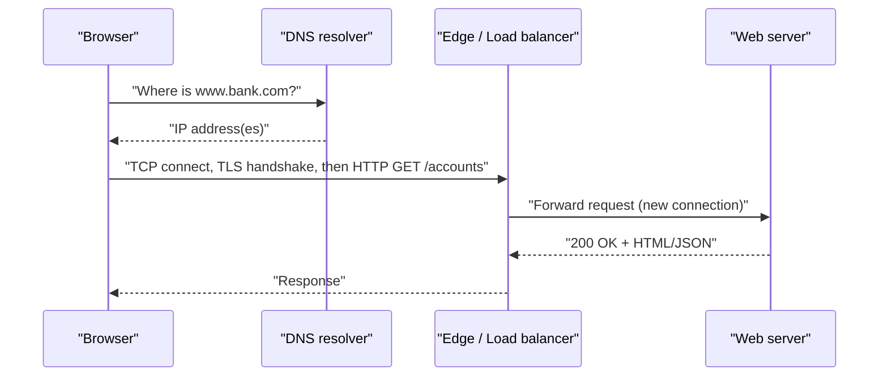
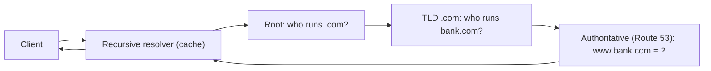
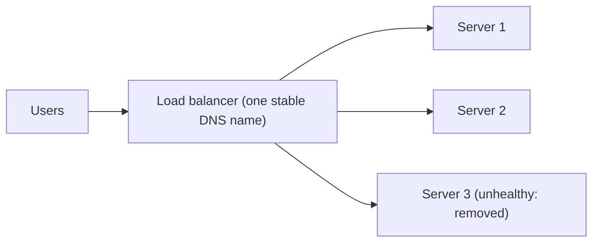
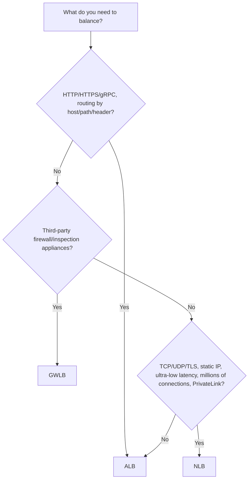
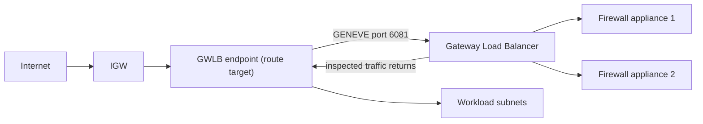
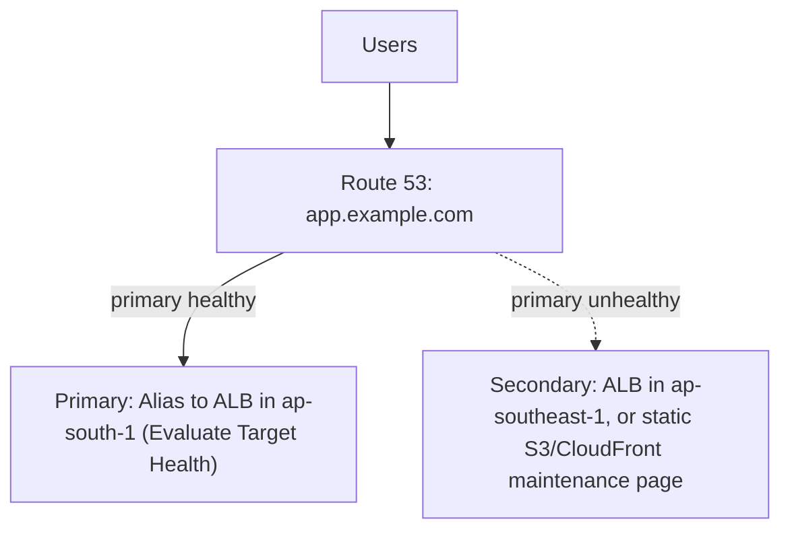
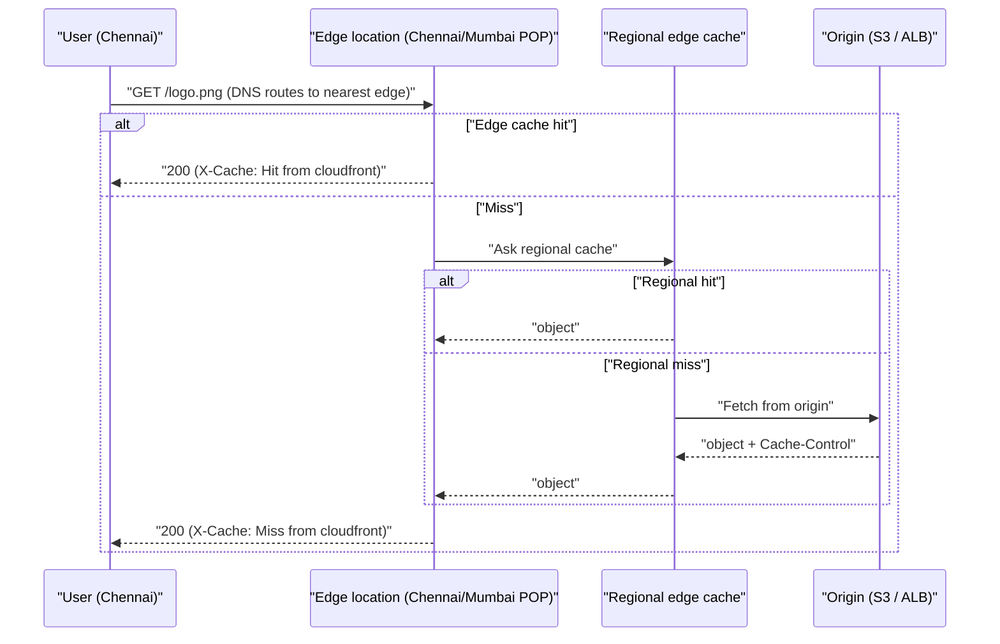
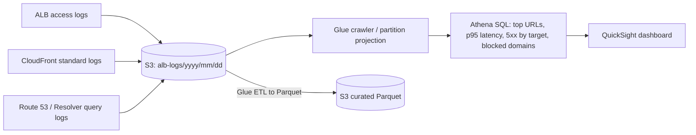
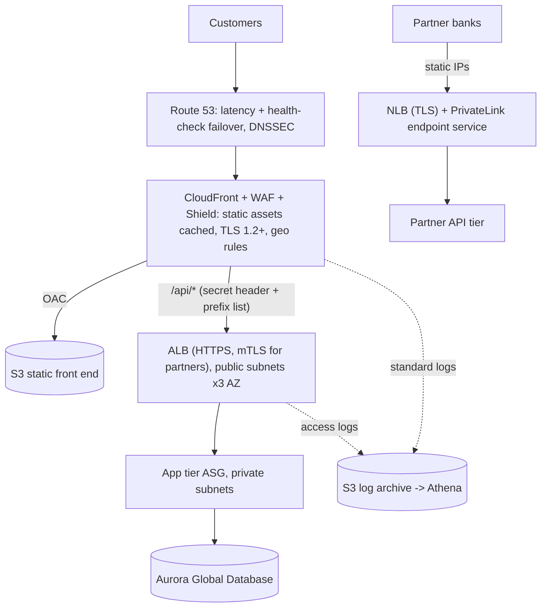

# AWS Load Balancing (ALB/NLB), Route 53 and CloudFront
### Complete Practical Guide (Equivalent to a 5-Hour Lecture)

> **How to use this file:** Read a section, then do its lab in your own AWS account. You will build a real load-balanced web tier, watch health checks remove a failed server, route by path/host/weights, terminate TLS, compare ALB and NLB behaviour, build DNS records and failover in Route 53, and put a global CDN in front of a private S3 bucket and an ALB.
> **Cost warning (read first):** Load balancers, Elastic IPs, public IPv4 addresses, EC2 instances, Route 53 hosted zones and health checks, and CloudFront beyond its free tier **can bill**. Typical lab cost is small (a few rupees per hour for 2 to 3 micro instances plus an ALB), but **forgetting them is the classic surprise**. Every lab ends with cleanup and Section 33 has a **master cleanup**. **CloudFront distributions must be disabled and fully deployed before they can be deleted (takes minutes).**
> **No domain needed:** all labs work without buying a domain. For Route 53 we create a hosted zone for a **made-up domain** and query its name servers directly; for CloudFront we use the default `*.cloudfront.net` name; for HTTPS on the ALB we import a self-signed certificate. An optional lab shows the real-domain flow if you own one.
> **Free plan note:** your plan may restrict some services or sizes. If a step is blocked, the explanation still teaches the concept.
> **Region:** ap-south-1 (Mumbai). **Prices, limits, defaults and some features change**, so treat numbers as approximately right and verify in the docs and pricing pages.
> **Prior notes assumed:** IAM, S3, EC2/Auto Scaling, VPC, Lambda/CLI, Databases. Labs use the **default VPC** so they work even if you deleted `lab-vpc`.

---

## Table of Contents

**Part A: Prerequisites (do not skip)**
1. How one web request travels (HTTP, headers, status codes)
2. TLS/HTTPS and certificates
3. DNS in depth
4. Load balancing concepts
5. CDN and caching concepts
6. Recap: VPC, security groups, EC2, Auto Scaling

**Part B: Elastic Load Balancing**
7. ELB overview and the four types
8. Concepts common to all load balancers
9. Lab 0: Build the backend servers
10. Application Load Balancer (ALB) + Labs 1, 2, 3
11. TLS on the ALB + Lab 4
12. ALB attributes, stickiness, logging + Lab 5
13. Network Load Balancer (NLB) + Lab 6
14. Gateway Load Balancer, Classic LB, ALB features (auth, WAF), ASG integration
15. ELB pricing and troubleshooting

**Part C: Amazon Route 53**
16. Overview, hosted zones, registrar vs DNS host, delegation
17. Record types, Alias vs CNAME, TTL
18. Routing policies
19. Health checks and failover
20. Private hosted zones, Resolver, DNSSEC, query logging
21. Lab 7: Route 53 hands-on
22. Route 53 pricing and troubleshooting

**Part D: Amazon CloudFront**
23. CloudFront architecture and concepts
24. Origins, OAC, behaviors, cache and origin request policies
25. Invalidation, TTL, versioning, signed URLs/cookies, geo restriction, HTTPS and certificates
26. Edge compute: CloudFront Functions vs Lambda@Edge
27. Labs 8, 9, 10, 11, 12
28. Lab 13 (optional): real custom domain
29. CloudFront pricing and troubleshooting
30. Global Accelerator, WAF, Shield: how they fit

**Part E: Putting it together**
31. **For data engineers**: where these services show up (+ log analytics)
32. Lab 14: Monitoring and logs
33. Master cleanup
34. Real-world architectures (bank, hospital, enterprise)
35. Best practices checklist
36. Exam cheat sheet and 30 practice questions
37. Interview questions and final checklist

---

# PART A: PREREQUISITES

---

## 1. How One Web Request Travels



### 1.1 HTTP basics
- **HTTP** is the request/response protocol of the web; **HTTPS** is HTTP inside **TLS** encryption.
- A **request** has a method, path, headers and optional body: `GET /api/orders?id=5 HTTP/1.1`, `Host: api.bank.com`.
- Methods: **GET** (read), **POST** (create), **PUT/PATCH** (update), **DELETE**, **HEAD** (headers only), **OPTIONS** (CORS pre-flight).
- Ports: **80** HTTP, **443** HTTPS.

### 1.2 Status codes (you will read these constantly)
| Range | Meaning | Examples |
|---|---|---|
| **2xx** | Success | 200 OK, 201 Created, 204 No Content |
| **3xx** | Redirect | 301 permanent, 302 temporary |
| **4xx** | **Client** error | 400 bad request, 401 unauthenticated, **403 forbidden**, **404 not found**, 429 too many requests |
| **5xx** | **Server** error | 500 app crash, **502 bad gateway**, **503 service unavailable**, **504 gateway timeout** |
Load balancer meanings: **502** = the target gave an invalid/closed response; **503** = **no healthy targets** (or none registered); **504** = the target didn't answer in time.

### 1.3 Headers that matter for load balancers and CDNs
| Header | Purpose |
|---|---|
| **Host** | Which site/domain the client wants (enables **host-based routing** and virtual hosting) |
| **X-Forwarded-For (XFF)** | The **original client IP**, added by proxies/ALB (the server otherwise sees the proxy's IP) |
| **X-Forwarded-Proto** | Original protocol (`http`/`https`) so apps know if TLS was used |
| **Cache-Control / Expires / ETag / Last-Modified** | Tell caches how long to keep a response and how to revalidate |
| **Cookie / Set-Cookie** | Session identifiers (used by **sticky sessions**) |
| **Location** | Where a redirect points |
| **Vary** | Which request headers change the response (affects caching) |

### 1.4 Reverse proxy
A **reverse proxy** accepts client requests and forwards them to backend servers (the client never talks directly to the backend). **Load balancers and CDNs are reverse proxies.** Consequences: the backend sees the proxy's IP unless you read XFF; TLS can be **terminated** at the proxy; the proxy opens a **new connection** to the backend (with its own timeouts).

---

## 2. TLS/HTTPS and Certificates

- **TLS** encrypts traffic and **authenticates the server** so users know they're talking to the real `www.bank.com`.
- A **certificate** binds a domain name to a public key and is **signed by a Certificate Authority (CA)** the browser trusts. The server proves possession of the matching **private key**.
- **Chain of trust:** site certificate → intermediate CA → root CA (in the browser's trust store).
- **SNI (Server Name Indication):** the client says which hostname it wants during the TLS handshake, so **one IP can serve many certificates** (ALB and CloudFront use SNI).
- **TLS termination (offload):** the load balancer/CDN decrypts HTTPS, then talks to servers over HTTP (or re-encrypts to HTTPS: **end-to-end TLS**). Termination centralizes certificates and saves backend CPU.
- **TLS passthrough:** the balancer forwards encrypted bytes untouched (NLB TCP listener); the backend holds the certificate.
- **AWS Certificate Manager (ACM):** issues **free public certificates** (DNS or email validation, **auto-renewing**) for use with ELB, CloudFront, API Gateway; you can also **import** your own. ACM certificates can't be exported for use on EC2 servers (private keys stay inside AWS), except for exportable private certificate options.
- **Security policies** pick TLS versions and ciphers (e.g., TLS 1.2+/1.3). **mTLS (mutual TLS)** also authenticates the **client** with a certificate (ALB supports it).

---

## 3. DNS in Depth

(You met DNS in Phase 0 and the VPC notes; here is what Route 53 needs.)

### 3.1 The hierarchy
```
. (root)  ->  .com (TLD)  ->  bank.com (your zone)  ->  www.bank.com (record)
```
- **Root servers** know the TLD servers; **TLD servers** (.com, .in) know the **authoritative name servers** of each domain; **authoritative name servers** hold the real records.
- **Recursive resolver** (your ISP, 8.8.8.8, the VPC resolver) does the walking for clients and **caches** answers for the record's **TTL**.


### 3.2 Records you must know
| Type | Maps | Example |
|---|---|---|
| **A** | Name → IPv4 | `www.bank.com → 13.233.10.25` |
| **AAAA** | Name → IPv6 | |
| **CNAME** | Name → **another name** | `www.bank.com → bank-alb-123.ap-south-1.elb.amazonaws.com` |
| **NS** | Zone's name servers | Delegation |
| **SOA** | Zone metadata (serial, refresh, admin) | auto-created |
| **MX** | Mail servers | `10 mail.bank.com` |
| **TXT** | Free text (SPF, domain verification, DKIM) | |
| **SRV** | Service host+port | |
| **CAA** | Which CAs may issue certificates | |
| **PTR** | IP → name (reverse DNS) | |
### 3.3 TTL and caching
**TTL** = how long resolvers may cache an answer. **High TTL** (86400) = fewer queries, slow changes. **Low TTL** (60) = fast changes, more queries. **Before a migration or cutover, lower the TTL days ahead**, then change the record, then raise it. "DNS propagation" is really just caches expiring.

### 3.4 Registrar vs DNS host
- **Registrar:** where you **buy/own** the domain (Route 53 Registrar, GoDaddy...). It stores the **NS records at the TLD** (delegation).
- **DNS host:** the service whose name servers **answer queries** (Route 53 hosted zone). You can buy at one place and host DNS at another by setting the registrar's NS to the DNS host's name servers.

### 3.5 CNAME rules
- A **CNAME cannot coexist with other records at the same name**, and **cannot be placed at the zone apex** (`bank.com` itself, because the apex must carry NS/SOA). `www.bank.com` can be a CNAME. **Route 53 Alias** solves the apex case (Section 17).

### 3.6 Try DNS yourself (CloudShell)
```bash
sudo dnf install -y bind-utils 2>/dev/null     # provides dig (may already be present)
dig +noall +answer aws.amazon.com
dig +trace aws.amazon.com | tail -15           # walks root -> TLD -> authoritative
dig NS amazon.com +short
dig aws.amazon.com +noall +answer              # run twice: watch the TTL count down (cache)
```

---

## 4. Load Balancing Concepts

**Problem:** one server is a single point of failure and a capacity ceiling. **Solution:** many servers behind a **load balancer (LB)** that spreads requests and removes sick servers.


| Concept | Meaning |
|---|---|
| **Scale out (horizontal)** | Add more servers behind the LB |
| **Stateless servers** | Any server can handle any request (state in DB/cache) |
| **Health checks** | LB probes each server; unhealthy ones get **no traffic** |
| **Algorithms** | **Round robin** (take turns), **least connections/outstanding requests**, **hash** (same flow → same server), **weighted** |
| **Layer 4 (transport) LB** | Routes by IP/port (TCP/UDP), not understanding HTTP; very fast (**NLB**) |
| **Layer 7 (application) LB** | Understands HTTP; routes by host/path/header, can redirect, authenticate (**ALB**) |
| **Sticky sessions** | Same client keeps hitting the same server (via cookie/IP); useful if sessions live in server memory (better: externalize sessions) |
| **Connection draining (deregistration delay)** | Let in-flight requests finish before removing a server |
| **Cross-zone balancing** | Spread requests evenly across **all** servers in all AZs, not only the LB node's own AZ |
| **SSL offload** | LB handles TLS |
| **Blue/green & canary** | Shift weighted traffic between old/new fleets |

---

## 5. CDN and Caching Concepts

A **Content Delivery Network (CDN)** keeps **copies of content in many locations close to users**.
- **Origin:** the real source (S3 bucket, ALB, web server).
- **Edge location (POP):** a CDN site near users that caches responses.
- **Cache hit:** served from the edge (fast, no origin load). **Cache miss:** edge fetches from the origin, stores it, serves it.
- **Cache key:** what makes two requests "the same" (URL + chosen headers/cookies/query strings).
- **TTL:** how long an edge may serve its copy without asking the origin.
- **Invalidation:** forcibly remove cached copies early. **Versioned file names** (`app.v7.css`) avoid the need.
- **Static content** (images, CSS, JS, downloads) caches perfectly; **dynamic content** (personalized APIs) can still be accelerated through persistent connections and the CDN's network, but isn't cached (or cached briefly).
- **Why it matters:** lower latency for global users, **less origin load/cost**, **DDoS absorption**, TLS at the edge.

---

## 6. Recap: VPC, Security Groups, EC2, Auto Scaling

- An **ALB/NLB lives in subnets in ≥2 AZs** of your VPC (internet-facing ones in **public subnets**), has **nodes (ENIs) in each AZ**, and gets a **DNS name** resolving to those nodes' IPs.
- **Security-group pattern:** `alb-sg` allows 80/443 from the internet; **instance SG allows 80 only from `alb-sg`** (SG-to-SG).
- **Auto Scaling Groups** register/deregister instances with **target groups** automatically (you built this in the EC2 notes).
- Private targets are reachable by the LB through the **VPC local route**; targets need **no public IP**.

---

# PART B: ELASTIC LOAD BALANCING

---

## 7. ELB Overview and the Four Types

**Elastic Load Balancing (ELB)** is a managed, **highly available, auto-scaling** load-balancing service spanning multiple AZs. You never patch or scale it.

| Type | Layer | Protocols | Best for |
|---|---|---|---|
| **Application Load Balancer (ALB)** | **7** | HTTP, HTTPS, gRPC, WebSocket | Web apps, microservices, containers, Lambda targets, path/host routing, auth |
| **Network Load Balancer (NLB)** | **4** | TCP, UDP, TLS, TCP_UDP | Extreme performance/low latency, **static IPs**, non-HTTP protocols, PrivateLink, preserve client IP |
| **Gateway Load Balancer (GWLB)** | **3** (+4) | IP via **GENEVE (port 6081)** | Inserting **security/inspection appliances** (firewalls, IDS/IPS) transparently |
| **Classic Load Balancer (CLB)** | 4/7 | legacy | **Deprecated**: avoid for new designs |



---

## 8. Concepts Common to All Load Balancers

### 8.1 Scheme
- **Internet-facing:** nodes have **public IPs**, in **public subnets**; DNS name resolves to public IPs.
- **Internal:** nodes have **private IPs** only; reachable inside the VPC/VPN/peering (for service-to-service traffic, internal tools).

### 8.2 AZs, subnets and nodes
You choose **subnets in AZs** (ALB needs **≥2 AZs**). ELB creates a **load balancer node** in each. The DNS name returns the nodes' IPs; **IPs can change**, so **always use the DNS name** (never hardcode LB IPs). NLB can have **one static IP / Elastic IP per AZ**.

### 8.3 Cross-zone load balancing
| LB | Default | Charges |
|---|---|---|
| **ALB** | **On** (always at LB level; can be turned off per target group) | **No inter-AZ data charge** |
| **NLB / GWLB** | **Off** | If enabled, **inter-AZ data transfer is charged** |
With it **off**, each node only sends to targets in its own AZ, so uneven target counts per AZ cause uneven load.

### 8.4 Target groups (TG)
A **target group** is the set of backends plus how to check them.
| Target type | Notes |
|---|---|
| **instance** | EC2 instance ID (traffic to primary private IP) |
| **ip** | Any private IP (on-prem via VPN/DX, peered VPC, ECS tasks with awsvpc) |
| **lambda** | An ALB can invoke a Lambda function |
| **alb** | An **NLB can forward to an ALB** (static IP in front of ALB) |
One LB can have many TGs; one TG can be attached to listeners/rules of an LB; ASGs register instances into TGs.

### 8.5 Health checks
The LB probes each target; **only healthy targets receive traffic**.
| Setting | Meaning (typical defaults, verify) |
|---|---|
| Protocol/port/path | e.g., HTTP, traffic port, `/health` |
| Interval | seconds between probes (5-300; ALB default 30) |
| Timeout | wait for a response (ALB default 5 s) |
| Healthy threshold | consecutive successes to become healthy (ALB default 5; NLB 3) |
| Unhealthy threshold | consecutive failures to become unhealthy (ALB default 2; NLB 3) |
| Success codes (ALB) | HTTP codes counted healthy (default **200**; can be 200-499, a range, or list) |
**If all targets are unhealthy, ALB returns 503; NLB "fails open" and sends to all** (so it never blackholes everything). Design `/health` to check **critical dependencies lightly** (not a heavy DB query on every probe).

### 8.6 Security groups
- **ALB** has security groups (allow 80/443 from clients).
- **NLB** originally had none (and **preserves client IP**, so targets see real client IPs); NLBs now **support security groups** (choose at creation).
- Targets' SG should allow traffic **from the LB's SG** (ALB) or from clients/VPC as appropriate (NLB without SG).

### 8.7 Connection draining (deregistration delay)
When a target is deregistered (scale-in, deployment), the LB stops **new** requests and waits up to the **deregistration delay (default 300 s)** for in-flight requests to finish. Lower it for fast, short requests; raise it for long uploads/streams.

### 8.8 Other shared features
**Access logs** to S3, **CloudWatch metrics**, **CloudTrail** for API calls, **tags**, **AWS WAF** (ALB only, not NLB), **Shield Standard** automatic, **IPv6/dualstack**, **deletion protection**.

---

## 9. LAB 0: Build the Backend Servers

We'll create **three tiny web servers**: `web-a` and `web-b` (the "blue" site, in two AZs) and `api-1` (acts as an "API/green" server). The user data makes each page show **its instance ID and AZ**, and logs **client IP and X-Forwarded-For**.

```bash
export AWS_DEFAULT_REGION=ap-south-1
ACCOUNT_ID=$(aws sts get-caller-identity --query Account --output text)
BUCKET=s3lab-yourname-12345                # an S3 lab bucket (used for logs later)
mkdir -p ~/lblab && cd ~/lblab

DVPC=$(aws ec2 describe-vpcs --filters Name=isDefault,Values=true --query 'Vpcs[0].VpcId' --output text)
aws ec2 describe-subnets --filters Name=vpc-id,Values=$DVPC Name=default-for-az,Values=true \
   --query 'Subnets[].[SubnetId,AvailabilityZone]' --output text
SUB_A=<subnet id in ap-south-1a>
SUB_B=<subnet id in ap-south-1b>
```
**Security groups (SG-to-SG pattern)**
```bash
SG_ALB=$(aws ec2 create-security-group --group-name lb-lab-alb-sg --description "alb" --vpc-id $DVPC --query GroupId --output text)
aws ec2 authorize-security-group-ingress --group-id $SG_ALB --protocol tcp --port 80  --cidr 0.0.0.0/0
aws ec2 authorize-security-group-ingress --group-id $SG_ALB --protocol tcp --port 443 --cidr 0.0.0.0/0
SG_WEB=$(aws ec2 create-security-group --group-name lb-lab-web-sg --description "web servers" --vpc-id $DVPC --query GroupId --output text)
aws ec2 authorize-security-group-ingress --group-id $SG_WEB --protocol tcp --port 80 --source-group $SG_ALB
```
**Instance role (so we can run commands via SSM without SSH)**
```bash
cat > trust.json << 'EOF'
{ "Version":"2012-10-17","Statement":[{"Effect":"Allow","Principal":{"Service":"ec2.amazonaws.com"},"Action":"sts:AssumeRole"}] }
EOF
aws iam create-role --role-name lb-lab-role --assume-role-policy-document file://trust.json
aws iam attach-role-policy --role-name lb-lab-role --policy-arn arn:aws:iam::aws:policy/AmazonSSMManagedInstanceCore
aws iam create-instance-profile --instance-profile-name lb-lab-profile
aws iam add-role-to-instance-profile --instance-profile-name lb-lab-profile --role-name lb-lab-role
sleep 10
```
**User data template and launch**
```bash
cat > ud-template.sh << 'EOF'
#!/bin/bash
ROLE=ROLE_NAME
dnf install -y httpd
cat > /etc/httpd/conf.d/lab-log.conf << 'EOC'
LogFormat "%h xff=%{X-Forwarded-For}i proto=%{X-Forwarded-Proto}i \"%r\" %>s" labfmt
CustomLog logs/lab_log labfmt
EOC
TOKEN=$(curl -s -X PUT "http://169.254.169.254/latest/api/token" -H "X-aws-ec2-metadata-token-ttl-seconds: 300")
IID=$(curl -s -H "X-aws-ec2-metadata-token: $TOKEN" http://169.254.169.254/latest/meta-data/instance-id)
AZ=$(curl -s -H "X-aws-ec2-metadata-token: $TOKEN" http://169.254.169.254/latest/meta-data/placement/availability-zone)
echo ok > /var/www/html/health
if [ "$ROLE" = "WEB" ]; then
  echo "<h1>BLUE web server $IID in $AZ</h1>" > /var/www/html/index.html
else
  mkdir -p /var/www/html/api
  echo ok > /var/www/html/api/health
  echo "{\"service\":\"orders-api\",\"instance\":\"$IID\",\"az\":\"$AZ\"}" > /var/www/html/api/orders.json
  echo "<h1>GREEN (v2) server $IID in $AZ</h1>" > /var/www/html/index.html
fi
systemctl enable --now httpd
EOF
sed 's/ROLE_NAME/WEB/' ud-template.sh > web-ud.sh
sed 's/ROLE_NAME/API/' ud-template.sh > api-ud.sh

AMI=$(aws ssm get-parameter --name /aws/service/ami-amazon-linux-latest/al2023-ami-kernel-default-x86_64 --query Parameter.Value --output text)
launch () {  # name subnet userdata
  aws ec2 run-instances --image-id $AMI --instance-type t3.micro --subnet-id $2 --security-group-ids $SG_WEB \
    --iam-instance-profile Name=lb-lab-profile --metadata-options HttpTokens=required --user-data file://$3 \
    --tag-specifications "ResourceType=instance,Tags=[{Key=Name,Value=$1},{Key=Project,Value=aws-learning}]" \
    --query 'Instances[0].InstanceId' --output text
}
WEB_A=$(launch lb-web-a $SUB_A web-ud.sh)
WEB_B=$(launch lb-web-b $SUB_B web-ud.sh)
API_1=$(launch lb-api-1 $SUB_A api-ud.sh)
aws ec2 wait instance-running --instance-ids $WEB_A $WEB_B $API_1
echo "WEB_A=$WEB_A WEB_B=$WEB_B API_1=$API_1"
```
(Use your free-tier-eligible instance type if `t3.micro` isn't allowed. The instances live in public subnets only so `dnf` can reach the internet; their SG accepts **no direct traffic from the internet**. Only the ALB can reach port 80.) Wait about 2 minutes for Apache to install.

---

## 10. Application Load Balancer (ALB)

### 10.1 Listeners and rules
- A **listener** checks for connections on a **protocol:port** (HTTP:80, HTTPS:443...).
- Each listener has **rules** evaluated by **priority (lowest number first)**; the **default rule** catches the rest.
- **Rule = conditions + action.**
| Conditions | Actions |
|---|---|
| **host-header** (`api.bank.com`), **path-pattern** (`/api/*`), **http-header**, **http-request-method**, **query-string**, **source-ip** | **forward** (to one TG, or **weighted** TGs), **redirect** (e.g., HTTP→HTTPS), **fixed-response** (return 200/403/503 text), **authenticate-cognito / authenticate-oidc** (then forward) |
Multiple conditions in a rule are **ANDed**; multiple values in one condition are **ORed**.

### 10.2 What ALB adds
- **Host and path routing** → many services behind one LB (cost saver: microservices share one ALB).
- **Weighted target groups** → **blue/green** and **canary** releases.
- **Redirects and fixed responses** at the edge of your app.
- **User authentication offload** (Cognito, any OIDC IdP).
- **WebSockets, HTTP/2, gRPC**, **Lambda targets**, **mTLS**, **WAF**, **sticky sessions**, **slow start**, **least outstanding requests** routing algorithm.
- Adds **X-Forwarded-For, -Proto, -Port** and **X-Amzn-Trace-Id** headers.
- **Idle timeout 60 s** by default (raise for long requests/WebSockets; keep **server keep-alive > ALB idle timeout** to avoid 502s).
- **No static IP** (use NLB in front, or Global Accelerator).

### LAB 1: Create the target group and ALB
```bash
# Target group with fast health checks (for a lively lab)
TG_WEB=$(aws elbv2 create-target-group --name lb-lab-web-tg --protocol HTTP --port 80 --vpc-id $DVPC --target-type instance \
  --health-check-protocol HTTP --health-check-path /health --health-check-interval-seconds 10 \
  --healthy-threshold-count 2 --unhealthy-threshold-count 2 --query 'TargetGroups[0].TargetGroupArn' --output text)
aws elbv2 register-targets --target-group-arn $TG_WEB --targets Id=$WEB_A Id=$WEB_B

# The ALB itself: internet-facing, two AZs, with the ALB security group
ALB_ARN=$(aws elbv2 create-load-balancer --name lb-lab-alb --type application --scheme internet-facing \
  --subnets $SUB_A $SUB_B --security-groups $SG_ALB --query 'LoadBalancers[0].LoadBalancerArn' --output text)
aws elbv2 wait load-balancer-available --load-balancer-arns $ALB_ARN
ALB_DNS=$(aws elbv2 describe-load-balancers --load-balancer-arns $ALB_ARN --query 'LoadBalancers[0].DNSName' --output text)
echo $ALB_DNS

# Listener: HTTP:80 forward everything to the web target group
LISTENER=$(aws elbv2 create-listener --load-balancer-arn $ALB_ARN --protocol HTTP --port 80 \
  --default-actions Type=forward,TargetGroupArn=$TG_WEB --query 'Listeners[0].ListenerArn' --output text)

# Wait for targets to be healthy
until [ "$(aws elbv2 describe-target-health --target-group-arn $TG_WEB --query 'length(TargetHealthDescriptions[?TargetHealth.State==`healthy`])' --output text)" = "2" ]; do echo waiting; sleep 10; done
aws elbv2 describe-target-health --target-group-arn $TG_WEB --query 'TargetHealthDescriptions[].[Target.Id,TargetHealth.State]' --output table
```
**Test load balancing:**
```bash
for i in $(seq 1 8); do curl -s http://$ALB_DNS/ ; done
```
You see the page alternate between `web-a` and `web-b` (two different instance IDs and AZs).
**See what the DNS name resolves to:**
```bash
dig +short $ALB_DNS            # two IPs, one per AZ node (these can change over time)
```
**Look at the server's view of the client** (via Session Manager on `lb-web-a`, or SSM command):
```bash
CMD=$(aws ssm send-command --instance-ids $WEB_A --document-name AWS-RunShellScript \
   --parameters 'commands=["tail -3 /var/log/httpd/lab_log"]' --query 'Command.CommandId' --output text)
sleep 5; aws ssm get-command-invocation --command-id $CMD --instance-id $WEB_A --query StandardOutputContent --output text
```
Output looks like `172.31.x.x xff=<your CloudShell public IP> proto=http "GET / HTTP/1.1" 200`: the server sees the **ALB's private IP** (`%h`) but the real client IP in **X-Forwarded-For**. (SSM may take a couple of minutes to register.)

### LAB 2: Health checks, failover and 503
```bash
# 1) Break one server's web service via SSM
aws ssm send-command --instance-ids $WEB_B --document-name AWS-RunShellScript --parameters 'commands=["systemctl stop httpd"]' > /dev/null
# 2) Watch the ALB notice (about 20 seconds with our 10 s x 2 settings)
for i in $(seq 1 10); do
  aws elbv2 describe-target-health --target-group-arn $TG_WEB --query 'TargetHealthDescriptions[].[Target.Id,TargetHealth.State,TargetHealth.Reason]' --output text | tr '\n' ' '; echo; sleep 5; done
for i in $(seq 1 6); do curl -s http://$ALB_DNS/ ; done      # only web-a answers now: users never saw an error
# 3) Break the other one: all targets unhealthy
aws ssm send-command --instance-ids $WEB_A --document-name AWS-RunShellScript --parameters 'commands=["systemctl stop httpd"]' > /dev/null
sleep 40
curl -s -o /dev/null -w "HTTP %{http_code}\n" http://$ALB_DNS/        # 503 Service Temporarily Unavailable
# 4) Restore both and watch recovery (needs 2 consecutive successes)
for i in $WEB_A $WEB_B; do aws ssm send-command --instance-ids $i --document-name AWS-RunShellScript --parameters 'commands=["systemctl start httpd"]' > /dev/null; done
sleep 40; curl -s http://$ALB_DNS/
```
**Observe:** the reason shown for failing targets is `Target.FailedHealthChecks` or `Target.Timeout`; **503 when no healthy targets**; recovery after the **healthy threshold**. **Experiment:** change the health check path to `/nope` (`aws elbv2 modify-target-group --target-group-arn $TG_WEB --health-check-path /nope`): every target becomes unhealthy with reason `Health checks failed with these codes: [404]` (a very common production mistake). Restore `/health`.

### LAB 3: Routing rules: path, host, redirect, fixed response, weighted (blue/green)
**Second target group for the API/green server:**
```bash
TG_API=$(aws elbv2 create-target-group --name lb-lab-api-tg --protocol HTTP --port 80 --vpc-id $DVPC --target-type instance \
  --health-check-path /health --health-check-interval-seconds 10 --healthy-threshold-count 2 --unhealthy-threshold-count 2 \
  --query 'TargetGroups[0].TargetGroupArn' --output text)
aws elbv2 register-targets --target-group-arn $TG_API --targets Id=$API_1
```
**1) Path-based rule:** `/api/*` → API target group
```bash
aws elbv2 create-rule --listener-arn $LISTENER --priority 10 \
  --conditions '[{"Field":"path-pattern","PathPatternConfig":{"Values":["/api/*"]}}]' \
  --actions "[{\"Type\":\"forward\",\"TargetGroupArn\":\"$TG_API\"}]"
sleep 30
curl -s http://$ALB_DNS/api/orders.json ; echo         # served by the API server (JSON)
curl -s http://$ALB_DNS/                                  # still the blue web servers
```
**2) Host-based rule with a fixed response** (simulate `admin.lab.local` with a Host header)
```bash
aws elbv2 create-rule --listener-arn $LISTENER --priority 20 \
  --conditions '[{"Field":"host-header","HostHeaderConfig":{"Values":["admin.lab.local"]}}]' \
  --actions '[{"Type":"fixed-response","FixedResponseConfig":{"StatusCode":"200","ContentType":"text/plain","MessageBody":"hello from the ALB itself (no backend)"}}]'
curl -s -H "Host: admin.lab.local" http://$ALB_DNS/ ; echo
```
**3) Header rule:** only requests with `X-Beta: yes` go to the green server
```bash
aws elbv2 create-rule --listener-arn $LISTENER --priority 30 \
  --conditions '[{"Field":"http-header","HttpHeaderConfig":{"HttpHeaderName":"X-Beta","Values":["yes"]}}]' \
  --actions "[{\"Type\":\"forward\",\"TargetGroupArn\":\"$TG_API\"}]"
curl -s -H "X-Beta: yes" http://$ALB_DNS/        # GREEN page
curl -s http://$ALB_DNS/                          # BLUE page
```
**4) Weighted forwarding for a canary (default action): 90% blue, 10% green**
```bash
aws elbv2 modify-listener --listener-arn $LISTENER --default-actions \
 "[{\"Type\":\"forward\",\"ForwardConfig\":{\"TargetGroups\":[{\"TargetGroupArn\":\"$TG_WEB\",\"Weight\":90},{\"TargetGroupArn\":\"$TG_API\",\"Weight\":10}],\"TargetGroupStickinessConfig\":{\"Enabled\":false}}}]"
for i in $(seq 1 40); do curl -s http://$ALB_DNS/ | grep -o "BLUE\|GREEN"; done | sort | uniq -c
```
Roughly 36 BLUE / 4 GREEN. **Promote or roll back instantly** by changing weights (100/0 or 0/100): that's **blue/green with zero DNS changes**. Then **list rules**:
```bash
aws elbv2 describe-rules --listener-arn $LISTENER --query 'Rules[].[Priority,Conditions[0].Field,Actions[0].Type]' --output table
```
**Redirect rule (HTTP→HTTPS) comes in Lab 4.** Reset the default action to the web TG before moving on:
```bash
aws elbv2 modify-listener --listener-arn $LISTENER --default-actions Type=forward,TargetGroupArn=$TG_WEB
```

---

## 11. TLS on the ALB

### 11.1 How it works
- Add an **HTTPS listener (443)** with one or more certificates (ACM or imported). The ALB **terminates TLS**, then sends HTTP (or HTTPS) to targets.
- **SNI** lets one listener hold **many certificates** (default + additional); the ALB picks by hostname.
- Choose a **security policy** (TLS versions/ciphers), e.g., `ELBSecurityPolicy-TLS13-1-2-2021-06`.
- Standard pattern: **HTTP:80 → redirect to HTTPS:443**.
- Targets see HTTP unless you configure target group protocol HTTPS; use `X-Forwarded-Proto` to know the client's scheme.
- **Rules are per listener**: re-create path/host rules on the HTTPS listener.
- **Real certificates:** request a **public ACM certificate** for your domain and validate by **DNS (a CNAME in Route 53, can be added with one click)**; ACM auto-renews. For **CloudFront**, the ACM certificate **must be in us-east-1**; for ALB it must be in the **ALB's Region**.

### LAB 4: HTTPS with an imported self-signed certificate; redirect HTTP→HTTPS
```bash
cd ~/lblab
openssl req -x509 -newkey rsa:2048 -nodes -keyout lab.key -out lab.crt -days 30 -subj "/CN=lab.example.com"
CERT_ARN=$(aws acm import-certificate --certificate fileb://lab.crt --private-key fileb://lab.key --query CertificateArn --output text)
echo $CERT_ARN

HTTPS_L=$(aws elbv2 create-listener --load-balancer-arn $ALB_ARN --protocol HTTPS --port 443 \
  --certificates CertificateArn=$CERT_ARN --ssl-policy ELBSecurityPolicy-TLS13-1-2-2021-06 \
  --default-actions Type=forward,TargetGroupArn=$TG_WEB --query 'Listeners[0].ListenerArn' --output text)
curl -sk https://$ALB_DNS/                                   # -k because the cert is self-signed
curl -vk https://$ALB_DNS/ 2>&1 | grep -E "subject:|issuer:|TLSv|SSL connection"
```
You'll see `subject: CN=lab.example.com` and the negotiated TLS version. Without `-k`, curl rejects it (**browsers would show a warning**: this is why real certs come from a CA/ACM).

**Add the redirect:** make HTTP:80 send everyone to HTTPS
```bash
aws elbv2 modify-listener --listener-arn $LISTENER --default-actions \
 '[{"Type":"redirect","RedirectConfig":{"Protocol":"HTTPS","Port":"443","StatusCode":"HTTP_301"}}]'
curl -sI http://$ALB_DNS/ | egrep -i "HTTP/|location"        # 301 + Location: https://...
curl -skL http://$ALB_DNS/                                    # follows the redirect, page served over TLS
```
**Server sees the proto:** `X-Forwarded-Proto: https` in the Apache log (`proto=https`). **Think:** your path rules from Lab 3 live on the **HTTP** listener and are now bypassed by the redirect; you'd re-create them on the **HTTPS** listener. **Restore HTTP forwarding** if you want to continue testing over HTTP: `aws elbv2 modify-listener --listener-arn $LISTENER --default-actions Type=forward,TargetGroupArn=$TG_WEB`.

---

## 12. ALB Attributes, Stickiness, Logging

### 12.1 Useful attributes
| Attribute | Level | Purpose |
|---|---|---|
| `idle_timeout.timeout_seconds` | LB | Close idle connections (default 60 s) |
| `routing.http.drop_invalid_header_fields.enabled` | LB | Security hardening |
| `deletion_protection.enabled` | LB | Prevent accidental deletion |
| `access_logs.s3.*`, `connection_logs.s3.*` | LB | Logs to S3 |
| `deregistration_delay.timeout_seconds` | TG | Draining time |
| `stickiness.*` | TG | Sticky sessions |
| `load_balancing.algorithm.type` | TG | `round_robin` (default), `least_outstanding_requests`, `weighted_random` |
| `slow_start.duration_seconds` | TG | Ramp traffic to new targets |
| `load_balancing.cross_zone.enabled` | TG | Cross-zone behaviour |

### 12.2 Sticky sessions
- **Duration-based cookie** (`AWSALB`, created by the ALB) or **application-based cookie** (your app's cookie controls stickiness).
- **Pros:** works with apps keeping sessions in memory. **Cons:** uneven load, lost sessions when the server dies, harder scale-in. **Best practice:** store sessions in **ElastiCache/DynamoDB** and avoid stickiness.
- NLB offers **source-IP** stickiness; CLB had its own cookies.

### 12.3 Access logs
ALB access logs (to S3) record per request: time, client IP:port, target IP:port, `request_processing_time`, `target_processing_time`, `response_processing_time`, `elb_status_code`, `target_status_code`, bytes, request line, user agent, TLS cipher, trace ID. They're how you debug latency (which part is slow?) and 5xx (ELB-generated vs target-generated). Analyze with **Athena** (Section 31).

### LAB 5: Stickiness, algorithms, draining, logs
```bash
# 1) Without stickiness (alternates) vs with duration-based stickiness
aws elbv2 modify-target-group-attributes --target-group-arn $TG_WEB \
  --attributes Key=stickiness.enabled,Value=true Key=stickiness.type,Value=lb_cookie Key=stickiness.lb_cookie.duration_seconds,Value=60
rm -f jar; curl -s -c jar http://$ALB_DNS/ | grep -o "i-[a-z0-9]*"             # first request creates the cookie
for i in $(seq 1 5); do curl -s -b jar http://$ALB_DNS/ | grep -o "i-[a-z0-9]*"; done   # same instance every time
cat jar | grep AWSALB | cut -c1-60
for i in $(seq 1 4); do curl -s http://$ALB_DNS/ | grep -o "i-[a-z0-9]*"; done            # no cookie jar: alternates again
aws elbv2 modify-target-group-attributes --target-group-arn $TG_WEB --attributes Key=stickiness.enabled,Value=false

# 2) Algorithm and draining
aws elbv2 modify-target-group-attributes --target-group-arn $TG_WEB \
  --attributes Key=load_balancing.algorithm.type,Value=least_outstanding_requests Key=deregistration_delay.timeout_seconds,Value=30
aws elbv2 describe-target-group-attributes --target-group-arn $TG_WEB --query 'Attributes[?contains(Key,`algorithm`)||contains(Key,`dereg`)]' --output table

# 3) Idle timeout
aws elbv2 modify-load-balancer-attributes --load-balancer-arn $ALB_ARN --attributes Key=idle_timeout.timeout_seconds,Value=120
```
**4) Access logs to S3** (the console adds the needed bucket policy for you): **EC2 > Load Balancers > lb-lab-alb > Attributes > Edit > Access logs: Enable > S3 location `s3://BUCKET/alb-logs/` > "Create this location"/accept policy update > Save.** (From the CLI you must first add a bucket policy allowing ELB log delivery for your Region: see "Enable access logs for your Application Load Balancer" in the docs for the principal, then use `--attributes Key=access_logs.s3.enabled,Value=true Key=access_logs.s3.bucket,Value=$BUCKET Key=access_logs.s3.prefix,Value=alb-logs`.)
Generate traffic (`for i in $(seq 1 50); do curl -s -o /dev/null http://$ALB_DNS/; done`), wait **5 to 10 minutes**, then:
```bash
aws s3 ls s3://$BUCKET/alb-logs/ --recursive | tail -3
KEY=$(aws s3api list-objects-v2 --bucket $BUCKET --prefix alb-logs/ --query 'Contents[-1].Key' --output text)
aws s3 cp s3://$BUCKET/$KEY /tmp/alb.log.gz && zcat /tmp/alb.log.gz | head -2
zcat /tmp/alb.log.gz | awk '{print $9, $10, $11}' | sort | uniq -c       # elb_status_code, target_status_code, received_bytes (field positions can vary by version)
```
Look at `request_processing_time`/`target_processing_time`: they tell you whether latency is in the ALB or in **your app**.

---

## 13. Network Load Balancer (NLB)

### 13.1 What it is
A **layer-4** load balancer for **TCP, UDP, TLS and TCP_UDP**: **millions of requests per second**, **ultra-low latency**, built for **sudden, volatile traffic**.

### 13.2 Key properties
| Property | Detail |
|---|---|
| **Static IPs** | **One static IP per AZ**, or assign your **Elastic IP** per AZ (great when partners must **whitelist IPs**) |
| **Client IP preservation** | For **instance** targets the original **client IP is preserved** (targets' SG/NACL must allow clients); for IP targets it may not be (setting) |
| **Protocols** | TCP, UDP, TLS (can terminate TLS with ACM certs), TCP_UDP |
| **Health checks** | TCP, HTTP, HTTPS |
| **Cross-zone** | Off by default (charged if on) |
| **PrivateLink** | **Endpoint services require an NLB (or GWLB)** in front of your service |
| **Targets** | instance, ip, **alb** (NLB → ALB) |
| **Idle timeout** | TCP idle about 350 s by default (configurable in newer versions) |
| **Security groups** | Supported (choose at creation); no WAF |
| **Fail-open** | If all targets unhealthy it sends to all |

### 13.3 ALB vs NLB (exam table)
| | **ALB** | **NLB** |
|---|---|---|
| Layer | 7 | 4 |
| Protocols | HTTP/HTTPS/gRPC/WebSocket | TCP/UDP/TLS |
| Routing | host/path/header/query/method | By port (flow hash) |
| Static IP / EIP | **No** | **Yes** |
| Client IP | In **X-Forwarded-For** (target sees ALB) | **Preserved** (instance targets) |
| Latency/throughput | Good | **Very high / ultra-low** |
| WAF | **Yes** | No |
| Lambda target | Yes | No |
| Security groups | Yes | Yes (newer) |
| PrivateLink service | No | **Yes** |
| Use | Web apps, microservices | Games, IoT, gRPC over TCP, databases/brokers (e.g., Kafka), static IP, PrivateLink |

### LAB 6: NLB with Elastic IPs; see client IP preservation
```bash
# 1) Two Elastic IPs (one per AZ) and an NLB with static addresses
EIP1=$(aws ec2 allocate-address --domain vpc --query AllocationId --output text)
EIP2=$(aws ec2 allocate-address --domain vpc --query AllocationId --output text)
NLB_ARN=$(aws elbv2 create-load-balancer --name lb-lab-nlb --type network --scheme internet-facing \
  --subnet-mappings SubnetId=$SUB_A,AllocationId=$EIP1 SubnetId=$SUB_B,AllocationId=$EIP2 \
  --query 'LoadBalancers[0].LoadBalancerArn' --output text)
aws elbv2 wait load-balancer-available --load-balancer-arns $NLB_ARN
NLB_DNS=$(aws elbv2 describe-load-balancers --load-balancer-arns $NLB_ARN --query 'LoadBalancers[0].DNSName' --output text)
dig +short $NLB_DNS; aws ec2 describe-addresses --allocation-ids $EIP1 $EIP2 --query 'Addresses[].PublicIp' --output text   # same two IPs

# 2) TCP target group + listener
TG_TCP=$(aws elbv2 create-target-group --name lb-lab-tcp-tg --protocol TCP --port 80 --vpc-id $DVPC --target-type instance \
  --health-check-protocol HTTP --health-check-path /health --health-check-interval-seconds 10 \
  --healthy-threshold-count 2 --unhealthy-threshold-count 2 --query 'TargetGroups[0].TargetGroupArn' --output text)
aws elbv2 register-targets --target-group-arn $TG_TCP --targets Id=$WEB_A Id=$WEB_B
aws elbv2 create-listener --load-balancer-arn $NLB_ARN --protocol TCP --port 80 --default-actions Type=forward,TargetGroupArn=$TG_TCP
```
**3) The security-group gotcha:** the NLB preserves the client IP, but our `web-sg` allows port 80 **only from the ALB's SG**. Test:
```bash
curl -s -m 5 http://$NLB_DNS/ || echo "TIMEOUT: targets' SG blocks the real client IP"
aws elbv2 describe-target-health --target-group-arn $TG_TCP --query 'TargetHealthDescriptions[].[Target.Id,TargetHealth.State]' --output text
```
(Health checks come from the NLB nodes inside the VPC; allow the **VPC CIDR** for health checks and the **client CIDRs** for traffic.) **Fix** by allowing clients:
```bash
aws ec2 authorize-security-group-ingress --group-id $SG_WEB --protocol tcp --port 80 --cidr 0.0.0.0/0
sleep 20
for i in $(seq 1 6); do curl -s -m 5 http://$NLB_DNS/ | grep -o "i-[a-z0-9]*"; done
```
**4) Compare what the server logs** for ALB vs NLB traffic:
```bash
curl -s -o /dev/null http://$NLB_DNS/ ; curl -s -o /dev/null http://$ALB_DNS/
for i in $WEB_A $WEB_B; do
  CMD=$(aws ssm send-command --instance-ids $i --document-name AWS-RunShellScript --parameters 'commands=["tail -4 /var/log/httpd/lab_log"]' --query 'Command.CommandId' --output text)
  sleep 4; aws ssm get-command-invocation --command-id $CMD --instance-id $i --query StandardOutputContent --output text; done
```
Via the **NLB** the first field (`%h`) is **your real public IP** and `xff=-`; via the **ALB** it's the **ALB's private IP** with your IP in `xff=`. **That's client IP preservation vs proxying.**
**Remove the wide-open rule when done:** `aws ec2 revoke-security-group-ingress --group-id $SG_WEB --protocol tcp --port 80 --cidr 0.0.0.0/0`.
**Experiment:** enable cross-zone: `aws elbv2 modify-load-balancer-attributes --load-balancer-arn $NLB_ARN --attributes Key=load_balancing.cross_zone.enabled,Value=true` (note the inter-AZ data charge in real life).

---

## 14. Gateway Load Balancer, Classic LB, Integrations

### 14.1 Gateway Load Balancer (GWLB)
Makes it easy to deploy **third-party virtual appliances** (firewalls, IDS/IPS, deep packet inspection) **transparently** and scale them.

You send traffic via **route tables** to a **GWLB endpoint**; GWLB distributes flows to appliances, which inspect and return them. Key words: **transparent network gateway, GENEVE, port 6081, inspection VPC**. (Read-through only; no lab needed.)

### 14.2 Classic Load Balancer
Legacy L4/L7 balancer from the EC2-Classic era; no host/path routing, limited features. **Migrate to ALB/NLB.**

### 14.3 ALB authentication
`authenticate-cognito` / `authenticate-oidc` actions make the ALB **sign users in** (redirect to the IdP, validate tokens) before forwarding, passing claims to targets in headers. Great for internal tools (Airflow, Superset, Grafana, Jupyter) with corporate SSO, with **zero auth code in the app**.

### 14.4 WAF and Shield
**AWS WAF** attaches to **ALB (and CloudFront, API Gateway, AppSync)**; blocks SQLi/XSS, bots, bad IPs, **rate-based rules**. **NLB cannot have WAF** (use ALB or CloudFront). **Shield Standard** is automatic and free.

### 14.5 ASG integration (recap with detail)
Attach the ASG to a target group; ELB **health checks** can drive the ASG's replacement of unhealthy instances; scale on **`ALBRequestCountPerTarget`** (target tracking); **deregistration delay** gives graceful scale-in; **slow start** warms new targets.

---

## 15. ELB Pricing and Troubleshooting

### 15.1 Pricing (approximate; verify)
| Item | ALB | NLB | GWLB |
|---|---|---|---|
| **Hourly** per LB | ~$0.0225/hr class | similar | similar |
| **Usage unit** | **LCU** (max of: new connections, active connections, processed bytes, rule evaluations) | **NLCU** (new connections/flows, active flows, processed bytes) | GLCU |
| **Public IPv4** | each LB node's public IPv4 is billed hourly (ALB across 2 AZs = 2 addresses) | same (and EIPs) | n/a |
| **Data transfer** | Standard; **cross-AZ** charged only where cross-zone applies on NLB | | |
**Cost tips:** **share one ALB for many services** (host/path rules) instead of one per service; delete test LBs; avoid NLB cross-zone unless needed; use CloudFront in front to cut origin data.

### 15.2 ALB troubleshooting
| Symptom | Likely cause and fix |
|---|---|
| **503 Service Unavailable** | **No healthy/registered targets**; check target health and reasons |
| **502 Bad Gateway** | Target closed the connection, sent malformed HTTP, **keep-alive timeout shorter than ALB idle timeout**, target crashed, TLS to target mismatch |
| **504 Gateway Timeout** | Target didn't respond within **idle timeout**; slow app/DB, SG/NACL blocks return path, wrong port |
| **Targets unhealthy: "Request timed out"** | Target SG doesn't allow the **ALB's SG** on the health check port; app not listening; wrong port |
| **Unhealthy: "Health checks failed with these codes: [404]"** | Wrong health check path/success codes |
| **403 from ALB** | WAF block, listener rule fixed-response, authentication, source-ip rule |
| **Cannot reach ALB at all** | ALB in private subnets/no IGW route, SG blocks 80/443, NACL, internal scheme |
| **Uneven load** | Stickiness, long-lived connections, cross-zone off (NLB), few clients behind one NAT IP |
| **HTTPS cert warning** | Certificate name mismatch, self-signed/untrusted, expired, missing SNI cert |
| **Lost client IP in logs** | Read **X-Forwarded-For** (ALB) |
| **Redirect loop** | HTTP→HTTPS redirect combined with CloudFront/origin protocol settings |
| **ELB 5xx vs Target 5xx** | `HTTPCode_ELB_5XX_Count` = LB-generated (502/503/504); `HTTPCode_Target_5XX_Count` = your app returned it |

---

# PART C: AMAZON ROUTE 53

---

## 16. Route 53 Overview, Hosted Zones, Delegation

### 16.1 What Route 53 is
A **highly available, scalable, global DNS service** (the "53" is the DNS port) offering:
1. **Domain registration** (registrar),
2. **Authoritative DNS hosting** (**hosted zones**; it advertises a **100% availability SLA**),
3. **Health checks and DNS failover**,
4. **Traffic routing policies** (weighted, latency, geo...),
5. **Resolver** features for VPCs/hybrid DNS (Section 20).
Route 53 is a **global service** (no Region to choose for records).

### 16.2 Hosted zones
| | **Public hosted zone** | **Private hosted zone (PHZ)** |
|---|---|---|
| Answers | Anyone on the internet | Only **associated VPCs** |
| Use | Public websites/APIs | Internal names (`db.prod.internal`), split-horizon DNS |
| Requirements | A domain whose registrar NS points to the zone | VPC with **`enableDnsSupport` and `enableDnsHostnames`** both true |
| Cost | ~$0.50 per zone/month (**free if deleted within 12 hours of creation**) + queries | Same |
Every public zone gets **four NS records** (and an SOA). **Delegation:** set your registrar's name servers for the domain to those four.

### 16.3 Registering vs hosting
- Domain **registration** costs real money per year (varies by TLD like .com/.in) and may take minutes to days. **Do not register a domain just for these labs.**
- A hosted zone for a domain you **don't own** still works as an authoritative server that you can **query directly** (`dig @ns-123.awsdns-45.org name`), which is how we test without a domain. The wider internet simply won't ask it.
- If you transfer DNS hosting to Route 53 for an existing domain: create the zone, **recreate all records first**, then change NS at the registrar, wait for old TTLs.

---

## 17. Record Types, Alias vs CNAME, TTL

(Types in Section 3.2 apply.) **Route 53-specific: Alias records.**

### 17.1 Alias records
An **Alias** is a Route 53 extension that maps a name to an **AWS resource** while behaving like an A/AAAA record:
- **Targets:** ELB (ALB/NLB/CLB), **CloudFront distributions**, API Gateway, S3 **website** endpoints, Elastic Beanstalk, **Global Accelerator**, VPC interface endpoints, and **another record in the same zone**.
- **Works at the zone apex** (`bank.com`), where a CNAME can't.
- **Free queries** to AWS resources; **no TTL setting** (uses the target's, so IP changes propagate immediately).
- Can **evaluate target health** (for failover).
- Type is **A** (IPv4) or **AAAA** (IPv6), not "ALIAS" on the wire.
- **Can't point to an EC2 instance's DNS name** (use an A record to its Elastic IP, or an ELB).

| | **CNAME** | **Alias** |
|---|---|---|
| Zone apex | **No** | **Yes** |
| Target | Any DNS name | **AWS resources** (and same-zone records) |
| Query cost | Charged | **Free** (AWS targets) |
| TTL | You set | Target's |
| Health evaluation | No | **Yes** |
| Standard DNS everywhere | Yes | Yes (answers look like A records) |
**Exam rule:** *"Map `example.com` (apex) to an ALB/CloudFront"* → **Alias**.

### 17.2 TTL strategy
Low TTLs (60 s) for records you may change/fail over; high TTLs (1 day) for stable records (MX). Alias records follow the target.

---

## 18. Routing Policies

Every record can use a **routing policy** deciding which answer to return.

| Policy | How it answers | Health checks | Typical use |
|---|---|---|---|
| **Simple** | One record; may hold **multiple values** (client picks randomly) | No (not for multi-value in simple) | Single resource, basic mapping |
| **Weighted** | Splits by **weights** (0-255) among records of the same name | Yes | **Canary/blue-green**, A/B tests, gradual migration; weight 0 = none |
| **Latency-based** | Returns the record in the **AWS Region with lowest latency** to the user | Yes | Multi-Region apps for performance |
| **Failover** | **Primary/secondary** (active-passive) | **Required for primary** (or alias evaluate target health) | DR, static "maintenance page" secondary |
| **Geolocation** | By the **user's location** (continent/country/US state); needs a **Default** record | Yes | Localization, compliance/data residency, content restrictions |
| **Geoproximity** | By **distance** from users to resources with adjustable **bias** (shrink/expand a resource's area) | Yes | Shift traffic between Regions gradually (typically via **Traffic Flow**) |
| **IP-based** | By client **CIDR** (e.g., ISP or corporate ranges) | Yes | Route specific networks to specific endpoints, cost optimization |
| **Multivalue answer** | Returns **up to 8 healthy** records randomly | Yes (per record) | Simple client-side load balancing with health (not a replacement for ELB) |

### 18.1 Quick distinctions (exam favorites)
- **Latency vs Geolocation:** latency = **fastest Region**, not necessarily nearest; geolocation = **where the user is** (legal/language rules) regardless of speed.
- **Geolocation vs Geoproximity:** discrete **regions/countries** vs **distance with bias**.
- **Weighted vs Latency:** weighted = you control percentages; latency = Route 53 measures.
- **Failover** = one live, one standby; **Multivalue** = several live, health-filtered.
- **Simple** can't use health checks effectively; **Multivalue** can.
- Combine policies with **Traffic Flow (visual policy editor)** or nested alias records (e.g., latency → within each Region weighted).

---

## 19. Health Checks and Failover

### 19.1 Health check types
| Type | How |
|---|---|
| **Endpoint** | Route 53 health checkers (about 15 locations worldwide) send **HTTP/HTTPS/TCP** requests to an IP or domain every **30 s (standard)** or **10 s (fast, costs more)**; unhealthy after **N consecutive failures** (default 3). Healthy if **>18%** of checkers say healthy. HTTP(S) must return **2xx/3xx**. **String matching** can search the first 5,120 bytes of the response |
| **Calculated** | Combine up to **256 child checks** with AND/OR/**at least N** logic |
| **CloudWatch alarm** | Health = state of a **CloudWatch alarm** (use for **private** resources, which public health checkers cannot reach) |
**Important:** health checkers are on the internet, so your endpoint's **SG/firewall must allow Route 53 health checker IP ranges** (published list), and **private IPs can't be probed directly**: use an alarm-based check.

### 19.2 Failover patterns

- **Alias + Evaluate Target Health:** Route 53 treats an ALB alias as unhealthy when **all its targets are unhealthy**; no separate health check needed for ELB targets.
- **Active-passive:** primary + secondary failover records. **Active-active:** multiple weighted/latency records with health checks (unhealthy ones are removed).
- **DR levels** (recap): backup & restore (hours), pilot light (tens of minutes), warm standby (minutes), multi-site active-active (seconds). Route 53 + health checks is the **traffic switch** for these.
- **Remember DNS caching:** failover speed = health detection time + record TTL (+ resolver behaviour). Use **low TTLs** on failover records (e.g., 30-60 s).
- Also exists: **Route 53 Application Recovery Controller** (routing controls/readiness checks for large-scale recoveries).

---

## 20. Private Hosted Zones, Resolver, DNSSEC, Query Logging

- **Private hosted zone:** associate it with one or more VPCs (even cross-account/Region with extra steps or **Route 53 Profiles**). **Split-horizon:** same name `app.bank.com` can resolve to a public IP outside and a private IP inside (public zone + PHZ with same name).
- **Resolver (recap):** the VPC resolver (base+2) answers PHZ and public names. **Inbound endpoints** let on-prem resolve AWS names; **outbound endpoints + forwarding rules** let VPCs resolve corporate names. **DNS Firewall** blocks bad domains.
- **DNSSEC signing** for public zones (cryptographic proof answers weren't tampered with); uses a **KMS asymmetric key in us-east-1** and a **DS record** at the registrar.
- **Query logging:** public zone queries → CloudWatch Logs (log group must be in **us-east-1**); **Resolver query logs** (what VPC resources looked up) → S3/CloudWatch/Firehose. Great for security and data-engineering log analytics.
- **Private names for data stores:** point `db.prod.internal` (CNAME) at an RDS/Aurora endpoint so applications never hardcode the endpoint, then **cut over during restores, replica promotions or migrations by changing one record** (set a low TTL).

---

## 21. LAB 7: Route 53 Hands-On (Public Zone, Records, Policies, Failover, Private Zone)

> A hosted zone costs about $0.50/month but is **free if deleted within 12 hours**. Health checks cost about $0.50/month each (prorated hourly). Delete them at the end of the lab.

### 21.1 Create a public hosted zone for a made-up domain
```bash
cd ~/lblab
ZONE_NAME=lab-yourname-$RANDOM.com         # NOT registered; we will query its name servers directly
HZ=$(aws route53 create-hosted-zone --name $ZONE_NAME --caller-reference lab-$(date +%s) \
      --query 'HostedZone.Id' --output text | sed 's|/hostedzone/||')
NS=$(aws route53 get-hosted-zone --id $HZ --query 'DelegationSet.NameServers[0]' --output text)
echo "ZONE=$ZONE_NAME HZ=$HZ NS=$NS"
aws route53 list-resource-record-sets --hosted-zone-id $HZ --query 'ResourceRecordSets[].[Name,Type]' --output table   # NS + SOA exist
```
A helper to upsert records:
```bash
upsert () {   # usage: upsert '<ResourceRecordSet JSON>'
  aws route53 change-resource-record-sets --hosted-zone-id $HZ \
    --change-batch "{\"Changes\":[{\"Action\":\"UPSERT\",\"ResourceRecordSet\":$1}]}" --query 'ChangeInfo.Status' --output text
}
q () { dig +short @$NS "$1.$ZONE_NAME" ${2:-A}; }        # query the authoritative server directly
```
### 21.2 Simple A, CNAME and TTL
```bash
upsert "{\"Name\":\"www.$ZONE_NAME\",\"Type\":\"A\",\"TTL\":300,\"ResourceRecords\":[{\"Value\":\"192.0.2.10\"}]}"
upsert "{\"Name\":\"blog.$ZONE_NAME\",\"Type\":\"CNAME\",\"TTL\":300,\"ResourceRecords\":[{\"Value\":\"www.$ZONE_NAME\"}]}"
upsert "{\"Name\":\"$ZONE_NAME\",\"Type\":\"TXT\",\"TTL\":300,\"ResourceRecords\":[{\"Value\":\"\\\"hello-lab\\\"\"}]}"
q www; q blog CNAME; dig +noall +answer @$NS www.$ZONE_NAME        # note TTL 300
aws route53 test-dns-answer --hosted-zone-id $HZ --record-name www.$ZONE_NAME --record-type A \
   --query '[ResponseCode,RecordData]' --output text                  # API-based test (no dig needed)
```
**Try the CNAME-at-apex mistake:** attempt `upsert` a `CNAME` for `$ZONE_NAME` itself: Route 53 rejects it (conflicts with NS/SOA).

### 21.3 Alias at the apex to your ALB
```bash
ALB_HZ=$(aws elbv2 describe-load-balancers --load-balancer-arns $ALB_ARN --query 'LoadBalancers[0].CanonicalHostedZoneId' --output text)
upsert "{\"Name\":\"$ZONE_NAME\",\"Type\":\"A\",\"AliasTarget\":{\"HostedZoneId\":\"$ALB_HZ\",\"DNSName\":\"$ALB_DNS\",\"EvaluateTargetHealth\":true}}"
dig +noall +answer @$NS $ZONE_NAME A            # returns the ALB's IPs; there is no TTL control; apex works
curl -s --resolve $ZONE_NAME:80:$(dig +short @$NS $ZONE_NAME | head -1) http://$ZONE_NAME/    # request the ALB "as" your domain
```
(`--resolve` fakes the DNS answer locally so curl uses your zone's answer with the right `Host` header.)

### 21.4 Weighted routing (80/20)
```bash
upsert "{\"Name\":\"shop.$ZONE_NAME\",\"Type\":\"A\",\"SetIdentifier\":\"blue\",\"Weight\":80,\"TTL\":10,\"ResourceRecords\":[{\"Value\":\"192.0.2.10\"}]}"
upsert "{\"Name\":\"shop.$ZONE_NAME\",\"Type\":\"A\",\"SetIdentifier\":\"green\",\"Weight\":20,\"TTL\":10,\"ResourceRecords\":[{\"Value\":\"192.0.2.20\"}]}"
for i in $(seq 1 50); do dig +short @$NS shop.$ZONE_NAME; done | sort | uniq -c
```
About **40 answers for .10 and 10 for .20**. Change the weights to 100/0 to "complete" a migration (weight 0 = never returned unless all are 0).

### 21.5 Latency and geolocation (tested with the API, no real users needed)
```bash
upsert "{\"Name\":\"global.$ZONE_NAME\",\"Type\":\"A\",\"SetIdentifier\":\"mumbai\",\"Region\":\"ap-south-1\",\"TTL\":60,\"ResourceRecords\":[{\"Value\":\"192.0.2.31\"}]}"
upsert "{\"Name\":\"global.$ZONE_NAME\",\"Type\":\"A\",\"SetIdentifier\":\"virginia\",\"Region\":\"us-east-1\",\"TTL\":60,\"ResourceRecords\":[{\"Value\":\"192.0.2.32\"}]}"
MYPUB=$(curl -s https://checkip.amazonaws.com)      # CloudShell's IP (an AWS IP; use your own laptop IP from checkip.amazonaws.com for an India test)
for ip in 8.8.8.8 <your-laptop-public-ip>; do
  echo "client subnet $ip ->"; aws route53 test-dns-answer --hosted-zone-id $HZ --record-name global.$ZONE_NAME --record-type A \
     --edns0-client-subnet-ip $ip --query RecordData --output text
done
```
`test-dns-answer` lets you **simulate where the user is** (EDNS client subnet). A US IP should get the Virginia record; an Indian IP should get Mumbai (latency decisions are based on measured network latency, so results can vary). Now **geolocation** with a mandatory default:
```bash
upsert "{\"Name\":\"geo.$ZONE_NAME\",\"Type\":\"A\",\"SetIdentifier\":\"india\",\"GeoLocation\":{\"CountryCode\":\"IN\"},\"TTL\":60,\"ResourceRecords\":[{\"Value\":\"192.0.2.41\"}]}"
upsert "{\"Name\":\"geo.$ZONE_NAME\",\"Type\":\"A\",\"SetIdentifier\":\"default\",\"GeoLocation\":{\"CountryCode\":\"*\"},\"TTL\":60,\"ResourceRecords\":[{\"Value\":\"192.0.2.42\"}]}"
aws route53 test-dns-answer --hosted-zone-id $HZ --record-name geo.$ZONE_NAME --record-type A --edns0-client-subnet-ip <your-laptop-public-ip> --query RecordData --output text   # India record
aws route53 test-dns-answer --hosted-zone-id $HZ --record-name geo.$ZONE_NAME --record-type A --edns0-client-subnet-ip 8.8.8.8 --query RecordData --output text           # default record
```
(Remove the default record and retry the US IP: **no answer**. That is why a default record is needed.)

### 21.6 Failover with a real health check (alias to ALB, secondary static)
```bash
# Primary: alias to the ALB with Evaluate Target Health; Secondary: a static "maintenance" IP
upsert "{\"Name\":\"app.$ZONE_NAME\",\"Type\":\"A\",\"SetIdentifier\":\"primary\",\"Failover\":\"PRIMARY\",\"AliasTarget\":{\"HostedZoneId\":\"$ALB_HZ\",\"DNSName\":\"$ALB_DNS\",\"EvaluateTargetHealth\":true}}"
upsert "{\"Name\":\"app.$ZONE_NAME\",\"Type\":\"A\",\"SetIdentifier\":\"secondary\",\"Failover\":\"SECONDARY\",\"TTL\":30,\"ResourceRecords\":[{\"Value\":\"198.51.100.7\"}]}"
echo "normal:"; dig +short @$NS app.$ZONE_NAME                 # ALB IPs
# Break the application: stop Apache on both web servers
for i in $WEB_A $WEB_B; do aws ssm send-command --instance-ids $i --document-name AWS-RunShellScript --parameters 'commands=["systemctl stop httpd"]' > /dev/null; done
sleep 90
echo "during outage:"; dig +short @$NS app.$ZONE_NAME            # 198.51.100.7 (secondary)
# Restore
for i in $WEB_A $WEB_B; do aws ssm send-command --instance-ids $i --document-name AWS-RunShellScript --parameters 'commands=["systemctl start httpd"]' > /dev/null; done
sleep 90
echo "recovered:"; dig +short @$NS app.$ZONE_NAME
```
**Also create an explicit endpoint health check** (what you'd use for non-ELB endpoints) and read its status:
```bash
HC=$(aws route53 create-health-check --caller-reference hc-$(date +%s) --health-check-config \
  "Type=HTTP,FullyQualifiedDomainName=$ALB_DNS,Port=80,ResourcePath=/health,RequestInterval=10,FailureThreshold=2" \
  --query 'HealthCheck.Id' --output text)
sleep 45
aws route53 get-health-check-status --health-check-id $HC --query 'HealthCheckObservations[].[Region,StatusReport.Status]' --output text | head -5
```
(You'll see observations from several checker Regions: `Success: HTTP Status Code 200`.) **Think:** how long would real users have been sent to the secondary? (detection time + TTL + resolver behaviour.)

### 21.7 Private hosted zone and internal names
```bash
PHZ=$(aws route53 create-hosted-zone --name lab.internal --caller-reference phz-$(date +%s) \
        --vpc VPCRegion=ap-south-1,VPCId=$DVPC --hosted-zone-config PrivateZone=true,Comment=lab \
        --query 'HostedZone.Id' --output text | sed 's|/hostedzone/||')
API_IP=$(aws ec2 describe-instances --instance-ids $API_1 --query 'Reservations[0].Instances[0].PrivateIpAddress' --output text)
aws route53 change-resource-record-sets --hosted-zone-id $PHZ --change-batch \
 "{\"Changes\":[{\"Action\":\"UPSERT\",\"ResourceRecordSet\":{\"Name\":\"db.lab.internal\",\"Type\":\"A\",\"TTL\":30,\"ResourceRecords\":[{\"Value\":\"$API_IP\"}]}}]}"
# resolve it from INSIDE the VPC (via SSM on web-a) and from OUTSIDE (CloudShell)
CMD=$(aws ssm send-command --instance-ids $WEB_A --document-name AWS-RunShellScript --parameters 'commands=["getent hosts db.lab.internal"]' --query 'Command.CommandId' --output text)
sleep 5; aws ssm get-command-invocation --command-id $CMD --instance-id $WEB_A --query StandardOutputContent --output text   # private IP
getent hosts db.lab.internal || echo "CloudShell is outside the VPC: not resolvable"
```
**Cutover idea:** change `db.lab.internal` to point at another endpoint (a restored database or promoted replica) and clients move within the TTL: **no application redeploy**.

### 21.8 Optional: if you own a domain
Create a hosted zone for it, **recreate existing records**, then set the registrar's name servers to the zone's four NS values; verify with `dig NS yourdomain.com +short`. Add `Alias A` to your ALB and `https://yourdomain.com` works once you attach an **ACM certificate** (Lab 13 shows the DNS-validation flow).

**Cleanup for this lab (in Section 33):** delete health check(s), all non-NS/SOA records, then the hosted zones.

---

## 22. Route 53 Pricing and Troubleshooting

### 22.1 Pricing (approximate; verify)
| Item | Cost |
|---|---|
| Hosted zone | ~$0.50/month (free if deleted within 12 h) |
| Standard queries | ~$0.40 per million; latency/geo/IP-based queries cost more; **Alias queries to AWS resources free** |
| Health checks | ~$0.50/month (AWS endpoints), ~$0.75 (others), extras for HTTPS, string match, **fast interval** |
| Domain registration | Per TLD per year |
| Resolver endpoints | Per ENI-hour + queries |
| Traffic Flow policy records | Per policy record per month |

### 22.2 Troubleshooting
| Symptom | Likely cause and fix |
|---|---|
| **NXDOMAIN / site not resolving** | Registrar NS don't match the hosted zone's NS; record missing/typo; zone created twice (different NS sets); domain not yet delegated |
| **Old IP still returned** | **TTL/caching** (resolver or local), wait or lower TTL ahead of time; `dig +trace`, query authoritative NS directly |
| **Can't create CNAME at apex** | Not allowed: use **Alias** |
| **Alias not available** | Target type unsupported (e.g., EC2 DNS name) or wrong hosted-zone ID of the target |
| **Failover not triggering** | Primary has no health check/EvaluateTargetHealth; health check blocked by SG (checkers can't reach); check path returns 2xx/3xx; TTL slow; wrong child/inverted |
| **Health check unhealthy but site works** | SG/NACL blocks **Route 53 checker IP ranges**, string-match mismatch, redirect loop, HTTPS cert/SNI issue |
| **Health check can't reach private resource** | Public checkers can't see private IPs: use **CloudWatch alarm-based** check |
| **PHZ name doesn't resolve** | PHZ not associated with the VPC; `enableDnsSupport/Hostnames` off; custom DHCP DNS bypasses the VPC resolver; query from outside |
| **Geolocation returns nothing** | No **default** record; location not matched |
| **Latency routing "wrong" Region** | Latency ≠ geography; measured performance; check record Regions and health |
| **Email broken after migration** | MX/TXT (SPF/DKIM) records not recreated |
| **ACM validation stuck** | CNAME validation record missing or created in the wrong zone/zone not delegated |

---

# PART D: AMAZON CLOUDFRONT

---

## 23. CloudFront Architecture and Concepts

### 23.1 What it is
**Amazon CloudFront** is AWS's **global CDN**: **hundreds of edge locations** (600+ points of presence) plus **regional edge caches**. It caches content near users, **terminates TLS at the edge**, proxies dynamic requests over **AWS's private backbone** with persistent connections, and integrates with **WAF**, **Shield (Standard included)**, **Lambda@Edge/CloudFront Functions**, and AWS origins. It supports **HTTP/2, HTTP/3, WebSockets, IPv6, gzip/Brotli**. An **always-free tier** (on the order of **1 TB** of data transfer out and **10 million requests** per month) applies; verify current terms.

### 23.2 The request path

Two cache tiers (**edge** and **regional edge cache**) raise the hit ratio. Optional **Origin Shield** adds a single extra caching layer in front of your origin to collapse requests.

### 23.3 Core vocabulary
| Term | Meaning |
|---|---|
| **Distribution** | A CloudFront configuration with a domain `dxxxxxxxx.cloudfront.net` |
| **Origin** | Where content comes from: **S3 bucket**, **custom origin** (ALB, EC2, any HTTP server, API Gateway, MediaPackage...) |
| **Behavior (cache behavior)** | Rules for a **path pattern** (`/images/*`, `/api/*`, default `*`): which origin, cache policy, protocols, methods, function associations |
| **Cache policy** | What forms the **cache key** and the TTLs |
| **Origin request policy** | What extra headers/cookies/query strings to **forward to the origin** (not part of the cache key) |
| **Response headers policy** | Add CORS/security headers to responses |
| **Edge location / POP** | Site near users |
| **Invalidation** | Remove cached objects early |
| **OAC** | Origin Access Control: lets CloudFront access a **private S3 bucket** |
| **Price class** | Limit which edge Regions you use (and pay for) |

---

## 24. Origins, OAC, Behaviors, Policies

### 24.1 S3 as an origin: keep the bucket PRIVATE with OAC
**Never make the bucket public** to serve a site. Use **Origin Access Control (OAC)**:
1. Create an OAC (signing `sigv4`, always).
2. Attach it to the S3 origin.
3. Bucket policy allows only **`cloudfront.amazonaws.com`** for **your distribution**:
```json
{
  "Version": "2012-10-17",
  "Statement": [{
    "Sid": "AllowCloudFrontServicePrincipal",
    "Effect": "Allow",
    "Principal": { "Service": "cloudfront.amazonaws.com" },
    "Action": "s3:GetObject",
    "Resource": "arn:aws:s3:::BUCKET/*",
    "Condition": { "StringEquals": { "AWS:SourceArn": "arn:aws:cloudfront::ACCOUNT_ID:distribution/DISTRIBUTION_ID" } }
  }]
}
```
OAC replaces the legacy **OAI** (Origin Access Identity): OAC supports **SSE-KMS**, all Regions, and **PUT/DELETE**. **Don't use the S3 *website* endpoint** with OAC (website endpoints are public HTTP-only custom origins); use the **REST endpoint** (`bucket.s3.region.amazonaws.com`).
Add **Default root object** `index.html` (so `/` works). For a **single-page app**, map **403/404 errors → `/index.html` with 200** (custom error response).

### 24.2 Custom origins (ALB/EC2/other)
- **Origin protocol policy:** HTTP only / HTTPS only / match viewer. Use HTTPS to the origin for end-to-end TLS (the origin's certificate **must match the origin domain name**).
- **Restrict the origin to CloudFront** so people can't bypass it: (a) ALB security group allows the **CloudFront managed prefix list** `com.amazonaws.global.cloudfront.origin-facing`, and/or (b) CloudFront adds a **secret custom header** and the ALB rule forwards only requests with it.
- **Origin groups (failover):** a primary and secondary origin; CloudFront retries the secondary on selected status codes (e.g., 500, 502, 503, 504) or timeouts (for GET/HEAD).
- Timeouts: connection timeout, **origin response timeout** (default 30 s, can be raised), keep-alive.

### 24.3 Behaviors
```
Default (*)     -> origin S3   (static site, CachingOptimized)
/api/*          -> origin ALB  (CachingDisabled, forward all headers/cookies/query strings via origin request policy)
/private/*      -> origin S3   (requires signed URL/cookies)
```
Evaluated by **most specific path pattern first**, default last. Each behavior sets: viewer protocol policy (**HTTP and HTTPS / Redirect HTTP to HTTPS / HTTPS only**), allowed methods (GET,HEAD / +OPTIONS / all including POST,PUT,DELETE,PATCH), cache policy, origin request policy, response headers policy, compression, function associations, signed access.

### 24.4 Cache keys and policies (the biggest tuning lever)
- The **cache key** defaults to **URL path + host**. Anything you include (headers, cookies, query strings) **splits the cache into more variants and lowers the hit ratio**.
- **Managed cache policies** you will use: **CachingOptimized** (static content; ignores headers/cookies/query strings; TTL up to 1 year, default 24 h), **CachingDisabled** (APIs), plus **Elemental-MediaPackage**, etc.
- **Origin request policies** forward what the origin needs **without** polluting the cache key (e.g., **AllViewer**, **AllViewerExceptHostHeader** for ALB origins).
- **TTLs:** minimum / default / maximum TTL combined with the origin's **`Cache-Control: max-age` / `s-maxage` / `Expires`**. If the origin sends max-age, CloudFront honors it **within** the min/max bounds; if absent, it uses the default TTL (24 h).
- Only **GET/HEAD** (optionally OPTIONS) responses are cached; **POST/PUT/DELETE are proxied, not cached**.
- Headers to inspect: **`X-Cache`** (`Hit from cloudfront`, `Miss from cloudfront`, `RefreshHit from cloudfront`, `Error from cloudfront`), **`Age`**, **`X-Amz-Cf-Pop`** (which edge), `X-Amz-Cf-Id`.
- Improve hit ratio: normalize query strings/headers, don't forward cookies unnecessarily, use versioned static file names, enable **compression**, enable **Origin Shield** for shared origins, raise TTLs for immutable assets.

---

## 25. Invalidation, Versioning, Signed URLs/Cookies, Geo, HTTPS

### 25.1 Updating cached content
| Technique | Details |
|---|---|
| **Wait for TTL** | Simplest; stale until expiry |
| **Invalidation** | `aws cloudfront create-invalidation --paths "/index.html" "/images/*"`; takes **seconds to minutes**; **first 1,000 paths per month free**, then charged per path (a wildcard `/*` counts as **one path**) |
| **Versioned file names / query strings** | `app.v7.css`, `main.3f2a1c.js`: new name = new cache entry, **no invalidation needed**, old users still get old file consistently. **Best practice for static assets**: long TTL + versioned names, short TTL for `index.html` |

### 25.2 Restricting access to private content
| Method | Use |
|---|---|
| **Signed URLs** | Restrict **one file** (downloads, a single report) with an expiry (and optional IP range) |
| **Signed cookies** | Restrict **many files** (a whole premium area, HLS video segments) without changing URLs |
| **Key groups** | Public keys you register with CloudFront; **you hold the private key** and sign; behaviors list **trusted key groups** (the old "trusted signers/root-account key pairs" method is deprecated) |
| **OAC** | Restricts **S3 to CloudFront only** (different layer: protects the origin) |
| **S3 presigned URL** | Gives access straight to S3 (bypasses CloudFront caching/edge). CloudFront signed URLs are preferred for global delivery and edge features |
| **Geo restriction** | **Allow list/deny list by country** at the distribution (for content licensing) |
| **WAF** | Rate limits, IP lists, bot control, managed rules |
| **Field-level encryption** | Encrypt specific sensitive form fields at the edge so only the intended backend can decrypt |

### 25.3 HTTPS, certificates and domains
- **Default certificate** for `*.cloudfront.net` (works immediately).
- **Custom domain** (`www.bank.com`): add it as an **alternate domain name (CNAME)** and attach an **ACM certificate that lives in us-east-1 (N. Virginia)**, **regardless of where your origin is** (**top exam fact**).
- **SNI** (free) serves the right cert to modern clients; **dedicated IP** custom SSL (extra monthly fee) is only for very old clients.
- DNS: **Route 53 Alias A/AAAA** from `www.bank.com` (or the apex) to the distribution.
- **Viewer protocol policy** `redirect-to-https` is the norm; set a **minimum TLS version/security policy**.
- **Origin certificate** must match the origin's domain name when using HTTPS to the origin.

### 25.4 Other features
**Compression** (gzip/Brotli), **HTTP/3**, **custom error pages** and **error caching TTL**, **standard logs** (to S3) and **real-time logs** (to Kinesis Data Streams), **CloudWatch metrics** (requests, bytes, 4xx/5xx rates; **in us-east-1**) plus optional **additional metrics** (cache hit rate, origin latency), **continuous deployment** (staging distribution with weighted/header-based traffic), **KeyValueStore** for edge functions, **dynamic content acceleration**, **price classes** (All / 200 / 100).

---

## 26. Edge Compute: CloudFront Functions vs Lambda@Edge

| | **CloudFront Functions** | **Lambda@Edge** |
|---|---|---|
| Language | **JavaScript** (limited runtime) | Node.js, Python |
| Where it runs | **Every edge location** | **Regional edge caches** |
| Triggers | **Viewer request, viewer response** | Viewer request/response **and origin request/response** |
| Duration | **Sub-millisecond** (tiny budget) | Up to 5 s (viewer) / 30 s (origin) |
| Memory/size | Very small | 128 MB (viewer) up to higher for origin; larger packages |
| Network/file/body access | **No** | **Yes** (call APIs, read body) |
| Scale | Millions of requests/s | Thousands/s |
| Cost | **Much cheaper** | Per request + duration |
| Typical uses | URL rewrites, **redirects**, header manipulation, **simple auth tokens**, cache-key normalization, A/B cookies | **Auth with external calls**, dynamic origin selection, response generation, image resizing, SEO bots handling |
| Deploy | CloudFront console/CLI | **Create in us-east-1**, replicated to edges |
Use **Functions** whenever its limits suffice; use **Lambda@Edge** when you need network calls or origin-side triggers.

---

## 27. LABS 8-12: CloudFront Hands-On

### LAB 8: Private S3 website behind CloudFront with OAC
```bash
cd ~/lblab
CFB=cflab-yourname-$RANDOM
aws s3 mb s3://$CFB --region ap-south-1                       # Block Public Access stays ON (default)
mkdir -p site && cat > site/index.html << 'EOF'
<html><head><link rel="stylesheet" href="/app.css"></head>
<body><h1>CloudFront + private S3 (version 1)</h1><p>Served from the edge.</p></body></html>
EOF
echo "body{font-family:sans-serif;background:#eef}" > site/app.css
aws s3 cp site/index.html s3://$CFB/index.html --content-type text/html
aws s3 cp site/app.css    s3://$CFB/app.css    --content-type text/css

# 1) Origin Access Control
OAC_ID=$(aws cloudfront create-origin-access-control --origin-access-control-config \
  Name=lab-oac-$RANDOM,SigningProtocol=sigv4,SigningBehavior=always,OriginAccessControlOriginType=s3 \
  --query 'OriginAccessControl.Id' --output text)

# 2) Distribution config (managed policy CachingOptimized = 658327ea-f89d-4fab-a63d-7e88639e58f6)
cat > dist.json << EOF
{
  "CallerReference": "cflab-$(date +%s)",
  "Comment": "lab static site",
  "Enabled": true,
  "DefaultRootObject": "index.html",
  "PriceClass": "PriceClass_100",
  "Origins": { "Quantity": 1, "Items": [ {
      "Id": "s3-origin",
      "DomainName": "$CFB.s3.ap-south-1.amazonaws.com",
      "OriginAccessControlId": "$OAC_ID",
      "S3OriginConfig": { "OriginAccessIdentity": "" } } ] },
  "DefaultCacheBehavior": {
      "TargetOriginId": "s3-origin",
      "ViewerProtocolPolicy": "redirect-to-https",
      "CachePolicyId": "658327ea-f89d-4fab-a63d-7e88639e58f6",
      "Compress": true,
      "AllowedMethods": { "Quantity": 2, "Items": ["GET","HEAD"] } },
  "ViewerCertificate": { "CloudFrontDefaultCertificate": true }
}
EOF
DIST=$(aws cloudfront create-distribution --distribution-config file://dist.json --query 'Distribution.[Id,DomainName]' --output text)
DIST_ID=$(echo $DIST | awk '{print $1}'); CF_DOMAIN=$(echo $DIST | awk '{print $2}'); echo $DIST_ID $CF_DOMAIN
# (verify the managed policy id if needed: aws cloudfront list-cache-policies --type managed --query 'CachePolicyList.Items[].CachePolicy.[Id,CachePolicyConfig.Name]' --output table)

# 3) Bucket policy: ONLY this distribution may read the bucket
cat > cf-bucket-policy.json << EOF
{ "Version":"2012-10-17","Statement":[{
  "Sid":"AllowCloudFrontServicePrincipal","Effect":"Allow","Principal":{"Service":"cloudfront.amazonaws.com"},
  "Action":"s3:GetObject","Resource":"arn:aws:s3:::$CFB/*",
  "Condition":{"StringEquals":{"AWS:SourceArn":"arn:aws:cloudfront::$ACCOUNT_ID:distribution/$DIST_ID"}} }]}
EOF
aws s3api put-bucket-policy --bucket $CFB --policy file://cf-bucket-policy.json

# 4) Wait for deployment (5-15 minutes)
aws cloudfront wait distribution-deployed --id $DIST_ID && echo deployed
```
**Test:**
```bash
curl -sI https://$CFB.s3.ap-south-1.amazonaws.com/index.html | head -1          # 403: bucket is private (direct access denied)
for i in 1 2 3; do curl -sI https://$CF_DOMAIN/ | egrep -i "^HTTP|x-cache|^age|x-amz-cf-pop|content-type"; echo ---; done
curl -s https://$CF_DOMAIN/
```
The first response should show **`X-Cache: Miss from cloudfront`** then **`Hit from cloudfront`** with a growing **`Age`**, and `X-Amz-Cf-Pop` names the edge (airport-style code like `BOM...`). Try `http://$CF_DOMAIN/`: you get a **301 to HTTPS**. Open the URL in a browser.

### LAB 9: Caching, TTL, invalidation and versioned names
```bash
# 1) Give index.html a short TTL at the origin, then change it
aws s3 cp site/index.html s3://$CFB/index.html --content-type text/html --cache-control "max-age=60"
sed -i 's/version 1/version 2/' site/index.html
aws s3 cp site/index.html s3://$CFB/index.html --content-type text/html --cache-control "max-age=60"
curl -s https://$CF_DOMAIN/ | grep -o "version [0-9]"          # may still show the OLD version from cache (up to the previous TTL)

# 2) Invalidate the path and watch it refresh
INV=$(aws cloudfront create-invalidation --distribution-id $DIST_ID --paths "/index.html" --query 'Invalidation.Id' --output text)
aws cloudfront wait invalidation-completed --distribution-id $DIST_ID --id $INV
curl -sI https://$CF_DOMAIN/ | egrep -i "x-cache|^age"          # Miss (fresh fetch), Age restarts
curl -s https://$CF_DOMAIN/ | grep -o "version [0-9]"          # version 2

# 3) The better way for static assets: versioned file names (no invalidation needed)
echo "body{font-family:sans-serif;background:#efe}" > site/app.v2.css
aws s3 cp site/app.v2.css s3://$CFB/app.v2.css --content-type text/css --cache-control "public,max-age=31536000,immutable"
sed -i 's#/app.css#/app.v2.css#; s/version 2/version 3/' site/index.html
aws s3 cp site/index.html s3://$CFB/index.html --content-type text/html --cache-control "max-age=60"
aws cloudfront create-invalidation --distribution-id $DIST_ID --paths "/index.html" > /dev/null    # only the HTML (tiny TTL) needs it
sleep 20; curl -s https://$CF_DOMAIN/ | grep -o "app[.a-z0-9]*css"
```
**Pattern:** `index.html` (short TTL, invalidated on deploy) references **immutable, versioned** CSS/JS (1-year TTL). That is how production sites deploy instantly with maximum caching.
**Query-string behaviour (observe):** `curl -sI "https://$CF_DOMAIN/app.v2.css?x=1" | egrep -i "x-cache"` then again with `?x=2`: **CachingOptimized ignores query strings**, so both are the **same cache entry** (a hit). A policy that includes query strings would treat each as a separate entry.

### LAB 10: Add the ALB as an origin, route `/api/*` to it, and lock the ALB down to CloudFront
**Console path (clearer for multi-origin setup):**
```
CloudFront > Distributions > (your distribution) > Origins > Create origin
   Origin domain: lb-lab-alb-....elb.amazonaws.com | Protocol: HTTP only | Name: alb-origin > Create
Behaviors > Create behavior
   Path pattern: /api/*  | Origin: alb-origin | Viewer protocol: Redirect HTTP to HTTPS
   Allowed methods: GET, HEAD, OPTIONS, PUT, POST, PATCH, DELETE
   Cache policy: CachingDisabled | Origin request policy: AllViewerExceptHostHeader  > Create
```
(Wait for **Deployed**.) **Test:**
```bash
curl -s https://$CF_DOMAIN/api/orders.json ; echo                # JSON from your API server through CloudFront (dynamic path, not cached)
curl -sI https://$CF_DOMAIN/api/orders.json | egrep -i "x-cache"  # Miss/“Error”-free: CachingDisabled => never "Hit"
curl -s https://$CF_DOMAIN/ | grep -o "version [0-9]"             # default behavior still serves S3
```
Because the ALB's listener rule from Lab 3 sends `/api/*` to the API target group, this proves: **one distribution, two origins, path-based behaviors.**
**Lock the ALB down so users can't bypass CloudFront:**
```bash
PL=$(aws ec2 describe-managed-prefix-lists --filters Name=prefix-list-name,Values=com.amazonaws.global.cloudfront.origin-facing --query 'PrefixLists[0].PrefixListId' --output text)
aws ec2 authorize-security-group-ingress --group-id $SG_ALB --ip-permissions "IpProtocol=tcp,FromPort=80,ToPort=80,PrefixListIds=[{PrefixListId=$PL}]"
aws ec2 revoke-security-group-ingress --group-id $SG_ALB --protocol tcp --port 80 --cidr 0.0.0.0/0
curl -s -m 6 http://$ALB_DNS/api/orders.json || echo "direct ALB access now blocked (timeout)"
curl -s https://$CF_DOMAIN/api/orders.json                        # still works via CloudFront
```
(The CloudFront managed prefix list counts as **many rules** against the SG rules-per-group quota (about 55); if the authorize call fails with a quota error, request an increase or use the **secret custom header + ALB listener rule** approach instead.) **Think:** what other ways exist to ensure only CloudFront reaches the origin? (custom header secret rotated via Secrets Manager; VPC origins feature that lets CloudFront reach **private** ALBs/instances.) Restore the open rule later if you want to test other labs: `aws ec2 authorize-security-group-ingress --group-id $SG_ALB --protocol tcp --port 80 --cidr 0.0.0.0/0`.

### LAB 11: Signed URLs with a key group (private content)
```bash
cd ~/lblab
openssl genrsa -out cf_private.pem 2048
openssl rsa -pubout -in cf_private.pem -out cf_public.pem
python3 - << 'EOF'
import json
json.dump({"CallerReference": "lab-key-1", "Name": "lab-public-key", "EncodedKey": open("cf_public.pem").read()}, open("pubkey.json", "w"))
EOF
KEY_ID=$(aws cloudfront create-public-key --public-key-config file://pubkey.json --query 'PublicKey.Id' --output text)
KG_ID=$(aws cloudfront create-key-group --key-group-config Name=lab-key-group,Items=$KEY_ID --query 'KeyGroup.Id' --output text)
echo $KEY_ID $KG_ID
mkdir -p private && echo "TOP SECRET quarterly report" > private/report.txt
aws s3 cp private/report.txt s3://$CFB/private/report.txt
```
**Require signing on `/private/*` (console):**
```
CloudFront > distribution > Behaviors > Create behavior
   Path pattern: /private/*  | Origin: s3-origin | Viewer protocol: Redirect HTTP to HTTPS
   Restrict viewer access: Yes | Trusted authorization type: Trusted key groups | Key group: lab-key-group
   Cache policy: CachingOptimized > Create     (wait for Deployed)
```
**Test:**
```bash
curl -s https://$CF_DOMAIN/private/report.txt ; echo              # 403: Missing Key-Pair-Id query parameter or cookies value
SURL=$(aws cloudfront sign --url https://$CF_DOMAIN/private/report.txt --key-pair-id $KEY_ID \
        --private-key file://cf_private.pem --date-less-than $(date -u -d '+5 minutes' +%FT%TZ))
echo $SURL | cut -c1-120
curl -s "$SURL"                                                    # TOP SECRET quarterly report
SEXP=$(aws cloudfront sign --url https://$CF_DOMAIN/private/report.txt --key-pair-id $KEY_ID \
        --private-key file://cf_private.pem --date-less-than $(date -u -d '+10 seconds' +%FT%TZ))
sleep 15; curl -s "$SEXP"                                          # 403 AccessDenied: URL expired
```
**Compare:** an S3 **presigned URL** goes straight to S3; a **CloudFront signed URL** gets edge caching, your own domain, WAF, and key-group control. **Cookies variant:** `Set-Cookie` with `CloudFront-Policy`, `CloudFront-Signature`, `CloudFront-Key-Pair-Id` to protect many files.

### LAB 12: A CloudFront Function (security headers + redirect)
```bash
cd ~/lblab
cat > addheaders.js << 'EOF'
function handler(event) {
  var response = event.response;
  var headers = response.headers;
  headers['strict-transport-security'] = { value: 'max-age=63072000; includeSubdomains; preload' };
  headers['x-content-type-options']    = { value: 'nosniff' };
  headers['x-lab']                     = { value: 'added-by-cloudfront-function' };
  return response;
}
EOF
aws cloudfront create-function --name lab-add-headers --function-config Comment="add headers",Runtime=cloudfront-js-2.0 --function-code fileb://addheaders.js
ETAG=$(aws cloudfront describe-function --name lab-add-headers --query 'ETag' --output text)
aws cloudfront test-function --name lab-add-headers --if-match $ETAG --stage DEVELOPMENT \
  --event-object '{"version":"1.0","context":{"eventType":"viewer-response"},"viewer":{"ip":"1.2.3.4"},"request":{"method":"GET","uri":"/","headers":{},"cookies":{},"querystring":{}},"response":{"statusCode":200,"statusDescription":"OK","headers":{},"cookies":{}}}' \
  --query 'TestResult.FunctionOutput' --output text | head -c 300; echo
aws cloudfront publish-function --name lab-add-headers --if-match $ETAG
```
**Associate it (console):** *Behaviors > Default (*) > Edit > Function associations > Viewer response: CloudFront Functions > lab-add-headers > Save* (wait **Deployed**). **Test:**
```bash
curl -sI https://$CF_DOMAIN/ | egrep -i "x-lab|strict-transport|x-content-type"
```
**Try a redirect function (viewer request):** return `{statusCode: 301, statusDescription: 'Moved Permanently', headers: {location: {value: 'https://example.com' + event.request.uri}}}` for requests whose `host` header equals an old domain. **Lambda@Edge** (not done in lab) would be chosen if you needed to call an API or read the body.

---

## 28. LAB 13 (Optional): Custom Domain with ACM + Route 53 + CloudFront
Only if you own a domain (say `example.in`) and can create a hosted zone for it.
1. **Hosted zone** for `example.in` in Route 53; set registrar NS to Route 53's four name servers.
2. **ACM certificate in `us-east-1`** (switch the console Region!): *Request public certificate* → names `example.in` and `www.example.in` → **DNS validation** → click **"Create records in Route 53"** → wait for **Issued**.
3. **CloudFront distribution:** *Alternate domain names (CNAMEs)* `www.example.in`, `example.in`; *Custom SSL certificate* = the ACM cert; viewer policy redirect to HTTPS; security policy TLS 1.2 minimum.
4. **Route 53 records:** **Alias A and AAAA** for both names → the CloudFront distribution (hosted zone ID for CloudFront aliases is the fixed value `Z2FDTNDATAQYW2`).
5. Verify: `dig +short www.example.in`, `curl -sI https://www.example.in | head -5`.
Gotchas: certificate **not in us-east-1** (CloudFront won't list it); **CNAME already used by another distribution**; cert doesn't cover the alias name; DNS not yet delegated.

---

## 29. CloudFront Pricing and Troubleshooting

### 29.1 Pricing (approximate; verify, flat-rate options may also exist)
| Item | Notes |
|---|---|
| **Data transfer out to viewers** | Per GB, tiered by volume and **edge Region** (India/other regions cost more than US/EU); cheaper than direct S3/EC2 internet egress |
| **Origin → CloudFront** | **Free for AWS origins** (S3, ALB, EC2) |
| **HTTP/HTTPS requests** | Per 10,000 requests |
| **Invalidations** | First **1,000 paths/month free**, then per path |
| **Functions / Lambda@Edge** | Per invocation (CloudFront Functions far cheaper) |
| **Origin Shield, real-time logs, dedicated-IP SSL, field-level encryption** | Extras |
| **Free tier** | ~1 TB out + 10 M requests/month (always free; check) |
**Cost tips:** **price class 100/200** if your users are in cheaper regions, **high cache hit ratio**, compress, **versioned assets**, avoid unnecessary invalidations, use CloudFront in front of S3/ALB to cut origin transfer.

### 29.2 Troubleshooting
| Symptom | Likely cause and fix |
|---|---|
| **403 AccessDenied (S3 XML) via CloudFront** | OAC not attached, **bucket policy missing/wrong distribution ARN**, object doesn't exist (S3 returns 403 without ListBucket), default root object missing, using S3 **website** endpoint with OAC |
| **403 "Missing Key-Pair-Id"** | Behavior requires signed URL/cookies |
| **502 Bad Gateway** | TLS handshake to origin failed (cert name mismatch/untrusted/protocol), origin closed connection, origin SG blocks CloudFront |
| **503/504** | Origin overloaded/unreachable, origin response timeout too low, SG/NACL blocks CloudFront prefix list |
| **Old content still served** | TTL not expired; **invalidate** or use versioned names; browser cache; `Cache-Control` at origin |
| **Always `Miss from cloudfront`** | `CachingDisabled`, `Cache-Control: no-store/private`, unique values in cache key (cookies/headers/query strings), POST requests, `Vary: *` |
| **Query strings/cookies/headers ignored by the origin** | They are not in the **origin request policy** (forward them) |
| **Cert error on custom domain** | ACM cert not in **us-east-1**, not issued, name not covered, alternate domain not added, CNAME conflict |
| **CORS errors** | Add **response headers policy**/forward `Origin`; include in cache key if responses vary |
| **Redirect loop** | Viewer **redirect to HTTPS** plus origin redirecting to HTTP/HTTPS mismatch, or S3 website redirects |
| **SPA routes 404/403** | Add **custom error response** 403/404 → `/index.html` (200) |
| **Distribution "InProgress" for long** | Normal for changes (minutes); wait or check status |
| **Can't delete distribution** | Must **disable**, wait until **Deployed**, then delete; remove associated functions/aliases first |

---

## 30. Global Accelerator, WAF, Shield: How They Fit

| Service | What | When |
|---|---|---|
| **CloudFront** | CDN with caching for **HTTP(S)** | Static/dynamic web, downloads, video |
| **AWS Global Accelerator** | **Two static anycast IPs**; routes TCP/UDP traffic over the AWS backbone to **ALB/NLB/EC2/Elastic IPs in one or more Regions** with **health-based, fast failover** (no caching, no DNS TTL delay) | Gaming, IoT, VoIP, **non-HTTP**, need **static IPs/whitelisting**, instant regional failover |
| **S3 Transfer Acceleration** | Faster uploads to S3 via edge | Long-distance S3 uploads |
| **Route 53** | DNS-level routing and failover | Global routing, cheap, TTL-bound |
| **ALB/NLB** | In-Region balancing | Regional distribution |
| **AWS WAF** | L7 filtering on **CloudFront, ALB, API Gateway, AppSync, Cognito** | SQLi/XSS, bots, rate limiting, geo/IP rules |
| **AWS Shield** | Standard: automatic L3/L4 DDoS protection (free); **Advanced**: extra protection, response team, cost protection | Business-critical internet apps |
**Layered edge:** Route 53 → CloudFront (+WAF, Shield) → ALB (+WAF) → targets in private subnets.
**Exam comparisons:** *Static IPs for a TCP/UDP app across Regions* → **Global Accelerator**. *Cache static website globally* → **CloudFront**. *Failover between Regions in seconds without DNS caching* → **Global Accelerator**. *Cheaper DNS-based failover (tolerates TTL)* → **Route 53**.

---

# PART E: PUTTING IT TOGETHER

---

## 31. For Data Engineers: Where These Services Show Up

| Use | How |
|---|---|
| **Internal web UIs for data tools** (self-managed Airflow, Superset, Metabase, Grafana, Jupyter, Kafka UI, NiFi) | **Internal ALB** (HTTPS, ACM cert, **authenticate-oidc/cognito** for SSO), targets in private subnets (ASG/ECS), Route 53 **private** or public name |
| **Data/ML serving APIs** | **ALB → ECS/Lambda** or API Gateway; **CloudFront** for caching public/semi-public data endpoints |
| **Public dashboards, docs, datasets and downloads** | **S3 + CloudFront (OAC)**, **signed URLs/cookies** for private reports, geo restrictions for licensed data; low egress cost |
| **Non-HTTP data services** (Kafka brokers, custom TCP ingest, syslog/UDP, JDBC gateways) | **NLB** (TCP/UDP/TLS), static IPs for partner whitelisting, **PrivateLink** to expose a data service to other VPCs/accounts |
| **Stable names for databases and services** | **Route 53 private hosted zone** (`warehouse.prod.internal`, `db.prod.internal`): cutovers during restores/migrations by changing one record; hybrid DNS via **Resolver endpoints** to reach on-prem sources |
| **Multi-Region data APIs / DR** | **Route 53 latency/failover with health checks**, or **Global Accelerator**; replicated data (Aurora Global DB, DynamoDB Global Tables, S3 CRR) behind it |
| **Log analytics pipelines (a classic DE task)** | **ALB access logs, CloudFront standard/real-time logs, Route 53 query logs, VPC Flow Logs** → **S3 (partitioned)** → **Glue Catalog / Athena** (or Firehose → OpenSearch) for traffic, latency, error, security analytics; partitioned by date/hour and compacted to Parquet |
| **Ingestion endpoints** | CloudFront + WAF in front of an ingestion API (rate limiting), ALB → Lambda/ECS → Kinesis/Firehose/S3 |
| **Event-driven pipelines** | ALB can invoke **Lambda** targets for lightweight HTTP ingestion |

**Log analytics sketch (use after the Athena phase):**

**Typical questions Athena answers:** *"Which target/AZ produces 5xx?"* (`elb_status_code`, `target_status_code`), *"p95 `target_processing_time` by path?"*, *"top client IPs and user agents (bots)?"*, *"cache hit ratio by path from CloudFront logs (`x-edge-result-type`)?"*, *"which internal hosts query suspicious domains?"*. ALB and CloudFront logs have documented Athena table DDLs (use the console's table templates or docs) with **partition projection** to avoid crawling.

---

## 32. LAB 14: Monitoring, Alarms and Logs
**ALB metrics and an alarm**
```bash
ALB_DIM=$(echo $ALB_ARN | cut -d/ -f2-4)              # app/lb-lab-alb/<id>
aws cloudwatch get-metric-statistics --namespace AWS/ApplicationELB --metric-name RequestCount \
  --dimensions Name=LoadBalancer,Value=$ALB_DIM --start-time $(date -u -d '30 minutes ago' +%FT%TZ) --end-time $(date -u +%FT%TZ) \
  --period 300 --statistics Sum --query 'Datapoints[].[Timestamp,Sum]' --output table
TOPIC=$(aws sns create-topic --name lb-lab-alerts --query TopicArn --output text)
aws sns subscribe --topic-arn $TOPIC --protocol email --notification-endpoint you@example.com      # confirm the email
aws cloudwatch put-metric-alarm --alarm-name lb-lab-5xx --namespace AWS/ApplicationELB --metric-name HTTPCode_ELB_5XX_Count \
  --dimensions Name=LoadBalancer,Value=$ALB_DIM --statistic Sum --period 60 --evaluation-periods 1 --threshold 5 \
  --comparison-operator GreaterThanOrEqualToThreshold --treat-missing-data notBreaching --alarm-actions $TOPIC
aws cloudwatch put-metric-alarm --alarm-name lb-lab-unhealthy --namespace AWS/ApplicationELB --metric-name UnHealthyHostCount \
  --dimensions Name=LoadBalancer,Value=$ALB_DIM Name=TargetGroup,Value=$(echo $TG_WEB | cut -d: -f6) --statistic Maximum --period 60 \
  --evaluation-periods 1 --threshold 1 --comparison-operator GreaterThanOrEqualToThreshold --alarm-actions $TOPIC
```
Trigger them: stop Apache on both web servers (Lab 2) and hit the ALB a few times to generate 503s; the alarms notify you. **Key ALB metrics:** `RequestCount`, `TargetResponseTime`, `HTTPCode_Target_2XX/4XX/5XX_Count`, `HTTPCode_ELB_5XX_Count`, `HealthyHostCount`, `UnHealthyHostCount`, `ActiveConnectionCount`, `RejectedConnectionCount`, `TargetConnectionErrorCount`. **NLB:** `ActiveFlowCount`, `NewFlowCount`, `ProcessedBytes`, `UnHealthyHostCount`, `TCP_Target_Reset_Count`.
**CloudFront metrics (CloudWatch in us-east-1):**
```bash
aws cloudwatch get-metric-statistics --region us-east-1 --namespace AWS/CloudFront --metric-name Requests \
  --dimensions Name=DistributionId,Value=$DIST_ID Name=Region,Value=Global --start-time $(date -u -d '1 hour ago' +%FT%TZ) --end-time $(date -u +%FT%TZ) \
  --period 300 --statistics Sum --query 'Datapoints[].[Timestamp,Sum]' --output table
```
Others: `BytesDownloaded`, `4xxErrorRate`, `5xxErrorRate`, `TotalErrorRate`; (enable **additional metrics** for `CacheHitRate`, `OriginLatency`).
**Route 53 health check metrics (us-east-1):** `HealthCheckStatus` (1 = healthy), `HealthCheckPercentageHealthy`; create an alarm and SNS notification on failure.
**CloudFront standard logs:** *Distribution > Logging > Standard logging > S3 bucket (with ACL/permissions as prompted) > prefix `cf-logs/`.* After some minutes, files appear in S3 (tab-separated, fields like `x-edge-result-type`, `time-taken`, `sc-status`). Use them in Section 31's pipeline.

---

## 33. Master Cleanup (Do This Now)

Order matters. Re-export variables or rediscover IDs by name if your shell restarted. **CloudFront deletion takes time (disable → wait → delete).**
```bash
export AWS_DEFAULT_REGION=ap-south-1
ACCOUNT_ID=$(aws sts get-caller-identity --query Account --output text)

# 1) CloudFront first (slowest). Disable, wait, delete. (needs jq, available in CloudShell)
for DIST_ID in $(aws cloudfront list-distributions --query "DistributionList.Items[?Comment=='lab static site'].Id" --output text); do
  aws cloudfront get-distribution-config --id $DIST_ID > /tmp/dc.json
  ETAG=$(jq -r .ETag /tmp/dc.json)
  jq '.DistributionConfig | .Enabled=false' /tmp/dc.json > /tmp/dc-disabled.json
  aws cloudfront update-distribution --id $DIST_ID --if-match $ETAG --distribution-config file:///tmp/dc-disabled.json > /dev/null
  aws cloudfront wait distribution-deployed --id $DIST_ID
  ETAG2=$(aws cloudfront get-distribution --id $DIST_ID --query ETag --output text)
  aws cloudfront delete-distribution --id $DIST_ID --if-match $ETAG2 && echo "deleted $DIST_ID"
done
# (if the distribution has function associations or extra behaviors, removal is the same; if delete fails, check the error text)
for k in $(aws cloudfront list-key-groups --query "KeyGroupList.Items[?KeyGroup.KeyGroupConfig.Name=='lab-key-group'].KeyGroup.Id" --output text); do
  E=$(aws cloudfront get-key-group --id $k --query ETag --output text); aws cloudfront delete-key-group --id $k --if-match $E; done
for p in $(aws cloudfront list-public-keys --query "PublicKeyList.Items[?Name=='lab-public-key'].Id" --output text); do
  E=$(aws cloudfront get-public-key --id $p --query ETag --output text); aws cloudfront delete-public-key --id $p --if-match $E; done
E=$(aws cloudfront describe-function --name lab-add-headers --query ETag --output text 2>/dev/null) && aws cloudfront delete-function --name lab-add-headers --if-match $E
for o in $(aws cloudfront list-origin-access-controls --query "OriginAccessControlList.Items[?starts_with(Name,'lab-oac')].Id" --output text); do
  E=$(aws cloudfront get-origin-access-control --id $o --query ETag --output text); aws cloudfront delete-origin-access-control --id $o --if-match $E; done

# 2) Route 53: health checks, records, zones
for h in $(aws route53 list-health-checks --query 'HealthChecks[].Id' --output text); do aws route53 delete-health-check --health-check-id $h; done
for Z in $(aws route53 list-hosted-zones --query "HostedZones[?contains(Name,'lab-yourname') || Name=='lab.internal.'].Id" --output text); do
  Z=${Z#/hostedzone/}
  aws route53 list-resource-record-sets --hosted-zone-id $Z --query "ResourceRecordSets[?Type!='NS' && Type!='SOA']" > /tmp/rr.json
  python3 - << EOF > /tmp/del.json
import json
rr = json.load(open('/tmp/rr.json'))
print(json.dumps({"Changes": [{"Action": "DELETE", "ResourceRecordSet": r} for r in rr]}))
EOF
  [ "$(jq '.Changes|length' /tmp/del.json)" != "0" ] && aws route53 change-resource-record-sets --hosted-zone-id $Z --change-batch file:///tmp/del.json > /dev/null
  aws route53 delete-hosted-zone --id $Z > /dev/null && echo "deleted zone $Z"
done

# 3) Load balancers, listeners, target groups, EIPs
for lb in $(aws elbv2 describe-load-balancers --query "LoadBalancers[?starts_with(LoadBalancerName,'lb-lab-')].LoadBalancerArn" --output text); do aws elbv2 delete-load-balancer --load-balancer-arn $lb; done
sleep 60
for tg in $(aws elbv2 describe-target-groups --query "TargetGroups[?starts_with(TargetGroupName,'lb-lab-')].TargetGroupArn" --output text); do aws elbv2 delete-target-group --target-group-arn $tg; done
aws ec2 describe-addresses --query 'Addresses[?AssociationId==`null`].[PublicIp,AllocationId]' --output text     # release leftovers: aws ec2 release-address --allocation-id eipalloc-...
aws acm delete-certificate --certificate-arn $CERT_ARN 2>/dev/null          # imported lab certificate (after the ALB is gone)

# 4) EC2 instances, security groups, IAM
aws ec2 terminate-instances --instance-ids $WEB_A $WEB_B $API_1 && aws ec2 wait instance-terminated --instance-ids $WEB_A $WEB_B $API_1
for sg in $SG_WEB $SG_ALB; do aws ec2 delete-security-group --group-id $sg; done
aws iam remove-role-from-instance-profile --instance-profile-name lb-lab-profile --role-name lb-lab-role
aws iam delete-instance-profile --instance-profile-name lb-lab-profile
aws iam detach-role-policy --role-name lb-lab-role --policy-arn arn:aws:iam::aws:policy/AmazonSSMManagedInstanceCore
aws iam delete-role --role-name lb-lab-role

# 5) Alarms, topics, S3 buckets (empty then delete)
aws cloudwatch delete-alarms --alarm-names lb-lab-5xx lb-lab-unhealthy
aws sns delete-topic --topic-arn $TOPIC
aws s3 rm s3://$CFB --recursive && aws s3 rb s3://$CFB
aws s3 rm s3://$BUCKET/alb-logs/ --recursive; aws s3 rm s3://$BUCKET/cf-logs/ --recursive
```
**Verify:**
```bash
aws elbv2 describe-load-balancers --query 'LoadBalancers[].LoadBalancerName'
aws cloudfront list-distributions --query 'DistributionList.Items[].[Id,Status,Comment]' --output table
aws route53 list-hosted-zones --query 'HostedZones[].Name'
aws route53 list-health-checks --query 'HealthChecks[].Id'
aws ec2 describe-addresses --query 'Addresses[].PublicIp'
aws ec2 describe-instances --filters Name=instance-state-name,Values=running --query 'Reservations[].Instances[].InstanceId'
```
Next day, check **Cost Explorer** grouped by service/usage type: no `LoadBalancerUsage`, `PublicIPv4`, or EC2 charges should keep growing.

---

## 34. Real-World Architectures

### 34.1 Bank: public web + API, multi-Region

Controls: SG chain, **WAF managed rules + rate limiting**, **TLS policies**, **ACM auto-renewal**, **Route 53 health checks** with SNS alarms, **Resolver** endpoints for hybrid DNS, **GWLB inspection VPC** for egress/ingress filtering, tested **regional failover runbook**.

### 34.2 Healthcare
CloudFront + WAF in front of a patient portal, ALB with **OIDC authentication** to the hospital IdP, internal **NLB/PrivateLink** to share APIs with partner systems, **private hosted zone** names for clinical databases, all logs retained in S3 for audit, **geo restriction** and **signed URLs** for time-limited access to documents.

### 34.3 Enterprise data platform
**Internal ALB** (HTTPS + SSO via `authenticate-oidc`) for Airflow/Superset/JupyterHub in private subnets; **NLB** for Kafka/JDBC gateways with static IPs; **Route 53 private zones** for `kafka.prod.internal`, `warehouse.prod.internal`; **CloudFront + S3** for dataset catalogs and report downloads with **signed URLs**; **ALB/CloudFront/Route 53/Flow logs → S3 → Athena** for platform observability; multi-Region reads via **Route 53 latency routing** over replicated stores.

### 34.4 Blue/green deployment pattern
Two target groups behind one ALB; **weighted forward** 100/0 → 90/10 → 50/50 → 0/100 with alarms on 5xx and latency; rollback = flip weights. (Alternative at DNS level: Route 53 weighted records, slower because of TTLs.)

---

## 35. Best Practices Checklist

**Load balancing**
1. **ALB for HTTP(S)**, **NLB for TCP/UDP/static IP/ultra-low latency/PrivateLink**, **GWLB for inspection appliances**; avoid CLB.
2. **≥2 AZs**, targets in **each AZ**, targets in **private subnets**, **SG-to-SG** (target SG allows only the ALB SG).
3. Meaningful **`/health`** endpoints (light, dependency-aware), tuned **intervals/thresholds**, correct **success codes**.
4. **HTTPS everywhere**: ACM certs, HTTP→HTTPS redirect, modern **security policy**, `X-Forwarded-*` aware apps.
5. **Stateless apps**; avoid stickiness; externalize sessions (ElastiCache/DynamoDB).
6. **Deregistration delay** and **keep-alive > idle timeout** to prevent 502s; set **idle timeout** for long requests.
7. **Share ALBs** across services with host/path rules; **WAF** on public ALBs; **access logs** on.
8. Alarms on **5xx, latency, unhealthy hosts**.

**Route 53**
9. **Alias** for AWS resources (apex-friendly, free, health-aware); **low TTL** on records you may change.
10. **Health checks + failover/latency** for multi-Region; **alarm-based checks** for private endpoints; allow **health checker IPs**.
11. **Private hosted zones** for internal names; don't hardcode endpoints; **DNSSEC** and **query logging** where required.
12. **Recreate all records before changing NS** during migrations; **lower TTL days ahead**.

**CloudFront**
13. **Private S3 + OAC**, never public buckets for sites; **default root object** and SPA error mapping.
14. **Versioned assets with long TTL**, short TTL for HTML; invalidate only when needed.
15. **Minimal cache keys**; **cache policy vs origin request policy** separated; **compression** on.
16. **Lock origins to CloudFront** (prefix list/secret header/VPC origins); **WAF + Shield**; **HTTPS only**; certs in **us-east-1**.
17. **Signed URLs/cookies** for private content; **geo restriction** if licensed.
18. Prefer **CloudFront Functions** for light edge logic, **Lambda@Edge** only when necessary.
19. Standard/real-time **logs to S3**, metrics alarms (5xx rate, origin latency, hit rate).

**Cost and operations**
20. Use **price classes** wisely, maximize **cache hit ratio**, delete unused LBs/EIPs/zones, **IaC** for all edge/network config, **tag everything**.

---

## 36. Exam Cheat Sheet and 30 Practice Questions

### 36.1 Facts to memorize
**ELB**
- **ALB = L7** (HTTP/HTTPS/gRPC/WebSocket; host/path/header/query/method rules; redirects; fixed responses; auth via Cognito/OIDC; Lambda targets; WAF; **no static IP**; client IP in **X-Forwarded-For**). **NLB = L4** (TCP/UDP/TLS; **static IP/EIP per AZ**; **preserves client IP**; ultra-low latency; PrivateLink; **no WAF**; can target an ALB). **GWLB** = appliances via **GENEVE 6081**. **CLB** = legacy.
- **Cross-zone:** ALB **on** (free); NLB/GWLB **off** by default (charges inter-AZ if on).
- **Health checks:** unhealthy targets get no traffic; **ALB with no healthy targets → 503**; NLB fails open. **Deregistration delay default 300 s.** **ALB idle timeout 60 s.**
- **502** bad response from target, **503** no healthy targets, **504** target timeout.
- **Target types:** instance, ip, lambda, alb. **Sticky sessions:** ALB cookie (`AWSALB`), NLB source IP. **Weighted target groups** → blue/green/canary.
- **ALB needs ≥2 AZs**; LB DNS IPs change (use DNS name). **ASG + target group** integration; scale on `ALBRequestCountPerTarget`.
- **SNI:** multiple certificates per HTTPS listener. **ACM cert** must be in the ALB's Region.
**Route 53**
- Global DNS, **100% SLA**; **public vs private** hosted zones (PHZ needs VPC association + DNS support/hostnames). **Alias:** apex OK, free for AWS targets, no TTL, health evaluation; **CNAME not at apex.**
- Policies: **Simple, Weighted, Latency, Failover, Geolocation (needs default), Geoproximity (bias; Traffic Flow), IP-based, Multivalue (up to 8 healthy)**.
- **Health checks:** endpoint (HTTP/HTTPS/TCP, 30 s or 10 s), calculated, **CloudWatch alarm (for private resources)**; checkers need SG access; **TTL affects failover time**.
- **Registrar ≠ DNS host**; update registrar NS to delegate; lower TTL before migration; **DNSSEC** (KMS key in us-east-1); query logs for public zones in **us-east-1**.
**CloudFront**
- Global CDN; **edge + regional edge cache**; origins S3/ALB/custom; **behaviors by path**; **OAC (replaces OAI)** keeps S3 private; **ACM cert in us-east-1** for custom domains; **Alias A/AAAA** from Route 53.
- **Cache policy** (TTLs, cache key) vs **origin request policy** (forward without caching); **CachingOptimized / CachingDisabled**; only **GET/HEAD** cached; **invalidation** (1,000 paths/month free) vs **versioned names**; **signed URLs** (one file) / **signed cookies** (many) with **key groups**; **geo restriction**; **field-level encryption**; **origin groups** for failover; **price classes**.
- **CloudFront Functions** (JS, viewer request/response, sub-ms, cheap) vs **Lambda@Edge** (Node/Python, origin triggers, network access, deploy in us-east-1).
- **Global Accelerator:** static anycast IPs, TCP/UDP, no caching, fast failover.

### 36.2 30 scenario questions (try first, then read answers)

**Q1.** A web app needs routing `/images/*` to one server fleet and `/api/*` to another behind one DNS name.
**A:** **ALB** with **path-based routing** rules to separate target groups.

**Q2.** A partner requires fixed IP addresses to whitelist for your TCP service.
**A:** **NLB with Elastic IPs** (one per AZ), or **Global Accelerator** (two static anycast IPs).

**Q3.** The backend must see the real client IP while using a load balancer for TCP traffic.
**A:** **NLB** (preserves source IP for instance targets); with ALB read **X-Forwarded-For**.

**Q4.** Users get 503 from the ALB.
**A:** **No healthy or registered targets**: check target health (health check path/port, SG from ALB SG).

**Q5.** Users intermittently get 502 from the ALB; the app uses HTTP keep-alive.
**A:** Server **keep-alive timeout is shorter than the ALB idle timeout** (60 s default): raise server keep-alive above it.

**Q6.** Targets fail health checks with "Request timed out" though Apache runs.
**A:** Target **security group doesn't allow the ALB's SG** on the health check port.

**Q7.** Deploy a new version to 10% of traffic and roll back instantly.
**A:** **ALB weighted target groups** (blue/green/canary); alternatively Route 53 weighted records (slower: TTL).

**Q8.** Insert third-party firewall appliances transparently into the traffic path and scale them.
**A:** **Gateway Load Balancer** (GENEVE) with GWLB endpoints.

**Q9.** Offload TLS and manage certificates centrally with automatic renewal.
**A:** **ALB HTTPS listener with an ACM certificate** (SNI for multiple certs).

**Q10.** Force all HTTP traffic to HTTPS at the load balancer.
**A:** **ALB redirect action** (HTTP:80 → HTTPS:443, 301).

**Q11.** Add SSO login to an internal tool with no code changes.
**A:** **ALB `authenticate-oidc` / `authenticate-cognito`** action.

**Q12.** Map the apex domain `example.com` to an ALB.
**A:** **Route 53 Alias A record** (CNAME is not allowed at the apex).

**Q13.** Send users to the AWS Region with the lowest latency.
**A:** **Latency-based routing** records per Region (with health checks).

**Q14.** Serve different content/legal terms by user country; unmatched users need a fallback.
**A:** **Geolocation routing** plus a **default** record.

**Q15.** Gradually shift traffic between two Regions, with the ability to bias the split by geography.
**A:** **Geoproximity routing** (bias) via Traffic Flow; or weighted for simple percentages.

**Q16.** Active-passive disaster recovery: if the primary site fails, show a static maintenance page.
**A:** **Failover routing**: primary alias to ALB (with health evaluation/health check), secondary alias to S3/CloudFront static page.

**Q17.** A Route 53 health check on a private instance always fails.
**A:** Health checkers are **public**; use a **CloudWatch alarm–based health check** (or expose a public endpoint).

**Q18.** After switching DNS, some users still reach the old server for hours.
**A:** **TTL/resolver caching**; lower TTLs before the change.

**Q19.** Internal service names should only resolve inside the VPC.
**A:** **Private hosted zone** associated with the VPC (enable DNS support and hostnames).

**Q20.** Serve a static website from S3 globally over HTTPS with the bucket kept private.
**A:** **CloudFront + OAC** (bucket policy allows only the distribution), default root object, ACM cert in us-east-1 for a custom domain.

**Q21.** An ACM certificate for a CloudFront custom domain isn't selectable.
**A:** It must be requested/imported in **us-east-1**.

**Q22.** Updated JS/CSS isn't showing for users after deployment.
**A:** Cached at edge/browser: **invalidate** or, better, **version file names** (long TTL for assets, short for HTML).

**Q23.** Restrict a premium video library to paying users; many files per session.
**A:** **CloudFront signed cookies** with a trusted key group (signed URLs for single files).

**Q24.** Block users from certain countries from downloading licensed content.
**A:** **CloudFront geo restriction** (allow/deny list) (or WAF geo-match).

**Q25.** Prevent attackers from bypassing CloudFront by hitting the ALB directly.
**A:** Restrict the ALB SG to the **CloudFront managed prefix list** and/or require a **secret custom header**; or use **VPC origins**.

**Q26.** Add a security header to every response with minimal cost and latency.
**A:** **CloudFront Function** (viewer response) rather than Lambda@Edge.

**Q27.** Call an external API from the edge to authorize requests before the origin.
**A:** **Lambda@Edge** (viewer/origin request; network access); CloudFront Functions can't make network calls.

**Q28.** A gaming/IoT app uses UDP/TCP and needs instant regional failover and static IPs.
**A:** **AWS Global Accelerator** in front of NLB/ALB endpoints.

**Q29.** Speed up TLS and dynamic API responses for global users even when responses aren't cacheable.
**A:** **CloudFront** (edge TLS termination, persistent connections, AWS backbone) with CachingDisabled for dynamic paths.

**Q30.** Provide an HTTPS endpoint with WAF protection in front of an application on EC2/ALB.
**A:** **CloudFront and/or ALB with AWS WAF** (NLB can't host WAF).

---

## 37. Interview Questions and Final Checklist

### Interview questions (answer aloud, 1-2 minutes each)
1. ALB vs NLB vs GWLB: layers, features, when to use each.
2. How do health checks work and what happens when all targets fail?
3. Explain cross-zone load balancing and its cost implications.
4. How would you implement blue/green or canary releases with ELB and with Route 53? Compare.
5. Walk through a request: DNS → CloudFront → ALB → target, including TLS and headers.
6. Alias vs CNAME. Why can't you CNAME the apex?
7. Compare Route 53 routing policies; design a multi-Region active-active/active-passive setup.
8. How does DNS failover time depend on health checks and TTL?
9. How do you protect an S3 origin and an ALB origin when using CloudFront?
10. Explain cache keys, cache policies, TTLs and how to maximize hit ratio.
11. Invalidation vs versioned file names; how do you deploy a SPA safely?
12. CloudFront Functions vs Lambda@Edge vs Lambda behind an ALB.
13. CloudFront vs Global Accelerator vs Route 53 failover.
14. How would you analyze ALB/CloudFront logs at scale? (S3 → Glue/Athena, partitioning, Parquet)
15. How do you expose a private data service to another account/VPC without peering? (NLB + PrivateLink)
16. A site shows 502/504 intermittently: describe your debugging steps.

**Answer structure:** *requirement → service choice and why → how traffic flows → trade-offs/cost → failure and recovery.*

### Final self-check (tick when you can do it without notes)
- [ ] Explain HTTP status codes, X-Forwarded-For, TLS termination, SNI, TTL and caching
- [ ] Build an ALB with target groups, SG-to-SG rules, health checks; interpret target health and 502/503/504
- [ ] Create path/host/header rules, redirects, fixed responses and weighted blue/green routing
- [ ] Add an HTTPS listener with ACM (imported cert in the lab) and HTTP→HTTPS redirect
- [ ] Configure stickiness, deregistration delay, idle timeout and access logs
- [ ] Build an NLB with Elastic IPs; explain client IP preservation and the target SG implication
- [ ] Create a public hosted zone; build A/CNAME/Alias/weighted/latency/geolocation/failover records and test them
- [ ] Create health checks and a private hosted zone; explain delegation, TTL and registrar vs DNS host
- [ ] Build CloudFront with a private S3 origin (OAC); read `X-Cache`, `Age`, POP headers
- [ ] Use invalidation and versioned assets; explain cache and origin request policies
- [ ] Add an ALB origin with behaviors and lock the origin to CloudFront
- [ ] Sign URLs with a key group; deploy a CloudFront Function
- [ ] Explain Global Accelerator, WAF and Shield positioning
- [ ] Run the master cleanup (CloudFront disable → wait → delete) and verify nothing billable remains

**Next topic:** Continue **Phase 2: Architecture Essentials** with **decoupling: SQS, SNS, EventBridge and Step Functions**, then **high availability and disaster recovery strategies** and **monitoring/governance (CloudWatch, CloudTrail, Config)**. These build on what you now have: ALB/Route 53/CloudFront as the front door, and queues/event buses/state machines orchestrating the work behind it.
